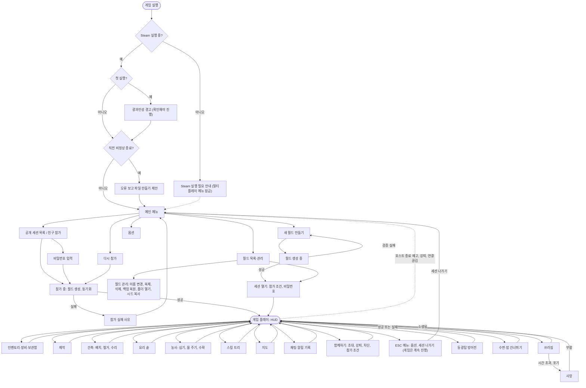
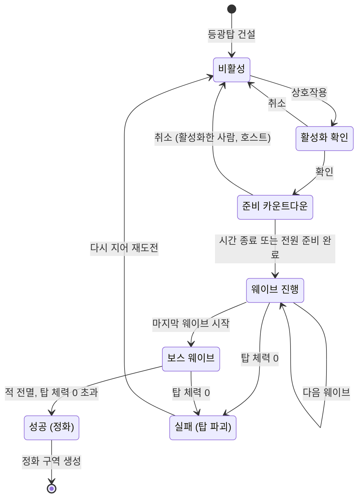
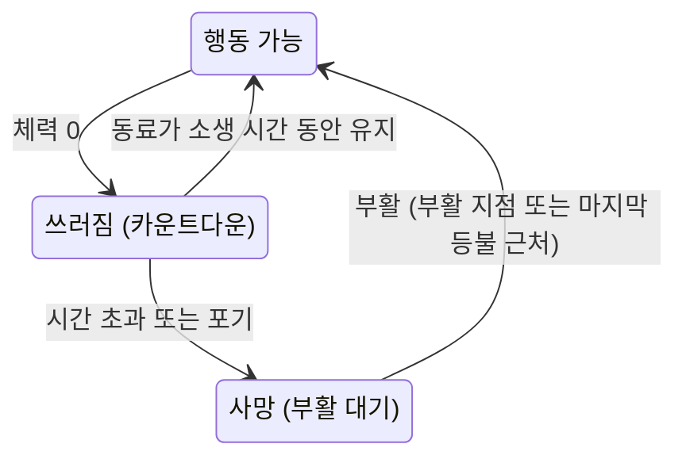

# 디자인 시안서 — 「꺼진 하늘」(임시 명칭)

> 2026-11-04 UI 구현 방식이 uGUI로 바뀜(STORYBOARD v1.7, SDD D-27). 이 문서의 UI Toolkit 언급은 당시 기준.

- 문서 버전: 0.1 (시안, 사용자 결정 대기)
- 작성일: 2026-11-02
- 작성: ui-ux-designer (시안 모드)
- 참조 문서: `docs/SRS.md` v0.4 (승인), `docs/SDD/` v0.2 (승인), `docs/PROJECT_STATUS.md` 결정 기록
- 상태: **결정 대기**. 이 문서는 선택지를 보여 주는 문서이며, 구현 기준이 아닙니다. 사용자가 고른 안만 `docs/STORYBOARD.md`(확정 모드)에 옮겨 적습니다.
- 와이어프레임(브라우저에서 바로 열림, 외부 자료 없음): `docs/wireframes/hud-ABC.html`, `docs/wireframes/defense-ABC.html`, `docs/wireframes/cooking-ABC.html` (7장)

---

## 0. 결정 요약

결정이 필요한 항목은 **15개**입니다. 각 항목의 상세 시안은 3장에 있습니다. 표준안으로 두는 화면은 4장, SRS에 없어서 "제안"으로만 남긴 것은 5장, SRS·SDD에서 발견한 문제는 6장입니다.

| ID | 기능 | 시안 A | 시안 B | 시안 C | 추천 |
|---|---|---|---|---|---|
| D-01 | 공통 디자인 시스템 | **불씨** — 숯빛 패널에 호박색 빛, 둥근 모서리, 글꼴 Pretendard | **새벽빛** — 청회색 패널에 크림색 빛, 얇은 선, 글꼴 Noto Sans KR | **등광 놋쇠** — 옛 문명 장치 느낌, 각진 모서리와 놋쇠 선, 글꼴 IBM Plex | A |
| D-02 | HUD | **상시 표시형** — 모든 상태를 하단 중앙에 늘 보임 | **상황 표시형** — 평소엔 십자선만, 변할 때·위험할 때·호출할 때 표시 | **장치형(diegetic)** — 손목 계기·등불 이름표로 표현, 최소 HUD | A |
| D-03 | 메인 메뉴·월드 관리·새 월드 | **계층형** — 고전적인 메뉴 → 화면 이동 | **월드 중심 대시보드** — 첫 화면이 월드 카드 목록, 새 월드는 옆 패널 | **마지막 등불 연출형** — 3D 장면이 메뉴, 새 월드는 4단계 마법사 | B |
| D-04 | 세션·로비 | **최소형** — 시작 전 모달 한 장 + 게임 안 플레이어 탭, 초대는 Steam 오버레이 | **허브형** — 모달 + 게임 안 「함께하기」 패널(자체 친구 목록 초대 포함) | (없음, 2안) | A |
| D-05 | 인벤토리·보관함·장비 | **격자 한 화면** — 가방·장비·보관함이 나란히 | **목록 중심** — 정렬·필터, 큰 글씨, 상세·동작 버튼 | **휠 + 격자** — 손에 든 것은 방사형 휠, 가방은 격자 | A |
| D-06 | 제작 | **가방 옆 탭** — 인벤토리 화면 안의 「제작」 탭 | **독립 레시피북** — 제작대·키로 여는 별도 화면 | (없음, 2안) | A |
| D-07 | 건축(배치·철거·수리) | **건축 도구 모드형** — 하단 목록 + [배치/철거/수리] 모드 | **방사형 휠** — 휠에서 고르고 바로 배치 | **전체 목록 창** — 큰 창에서 고른 뒤 배치 모드 | A |
| D-08 | 등광탑 방어전 | **상단 방어전 바** — 웨이브·탑 체력·보스를 상단 중앙에 | **등광탑 중심(월드 속)** — 정보를 탑 위 고리와 가장자리 표시로 | **우측 진행 패널** — 웨이브 단계 목록과 탑 체력을 우측에 | A |
| D-09 | 요리 솥·보조 기구 | **방식 탭 + 목록** — 조리 방식별 탭, 닫힌 탭엔 필요 기구 안내 | **솥 도식 + 목록** — 솥 주변 기구 배치도로 "왜 못 만드는지"를 보여 줌 | **필터 목록** — 한 줄 목록에 상태·위협별 필터 칩 | B |
| D-10 | 농사 | **조준 패널** — 작물을 조준하면 정보 표시 | **조준 패널 + 근처 상태 아이콘** — 가까운 작물 위에 물·햇빛·수확 아이콘 | (없음, 2안) | B |
| D-11 | 숙련도·스킬 트리 | **방사형 별자리** — 중앙에서 퍼지는 노드 그래프 | **열(column)형 트리** — 분야별 열을 위에서 아래로 | (없음, 2안) | B |
| D-12 | 지도 | **전체 화면 지도** — 범례·표시 토글 패널 포함 | **반투명 창 지도** — 게임이 비쳐 보이는 중앙 창 | (없음, 2안) | A |
| D-13 | 쓰러짐·소생·사망·부활 | **중앙 패널형** — 화면을 어둡게 하고 중앙에 카운트다운·선택 | **시야 유지형** — 낮은 시점·가장자리 효과, 작은 카운트다운 | (없음, 2안) | A |
| D-14 | 채팅·알림 기록 | **통합 로그** — 채팅과 시스템 알림을 한 창에 | **분리형** — 채팅 창 + 중요 알림 토스트, 기록은 탭으로 | (없음, 2안) | B |
| D-15 | 튜토리얼·목표 안내 | **체크리스트 카드** — 6단계 전체 목록을 보여 줌 | **한 단계 카드** — 지금 할 일 하나만 보여 줌 | (없음, 2안) | B |

**표준안 하나만 둔 화면**(결정 불필요): 옵션(조작·화면·오디오·언어·접근성·게임), 공개 세션 목록, 참가 실패 사유, 비밀번호 입력, 확인 대화상자, 오류·거부 메시지 규칙, Steam 실행 필요 안내, 광과민성 경고, 오류 보고, 월드 생성 진행·실패, 월드 관리 세부(이름 변경·복제·삭제·백업 복원·폴더 열기), 호스트 종료 예고 배너, 수면·밤 건너뛰기 오버레이, 스토리 전달 틀, 개발용 성능 표시. (4장)

---

## 1. 설계 전제

### 1.1 SRS·SDD에서 오는 제약

| 제약 | 근거 | 디자인에 주는 영향 |
|---|---|---|
| 키보드·마우스와 게임패드 어느 하나만으로 모든 기능 사용 | NFR-004, FR-166 | 모든 화면은 포커스 이동(↑↓←→/D-pad)으로 조작 가능해야 함. 마우스 호버 전용 정보(툴팁) 금지 |
| 안내 키는 현재 입력 장치의 현재 할당 | NFR-002, FR-117 | 화면에 키 이름을 글자로 박지 않고 "키캡 컴포넌트"로 표시. 장치가 바뀌면 1초 안에 교체 |
| 글자 입력(채팅·월드 이름·비밀번호)은 게임패드에서 Steam 화면 키보드 | NFR-004 | 입력창은 "선택 → 화면 키보드 호출 → 결과 반영" 흐름. 입력 중 게임 화면을 가리지 않는 위치 |
| 한국어·영어, 재시작 없이 전환, 영어 글자 0건 검사 | NFR-044, FR-157 | 영어는 보통 한국어보다 길어짐(버튼 +40~80%). 고정 너비 금지 |
| 글자 크기 3단계 이상, 색각 보정, 흔들림 0~100%, 섬광 줄이기 | FR-129~131 | 모든 크기는 상대값(배율). 색 외 구분(모양·아이콘·글자). 깜빡임 연출 금지 |
| 일시정지가 없음(1인 플레이 일시정지 SUG-027 보류, 호스트 방식 멀티) | SRS 2.6.2 | 인벤토리·제작·지도 등 모든 화면은 **게임이 계속 흐르는 중** 열림. 피격 시 알림, 닫기 쉬운 위치. (6장 I-07에서 확인 요청) |
| UI는 UI Toolkit(UXML/USS), 월드 공간 표시는 화면 좌표 투영 | SDD D-16, R-18 | 이름표·핑·작물 아이콘 같은 월드 마커는 개수를 제한하고 한 방식으로 통일. 3D 소품이 필요한 장치형은 비용이 큼 |
| UI 프레임 예산 0.8 ms (HUD·이름표·나침반) | SDD 3.12.3 | 배경 블러·복잡한 그림자 금지. 반투명 단색 패널 + 얇은 선으로 구성 |
| 참가자 요청은 호스트 검증 후 반영, 거부 사유 표시 | FR-007, NFR-003 | 모든 행동에 "대기 → 성공/거부" 피드백 자리를 둠. 거부 사유는 "무엇이 + 어떻게 고치나" |
| 접근성 기능이 M5~M6에 들어옴(색각 M5, 글자 크기·자막 M6) | 2.6.1 | M1~M4 화면도 처음부터 글자 크기 배율·색 토큰을 쓰도록 디자인 시스템에 반영 (6장 I-04) |

### 1.2 이 게임의 디자인 원칙

1. **잿빛 속의 따뜻한 빛.** UI의 기본은 무채색에 가까운 어두운 잿빛이고, 따뜻한 색(호박·크림·놋쇠)은 **빛과 관련된 의미**(선택, 활성, 정화 진행, 등광탑)에만 쓴다. 따뜻한 색이 보이면 "지금 의미 있는 것"이라고 배우게 한다.
2. **어두운 곳에서도, 밝은 곳에서도 읽힌다.** 밤의 잠식 지역과 햇빛이 쏟아지는 정화 구역 낮 양쪽에서 읽혀야 한다. 텍스트 패널은 배경 불투명도 0.72 이상(가장 밝은 흰 배경 위에서도 5.8:1 이상, 계산값)으로 둔다.
3. **색만으로 말하지 않는다.** 모든 상태는 색 + 모양 또는 아이콘 + 글자 중 둘 이상으로 구분한다(FR-130).
4. **사용자가 지금 해야 할 한 가지가 한눈에.** 화면마다 주 행동 버튼은 하나(호박색 채움), 나머지는 선만 있는 보조 버튼.
5. **같은 동작은 같은 모양, 같은 위치.** 확인·취소·닫기·길게 눌러 확인은 모든 화면에서 같다.
6. **8명이 함께 쓰는 게임.** 동료 상태·핑·준비 상태 같은 "남의 정보"는 이름 + 모양으로 구분하고, 플레이어별 색에 의존하지 않는다.
7. **Valheim 느낌을 피한다.** 나무·양피지·룬 문양 대신, 잿빛 장막 / 옛 문명의 빛 장치라는 자기 세계관(차분한 기하학적 패널, 등불 모티프)을 쓴다. 장르 관례(하단 퀵슬롯, 나침반)는 쓰되 배치와 형태는 다르게 한다.

---

## 2. 전체 사용자 흐름

### 2.1 화면 전체 흐름

노드 이름은 임시 이름이며, 확정 모드에서 `SCR-xxx` 화면 ID를 붙입니다.



### 2.2 등광탑 방어전 흐름 (D-08)



### 2.3 쓰러짐·사망 흐름 (D-13)



---

## 3. 기능별 시안

> 공통 표기: 와이어프레임은 1920×1080 기준입니다. 번호(①②…)는 요소 번호로, 확정 모드의 표와 연결됩니다. 아이콘은 기호로 대신 표시했고 실제 아이콘 세트는 확정 모드에서 정합니다. 키 표시는 키보드·마우스 기준으로 쓰고 괄호 안에 게임패드를 적습니다(키 할당은 확정 모드에서 정리).

---

## 결정 D-01 · 기능: 공통 디자인 시스템 (관련 NFR-001~003, NFR-044, FR-117, FR-129~131, FR-166 / 관련 DES-091~093, DES-095)

### 모든 시안에 공통인 규칙 (결정 불필요)

**해상도·배율**

| 항목 | 규칙 |
|---|---|
| 기준 | 1920×1080 좌표로 설계. UI Toolkit 패널을 "화면 크기에 맞춰 배율" 모드, 기준 1920×1080, **높이 기준**으로 맞춤 |
| 1440p / 4K | 기준 좌표의 ×1.333 / ×2.0 배율 (선명한 벡터·SDF 글꼴 사용) |
| 21:9 울트라와이드 | 배경·연출은 전체 폭을 채우고, **HUD는 가운데 16:9 영역에 배치**(기본). HUD를 가장자리에 붙이는 옵션은 5장 제안 P-03 |
| 16:10 등 좁은 화면 | 높이 기준 배율이므로 좌우가 줄어듦. 좌우 여백 40px를 지키고, 부족하면 채팅 폭을 먼저 줄임 |
| 안전 여백 | 화면 가장자리에서 40px (1080p 기준) 안쪽에 HUD 배치 |
| 와이어프레임 확인 | `hud-ABC.html`에서 화면비 16:9/21:9, HUD 위치(가운데/가장자리)를 바꿔 볼 수 있음 |

**간격·글자**

| 항목 | 규칙 |
|---|---|
| 간격 단위 | 4px 기준. 4 / 8 / 12 / 16 / 24 / 32 / 48 |
| 목록 행·버튼 최소 높이 | 56px (게임패드 포커스 표시가 보일 크기) |
| 글자 크기(보통, 1080p) | 보조 20 / 본문 24 / 제목 30 / 큰 제목 40 / HUD 숫자 22 (굵게) |
| 글자 크기 옵션 | 작게 ×0.9 / 보통 ×1.0 / 크게 ×1.25 (FR-129 최소 3단계). 가장 작은 보조 글자가 "작게"에서도 18px 이상 |
| 영어 대응 | 버튼·탭은 **내용에 맞춰 늘어나는 너비**(최소 너비만 지정). 말줄임(…)은 이름류에만 쓰고 말줄임 시 전체 이름을 상세/도움말 줄에 표시. 개발 중 "글자 길이 +40% 가짜 번역"으로 점검 |
| 사용자 입력 글자 | 채팅·월드 이름·Steam 이름은 리치 텍스트 해석 끔(NFR-050), 긴 이름은 말줄임 |

**컴포넌트와 상태** (모든 시안에서 같은 동작)

| 컴포넌트 | 기본 | 호버(마우스) | 포커스(게임패드·키보드) | 눌림 | 비활성 | 오류 |
|---|---|---|---|---|---|---|
| 버튼(주/보조/위험) | 주: 빛색 채움+어두운 글자. 보조: 선만 | 배경 +8% 밝게, 커서 | **3px 빛색 외곽선 + 왼쪽 ▶ 표시**(색에만 의존하지 않음) | 배경 −8%, 1px 아래로 | 점선 테두리 + 🔒 + 회색 글자. **포커스는 받음**(사유를 읽기 위해) | 위험 버튼은 위험색 선+글자 |
| 토글·체크 | ☐ / ☑ + 글자 「켬/끔」 | 배경 밝게 | 외곽선+▶ | - | 회색+사유 | - |
| 슬라이더 | 막대+값 숫자 병기(예: 70%) | 손잡이 강조 | 외곽선, ◀▶로 5% 단위 | - | 회색 | - |
| 드롭다운·세그먼트 | 현재 값 표시 | 밝게 | 외곽선, ◀▶로 값 이동 | - | 회색 | - |
| 텍스트 입력 | 선 테두리 | 테두리 밝게 | 외곽선. 게임패드: Ⓐ → Steam 화면 키보드 | - | 회색 | **위험색 2px 테두리 + ⚠ + 아래 한 줄 메시지** |
| 목록 행 | 아이콘+이름+상태 글자 | 배경 +8% | 외곽선+▶ | - | 회색+상태 글자 | 위험색 왼쪽 막대+⚠ |
| 탭 | 글자+아래 선 | 밝게 | 외곽선. 게임패드 LB/RB로 이동 | - | 🔒+필요 조건 글자 | - |
| 아이템 칸 | 아이콘+수량(우하단) | 툴팁 0.5초 뒤 | 외곽선 + **도움말 줄에 이름·설명** | - | 어둡게(해당 없음) | 망가짐: 사선 줄무늬+「망가짐」 글자 |
| 길게 누르기 버튼 | 키캡+동사 | - | 누르는 동안 고리가 차오름 | 고리 진행 | 회색 | 중간에 놓으면 고리가 줄어들며 취소 |
| 확인 대화상자 | 제목+설명+버튼 2개 | - | 위험한 동작은 **기본 포커스가 「취소」** | - | - | - |
| 토스트 | 아이콘+한두 줄, 3~5초 | - | - | - | - | 거부 사유는 위험색 선+⚠ |

규칙 두 가지를 더합니다.
- **게임패드는 호버가 없으므로** 툴팁에 의존하지 않습니다. 선택한 항목의 설명과 비활성 사유는 화면 아래 **도움말 줄**에 항상 표시합니다(와이어프레임 `cooking-ABC.html` 하단 참고).
- **길게 눌러 확인**은 위험하거나 실수하기 쉬운 동작(철거, 쓰러짐 포기, 소생, 방어전 취소)에만 씁니다. 길게 누르기가 어려운 사용자를 위한 대체 방식은 5장 제안 P-08.

**색 사용 규칙** (의미 → 색 역할)

| 역할 | 뜻 | 반드시 함께 쓰는 모양·글자 |
|---|---|---|
| 빛(호박/크림/놋쇠) | 선택, 활성, 등광탑, 정화 진행, 현재 도구 | 포커스 외곽선, 활성 표시 |
| 위험(적색 계열) | 체력, 피해, 거부·오류, 낮은 수치 경고, 방어전 실패 | ⚠ 또는 ✕ + 글자, 낮은 수치는 사선 줄무늬 |
| 정화(청록/연녹 계열) | 정화 구역, 성공, 충족·연결됨 | ✔ + 글자, 지도에서는 **해칭 채움 + 외곽선** |
| 독기 | 보라 계열 | **육각형 칩** + ☣ |
| 혹한 | 하늘색 계열 | **마름모 칩** + ❄ |
| 완전한 어둠 | 청보라 계열 | **원형 칩** + ◐ |
| 생존 수치 | 체력=위험색, 스태미나=연두, 허기·갈증·피로=모래색 | 아이콘(♥ ⚡ 🍖 💧 🌙) + 숫자. 색이 아니라 **아이콘·위치·숫자**로 구분 |
| 비활성 | 회색 (대비 3:1 이상 유지) | 🔒·점선 |

핑·동료는 **플레이어별 색을 쓰지 않고** 이름과 기호(◆ 동료, ▼ 핑, ✚ 쓰러짐, ✕ 사망 위치, ⌂ 부활 지점)로 구분합니다.

### 시안 A: 불씨 (Ember) — 잿빛 숲의 모닥불
- **콘셉트**: UI 전체가 숯빛 잿빛이고, 빛을 뜻하는 곳에서만 호박색이 켜집니다. 둥근 모서리(6px)의 부드러운 반투명 패널.
- **글꼴**: **Pretendard** — 한글+영문 한 벌(영문은 Inter 계열)로 가독성이 높고 굵기가 다양함. 라이선스 SIL OFL 1.1: 게임에 넣어 판매하는 상업 사용 가능, 글꼴 파일 단독 판매 금지, 라이선스 원문 동봉 필요.
- **색(다크, 계산한 대비는 패널 #14151A 기준)**

| 역할 | 값 | 패널 대비 |
|---|---|---|
| 패널 배경 | #14151A (불투명도 0.78) | - |
| 본문 글자 | #E8E4DC | 14.4 : 1 |
| 보조 글자 | #A9A59C | 7.4 : 1 |
| 빛(선택·활성) | #F2A53A | 8.9 : 1 |
| 위험·체력 | #E5594F | 5.1 : 1 |
| 정화 | #6FD1B0 | 9.9 : 1 |
| 독기 / 혹한 / 어둠 | #C77DDB / #6DB8F0 / #8F9BFF | 6.4 / 8.5 / 7.2 : 1 |
| 스태미나 / 허기·갈증·피로 | #A8D45A / #D8CBB0 | 10.6 / 11.4 : 1 |
| 비활성 글자 | #6B6A66 | 3.4 : 1 (비활성은 AA 예외) |

- **장점**: 가장 단순해 구현·검증이 쉽습니다. 한·영 글꼴 하나로 끝나고, 밤과 낮 모두에서 읽기 쉽습니다. 빛=따뜻한 색이라는 세계관 규칙이 가장 분명합니다.
- **단점**: 인상이 무난해서 "개성"은 약합니다. 호박색이 포커스와 빛 둘 다에 쓰여 화면에 호박색이 많아질 수 있습니다(포커스는 외곽선+▶로 구분).

### 시안 B: 새벽빛 (Pale Dawn) — 차가운 슬레이트에 크림색 빛
- **콘셉트**: 청회색 슬레이트 패널(2px 모서리, 가는 선)에 크림색 빛. 정화 구역에서는 UI 포인트색이 따뜻해지고 잠식 지역에서는 차가워지는 "지역 반응형 색조"를 옵션으로 둘 수 있음(잠식 = 차가운 푸른 회색 / 정화 = 따뜻한 크림).
- **글꼴**: **Noto Sans KR** — SIL OFL 1.1(상업 사용 가능, 단독 판매 금지). 가변 굵기, 글자 범위가 넓음. 용량이 커서 사용 글자만 서브셋 필요.
- **색**: 패널 #101820, 본문 #EAF0F2(15.5:1), 보조 #9FB0B8(8.0:1), 빛 #FFE9A8(14.9:1), 정화 #9FE3D0(12.2:1), 위험 #FF8A7A(7.8:1), 독기·혹한·어둠 #D79BEA / #8CCBFF / #A9B4FF(모두 6:1 이상).
- **장점**: 세련되고 대비가 가장 높습니다. 지역 반응형 색조를 쓰면 "잿빛 장막 → 햇빛" 경험이 UI에서도 느껴집니다.
- **단점**: 지역 반응형 색조까지 하면 확인할 색 조합이 지역 수만큼 늘어납니다(대비 검증, 색각 보정과의 상호작용). 차가운 톤이라 "따뜻한 빛" 강조가 A보다 약합니다.

### 시안 C: 등광 놋쇠 (Lamp Brass) — 옛 문명의 장치
- **콘셉트**: 올리브빛 검정 패널에 놋쇠 선, 각진(0px, 모서리 깎임) 형태. 옛 문명이 만든 등광 장치의 계기판 느낌. 숫자는 고정폭 글꼴.
- **글꼴**: **IBM Plex Sans KR**(본문) + **IBM Plex Mono**(숫자·계기) — 둘 다 SIL OFL 1.1(상업 사용 가능). 글꼴이 두 종이라 용량·관리가 늘어남.
- **색**: 패널 #16140F, 본문 #EDE6D3(14.8:1), 보조 #B3AA93(8.0:1), 빛(놋쇠) #D9A441(8.2:1), 정화 #7FC8A0(9.4:1), 위험 #E8684F(5.7:1), 독기·혹한·어둠 #C98BD6 / #7DB5DD / #9AA3E6(모두 6:1 이상).
- **장점**: 세계관(옛 문명의 빛 장치)이 가장 강하게 드러나고 Valheim과 확실히 다릅니다. 장치형 HUD(D-02 C)와 잘 어울립니다.
- **단점**: 각진 장식이 많아 제작 공수가 큽니다. 글꼴 2종. 직선적인 디자인이 호불호가 갈립니다.

> 대비는 sRGB 상대 휘도 공식으로 계산한 값(반올림)입니다. 구현 단계에서 도구로 다시 검증합니다. `hud-ABC.html`의 "색 테마" 버튼으로 세 시안을 HUD 위에서 바로 비교할 수 있습니다(글꼴은 PC에 설치된 것으로 표시되며, 설치되어 있지 않으면 맑은 고딕).

### 추천: 시안 A
이유: (1) 세계관 규칙(잿빛 속 따뜻한 빛)을 가장 단순하게 표현하고, (2) 글꼴 한 벌로 한·영 모두 해결되며, (3) 대비 검증·색각 보정과 충돌할 조합이 가장 적어 M1~M2에 바로 쓸 수 있습니다. B의 "지역 반응형 색조"는 A 위에 나중에 얹을 수 있습니다. C는 세계관은 좋지만 공수가 큽니다.

---

## 결정 D-02 · 기능: HUD (관련 NFR-001, NFR-002, FR-122, FR-124~126, FR-159, FR-160, FR-096, FR-104~108, FR-116 / 관련 DES-091, DES-096, DES-097, DES-095)

> **와이어프레임**: `docs/wireframes/hud-ABC.html` — 시안 A/B/C, 장면(잠식 밤/잠식 낮/정화 낮), 입력(키보드/게임패드), 한/영, 색 테마, 21:9, 환경 위협 상태(막는 중/노출 중), B의 상태(평상시/경고/호출), C의 손목 계기(내림/올림)를 바꿔 볼 수 있습니다.

**모든 HUD 시안에 공통인 요소 사양**

| 요소 | 위치 | 규칙 | 근거 |
|---|---|---|---|
| 십자선 | 화면 정중앙 | 흰색 원 + 어두운 외곽선(밝은 낮에도 보임) | - |
| 상호작용 안내 | 십자선 바로 아래 | 키캡(현재 장치·현재 할당) + 동사 + 대상 이름. 상호작용 거리 밖이면 표시 안 함. 못 하는 이유가 있으면 회색 + 사유 한 줄 | NFR-002, NFR-003 |
| 거부 사유 | 안내 아래 한 줄 토스트 3초 | 「무엇이 + 어떻게」 한 문장. 예: 「인벤토리 가득 참 · 버리거나 보관함에 넣으세요」 | NFR-003 |
| 환경 위협 칩 | 우하단(또는 장치) | 모양(육각/마름모/원) + 아이콘 + 이름 + 상태 글자 3종(**막는 중 / 노출 중 / 해당 없음은 숨김**) + 막는 수단(장비 이름 또는 버프 이름 + 남은 시간) | FR-104~108, NFR-001 |
| 버프 | 위협 칩 아래 | 아이콘 + 이름 + 남은 시간(초 단위, 분:초) + 얇은 진행 막대 | NFR-001, FR-096 |
| 나침반 | 상단 중앙, 폭 700px | 방위 ±90°. 동료 ◆(이름), 핑 ▼, 쓰러진 동료 ✚(빨강+글자), 사망 위치 ✕, 부활 지점 ⌂ | FR-125 |
| 목표 한 줄 | 나침반 아래 | ◎ + 한 줄. 옵션으로 끔 가능 | FR-122 |
| 핑 | 월드 마커 + 나침반 | ▼ + 이름 + 종류 + 거리 (예: 서림 · 광석 · 42 m). 유지 시간이 끝나면 사라짐 | FR-126 |
| 이름표 | 동료 머리 위 | 이름만. 거리 제한 안에서만. 옵션으로 끔 가능 | FR-159 |
| 동료 상태 | 우상단(시안별로 다름) | 이름, 체력 비율(막대+%), 쓰러짐은 ✚ + 글자 + 남은 시간, 사망은 ✕ | FR-160 |
| 호스트 종료 예고 | 상단 중앙 배너 | 「호스트가 세션을 닫습니다 0:30」 + 호스트에게만 [취소]. 카운트다운 숫자만 갱신(깜빡임 없음) | FR-116 |
| 피격 | 화면 가장자리 방향 호 | 공격 방향 쪽 가장자리에 짧게 붉은 호 + 모양. 강도는 흔들림/섬광 옵션을 따름 | FR-131 |
| 낮은 수치 경고 | 해당 게이지 | 25% 이하: 사선 줄무늬 + ⚠ + 숫자 (색에만 의존하지 않음) | FR-130 |

### 시안 A: 상시 표시형 — 모든 상태를 하단 중앙에 모은 계기판
- **콘셉트**: 필요한 정보는 늘 보이고, 시선 이동이 적도록 **하단 중앙에 몰아서** 배치합니다(좌: 체력·스태미나 / 중: 퀵슬롯 / 우: 허기·갈증·피로). Valheim처럼 좌하단/좌상단이 아니라 하단 중앙 군집입니다.
- **화면 구성**

```
┌─ HUD 시안 A (1920×1080) ──────────────────────────────────────────────
│            ① 나침반 [N ... ◆하루 ... ✚도윤 ... ✕사망]            ⑥ 동료 4
│            ② ◎ 목표: 첫 등광탑 재료 모으기                          하루 ▓▓▓▓░ 90%
│                                                                    서림 ▓▓▓░░ 55%
│                                 ③ ＋ 십자선                         도윤 ✚ 쓰러짐 0:24
│                                 [E] 열매 채집                       이안 ▓▓▓▓▓ 100%
│                                 (열매 덤불)
│
│ ⑦ 채팅(최근 3줄)                  ⑤' 돌도끼 82/100
│ 서림: 늪 입구에…         ④ 체력 ▓▓▓▓▓░ 72     ⑤ [1][2][3]…[8] 퀵슬롯    ④ 🍖 ▓▓░ 38        ⑧ ☣ 독기 [막는 중]
│ ◆ 도윤이 쓰러졌습니다       ⚡ 스태미나 ▓▓▓░ 62                         💧 ▓▓▓ 55        🍲 해독 절임 02:31
│ [Enter] 채팅                                                         🌙 ▓▓▓ 64
└──────────────────────────────────────────────────────────────────────
```

| 번호 | 요소 | 설명 |
|---|---|---|
| ① | 나침반 | 상단 중앙 |
| ② | 목표 한 줄 | 나침반 아래 |
| ③ | 십자선·상호작용 안내 | 중앙 |
| ④ | 생존 수치 | 퀵슬롯 좌측에 체력(굵게)+스태미나, 우측에 허기·갈증·피로. 모두 아이콘+막대+숫자 |
| ⑤ | 퀵슬롯 8칸 + 현재 도구 이름·내구도 | 하단 중앙 |
| ⑥ | 동료 목록 | 우상단. 최대 7명 |
| ⑦ | 채팅 | 좌하단, 최근 줄만, 일정 시간 뒤 흐려짐 |
| ⑧ | 환경 위협 칩 + 버프 | 우하단 |

- **사용자 흐름**: 평소 플레이 중 시선을 아래로 조금만 내리면 모든 수치를 읽음 → 수치가 25% 이하로 떨어지면 줄무늬+⚠로 강조 → 위협 지역에 들어가면 위협 칩이 나타남.
- **장점**: 놓치는 정보가 없고, NFR-001(상태가 바뀌면 0.5초 안에 HUD가 같아짐)을 그대로 만족합니다. 구현 비용이 가장 낮고 시험하기 쉽습니다. 게임패드/마우스 차이 없음.
- **단점**: 화면 하단이 항상 차 있어 몰입감이 줄어듭니다. 정보가 많아 처음엔 복잡해 보입니다(자동 흐림 옵션으로 완화 가능).

### 시안 B: 상황 표시형 — 필요할 때만 보이는 HUD
- **콘셉트**: 평소에는 십자선·현재 도구·희미한 나침반만 보입니다. 상태 수치는 (1) 값이 크게 바뀔 때 3초, (2) 25% 이하로 떨어졌을 때 가장자리 경고, (3) 사용자가 **호출**(키보드: 키 누름 / 게임패드: 버튼 길게)할 때 보입니다.
- **화면 구성**

```
┌─ HUD 시안 B ─ 평상시 ────────────────────────────────────────────────
│               ① 나침반(희미, 40%)
│
│                                 ③ ＋ [E] 열매 채집
│
│                                 ⑤ 🪓 돌도끼 82/100 (작은 칩)                      ⑧ ☣ 독기 [막는 중]
└──────────────────────────────────────────────────────────────────────
┌─ HUD 시안 B ─ 경고 발생 ──────────────────────────────────────────────
│               ① 나침반(선명)        ⑨ ✚ 도윤 쓰러짐 0:24 · 동쪽 ▶
│ ⑩ ⚠ 🍖 허기 낮음 24%  (좌측 가장자리 칩)
└──────────────────────────────────────────────────────────────────────
┌─ HUD 시안 B ─ 호출 ───────────────────────────────────────────────────
│               ① 나침반   ② 목표                                    ⑥ 동료 목록
│ ④ 체력/스태미나/허기/갈증/피로 카드 (좌하단)    ⑤ 퀵슬롯 8칸 (펼침)            ⑧ 위협·버프
└──────────────────────────────────────────────────────────────────────
```
- **사용자 흐름**: 평소엔 풍경을 봄 → 허기가 25%에 닿으면 가장자리에 칩이 3초 나타나고 이후 낮은 동안 작은 표시가 남음 → 정확한 수치가 궁금하면 호출.
- **장점**: 몰입감이 가장 좋고 화면이 깔끔합니다. 동료 쓰러짐처럼 중요한 이벤트만 강조됩니다.
- **단점**: 서서히 줄어드는 허기·갈증처럼 "변화를 못 느끼는 수치"는 임계값에서야 보여 늦게 인지할 수 있습니다. 호출 입력이 하나 늘어납니다. **SRS NFR-001의 수용 기준(HUD의 값이 바뀌면 0.5초 안에 같아짐)을 "표시 중일 때"로 고쳐야 하고**, "HUD 표시 방식 옵션"이 새 요구사항이 됩니다(6장 I-02, 5장 P-01). 접근성을 위해 「항상 표시」 옵션이 사실상 필수입니다(= 시안 A를 함께 만들어야 함).

### 시안 C: 장치형(diegetic) — 화면 속 장치로 표현
- **콘셉트**: 체력·허기·갈증·피로는 **왼쪽 손목의 옛 등광 계기**에 표시됩니다. 평소엔 손목을 내려 계기 윗부분의 작은 숫자만 보이고, 손목을 올리면(키/버튼) 4개 링과 위협 상태가 크게 보입니다. 스태미나는 달릴 때만 십자선 둘레 호(호흡)로, 동료는 머리 위 **작은 등불 이름표**(체력이 낮을수록 어둡고, 쓰러지면 꺼짐 + ✕ + 시간)로, 위협은 마스크/고글처럼 시야 가장자리의 테두리 효과로 표현합니다.
- **화면 구성**

```
┌─ HUD 시안 C ──────────────────────────────────────────────────────────
│               ① 나침반(얇은 띠)
│
│                              ◯ 스태미나 호 (달릴 때만)
│                              ③ ＋ [E] 열매 채집          (머리 위) 🏮 하루
│
│ ⑪ 손목 계기 (내림: ♥72 🍖38 💧55 🌙64 · ⬢☣✔)         ⑤' 얇은 퀵슬롯(선택 칸만 선명)
│    └ 올림: ○72 ○38 ○55 ○64 + 독기 막는 중 02:31
└──────────────────────────────────────────────────────────────────────
```
- **사용자 흐름**: 평소엔 화면이 거의 비어 있음 → 위협 지역에서는 시야 가장자리에 보랏빛 테두리가 생기고 손목 계기에 ☣ 표시 → 손목을 올려 정확한 수치를 확인.
- **장점**: 몰입감이 가장 높고 세계관(옛 등광 기술 장치)이 가장 잘 드러나며 다른 게임과 가장 차별됩니다.
- **단점**: 구현 비용이 가장 큽니다(3D 손목 소품, 올림/내림 애니메이션, 월드 공간 UI 또는 렌더 텍스처 → SDD R-18 위험). 가독성·접근성이 가장 불리해 「일반 HUD」 대체 옵션(= 시안 A)을 반드시 함께 만들어야 합니다. M2(체력·허기·갈증 HUD)의 일정이 길어집니다. 8인 협동에서 동료 체력을 숫자로 못 읽습니다(등불 밝기는 5단계 정도만 구분).

### 추천: 시안 A
이유: NFR-001을 그대로 만족하고 구현·시험이 가장 쉬우며, 8인 협동에서 동료 상태를 정확히 읽을 수 있습니다. 몰입감이 아쉬우면 **A 위에 「자동 흐림」(모든 수치가 정상이면 투명도 55%)을 더하거나, 나중에 B의 「상황 표시」를 옵션으로 추가**할 수 있습니다. B·C는 A의 구성요소를 재사용하므로 A를 먼저 만들면 손해가 없습니다. 반대로 B나 C를 먼저 고르면 접근성 때문에 A도 만들어야 해서 비용이 늘어납니다.

---

## 결정 D-03 · 기능: 메인 메뉴·월드 관리·새 월드 만들기 (관련 FR-012, FR-013, FR-020~022, FR-144, FR-149~152, FR-156, FR-167, FR-115, NFR-006 / 관련 DES-055, DES-099, DES-030, DES-054)

**모든 시안에 공통인 화면 내용**

*월드 목록의 한 항목(월드 카드)*: 월드 이름 / 난이도(쉬움·보통·어려움·사용자 지정) / 참가 조건 아이콘+글자(공개·친구 전용·초대 전용) / 마지막 저장 시각 / Steam Cloud 동기화 표시(켬·끔) / 시드(보기·복사) / 상태 오류(파일 손상 감지 시 「손상됨 · 백업에서 복원」, NFR-037).
*월드 관리 동작*: 이름 바꾸기(FR-149), 복제(FR-150, 백업은 복사 안 함 안내), 삭제(FR-151, 확인 + Steam Cloud 켜진 월드는 「다른 PC에서도 사라집니다」 경고, 백업도 함께 삭제 안내), 폴더 열기(FR-152), 백업에서 복원(FR-020), Steam Cloud 켬/끔(FR-021), 시드 복사(FR-167).
*메인 메뉴 항목*: 월드(새로 만들기·불러오기), 참가(공개 세션 목록·친구), 다시 참가(마지막으로 있던 세션이 있을 때만 활성, FR-115), 옵션, 종료. Steam이 실행 중이 아니면 멀티플레이 관련 항목을 잠그고 「Steam 실행 필요」를 표시(NFR-006).

**새 월드 만들기 입력 사양** (세 시안 모두 같은 필드)

| 필드 | 컨트롤 | 규칙 | 오류 메시지(무엇이 + 어떻게) |
|---|---|---|---|
| 월드 이름 | 텍스트 입력(게임패드: 화면 키보드) | 1자 이상 ~ 최대 글자 수(설정값), 제어 문자 제거 | 「월드 이름을 입력하세요 (1~N자)」 |
| 시드 | 텍스트 입력 + [🎲 무작위] 버튼 + [복사] | 기본은 「무작위」가 선택되어 있고, 정해진 시드 값이 입력칸에 미리 보임(복사 가능). 직접 입력하면 「무작위」가 해제됨. 같은 시드 = 같은 지형(안내 문구) | 입력 길이 초과: 「시드가 너무 깁니다 (최대 N자)」 |
| 난이도 | 세그먼트 [쉬움 / **보통** / 어려움 / 사용자 지정] | 보통이 기본(모든 배율 1.0). 사용자 지정은 슬라이더 4개(상태 감소 속도, 적 체력, 적 피해, 실패 시 재료 손실 비율, 손실 비율 100% 상한) | - |
| 참가 조건 | 세그먼트 [공개 / **친구 전용** / 초대 전용] | **기본 「친구 전용」**. 항목마다 한 줄 설명(공개: 「공개 목록에 나타나며 누구나 참가할 수 있습니다」 / 친구 전용: 「Steam 친구만 참가할 수 있습니다」 / 초대 전용: 「초대를 받은 사람만 참가할 수 있습니다」). 「공개」를 고르면 경고 한 줄: 「참가자는 보관함과 건축물을 자유롭게 쓸 수 있습니다」(FR-133, SUG-018 보류) | - |
| [만들기] | 주 버튼 | 이름이 비어 있으면 비활성 + 사유 | - |

*월드 생성 중*: 진행 막대 + 문구 「월드를 만드는 중…」(취소 불가). 검증 실패 시 오류: 「이 시드로는 플레이할 수 있는 월드를 만들지 못했습니다. 다른 시드를 입력하거나 [무작위]를 눌러 다시 시도하세요.」(FR-170, SDD 3.11 기본 정책).

### 시안 A: 계층형 — 고전적인 메뉴에서 화면으로 이동
- **콘셉트**: 배경에 꺼져 가는 마지막 등불의 3D 장면, 왼쪽에 세로 메뉴. 각 메뉴는 별도 화면(월드 목록, 새 월드 폼, 옵션)으로 이동합니다.
- **화면 구성**

```
┌─ 메인 메뉴 A ─────────────────────────────────────────
│ ① 로고 「꺼진 하늘」
│ ② ▶ 월드 불러오기                     (배경: 마지막 등불 3D 장면)
│    새 월드 만들기
│    참가하기 (공개 세션·친구)
│    다시 참가 (마지막 세션이 있을 때)
│    옵션
│    종료
└───────────────────────────────────────────────────────
┌─ 월드 불러오기 A ─────────────────────────────────────
│ 월드 카드 목록 (세로)                        │ ③ 선택한 월드 상세
│ ▶ 재의 숲 · 보통 · 친구 전용 · 어제 21:40     │ 시드 ASH-01 [복사]
│   늪 건너기 · 어려움 · 공개 · 3일 전          │ 참가 조건 [공개|친구 전용|초대 전용]
│                                              │ [세션 열기] [이름 변경] [복제] [삭제]
│                                              │ [백업에서 복원] [폴더 열기] Cloud ☑
└───────────────────────────────────────────────────────
```
- **사용자 흐름**: 메인 메뉴 → 월드 불러오기 → 월드 선택 → [세션 열기] / 새 월드 만들기 → 폼 한 화면 → [만들기] → 생성 → 세션 열기 모달.
- **장점**: 가장 익숙하고 배우기 쉽습니다. 화면마다 할 일이 하나라 게임패드 이동이 단순하고 구현이 쉽습니다.
- **단점**: 매번 화면을 오가야 해서 "마지막에 하던 월드로 들어가기"까지 클릭이 많습니다(메뉴 → 목록 → 선택 → 세션 열기 = 4동작).

### 시안 B: 월드 중심 대시보드 — 첫 화면이 월드 목록
- **콘셉트**: 첫 화면 자체가 월드 카드 목록입니다. 마지막으로 한 월드가 맨 앞에 크게 놓이고, 상단 탭에 [월드 / 참가 / 옵션]이 있습니다. 새 월드와 월드 관리는 오른쪽에서 밀려 나오는 패널로 처리합니다.
- **화면 구성**

```
┌─ 메인 메뉴 B ─────────────────────────────────────────────────────
│ ① 로고        탭: [월드] [참가] [옵션] [종료]          다시 참가 ▶ (있을 때)
│ ┌ ② 마지막 월드 카드 (크게) ──────────────┐   ┌ ④ 새 월드 만들기 [+] ┐
│ │ 재의 숲 · 보통 · 친구 전용 · Cloud ☑      │   │ (누르면 오른쪽 패널로 폼) │
│ │ 어제 21:40 저장 · 시드 ASH-01 [복사]      │   └────────────────────┘
│ │ [세션 열기 ▶]   [⋯ 관리]                  │
│ └─────────────────────────────────────────┘
│ ③ 다른 월드 카드들 (작게, 가로 스크롤)
└───────────────────────────────────────────────────────────────────
  [⋯ 관리] → 오른쪽 패널: 이름 변경 / 복제 / 삭제 / 백업에서 복원 / 폴더 열기 / 시드 복사 / Cloud / 참가 조건
```
- **사용자 흐름**: 게임 실행 → 맨 앞 월드의 [세션 열기] 한 번(= 마지막 월드로 가장 빠르게 시작). 새 월드는 [+] → 오른쪽 패널 폼.
- **장점**: 반복 플레이 시작이 가장 빠릅니다(2동작). 한 화면에 월드 정보(참가 조건·난이도·시드)가 보여 한눈에 비교됩니다.
- **단점**: 한 화면에 요소가 많아 게임패드 포커스 이동 경로(탭 ↔ 카드 ↔ 패널)를 신중히 설계해야 합니다. 월드가 매우 많아지면(수십 개) 가로 스크롤이 불편해 정렬·검색이 필요해질 수 있습니다.

### 시안 C: 마지막 등불 연출형 — 장면이 곧 메뉴
- **콘셉트**: 마지막 등불이 있는 3D 장면에서 오브젝트(등불=월드, 우편함=참가, 장비 상자=옵션)를 골라 메뉴로 들어갑니다. 새 월드는 **4단계 마법사**(이름 → 시드 → 난이도 → 참가 조건 → 확인)로, 단계마다 결정 하나만 보여 줍니다.
- **화면 구성**

```
┌─ 메인 메뉴 C ─────────────────────────────────────────────────────
│ (3D 장면: 꺼져 가는 등불, 카메라가 서서히 움직임)
│   등불 = 월드  ·  편지함 = 참가  ·  상자 = 옵션   (선택한 오브젝트에 라벨과 호박색 윤곽)
└───────────────────────────────────────────────────────────────────
┌─ 새 월드 만들기 C (2/4) ──────────────────────────────────────────
│ 단계 ●─●─○─○     「시드를 정할까요?」
│ [🎲 무작위로 정하기]   [직접 입력]       ※ 나중에 월드 관리에서 시드를 복사할 수 있습니다
│ [◀ 이전]                                 [다음 ▶]
└───────────────────────────────────────────────────────────────────
```
- **사용자 흐름**: 장면에서 등불 선택 → 월드 목록 → 새 월드는 마법사 4단계 → 확인 → 생성.
- **장점**: 첫인상과 세계관 몰입이 가장 강합니다. 마법사는 게임패드에서 한 번에 한 결정만 하므로 부담이 적습니다.
- **단점**: 3D 메뉴 장면의 제작·카메라 연출·접근성(포커스 순서) 비용이 큽니다. 월드 정보를 한눈에 비교할 수 없고, 새 월드 만들기가 단계 수만큼 느립니다. 빠르게 시작하기에는 불리합니다.

### 추천: 시안 B
이유: 이 게임은 같은 월드를 반복해서 이어 하는 협동 게임이라 "시작까지 동작 수"가 가장 중요합니다. B는 마지막 월드를 한 번에 열면서도 월드 관리(참가 조건·시드·복제·백업)가 한 곳에 모입니다. A는 안전하지만 느리고, C는 비용 대비 효과가 낮습니다(연출은 배경 장면만 가져와 B에 얹을 수 있음).

---

## 결정 D-04 · 기능: 세션·로비 (관련 FR-001~004, FR-011, FR-115, FR-116, FR-144~148, FR-165 / 관련 DES-054, DES-031, DES-085, DES-102)

**모든 시안에 공통인 화면 내용**

*세션 열기 모달* (월드를 고른 뒤): 월드 이름·난이도 요약 / **참가 조건** 세그먼트 [공개|친구 전용|초대 전용] (월드에 저장된 값이 미리 선택됨, 새 월드는 친구 전용) / **비밀번호**(선택 입력, 최대 글자 수는 설정값; 「비밀번호는 저장되지 않으며, 세션을 열 때마다 입력합니다」 안내; 초대로 들어온 사람에게는 묻지 않는다는 안내) / [세션 열기] 주 버튼.
*공개 세션 목록(표준)*: 열 = 월드 이름 / 호스트 / 인원 n/8 / 🔒 비밀번호 / 게임 버전 일치 여부(불일치는 비활성 + 「게임 업데이트 필요」). [새로 고침], 비밀번호가 있는 세션은 [참가] → 비밀번호 입력 창. 빈 목록 안내: 「지금 열려 있는 공개 세션이 없습니다. [새로 고침]을 눌러 다시 확인하세요.」 (이 게임의 세션만 표시, NFR-009)
*재접속*: 연결이 끊기면 안내창 「연결이 끊겼습니다. [다시 참가] / [메인 메뉴]」, 메인 메뉴에도 「다시 참가」. 자리 예약 시간이 지나면 「자리 예약이 끝났습니다. 일반 참가 규칙을 따릅니다」(FR-115).
*호스트 종료 예고*(FR-116): 모든 플레이어 화면 상단 중앙 배너 「호스트가 세션을 닫습니다 0:30」(호스트에게만 [취소]). 종료 후 메인 메뉴에 「세션이 종료되었습니다」.
*강퇴된 사람*: 메인 메뉴로 돌아가 「호스트가 내보냈습니다. 다시 초대받으면 참가할 수 있습니다」(진행은 보존됨).

**참가 실패·세션 종료 사유 문구** (표준, NFR-003)

| 사유 | 제목 | 무엇이 잘못됐나 | 어떻게 고치나 |
|---|---|---|---|
| 호스트 응답 없음 (`join.timeout`) | 호스트에 연결하지 못했습니다 | 호스트가 응답하지 않습니다 | 호스트가 게임 중인지, 인터넷 연결이 정상인지 확인하고 다시 시도하세요 |
| 인원 초과 (`join.full`) | 인원 초과 | 세션이 가득 찼거나 자리 예약 중입니다 | 잠시 후 다시 시도하거나 호스트에게 문의하세요 |
| 버전 불일치 (`join.version`) | 게임 버전 불일치 | 호스트와 게임 버전이 다릅니다 | Steam에서 게임을 업데이트한 뒤 다시 시도하세요 |
| 비밀번호 불일치 (`join.password`) | 비밀번호 불일치 | 입력한 비밀번호가 맞지 않습니다 | 호스트에게 비밀번호를 확인하세요 (남은 시도 n회) |
| 시도 횟수 초과 (`join.attempt_limit`) | 잠시 후 다시 시도하세요 | 1분 안에 너무 많이 틀렸습니다 | 1분 뒤에 다시 입력하세요 |
| 차단됨 (`join.banned`) | 참가할 수 없습니다 | 호스트가 이 계정의 참가를 막았습니다 | 호스트에게 직접 문의하세요 |
| 참가 조건 불충족 (`join.access`) | 참가 조건이 맞지 않습니다 | 이 방은 (친구만 / 초대받은 사람만) 참가할 수 있습니다 | 호스트에게 초대를 요청하세요 |
| 월드 생성 불일치 (`join.gen_mismatch`) | 월드 생성 오류 | 이 PC에서 만든 월드가 호스트와 다릅니다 | 게임을 다시 시작해 참가하세요. 계속되면 「오류 보고 파일 만들기」를 사용하세요 |
| 강퇴 | 호스트가 내보냈습니다 | 호스트가 세션에서 내보냈습니다 | 다시 초대받으면 참가할 수 있습니다 |
| 연결 끊김 | 연결이 끊겼습니다 | 호스트와의 연결이 끊어졌습니다 | [다시 참가]를 누르세요 (자리 예약 시간 안에) |

### 시안 A: 최소형 — 시작 전 모달 + 게임 안 플레이어 탭, 초대는 Steam 오버레이
- **콘셉트**: 세션 설정은 월드 시작 전 모달 한 장으로 끝내고, 게임 안에서는 ESC 메뉴의 「플레이어」 탭 하나로 관리합니다. 친구 초대는 Steam 오버레이의 친구 초대 창을 부릅니다.
- **화면 구성**

```
┌─ 세션 열기 (모달) ─────────────────────────────────────
│ ① 월드: 재의 숲 · 보통
│ ② 참가 조건: [공개] [●친구 전용] [초대 전용]   「Steam 친구만 참가할 수 있습니다」
│ ③ 비밀번호(선택): [          ]  ※ 저장되지 않음
│                                         [세션 열기] [취소]
└────────────────────────────────────────────────────────
┌─ ESC 메뉴 > 플레이어 탭 ──────────────────────────────
│ 이름           상태            (호스트만)
│ ★ 나(호스트)   접속
│ 하루           접속            [강퇴] [차단]
│ 도윤           쓰러짐          [강퇴] [차단]
│ [친구 초대 (Steam)]   참가 조건: [친구 전용 ▾]   [차단 목록]   [세션 종료...]
└────────────────────────────────────────────────────────
```
- **장점**: 구현이 가장 쉽고 Steam 오버레이가 친구 상태·초대 검증을 이미 해 줍니다. 게임패드에서도 오버레이가 지원됩니다.
- **단점**: 초대 창이 게임 디자인과 달라 이질적이고, Steam 오버레이가 꺼져 있으면 쓸 수 없습니다. 게임 안에서 플레이어 관리를 하려면 ESC 메뉴를 거쳐야 합니다.

### 시안 B: 허브형 — 「함께하기」 패널
- **콘셉트**: 시작 전 모달은 같고, 게임 안에서는 항상 접근 가능한 **「함께하기」 패널**(전용 키/버튼) 하나에서 플레이어 목록, 자체 친구 목록으로 초대, 강퇴·차단, 참가 조건 변경, 종료 예고를 모두 처리합니다.
- **화면 구성**

```
┌─ 함께하기 패널 ────────────────────────────────────────
│ [플레이어 4/8] [친구 초대] [설정]  (LB/RB)
│ ── 플레이어 ──
│ ★ 나(호스트) · 접속     하루 · 접속 [강퇴][차단]     도윤 ✚ 쓰러짐 [강퇴][차단]
│ ── 친구 초대 ── (온라인 친구, 「플레이 중」 구분)
│ 서림 · 온라인   [초대]      이안 · 이 게임 하는 중   [초대]
│ ── 설정 (호스트) ── 참가 조건 [공개|친구 전용|초대 전용]  차단 목록  [세션 종료...]
└────────────────────────────────────────────────────────
```
- **장점**: 게임과 일관된 디자인으로 초대·관리가 한 곳에 있어 빠르고, 게임패드에서 같은 방식으로 조작됩니다.
- **단점**: 친구 목록(온라인 상태·정렬·초대 상태)을 Steamworks 호출로 자체 구현해야 해서 공수가 늘고(SRS FR-002는 초대만 요구), 화면 하나가 더 생깁니다.

### 추천: 시안 A
이유: 요구사항(FR-002 친구 초대)은 A로 충족되고, 개발 비용이 낮습니다. 자체 친구 목록은 안정화된 뒤 **A 위에 B의 패널을 확장**하면 됩니다(플레이어 탭 구조는 같음). 시작 전 모달·공개 목록·참가 실패 문구는 두 시안 모두 위 표준 사양을 씁니다.

---

## 결정 D-05 · 기능: 인벤토리·보관함·장비 (관련 FR-038~043, FR-133~137, FR-039, FR-032 / 관련 DES-005, DES-006, DES-011, DES-057, DES-059)

**모든 시안에 공통인 내용**: 가방 칸 수는 설정값(FR-038), 같은 아이템은 묶음 수까지 쌓임, 이동·나누기·버리기(FR-040), 먹기(FR-032), 손에 들기(FR-042), 장비 착용·해제(FR-043; **착용 칸 구성은 SRS 미정이라 칸 수는 확정 모드에서 결정**), 내구도 막대(FR-135) · 내구도 0은 「망가짐」 상태(FR-136, 사선 줄무늬 + 글자, 사라지지 않음) · 대응 장비에는 내구도 없음(FR-135), 수리(FR-137, 재료 표시, 수리 장소 C-11 미정), 가방이 가득 차면 상단에 「인벤토리 가득 참」 (FR-039), 보관함은 모두가 함께 쓰며 다른 사람이 같은 칸을 가져가면 즉시 갱신(FR-134). 이동 결과는 호스트가 확정하므로 요청 중 칸에 작은 로딩 점을 보이고, 거부되면 칸이 원래대로 돌아가며 사유 토스트.

### 시안 A: 격자 한 화면 — 가방·장비·보관함이 나란히
- **화면 구성**

```
┌─ 인벤토리 A ─────────────────────────────────────────────────────────
│ ① 가방 격자 (8×N)              │ ② 장비/손에 든 것           │ ⑤ 보관함 격자 (열었을 때만)
│ [🪓82][⛏][🔦][🍎x4]…          │ 손: [🪓 돌도끼 82/100]       │ [돌x20][나무x50]…
│ [🪵x23][🧱x8]…                 │ 머리 [방독 마스크]           │ 다른 사람이 쓰는 중이면 점 표시
│                                │ 몸   [  ]  빛 [등광 랜턴]    │
│ ③ 가득 참 7/32 칸              │ ④ 선택한 아이템 설명·동작     │ [모두 옮기기] [같은 것만]
│                                │ [들기] [먹기] [나누기] [버리기]│
└──────────────────────────────────────────────────────────────────────
  도움말 줄: 「돌도끼 · 내구도 82/100 · 나무를 벨 수 있습니다」
```
- **사용자 흐름**: 인벤토리 열기 → 칸 선택(포커스) → 동작 버튼 → 보관함이 열려 있으면 오른쪽 격자로 이동. 마우스는 끌어다 놓기, 게임패드는 「집기 → 놓을 칸 → 놓기」.
- **장점**: 공간감이 있고 장르 관례라 익숙합니다. 가방과 보관함을 한 화면에서 비교·이동할 수 있습니다.
- **단점**: 칸 수가 많아지면 게임패드로 칸을 하나씩 움직이는 시간이 깁니다. 글자 크기 「크게」에서 아이콘 칸이 커져 화면을 넘길 수 있습니다(스크롤 필요).

### 시안 B: 목록 중심 — 정렬·필터·큰 글씨
- **화면 구성**

```
┌─ 인벤토리 B ───────────────────────────────────────────────────────
│ 탭 [가방] [장비] [보관함]    정렬 [종류▾]   필터 [전체|도구|재료|음식]
│ ┌ 목록 ─────────────────────────────────┐ ┌ 상세 ─────────────────────┐
│ │ 🪓 돌도끼            내구도 ▓▓▓░ 82    │ │ 돌도끼 (1등급 도끼)        │
│ │ 🍎 열매              x4                 │ │ 내구도 82/100  [수리 재료 …]│
│ │ 🪵 나무              x23                │ │ [손에 들기] [나누기] [버리기]│
│ └─────────────────────────────────────┘ └─────────────────────────┘
│ 보관함 탭: 왼쪽 가방 목록 | 오른쪽 보관함 목록, 가운데 [→ 이동] [← 이동] [모두 이동]
└────────────────────────────────────────────────────────────────────
```
- **장점**: 게임패드와 글자 크기 「크게」에 가장 강합니다. 정렬·필터로 많은 아이템에서도 빨리 찾습니다. 상세(설명·동작)가 항상 보입니다.
- **단점**: 공간감이 없어 "칸이 얼마나 찼는지"가 직관적이지 않고, 한 화면에 보이는 아이템 수가 격자보다 적습니다. 정렬·필터는 SRS에 없는 기능이라 5장 제안 P-05로 둡니다(정렬 없이 칸 순서대로만 보이는 단순 목록도 가능).

### 시안 C: 휠 + 격자 — 손에 든 것은 방사형 휠
- **콘셉트**: 인벤토리 화면(격자)은 A와 같고, **자주 바꾸는 손에 든 것(도구·무기·광원)** 은 방사형 휠(최대 8칸)로 즉시 고릅니다(키 누름 유지 / 게임패드 스틱).
- **장점**: 전투·채집 중 도구 교체가 가장 빠릅니다. 퀵슬롯 바를 HUD에서 없애 화면이 깔끔해집니다(D-02 B·C와 어울림).
- **단점**: 휠 칸 지정(어떤 아이템을 휠에 넣을지) 화면이 따로 필요하고, 한 번에 보이는 항목이 8개로 제한됩니다. D-02에서 A(퀵슬롯 상시 표시)를 고르면 중복됩니다.

### 추천: 시안 A
이유: 장르 관례를 따라 학습 비용이 가장 낮고, 가방+장비+보관함을 한 화면에서 다루어 FR-133~134 시험이 쉽습니다. B의 목록 보기는 글자 크기 「크게」·접근성용 전환 옵션으로 나중에 추가할 수 있습니다. 휠(C)은 HUD 결정(D-02)이 B·C일 때 다시 검토합니다.

---

## 결정 D-06 · 기능: 제작 (관련 FR-052~056, FR-137, NFR-003 / 관련 DES-010, DES-058)

**공통 내용**: 제작법 목록(카테고리: 도구·무기·광원·장비·건축물 재료 등), 선택한 제작법의 결과물 이름·설명·도구 등급(FR-054, 숫자+글자), 필요 재료별 「보유 / 필요」 수량(충족 ✔, 부족 ✕ + 부족 수량 위험색+글자), [제작] 버튼(재료 부족이면 비활성이지만 포커스 가능, 도움말 줄에 「나무 1 부족」 같은 사유, FR-053), 결과물이 가방에 들어가지 못하면 「인벤토리 가득 참 · 바닥에 떨어집니다」 안내(FR-039). 첫 등광탑 설계도는 건축 목록에서 처음부터 보임(FR-056). 제작대 필요 여부·해금 방식은 SRS 미정(C-11).

### 시안 A: 가방 옆 탭 — 인벤토리 화면 안의 「제작」 탭
```
┌─ 인벤토리 [가방 | 제작] ──────────────────────────────────────────
│ 제작 탭:  ┌ 제작법 목록 ───────────┐ ┌ 상세 ───────────────────────┐
│           │ [도구] [무기] [광원]…   │ │ 돌도끼 (1등급)               │
│           │ ▶ 돌도끼      ✔ 가능     │ │ 나무 5/3 ✔   돌 1/2 ✕(1 부족) │
│           │   돌곡괭이    ✕ 부족     │ │ [제작]  ← 비활성 + 사유       │
│           └───────────────────────┘ └─────────────────────────────┘
│ 오른쪽 아래: 내 가방 요약 (재료 수량이 바로 보임)
└────────────────────────────────────────────────────────────────
```
- **장점**: 가방과 재료를 같은 화면에서 확인하며 만들 수 있고, 화면 수가 늘지 않습니다. 현재 잠정 규칙(제작대 불필요, 어디서나 제작)과 맞습니다.
- **단점**: 제작이 장소 기반(제작대 필요)으로 정해지면 구조를 바꿔야 합니다. 건축물 재료 같은 긴 목록은 탭이 비좁아질 수 있습니다.

### 시안 B: 독립 레시피북 — 제작대·키로 여는 별도 화면
```
┌─ 제작 (별도 화면) ───────────────────────────────────────────────
│ 카테고리 탭   필터 [만들 수 있는 것만 ☐]
│ 큰 카드 격자(제작법 아이콘+이름+가능 여부)  |  상세(재료, 결과, [제작] [10개] …)
│ 제작대를 쓰는 경우: 상단에 「작업대 · 근처 재료 사용」 표시
└──────────────────────────────────────────────────────────────
```
- **장점**: 제작법이 많아져도 넓은 화면에서 탐색하기 좋고, 제작대(장소) 방식으로 바뀌어도 그대로 쓸 수 있습니다.
- **단점**: 화면이 하나 늘고, 가방을 보려면 닫아야 합니다. 「만들 수 있는 것만」 필터는 SRS에 없는 UI 필터입니다(5장 P-05).

### 추천: 시안 A
이유: SDD 잠정 규칙(제작대 불필요, 모두 해금)과 맞고 M4 범위에서 가장 작습니다. C-11이 「제작대 필요」로 결정되면 B로 확장합니다(상세 영역은 같은 구성이라 재사용 가능).

---

## 결정 D-07 · 기능: 건축 — 배치·철거·수리 (관련 FR-057, FR-058, FR-138, FR-139, FR-056, FR-059, FR-161 / 관련 DES-012, DES-059, DES-096)

**공통 내용**
- **배치 미리보기**(반투명 윤곽): 배치 가능은 빛색 윤곽 + ✔, 불가는 위험색 윤곽 + ✕ + 사유 글자(겹침 / 지형 / 거리 / 정화 구역 안에는 등광탑 불가, FR-058·FR-059). 회전, 확정.
- **재료 칩**: 필요 재료 「보유 / 필요」, 부족이면 ✕ + 부족 수량.
- **철거**(FR-138): 대상을 조준하고 **길게 눌러 확인**(고리 진행). 회수 재료 미리보기(「나무 2 회수」, 소수점 버림 결과). 보관함은 「내용물 20개도 함께 떨어집니다」 경고. 방어전 준비·진행 중인 등광탑은 비활성 + 「방어전 중에는 철거할 수 없습니다」.
- **수리**(FR-139): 피해 입은 건축물만 수리 가능. 대상 조준 시 체력 막대 + 필요 재료. 피해 없으면 「수리할 필요가 없습니다」. 방어전 중 등광탑 수리 허용은 미정(C-54).

### 시안 A: 건축 도구 모드형 — 하단 목록 + [배치 / 철거 / 수리] 모드
```
┌─ 건축 모드 A ────────────────────────────────────────────────
│   (월드: 반투명 윤곽이 십자선 위치를 따라감)  [✔ 배치 가능]
│                                                 R: 회전  좌클릭: 배치 (Ⓐ)
│ 하단: 모드 [●배치] [철거] [수리]  (LB/RB)
│ 카테고리 [벽][바닥][침대][보관함][요리 솥]…
│ 목록: [나무 벽 4]  [나무 바닥]  [침대]  …   선택 항목 재료: 나무 4/4 ✔
└───────────────────────────────────────────────────────────────
```
- **장점**: 한 화면에서 모드만 바꿔 배치·철거·수리를 하므로 배우기 쉽고, 월드가 화면 대부분에 보입니다. 구현이 단순합니다.
- **단점**: 건축물 종류(C-12 미정)가 많아지면 하단 목록이 길어집니다. 모드 전환을 잊으면 의도치 않은 철거 시도가 있을 수 있어 철거는 항상 길게 눌러 확인합니다.

### 시안 B: 방사형 휠 — 휠에서 고르고 바로 배치
- 건축 키를 누르고 있으면 휠(카테고리 → 항목 2단계)이 열리고, 놓으면 배치 모드로 들어갑니다. 철거·수리는 대상을 조준해 상호작용 안내(「[철거 길게] [수리]」)로 합니다.
- **장점**: 빠르고 화면을 가리지 않습니다. 게임패드에 잘 맞습니다.
- **단점**: 종류가 많아지면 2단계 휠이 느려지고, 재료 비교·설명을 보여 줄 공간이 좁습니다. 한 번에 건축물을 훑어 보기 어렵습니다.

### 시안 C: 전체 목록 창 → 배치 모드
- 큰 창(제작 UI와 같은 레이아웃)에서 건축물을 고르고(설명·재료 상세), 닫으면 배치 모드로 들어갑니다. 철거·수리는 A와 같이 조준 방식.
- **장점**: 설명·재료 정보가 풍부합니다. 제작 화면과 모양이 같아 일관됩니다.
- **단점**: 건축을 자주 바꿔 쓸 때 창을 여닫아야 해 느립니다. 게임이 멈추지 않는데 큰 창을 여는 시간이 길어집니다.

### 추천: 시안 A
이유: 건축은 월드를 보면서 반복하는 작업이라 월드가 보이는 하단 목록이 가장 적합하고, 철거·수리를 같은 도구 안의 모드로 묶으면 학습이 쉽습니다. C-12(건축물 종류)가 확정되면 카테고리 구성만 바꾸면 됩니다.

---

## 결정 D-08 · 기능: 등광탑 방어전 (관련 FR-059~075, FR-153~155, FR-131 / 관련 DES-017, DES-061, DES-018)

> **와이어프레임**: `docs/wireframes/defense-ABC.html` — 시안 A/B/C와 단계(활성화 확인 / 준비 카운트다운 / 웨이브 진행 / 보스 등장 / 성공 / 실패)를 바꿔 볼 수 있습니다. 점선 칸은 나침반·기본 HUD 자리입니다.

**방어전 단계별 공통 사양**

| 단계 | 화면에 반드시 있어야 하는 것 | 근거 |
|---|---|---|
| ① 활성화 확인(모달, 세 시안 공통) | 방어전 시작 경고 / 웨이브 수 / 마지막 웨이브 보스 / **실패 시 재료 손실 비율과 남는 비율** / 현재 접속 인원 기준 조정 안내 / [활성화] [취소] — **기본 포커스는 「취소」** | FR-153, FR-064, FR-069 |
| ② 준비 카운트다운 | 남은 시간(큰 숫자) / **준비 완료 목록(이름 + ✔/○)** / 「준비 n/N」 / [준비 완료] / [방어전 취소](활성화한 플레이어와 호스트에게만 보임, 길게 누르기) / 등광탑 방향(나침반) / 전원 준비 시 「전원 준비 완료 · 바로 시작합니다」 | FR-154, FR-155 |
| ③ 웨이브 진행 | 웨이브 번호 n/N / 남은 적 수 / **등광탑 체력(막대 + %)** / 등광탑 방향·거리(시야 밖일 때) | FR-061, FR-062 |
| ④ 보스 | 「보스 등장」 알림(깜빡임 없음, 3초) / 보스 이름 + 체력 막대 / 웨이브 표시는 「마지막 웨이브」 | FR-063 |
| ⑤ 성공(정화) | 「정화 성공」 / 정화 구역 확대 요약 / 새로 열린 것(제작법·재료) / 목표 갱신 / [계속]. **밝아지는 연출은 2초에 걸쳐 서서히**(섬광 줄이기 켬이면 즉시 완화) | FR-065, FR-074, FR-075, FR-131 |
| ⑥ 실패(탑 파괴) | 「등광탑 파괴」 / **잃은 재료 비율과 자리에 남은 재료** / 재도전 안내(같은 자리나 다른 자리에 다시 지을 수 있음) / [계속] | FR-069, FR-070 |

### 시안 A: 상단 방어전 바
- **콘셉트**: 방어전 정보를 모두 상단 중앙(나침반 아래)에 가로 막대로 모읍니다. 목표 한 줄은 방어전 동안 숨깁니다.
- **화면 구성**

```
┌─ 방어전 중 (시안 A) ─────────────────────────────────────────────
│        ① 나침반 (등광탑 방향 표시)
│  ┌ ② 웨이브 3 / 5                                     ☠ 남은 적 14 ┐
│  │ 🗼 [▓▓▓▓▓▓▓▓░░░░░] 68%   (25/50/75% 눈금)                       │
│  └ 등광탑 체력 6,800 / 10,000                                       ┘
│  ┌ ③ (마지막 웨이브) ☠ 재 군주  [▓▓▓▓▓▓▓▓▓▓▓▓] 100%   ┐
│                              ＋
│                  기본 HUD (퀵슬롯, 상태, 버프)
└────────────────────────────────────────────────────────────────
```
- **사용자 흐름**: 확인 모달 → 준비 카운트다운(상단 카드 + 하단 [준비 완료] 버튼) → 웨이브 진행(상단 바) → 보스(바 아래에 보스 막대) → 성공/실패 중앙 요약 패널.
- **장점**: 위치가 고정되어 전투 중에도 한눈에 읽힙니다. 8인 모두 같은 정보를 같은 곳에서 봅니다. 구현이 가장 쉽습니다.
- **단점**: 상단 중앙의 면적을 많이 차지하고, 등광탑이 시야 밖이면 어디 있는지 모릅니다(나침반 표시로 보완).

### 시안 B: 등광탑 중심(월드 속) — 정보를 탑에 붙임
- **콘셉트**: 가장 중요한 정보를 **등광탑 머리 위 고리**(체력 %, 거리)와 시야 밖일 때 **화면 가장자리 표시**(「▶ 등광탑 84 m · 68%」)로 보여 줍니다. 웨이브·남은 적은 우상단의 작은 카드 한 장. 준비 카운트다운은 탑 위 숫자 원, 준비 목록은 하단 안내에 한 줄.
- **장점**: 시야 중앙이 비어 몰입감이 높고, 방어 대상(탑) 위치를 자연스럽게 알려 줍니다.
- **단점**: 탑이 가려지거나 멀면 체력이 안 보입니다(가장자리 표시로 보완). 월드 공간 마커 구현 필요(SDD R-18). 성공/실패 요약이 작아 정보량이 적습니다.

### 시안 C: 우측 진행 패널 — 웨이브 단계 목록
- **콘셉트**: 우측에 세로 패널을 두고 「준비 → 웨이브 1~4 → 웨이브 5 · 보스」 단계 목록(완료 ✔ / 진행 ▶ / 남음 ○), 남은 적, 등광탑 체력 막대를 한 곳에 모읍니다. 준비 단계에는 같은 패널에 카운트다운과 준비 목록, 버튼이 들어갑니다.
- **장점**: 진행 단계를 한눈에 알 수 있고(앞으로 몇 웨이브 남았는지), 시야 중앙·상단이 비어 있습니다.
- **단점**: 우상단 동료 목록(D-02 A)과 자리가 겹쳐 둘 중 하나를 이동하거나 방어전 동안 합쳐야 합니다. 주변시에서 읽어야 해서 탑 체력의 긴급성이 약합니다.

### 추천: 시안 A
이유: 전투 중 가장 중요한 두 정보(남은 웨이브, 등광탑 체력)를 시선 이동 없이 같은 위치에서 읽을 수 있고, 8명이 같은 화면 규칙을 공유하며 구현 위험이 낮습니다. B의 「화면 가장자리 등광탑 표시」는 A에 추가해도 좋습니다(비용 낮음).

---

## 결정 D-09 · 기능: 요리 솥과 보조 기구 (관련 FR-089~097, FR-091~093, FR-108, NFR-003 / 관련 DES-023, DES-065, DES-024)

> **와이어프레임**: `docs/wireframes/cooking-ABC.html` — 시안 A/B/C, 훈연대(미설치/연결됨), 절구(범위 밖/연결됨), 입력, 한/영, 색 테마를 바꿔 볼 수 있습니다. 요리법 이름·재료·시간은 모두 **예시 데이터**입니다(SRS 부록 C-23 미정).

**공통 내용 (Valheim 솥 레벨업 방식과 다른 점)**
- 솥에는 **레벨·업그레이드 표시가 없습니다**(FR-092). 대신 솥 주변 **인식 범위 안의 보조 기구**(도마=손질, 항아리=발효·절임, 훈연대=훈제, 절구=가루·약재)가 조리 방식을 하나씩 엽니다.
- 요리법 한 줄에 반드시 보이는 것: 이름 / 필요 기구(없으면 「솥만」) / 만들 수 있는지 상태 3종 — **만들 수 있음 ✔ / 재료 부족 ▲ / 기구 부족 ✕** (색 + 기호 + 글자).
- 선택한 요리법의 상세: 버프(위협 저항 종류는 모양 칩 + 지속 시간) / 필요 재료 「보유 / 필요」 / 필요 기구 칩(연결됨 ✔ / 미설치 ✕ / **범위 밖 ⚠**) / [요리하기] 버튼 / 이유 문장.
- 이유 문장은 「무엇이 + 어떻게」: 「절구 필요: 솥 인식 범위 밖입니다. 솥 가까이로 옮기세요」(FR-091) / 「훈연대 필요: 설치되지 않았습니다」 / 「늪 이끼 2 부족」(FR-093, NFR-003). 비활성 버튼도 포커스를 받고 같은 문장이 도움말 줄에 보입니다.
- 정해진 요리법만 가능합니다. 재료를 임의로 섞는 입력 칸은 없습니다(FR-095).
- 요리 시간·버프 중첩(C-23)은 미정이라 확정 모드에서 값 자리만 만듭니다.

### 시안 A: 방식 탭 + 목록 — 조리 방식별 탭
- **콘셉트**: 상단 탭 [기본 / 손질(도마) / 발효·절임(항아리) / 훈제(훈연대) / 가루·약재(절구)]. 기구가 연결된 방식은 켜짐(●), 아니면 🔒 + 이유(「범위 밖」 「미설치」)가 탭에 표시됩니다. 왼쪽 목록, 오른쪽 상세.
```
┌─ 요리 솥 A ──────────────────────────────────────────────────────
│ 탭: [기본 솥만] [손질 ●도마 연결] [▶발효·절임 ●항아리 연결] [훈제 🔒미설치] [가루·약재 🔒범위 밖]
│ ┌ 목록 (발효·절임) ───────────┐ ┌ 상세 ──────────────────────────┐
│ │ ▶ 해독 절임 스튜 ▲ 재료 부족  │ │ 해독 절임 스튜  ☣ 독기 저항 10:00  │
│ │   절임 열매      ✔ 가능       │ │ 늪 이끼 1/3 ✕  소금 2/2 ✔ …       │
│ └────────────────────────────┘ │ [🔒 요리하기] 「늪 이끼 2 부족」   │
└──────────────────────────────────────────────────────────────────
```
- **장점**: 레시피북처럼 익숙하고 기구와 조리 방식의 관계(기구 = 탭)가 직관적입니다. 구현이 쉽습니다.
- **단점**: **기구가 둘 이상 필요한 요리법**(예: 솥+항아리+도마)이 어느 탭에 속하는지 애매해 대표 탭에만 나옵니다. 어떤 요리가 독기 저항인지 찾으려면 탭을 하나씩 열어야 합니다. 기구 위치(범위)는 숫자·글자로만 알려 줍니다.

### 시안 B: 솥 도식 + 목록 — 기구 배치도로 설명
- **콘셉트**: 왼쪽에 **솥을 가운데 둔 기구 배치도**(점선 원 = 솥 인식 범위, 연결된 기구는 선으로 연결되어 밝게, 미설치는 점선 윤곽, 범위 밖은 원 밖에서 점선 화살표). 선택한 요리법이 요구하는 기구는 도식에서 굵은 윤곽으로 강조됩니다. 오른쪽은 「지금 만들 수 있음 / 재료 부족 / 기구 부족」으로 묶은 목록과 상세.
```
┌─ 요리 솥 B ─────────────────────────────────────────────────────
│ 솥 주변 기구 (점선 원 = 솥 인식 범위)   │ ▎지금 만들 수 있음 (2)
│        [🔪도마 ✔]                       │ ▎재료 부족 (1)   ▶ 해독 절임 스튜
│  [⚗절구 ⚠범위 밖] ┄┄ (🍲솥) ━━ [🏺항아리 ✔] │ ▎기구 부족 (2)   야광 버섯 요리, 훈제 고기
│        [♨훈연대 미설치]                  │ ─ 상세 ─ 해독 절임 스튜 ☣ 독기 저항 10:00
│  ※ 해독 절임 스튜 = 솥+항아리+도마 (강조)  │ 늪 이끼 1/3 ✕ … [🔒 요리하기] 「늪 이끼 2 부족」
└─────────────────────────────────────────────────────────────────
```
- **장점**: 이 게임만의 시스템(솥 주변 기구가 조리 방식을 해금)을 **한눈에 설명**하고, 「왜 못 만드는지」(범위 밖/미설치)를 공간으로 보여 줍니다. 여러 기구가 필요한 요리법도 자연스럽게 표현됩니다. Valheim 솥 레벨업과 시각적으로도 분명히 구분됩니다.
- **단점**: 화면 요소가 A보다 많고, 도식은 읽기 전용이라 게임패드 포커스 대상이 아닌 점을 설명해야 합니다. 도식 그래픽 제작 비용이 약간 있습니다.

### 시안 C: 필터 목록 — 목적에서 출발
- **콘셉트**: 모든 요리법을 한 줄 목록으로 보고, 위의 필터 칩으로 줄입니다(전체 / 만들 수 있음 / 재료 부족 / 기구 부족, 그리고 **위협별 ☣ 독기 / ❄ 혹한 / ◐ 어둠**). 목록 위에 「연결된 기구」 한 줄 띠.
- **장점**: 「독기 저항 음식이 뭐지?」처럼 **목적에서 시작하는** 플레이에 가장 빠릅니다. 요리법이 많아져도 확장됩니다.
- **단점**: 기구 시스템(범위, 조합)을 이해시키는 힘이 약합니다. 필터가 SRS에 없는 UI 기능이라 5장 제안 P-05가 됩니다.

### 추천: 시안 B
이유: 보조 기구 방식은 이 게임의 차별 포인트이고 처음 보는 플레이어에게 규칙이 가장 헷갈리는 부분입니다. B는 규칙을 그림으로 설명하고 「부족한 기구 안내」(FR-093)를 공간으로 해결합니다. C의 위협별 필터 칩은 B의 목록에 더해도 비용이 작습니다. A는 안전하지만 복합 요리법 표시가 약합니다.

---

## 결정 D-10 · 기능: 농사 (관련 FR-083~088 / 관련 DES-022, DES-065, DES-096)

**공통 내용**: 씨앗은 손에 든 뒤 땅을 조준해 심기(상호작용 안내 「[E] 심기」), 물 주기, 수확(「[E] 수확」)은 모두 상호작용 안내 컴포넌트를 씁니다. 작물 상태 표시는 **모양 + 글자**로 합니다: 생장 단계(●●○○ 점 + 외형), 물 있음 ◉ / 물 없음 ◌(물방울 윤곽), 수확 가능 ✔, 햇빛 부족 ☀✕(**일반 작물을 잠식 지역에 심었을 때**: 「햇빛이 닿는 정화 구역에서만 자랍니다」, FR-086), 그늘 작물은 「그늘 작물 · 잠식 지역에서도 자랍니다」(FR-087). 심을 수 없는 땅은 배치 미리보기처럼 사유를 표시.

### 시안 A: 조준 패널
- 작물을 조준할 때만 십자선 옆에 작은 패널이 나타납니다.
```
        ＋
   ┌ 감자 ──────────────┐
   │ 생장 ●●●○  (3/4)     │
   │ ◉ 물 있음 (남은 2:10)│
   │ [E] 물 주기  (불필요) │
   └────────────────────┘
```
- **장점**: 화면이 깨끗하고 구현이 가장 쉽습니다.
- **단점**: 밭 여러 칸의 상태(어느 칸이 물이 마름)를 알려면 하나씩 조준해야 합니다. 8인이 함께 가꾸는 큰 밭에서 불편합니다.

### 시안 B: 조준 패널 + 근처 상태 아이콘
- A에 더해, 플레이어 반경 약 8 m 안의 작물 위에 **상태 아이콘 하나**(물 없음 ◌, 수확 가능 ✔, 햇빛 부족 ☀✕)가 떠 있습니다(정상 생장 중이면 표시 없음).
- **장점**: 밭을 걸으며 「물 줄 곳, 수확할 곳」을 한눈에 찾습니다. 협동 농사에 적합합니다.
- **단점**: 월드 공간 마커라 표시 개수를 제한해야 합니다(최대 약 20개, 가까운 순, SDD R-18). 아이콘이 너무 많으면 시야가 어지러우므로 정상 상태는 숨깁니다. 수확 가능 표시에 반짝임을 쓰지 않습니다(광과민성).

### 추천: 시안 B
이유: 농사는 반복 관리 활동이며 협동에서 역할 분담(농부)이 생기기 쉬운 영역입니다. 월드 마커 시스템은 이름표·핑에서 이미 만드는 구조를 재사용하므로 추가 비용이 작습니다. 구현 부담이 걱정되면 A로 시작하고 B로 확장해도 됩니다.

---

## 결정 D-11 · 기능: 숙련도·스킬 트리 (관련 FR-098~101, FR-099, FR-100 / 관련 DES-026, DES-067)

> **주의**: 스킬 노드 목록, 단일 레벨/행동별 레벨, 스탯 종류는 SRS 미정(C-06)입니다. 아래는 **구조만** 보여 주며, 두 방식(단일 레벨 / 행동별 레벨)에서 모두 쓸 수 있게 만들었습니다.

**공통 내용**: 상단에 레벨, 경험치 막대(현재/다음 레벨), 보유 **스탯 포인트**. 노드 상태 4종 — 획득함 ●(빛색) / 획득 가능 ◎(외곽선 강조) / 선행 노드 필요 🔒 / 포인트 부족 ○(회색+「포인트 n 필요」). 노드 선택 시 이름, 효과, 비용, 선행 노드, [획득] 버튼(확인 한 번). 레벨업 알림은 토스트 「레벨 업! 스탯 포인트 +1」(FR-128)이며 트리를 자동으로 열지 않습니다. 스킬 초기화는 보류(SUG-024)라 없음.

### 시안 A: 방사형 별자리
```
┌─ 숙련도 A ──────────────────────────────────────────────
│ 레벨 7  ▓▓▓▓▓░░ 경험치 340/500          스탯 포인트 2
│                    ◎
│              ●─────●─────◎            중앙 = 시작 노드, 바깥으로 갈수록 상위
│        ●──●        │        ●──🔒
│                    ●                  우측: 선택한 노드 설명·비용·[획득]
└──────────────────────────────────────────────────────
```
- **장점**: 시각적으로 특별하고 "빛이 퍼져 나가는" 세계관과 어울립니다. 노드 사이 선행 관계가 선으로 직관적입니다.
- **단점**: 노드 수가 미정이라 배치 설계가 어렵고, 게임패드에서 "방향키로 다음 노드"가 모호합니다(가까운 노드 규칙 필요). 글자 크기 「크게」에서 노드 라벨이 겹칩니다.

### 시안 B: 열(column)형 트리
```
┌─ 숙련도 B ──────────────────────────────────────────────
│ 레벨 7  ▓▓▓▓▓░░ 340/500                 스탯 포인트 2
│ [채집]        [제작]        [전투]        [요리·농사]   ← 분야별 열 (C-06에 따라 단일 열도 가능)
│  ● 벌목 1      ◎ 도구 장인    🔒 …          …
│  ↓              ↓
│  ◎ 벌목 2      🔒 …
│ 선택한 노드: 이름 / 효과 / 비용 / 선행 [획득]
└──────────────────────────────────────────────────────
```
- **장점**: 게임패드 이동(←→ 열, ↑↓ 노드)이 명확하고 항상 같은 규칙입니다. 노드 수가 늘어도 스크롤로 확장됩니다. 단일 레벨이든 행동별 레벨이든 열 구성만 바꾸면 됩니다.
- **단점**: 시각적 개성이 약합니다. 열 사이 교차 선행 관계는 표현이 어렵습니다(필요하면 선행 노드 라벨 표기).

### 추천: 시안 B
이유: 구조가 미정인 상태(C-06)에서 가장 적게 바뀌고, 접근성(글자 크기, 게임패드)에 강합니다. 노드 목록이 확정되고 분량이 정해지면 A식 배경 연출(별자리 장식)만 입힐 수 있습니다.

---

## 결정 D-12 · 기능: 지도 (관련 FR-124, FR-125, FR-126, FR-140, FR-141, FR-075 / 관련 DES-097, DES-032)

**공통 내용**
- 표시 항목: 내 위치·방향(▲ 화살표) / 동료 위치(◆ + 이름) / 등광탑(비활성 △ · 방어전 중 ▲ + 불 · 정화 완료 ★ 로 모양 구분) / 정화 구역(**연한 해칭 채움 + 굵은 외곽선**, 색만 쓰지 않음) / 탐험한 곳(밝게) · 가 보지 않은 곳(어두운 안개) / 핑(▼) / 내 사망 위치(✕) / 내 부활 지점(⌂) / 지역 이름 라벨(5개 지역).
- 범례 패널: 위 기호 설명 + 항목별 표시 켜고 끄기.
- 조작: 이동(마우스 드래그 / 스틱), 확대·축소(휠 / 트리거), 「내 위치로」 버튼, 닫기. 사망 위치 지우기(FR-141 「직접 지울 수 있다」): 사망 위치 항목에서 [지우기].
- **지도는 게임을 멈추지 않습니다**: 화면 모서리에 피격 방향 알림이 계속 보이고, 상단에 「게임은 계속 진행 중」 표시(6장 I-07).
- 탐험 기록 공유 여부는 미정(C-53, 잠정 공유). 지도에 핑을 찍는 동작은 SRS에 없어 제외(5장 제안 P-09).

### 시안 A: 전체 화면 지도
```
┌─ 지도 A (전체 화면) ──────────────────────────────────────────────
│ 상단: 「지도」  ⚠ 게임은 계속 진행 중                               [닫기]
│ ┌ 지도 영역 (거의 전체) ─────────────────────────────┐ ┌ 범례·표시 토글 ┐
│ │ 지역 윤곽: 잿빛 숲(중앙) 잿물 늪 … 장막의 근원         │ │ ☑ 동료 ◆       │
│ │ ▲나  ◆하루  ★등광탑(정화)  ░░░ 정화 구역(해칭)        │ │ ☑ 등광탑 …     │
│ │ ▼서림의 핑  ✕사망 위치  ⌂부활 지점                     │ │ [사망 위치 지우기]│
│ └───────────────────────────────────────────────┘ └──────────────┘
└─────────────────────────────────────────────────────────────────
```
- **장점**: 3km×3km 월드를 큼직하게 보고 탐험 계획을 세우기 좋습니다. 범례·토글을 둘 공간이 충분합니다.
- **단점**: 화면 전체를 가려 위험한 순간에는 부담입니다(일시정지가 없는 게임).

### 시안 B: 반투명 창 지도
- 화면 중앙 약 60% 크기의 반투명 창에 지도를 표시해 뒤의 게임이 비쳐 보이고, 범례는 창 아래 한 줄 아이콘 띠(항목 토글은 옵션 메뉴 쪽으로).
- **장점**: 지도를 보면서도 주변 위협을 볼 수 있어 안전합니다.
- **단점**: 지도 면적이 작아 정화 구역·지역 경계 판별이 어렵고, 확대·이동 조작이 더 잦아집니다. 반투명 위에서는 대비(WCAG 4.5:1)를 지키기 어려워 지도 뒤에 어두운 판을 깔아야 합니다(결국 A와 비슷해짐).

### 추천: 시안 A
이유: 지도는 계획하는 화면이라 정보량이 우선이고, 위험은 피격 알림과 닫기 쉬운 위치(B/ESC)로 보완합니다. B는 대비 문제 때문에 A에 가까워집니다.

---

## 결정 D-13 · 기능: 쓰러짐·소생·사망·부활 (관련 FR-142, FR-143, FR-030, FR-031, FR-140, FR-141 / 관련 DES-004, DES-060, DES-013)

> 사망 시 소지품 처리, 부활 대기 시간, 부활 후 상태(C-05), 쓰러진 동안 적의 공격(C-45)은 SRS 미정입니다. 해당 자리는 비워 두고 구조만 설계합니다.

**공통 내용**
- *쓰러진 본인*: 이동·공격·채집·제작 불가 안내. **남은 시간 카운트다운**(숫자 + 원형 고리). **「포기(즉시 사망)」** 선택지는 **길게 눌러 확인**(실수 방지). 동료가 가까이 오면 「도윤이 소생 중 …%」.
- *소생하는 동료*: 쓰러진 동료 옆에서 상호작용 안내 「[E 길게] 소생」 + 진행 고리(소생 시간). 소생 중 피격·이동으로 중단되면 고리가 0으로 돌아가고 토스트 「소생이 중단되었습니다」.
- *다른 플레이어에게*: 나침반 ✚ + 이름, 동료 목록에 쓰러짐 글자 + 시간(FR-160), 월드에서는 머리 위 마커.
- *사망*: 「사망했습니다」 + 사망 위치 안내(지도·나침반 ✕) + **부활 위치 안내**(「부활 지점: 침대 / 마지막 등불 근처」) + [부활] 주 버튼 + (C-05에 따른) 대기 시간 · 소지품 안내 자리. 세션을 나가지 않고 이어 갈 수 있음을 분명히(FR-031).
- 화면 효과는 **천천히 변하는 단색 흑백/비네트**만 사용하고 깜빡임·번쩍임을 쓰지 않습니다(FR-131). 흔들림은 옵션 값을 따름.

### 시안 A: 중앙 패널형
```
┌─ 쓰러짐 A ──────────────────────────────────────────────
│ (화면 흑백 70% + 어두운 비네트)
│           ✚ 쓰러졌습니다
│              ◯ 0:24 (고리)
│        동료가 가까이 와서 소생해 줄 수 있습니다
│        [포기 (길게)]
│ 나침반: ✚ 나 · 하루 ◆ 접근 중
└─────────────────────────────────────────────────────────
┌─ 사망 A ───────────────────────────────────────────────
│        ✕ 사망했습니다   사망 위치는 지도에 표시됩니다
│        부활 위치: 침대 (재의 숲 근처)   [부활]   소지품: (C-05에 따름)
└─────────────────────────────────────────────────────────
```
- **장점**: 지금 할 수 있는 일(기다림/포기/부활)이 가장 분명하고 실수가 적습니다. 구현이 쉽습니다.
- **단점**: 화면이 많이 가려져 동료가 구하러 오는 상황을 보기 어렵습니다.

### 시안 B: 시야 유지형
- 쓰러지면 시점이 낮아지고 가장자리만 어두워지며, **작은 카운트다운 고리를 하단 중앙에** 둡니다. 동료가 오는 방향은 나침반에 강조되고 화면에 그대로 보입니다. 사망하면 우하단의 작은 부활 카드 + 상단 「사망했습니다」 띠(전체를 가리지 않음).
- **장점**: 상황을 계속 보고 있어 몰입감이 높고 동료 도움을 기다리는 협동 경험이 살아납니다.
- **단점**: 포기·부활 버튼이 작아 놓칠 수 있고, 포커스/키 안내를 눈에 띄게 하는 데 신경 써야 합니다. 쓰러졌을 때 적이 계속 때릴 수 있는 상황(C-45)에서는 시각적 부담이 있습니다.

### 추천: 시안 A
이유: 선택지(포기/부활)가 중요한 결정인데 B는 작은 버튼이라 오조작·누락 가능성이 높습니다. 동료 접근 정보는 A에서도 나침반으로 보완합니다. 결정 후에도 가장자리 효과만 B식으로 가볍게 해도 됩니다.

---

## 결정 D-14 · 기능: 채팅·알림 기록 (관련 FR-127, FR-128, NFR-050 / 관련 DES-069, DES-034)

**공통 내용**: 메시지 = 이름 + 내용. 시스템 알림(참가·퇴장, 쓰러짐·사망, 방어전 시작·성공·실패, 레벨업)은 **◆ 아이콘 + 기울임체 + 보조 글자색**으로 플레이어 메시지와 구분(FR-128, 색만 쓰지 않음). 입력: 키보드는 채팅 키 → 입력창 → Enter, 게임패드는 버튼 → Steam 화면 키보드(NFR-004). 글자 수 상한(설정값) 도달 시 입력칸 옆 「n/최대」 카운터가 위험색+글자로 표시되고 넘는 글자는 입력 안 됨. 빈 메시지는 전송 안 됨(전송 버튼 비활성). 채팅은 월드 파일에 저장되지 않음(안내 문구 불필요, 세션 동안만). 사용자 입력 글자는 리치 텍스트 해석 안 함. 평소에는 흐려지고 새 메시지가 오면 다시 진해짐. 최근 N개(설정값)까지 유지.

### 시안 A: 통합 로그
```
┌─ 채팅 A (좌하단) ─────────────────────────
│ 서림: 늪 입구에 광석 있어요
│ ◆ 도윤이 쓰러졌습니다                (기울임)
│ 하루: 가요!
│ ◆ 웨이브 3이 시작되었습니다
│ [Enter] 채팅 ▸ [입력칸                 ] 12/200
└──────────────────────────────────────────
```
- **장점**: 한 곳만 보면 되고 구현이 단순합니다. FR-128 「채팅 창에 시스템 알림을 시간 순으로」를 그대로 만족합니다.
- **단점**: 대화가 활발할 때 중요한 알림(쓰러짐, 방어전)이 묻힙니다.

### 시안 B: 분리형
```
┌─ 채팅 B ────────────────────────────────────────────────
│ 좌하단 채팅 창: 탭 [전체 | 채팅 | 알림]  (알림 기록은 「알림」 탭 또는 「전체」 탭)
│ 서림: 늪 입구에 광석 있어요
│ [입력칸]
│ 화면 상단/우측: 중요 알림 토스트 (4초)  ┌ ✚ 도윤이 쓰러졌습니다 ┐
└─────────────────────────────────────────────────────────
```
- **장점**: 쓰러짐·사망·방어전 같은 중요 알림이 따로 눈에 띄고, 채팅이 많아도 안 묻힙니다.
- **단점**: 화면 요소가 하나 늘고 토스트가 방어전 정보와 자리를 다툽니다(방어전 중 토스트는 위치를 조정). 구현 작업이 늘어납니다.

### 추천: 시안 B
이유: 8인 협동에서 「동료가 쓰러졌다」를 놓치는 것은 게임 경험에 직접 해가 되므로 중요한 알림은 채팅과 분리하는 편이 낫습니다. 기록 보존(FR-128)은 「전체/알림」 탭이 만족합니다.

---

## 결정 D-15 · 기능: 튜토리얼·목표 안내 (관련 FR-122, FR-123, FR-072, FR-110 / 관련 DES-035, DES-071)

**공통 내용**
- **목표 한 줄**(FR-122): 나침반 아래 `◎ 목표: …`, 월드 진행에 따라 바뀜(예: 「첫 등광탑 재료 모으기」→「등광탑 짓기」→「등광탑 지켜 내기」). 바뀔 때 한 번 토스트 「목표가 갱신되었습니다」. 옵션에서 끌 수 있음.
- **생존 튜토리얼**(FR-123) 6단계: 이동 → E 키 채집 → 도구 제작 → 도구로 벌목·채광 → 건축 → 섭취. 각 단계는 그 행동을 하면 끝나고 다음으로. **현재 장치의 키캡**으로 안내(「[E]」 또는 「Ⓐ」). [건너뛰기]는 언제든 가능(길게 누르기 아님), 옵션에서 다시 보거나 끌 수 있음. 새 참가자가 같은 월드에 들어와도 각자 진행. 이미 끝낸 사람은 다시 안 나옴.
- **첫 방어전 안내 문구**(FR-072): 방어전 화면 위에 짧은 안내 한 줄씩.
- 시작 도입(FR-110)과 단서(FR-111)는 4장 표준안 「스토리 전달 틀」로 처리(전달 형식 C-25 미정).

### 시안 A: 체크리스트 카드
```
┌─ 튜토리얼 A (우측 상단 카드) ─────────────
│ 생존 안내 2/6                  [건너뛰기]
│ ✔ 이동하기
│ ▶ 열매 채집하기  [E] 로 열매를 모으세요
│ ○ 도구 만들기
│ ○ 나무 베기 / 돌 캐기
│ ○ 건축하기
│ ○ 먹기
└──────────────────────────────────────────
```
- **장점**: 전체 과정과 진행 상황이 보이고 하고 싶은 순서로 건너뛰어 볼 수 있습니다.
- **단점**: 계속 화면에 남아 자리를 차지합니다(우상단 동료 목록과 겹침). 한꺼번에 많이 보여 첫 플레이어에게 압박이 될 수 있습니다.

### 시안 B: 한 단계 카드
```
┌─ 튜토리얼 B (화면 중앙 하단 위쪽) ─────────
│ ▶ 열매 채집하기  (2/6)
│ 열매 덤불을 조준하고 [E] 를 누르세요
│ [건너뛰기 ▸]
└──────────────────────────────────────────
  (완료 시: 체크 표시 후 1초 뒤 다음 단계로 교체)
```
- **장점**: 한 번에 하나만 보여 부담이 적고 자리를 적게 차지합니다. 맥락(조준 중인 대상) 옆에 둘 수 있습니다.
- **단점**: 전체 과정과 앞으로 할 일을 보기 어렵습니다. 단계가 완료되면 곧 사라져 놓친 설명을 다시 보기 어려워 「안내 다시 보기」(옵션)가 필요합니다.

### 추천: 시안 B
이유: 튜토리얼은 처음 몇 분만 필요하고 이후에는 사라져야 하므로 자리를 적게 차지하는 B가 맞습니다. HUD A(상시 표시)와도 겹침이 없습니다.

---

## 4. 표준안으로 두는 화면 (결정 불필요)

방향이 거의 정해져 있어 시안을 나누지 않았습니다. 사용자가 이의가 있을 때만 알려 주세요.

| 화면 | 표준안 내용 | 관련 |
|---|---|---|
| 옵션 | 왼쪽 세로 탭 + 오른쪽 항목 목록. 탭: **조작 / 화면 / 오디오 / 언어 / 접근성 / 게임**. 항목 변경은 즉시 적용(재시작 필요 항목은 항목 옆에 「재시작 필요」 표시). 모든 항목은 게임패드 ◀▶로 변경 가능. 「기본값 복원」은 탭마다 하단. 게임 중에도 메인 메뉴에서도 같은 화면 | FR-117~121, FR-129~132, FR-157, FR-166, FR-122·123·159(켬/끔) |
| 옵션 > 조작 | 장치 전환 탭 [키보드·마우스 / 게임패드](두 장치 할당은 따로 저장), 행동 목록(행동 이름 / 현재 입력 키캡 / [변경]). [변경] → 「새 입력을 누르세요」 대기 창(Esc/Ⓑ로 취소). **같은 장치 안에서 겹치면 경고**: 「이 입력은 [점프]에 이미 쓰고 있습니다. [기존 할당 비우기] [취소]」. 마우스 감도·게임패드 시점 감도·상하 반전·시야각 슬라이더(값 숫자 병기) | FR-117, FR-118 |
| 옵션 > 화면 | 그래픽 프리셋 4단계 세그먼트(낮음/보통/높음/최고, **높음이 기준**), 세부: 해상도, 화면 모드(전체/창/테두리 없는 창), 수직 동기화, 프레임 제한, 업스케일링(사용·방식 DLSS/FSR·품질 단계). 세부를 바꾸면 프리셋 표시가 「사용자 지정」으로 바뀜. 지원하지 않는 GPU의 DLSS는 비활성 + 사유 | FR-120, FR-121 |
| 옵션 > 오디오 | 슬라이더 5개(전체/효과음/음악/환경음/UI 소리, 0~100%, 숫자 병기) | FR-119 |
| 옵션 > 언어 | 드롭다운 한국어/English, 선택 즉시 적용(재시작 없음) | FR-157 |
| 옵션 > 접근성 | 자막 켬/끔, 글자 크기 작게/보통/크게(미리보기 문장 표시), 색각 보정(없음/적색약/녹색약/청색약), 카메라 흔들림 0~100%, 섬광 줄이기, 광과민성 경고 다시 보기 | FR-129~132 |
| 옵션 > 게임 | 목표 안내 켬/끔, 튜토리얼 안내 켬/끔·다시 보기, 이름표 켬/끔 | FR-122, FR-123, FR-159 |
| 광과민성 경고 | 첫 실행 때 메인 메뉴 전에 표시, 전체 화면 어두운 배경에 경고 문구 + [확인했습니다] 단일 버튼(확인해야 진행). 옵션에서 다시 볼 수 있음 | FR-132 |
| Steam 실행 필요 안내 | 모달 「Steam이 실행 중이 아닙니다. Steam을 실행하고 로그인한 뒤 다시 시작하세요」 + 멀티플레이 메뉴 잠금 + [다시 확인] [종료] | NFR-006 |
| 오류 보고 | 비정상 종료 뒤 첫 실행: 「지난번 게임이 비정상 종료되었습니다. 오류 보고 파일을 만들까요?」 / 포함 내용 목록 / **「이 파일에는 Steam ID가 들어 있습니다」 표시** / 월드 파일 포함 체크박스(기본 꺼짐) / [만들고 폴더 열기] [나중에] | FR-158 |
| 월드 생성 진행·실패 | 진행 막대 + 「월드를 만드는 중…」. 실패는 D-03의 오류 문구 | FR-170 |
| 월드 관리 세부 | 이름 변경(입력 + 저장), 복제(새 이름, 「백업은 복사되지 않습니다」), 삭제(확인 대화상자, **기본 포커스 「취소」**, Cloud 켜진 월드는 추가 경고), 백업에서 복원(백업 목록: 시각·크기, 복원 전 확인), 폴더 열기 | FR-020, FR-149~152 |
| 확인 대화상자 | 제목 + 설명 + 버튼 2개. 위험한 동작은 기본 포커스가 「취소」, 위험 버튼은 위험색 선. 설명에 결과를 구체적으로(「월드와 백업이 모두 삭제됩니다」) | 공통 |
| 거부·오류 메시지 규칙 | 한 문장 「무엇이 + 어떻게」, 아이콘 ⚠ + 글자. 위치: 행동 근처 토스트 또는 입력칸 아래. 3~5초(오류 모달은 확인할 때까지) | NFR-003 |
| 호스트 종료 예고 배너 | D-04에 기술 | FR-116 |
| 수면·밤 건너뛰기 | 침대 상호작용 → 화면이 서서히 어두워지는 수면 오버레이. 중앙 「수면 중 · 잠든 인원 5/8」. 조건이 안 맞으면 이유 표시(「정화 구역 밖에서 자는 사람이 있습니다」 「방어전 중에는 밤을 건너뛸 수 없습니다」). [일어나기] 항상 표시. 피격하면 즉시 깨어남. 아침이 오면 천천히 밝아짐 | FR-161, FR-162 |
| 스토리 전달 틀 | 시작 도입(FR-110)·지역 단서(FR-111)·결말(FR-113)을 보여 줄 공통 틀: 전체 화면 어두운 배경 + 자막형 문장 + 하단 [건너뛰기(길게)]. 도입은 플레이어당 한 번. **전달 방식(C-25)은 미정이라 틀만** 정의 | FR-110, FR-111, FR-113 |
| 개발용 성능 표시 | 개발 빌드 전용. 좌상단 모서리의 고정폭 글꼴 반투명 목록: FPS(평균·1% Low) / 프레임 시간 / 송신·수신 대역폭 / RTT / 동시 활동 적 수 / 동기화 자원 오브젝트 수. 1초마다 갱신, 측정 파일 저장 표시. 출시 빌드 메뉴에는 없음 | FR-163 |
| Steam 업적 알림 | 별도 UI 없음(Steam 오버레이 기본 알림 사용) | FR-164 |

---

## 5. SRS에 없어서 "제안"으로만 남긴 것 (화면에 넣지 않음)

사용자가 채택하면 requirements-analyst가 SRS에 반영한 뒤 스토리보드에 추가합니다.

| ID | 제안 | 이유 | 영향 |
|---|---|---|---|
| P-01 | **HUD 표시 방식 옵션**(상시 / 자동 흐림 / 상황 표시) | D-02 시안 B를 고르거나, A에서 몰입을 높이고 싶을 때 필요. 시안 B·C는 사실상 필수 | FR 추가 + NFR-001 수용 기준 조정 |
| P-02 | **고대비 UI 테마**(패널 불투명도 최대, 선 두껍게) | 저시력·밝은 정화 낮 가독성 | 옵션 항목 추가 |
| P-03 | **HUD 가장자리 맞춤 옵션**(울트라와이드) | 기본은 가운데 16:9에 모음. 일부 사용자는 가장자리 선호 | 옵션 항목 추가 |
| P-04 | **해상도·화면 모드 변경 뒤 되돌리기 확인**(예: 15초 안에 확인하지 않으면 이전 설정 복원) | 잘못된 해상도로 화면이 안 보이는 사고 방지 | FR-121 보강 |
| P-05 | **목록 정렬·필터**(인벤토리 정렬, 「만들 수 있는 것만」 제작 필터, 요리법 필터) | D-05 B, D-06 B, D-09 C에서 쓰임. 단순 목록으로도 가능 | 해당 FR 보강 |
| P-06 | 사망 후 대기 중 **동료 시점 관전** | 사망~부활 사이 지루함 감소. 부활 대기 시간(C-05)이 0이면 불필요 | 신규 FR, 동기화 비용 |
| P-07 | 게임패드용 **빠른 문구**(「도와줘」 「집합」 등) | 화면 키보드 채팅의 불편 보완. 핑(FR-126)으로 대부분 대체 가능 | 신규 FR |
| P-08 | **길게 누르기 대체 방식**(토글·연타) | 철거·소생·포기 등에 길게 누르기를 쓰므로 손 사용이 불편한 사용자에게 대안 필요(접근성) | 옵션 항목 추가 |
| P-09 | 지도에서 **직접 핑 찍기** | 현재 핑(FR-126)은 조준한 지점만 | FR-126 확장 |
| P-10 | **자체 친구 목록 초대**(D-04 B) | Steam 오버레이 대신 게임 내 통일된 UX | FR-002 확장 |
| P-11 | **UI 크기·투명도 슬라이더**(글자 크기와 별개) | HUD 밀도 조절 | 옵션 항목 추가 |
| P-12 | 권한 설정(SUG-018), 도감(SUG-032) 등 보류 SUG | 사용자가 보류한 항목 — 화면 없음 (공개 세션에서의 보관함·건축물 접근은 D-03 참가 조건 설명으로 경고만 표시) | - |

---

## 6. SRS·SDD에서 발견한 문제와 확정 전 확인 필요 항목

SRS/SDD는 직접 고치지 않았습니다. 총괄이 requirements-analyst/architect에 전달해 주세요.

| ID | 위치 | 내용 | 영향/제안 |
|---|---|---|---|
| I-01 | 총괄 요청 및 NFR-001, FR-104~106 | "환경 위협 **게이지**"라는 표현이 있었지만 SRS의 환경 위협은 **노출 누적 게이지가 없고** 지역에 있는 동안 지속 피해(독기 피해 = 초당 체력 감소 등)만 있음. 디자인은 「막는 중 / 노출 중」 상태 칩 + 버프 남은 시간 막대로 설계함 | 노출 누적 게이지(예: 독기 중독 수치)를 원하면 FR 추가 필요 |
| I-02 | NFR-001 수용 기준 | "플레이 화면에서 상태 값이 바뀌면 0.5초 이내에 HUD 표시가 새 값과 같아진다"는 **항상 표시되는 HUD**를 전제함. D-02 시안 B·C를 선택하면 "표시 중일 때" 또는 "호출 시"로 수용 기준을 고쳐야 함 | D-02 결정 후 SRS 조정 필요 |
| I-03 | FR-145 vs FR-004/FR-115 | 공개 세션 목록은 「접속 인원/8」을 표시하는데, 재접속 예약 자리(FR-115)는 접속 인원에는 안 들어가고 인원 제한에는 들어감. 목록에 7/8로 보이는데 참가하면 「인원 초과」가 되는 **혼란** 발생 가능 | 로비 메타데이터에 예약 수를 포함해 「7/8 (예약 1)」로 표시하거나, 거부 문구에 「자리 예약 중일 수 있음」을 넣음(디자인은 후자를 적용함). SDD 로비 메타데이터(`kh_count`)에 예약 수 추가 검토 |
| I-04 | 2.6.1 마일스톤 | 글자 크기·자막(FR-129)은 M6, 색각 보정(FR-130)은 M5, 섬광 줄이기(FR-131)는 M5인데 UI 화면은 M1~M4부터 만들어짐. 나중에 크기/색 대응을 붙이면 전 화면 재작업 | 디자인 시스템(D-01)의 **글자 배율, 색 토큰, 모양 구분 규칙을 M1 UI부터 적용**하도록 SDD D-16(USS 테마)에 명시 필요 |
| I-05 | FR-043 | 착용 칸 구성이 미정이고 구현 마일스톤이 M9a이지만, 인벤토리 화면(M3)이 이미 필요. 빈 착용 칸을 M3부터 보여 줄지 M9a에 추가할지 | 장비 칸 수·종류 결정 필요(D-05 확정 전). 디자인은 칸 구성을 데이터로 받도록 설계 |
| I-06 | 부록 C의 미결 항목 | 화면 세부에 영향을 주는 미결: C-04(수치 0일 때 불이익 → HUD 경고 문구), C-05(사망 소지품·부활 대기·시작 아이템 → D-13), C-06(숙련도 구조 → D-11), C-10(줍기 방식), C-11(제작대 → D-06), C-12(건축물 목록 → D-07), C-23(요리 시간·버프 중첩·해금 → D-09), C-25(스토리 전달 형식), C-28(게임패드 종류 → 안내 아이콘 세트), C-45(쓰러진 동안 적의 공격 → D-13), C-47(난이도 사후 변경 → D-03), C-53(탐험 기록 공유 → D-12), C-54(방어전 중 탑 수리 → D-07/D-08) | 스토리보드는 해당 칸을 「미정(C-xx)」으로 표시하고 자리만 설계. 특히 C-28은 아이콘 제작 범위(Xbox 계열만 vs PlayStation 등)에 직접 영향 |
| I-07 | SRS 전반 | **일시정지 동작이 명시되어 있지 않음.** 호스트 방식 멀티플레이이고 1인 플레이 일시정지(SUG-027)가 보류라서 모든 메뉴(인벤토리, 제작, 지도 등)가 「게임이 계속 흐르는 중」이라고 가정하고 설계함(피격 알림, 닫기 쉬운 위치 반영). 1인 플레이일 때 ESC 메뉴에서만 멈출지는 정해지지 않음 | 확인 필요: 이 가정이 맞는지 |
| I-08 | FR-142, FR-138 | 「포기」와 「철거 확인」을 **길게 누르기**로 설계했는데, 수용 기준은 「포기 선택 → 즉시 사망」 「확인 동작이 필요」까지만 정의. 시험 절차가 길게 누르기 시간을 포함해야 함 | 시험 문서에서 확인 방식 명시 필요 |
| I-09 | SDD D-16, R-18 | UI Toolkit은 월드 공간 UI에 제약이 있어, 월드 마커(이름표·핑·작물 아이콘·등광탑 고리)가 많은 설계는 비용·성능 위험이 있음. 디자인은 마커 개수를 제한(이름표 7, 핑 `핑 최대 개수`×플레이어, 작물 아이콘 ≤20)하고 한 방식으로 통일 | 시안 선택(D-02 C, D-08 B, D-10 B)에 따라 R-18 위험이 커짐. M2 착수 전 월드 마커 프로토타입 권장 |
| I-10 | FR-155 / FR-154 | 준비 완료 입력 키와 방어전 취소 권한(활성화한 플레이어 또는 호스트)은 정의됐으나, **준비 단계에서 인벤토리·건축 등 다른 행동이 가능한지**는 정의 없음 | 가능하다고 가정(방해하지 않음). 필요하면 FR-154에 한 줄 추가 |
| I-11 | FR-012 | 월드 이름 중복 허용 여부, 이름·시드 최대 글자 수가 없음(NFR-050은 일반 검증만) | 폼 오류 문구에 쓸 값 필요. 설정값 부록 C.1에 `월드 이름 최대 길이`, `시드 최대 길이` 추가 제안 |
| I-12 | 스토리보드 목차 | 총괄이 정한 스토리보드 템플릿은 색상 「라이트/다크」를 요구함. 이 게임은 **다크 단일 테마**를 제안(밝은 정화 낮에서도 어두운 반투명 패널로 가독성 확보). 고대비 테마는 제안 P-02 | 확정 모드에서 「라이트 테마: 없음」으로 표기해도 되는지 확인 |

---

## 7. 와이어프레임 파일

세 파일 모두 브라우저에서 바로 열립니다(외부 자료 없음, 이 파일 하나로 동작). 키보드 `1/2/3`으로 시안을 바꿀 수 있습니다. 파일명은 `<기능>-<시안>.html` 규칙을 따르되 세 시안을 한 파일에 담아 `ABC`로 표기했습니다.

| 파일 | 내용 | 바꿔 볼 수 있는 것 |
|---|---|---|
| `docs/wireframes/hud-ABC.html` | D-02 HUD 시안 A/B/C | 시안, 장면(잠식 밤 / 잠식 낮 / 정화 낮), 입력(키보드·게임패드 아이콘), 한/영, 색 테마(D-01 A/B/C), 화면비 16:9/21:9, HUD 위치(가운데/가장자리), 독기 상태(막는 중/노출 중), B 상태(평상시/경고/호출), C 손목 계기(내림/올림) |
| `docs/wireframes/defense-ABC.html` | D-08 등광탑 방어전 시안 A/B/C | 시안, 단계(활성화 확인 / 준비 / 웨이브 / 보스 / 성공 / 실패), 입력, 한/영, 색 테마, 화면비 |
| `docs/wireframes/cooking-ABC.html` | D-09 요리 솥 시안 A/B/C | 시안, 훈연대·절구 상태(미설치·범위 밖·연결됨), 요리법 선택(클릭), A 탭, C 필터, 입력, 한/영, 색 테마 |

주의: 와이어프레임의 아이콘은 이모지/기호이고, 일부 보조 글자는 16~18px로 작게 그려져 있습니다. 확정 모드에서 D-01의 글자 크기 기준(보조 20px 이상, 「작게」에서도 18px 이상)과 단색 아이콘 세트로 맞춥니다.

---

## 8. 변경 이력

| 버전 | 날짜 | 작성 | 내용 |
|---|---|---|---|
| 0.1 | 2026-11-02 | ui-ux-designer | 최초 작성(시안 모드). 결정 항목 15개, 와이어프레임 3개, SRS·SDD 확인 필요 12건 |
