# 소프트웨어 설계 명세서 (SDD) — 「꺼진 하늘」(임시 명칭)

## 1. 문서 식별 정보

| 항목 | 내용 |
|---|---|
| 문서 버전 | 0.8 |
| 작성일 | 2026-11-02 (최종 수정 2026-11-03) |
| 상태 | **승인** (사이클 1 Plan, 사용자 결정 2026-11-02 반영. v0.8은 M1 구현 묶음 1 결과의 사실 반영으로 승인 상태 유지) |
| 작성 | architect (기획 에이전트, 설계 담당) |
| 준거 표준 | IEEE Std 1016-2009 (설계 관점·설계 뷰 구조), ISO/IEC/IEEE 12207 (아키텍처 정의·설계 정의 프로세스) |
| 범위 | SRS v0.9의 FR 179개, NFR 57개 전체를 M1~M10(M9a/b/c 포함, 12개 마일스톤)에 걸쳐 구현하기 위한 소프트웨어 구조. 화면 배치·색상(ui-ux-designer 담당)과 코드 구현(developer 담당)은 범위 밖 |
| 참조 문서 | `docs/SRS.md` **v0.9** (v0.8에 M1 착수 전 사용자 결정 반영: Unity 6000.3.27f2, M1 측정은 이 PC 1대 + 봇 7개·다른 CPU 결정론과 실제 8대 P8은 M6, Steam 실행 필수(오프라인 플레이 없음), C-28·C-33·C-43·C-46·C-48·C-49 해소. v0.8 내용: v0.7에 M4 제작 추가 반영: FR-173 제작대, FR-174 제작대 제작 UI(C-11 해소), FR-175 용광로, FR-176 연료 규칙, FR-177 가공 진행, FR-178 숯 만들기, FR-179 석탄 광맥. v0.7 내용: v0.6에 손목 계기 결정 반영: C-58 올림 방식 기본 토글, C-59 올린 동안 모든 행동 가능, 등불 이름표 체력 4단계 + 꺼짐. v0.6 내용: v0.5에 HUD 디자인 변경 반영: 장치형 HUD 기본, FR-171 HUD 표시 방식 옵션, FR-172 손목 계기 올림/내림, NFR-001 「표시되고 있는 동안」 기준. v0.5 내용: v0.4에 2026-11-02 디자인 관련 사용자 결정 반영: 공개 목록 예약 자리 표시, M1부터 접근성 기반, 화면을 열어도 게임 진행 유지, 독립 레시피북, 다크 단일 테마. v0.4 내용: v0.3의 세션 참가 조건 변경 — 「초대 전용 / 친구 전용 / 공개」, 새 월드 생성·세션 열기 때 선택, 월드별 저장, 기본값 「친구 전용」 — 에 더해 2026-11-02 사용자 결정 반영: C-51 M1 범위 축소, C-52 성능 측정 기준, 인원 배율 적용 범위 등), `docs/PROJECT_STATUS.md` (2026-11-02 결정 기록·위험 목록), `CLAUDE.md` |
| 후속 문서 | `docs/DESIGN_PROPOSAL.md`, `docs/STORYBOARD.md` (ui-ux-designer), `src/` 소스 코드 (developer) |

### 1.1 용어 (SRS 1.3에 더해 설계에서 쓰는 말)

| 용어 | 뜻 |
|---|---|
| 레이어 | 클린 아키텍처의 동심원 구역: 도메인 → 애플리케이션 → 어댑터 → 인프라. 의존은 바깥에서 안쪽으로만 |
| asmdef | Unity Assembly Definition 파일. 폴더 하나를 별도 어셈블리(.dll)로 컴파일하고, 참조할 수 있는 어셈블리를 명시해 의존 방향을 컴파일 단계에서 강제함 |
| 포트 | 안쪽 레이어가 정의하고 바깥 레이어가 구현하는 인터페이스 (예: `IWorldSaveStore`) |
| 컴포지션 루트 | 모든 구현체를 만들어 포트에 연결하는 단 한 곳 (DES-100) |
| 서버 역할 | 게임 상태를 판정·저장하는 역할. 이번 버전에서는 호스트 PC가 맡음. 나중에 전용 서버가 맡을 수 있게 분리(NFR-032) |
| 틱 | 서버 계산 주기. 렌더 프레임과 별개로 고정 간격(기본 30Hz)으로 돎 |
| 엔터티 테이블 | 같은 종류의 월드 객체(자원 오브젝트, 적, 건축물, 드롭 아이템 등)를 객체별 NetworkObject 없이 「ID → 상태」 표 하나로 관리·복제하는 방식 (DES-053) |
| 스냅샷 / 델타 | 스냅샷: 어느 틱 시점 테이블 전체(바뀐 상태만). 델타: 그 뒤의 변경 목록 |
| 관심 범위 | 참가자마다 받을 데이터를 거리로 고르는 규칙. 거리 등급마다 갱신 빈도가 다름 |
| 흐름장(flow field) | 격자 칸마다 「목표로 가려면 어느 방향으로 가야 하는지」를 미리 계산한 표. 적 수십 체가 같은 표를 공유해 길 찾기 비용을 줄임 |
| 고정소수점 | 정수에 소수 자리를 약속해 실수를 표현하는 방식(예: Q16.16). CPU 종류와 무관하게 결과가 같음 |
| 카운터 기반 난수 | 「(키, 좌표, 번호) → 난수」처럼 상태 없이 입력만으로 값을 내는 난수. 호출 순서와 스레드 순서에 영향받지 않음 |
| 골든 해시 | 정해진 시드로 생성한 결과의 요약값을 저장소에 기록해 두고, 코드·엔진이 바뀌어도 값이 같은지 자동 비교하는 시험 기준값 |
| 서버 처리 예산 | 호스트 메인 스레드에서 서버 역할 처리에 쓰는 시간 상한(프레임당 평균). 3.12 |
| 규칙 교체 지점 | 아직 정해지지 않은 규칙(SRS 부록 C)을 인터페이스로 두고, 잠정 구현을 설정값으로 고르는 곳 (DES-033) |
| 콘텐츠 정의 | 아이템·제작법·웨이브 구성 등 게임 데이터. ScriptableObject 애셋으로 만들고 도메인에는 읽기 전용 레코드로 넘김 (DES-104) |

### 1.2 설계 표기법
- **Mermaid**: 문맥·구성(flowchart), 논리(classDiagram), 정보(erDiagram), 상호작용(sequenceDiagram), 상태(stateDiagram-v2)
- **표**: 모듈 책임, 인터페이스, 예산, 추적표
- **의사코드**: C#에 가까운 형태. 실제 문법과 다를 수 있음
- 설계 요소 ID `DES-001` 형식. 레이어별 번호 대역: 도메인 001~039, 월드 생성 040~049, 애플리케이션 050~079, 어댑터 080~099(가득 차면 120~139를 이어서 사용, v0.4부터), 인프라 100~119. 비어 있는 번호는 예약이며, 한 번 붙인 ID는 바꾸거나 재사용하지 않음

### 1.3 변경 이력

| 버전 | 날짜 | 작성자 | 변경 내용 |
|---|---|---|---|
| 0.1 | 2026-11-02 | architect | 최초 작성. SRS v0.3 기준(세션 참가 조건 월드별 저장 반영). 설계 요소 101개(DES-001~DES-113, 대역 사이 번호는 예약) |
| 0.2 | 2026-11-02 | architect | 사용자 결정 9건 반영, 참조 SRS v0.4, 상태 「승인」. (1) HDRP 유지 + 렌더링 의존 코드 격리: `Game.Infra.Rendering` asmdef와 **DES-114 RenderBackend(HDRP)** 신설, DES-109를 이 어셈블리로 이동, 3.4.4 신설, D-20 신설, M6-11 재평가 체크포인트, R-09 대응 갱신. (2) 생성기 V1 동결 시점 = 첫 공개 빌드(외부 테스트 빌드 포함), 0.x는 보존 안 함(3.11.7, D-10, R-12). (3) 경험치 소급 저장 안 함 확정(3.7.8). (4) 인원 배율은 웨이브 적 수·보스 체력에만, 일반 적 체력 미적용 확정(`IScalingRule` → 확정 규칙 `ScalingRules`, 3.7.6, 3.11.15). (5) 세션 비밀번호 저장 안 함 확정(3.5.1). (6) 동기화 범위 = 관심 범위(기본 300 m) 안에서 같게 확정(3.11.9, R-15). (7) 이동 = 클라이언트 계산 + 호스트 검사 확정, 위치 조작은 Check 단계 보안 점검 대상(D-04, R-07). (8) C-52 확정: 기준 프리셋 「높음」, 업스케일링 허용(DLSS·FSR 품질 모드, 기본 경로), 8인 1% Low 45 FPS(3.12.3, 3.12.4, 3.12.7, 3.12.9). (9) C-51: M1 부가 기능을 M2로 이동, 7장 M1/M2 재구성(M1 18 → 13, M2 6 → 11, M6 10 → 11, 합계 96 → 97). 설계 요소 102개 |
| 0.3 | 2026-11-02 | architect | 디자인 관련 사용자 결정 반영, 참조 SRS v0.5, 상태 「승인」 유지. (1) I-03 공개 세션 목록에 재접속 예약 자리 수 표시: 로비 메타데이터 `kh_resv` 추가, 예약 생성·해제 시 갱신(3.7.1, 3.9.6, DES-054, DES-102, M2-07, M3-12). (2) I-04 접근성 기반(글자 크기 배율, 색 토큰, 모양 구분 규칙)을 M1 UI부터 적용(3.7.10 신설, D-16, DES-091, DES-095, M1 머리말, M1-07, M1-08). (3) I-07 어떤 화면을 열어도 게임은 멈추지 않음(1인 포함)(3.10.7 신설, DES-091). (4) 디자인 결정 D-06 제작 화면 = 독립 레시피북, 제작대 진입 경로만 열어 둠(3.7.6 `ICraftingStationRule` 비고, 3.7.10, DES-058, DES-091). (5) I-12 다크 단일 테마, 테마 전환 구조 없음(3.7.10, D-16). 설계 요소 수·작업 수 변화 없음 |
| 0.4 | 2026-11-02 | architect | HUD 디자인 변경 반영(사용자 결정 2026-11-02), 참조 SRS v0.6, 상태 「승인」 유지. (1) 장치형 HUD 기본 + 일반 HUD 옵션: 두 방식이 같은 HUD 뷰모델을 공유하고 표시 방식만 교체하는 구조(3.7.11 신설, **DES-074 HudViewModel**, **DES-120 DiegeticHud** 신설, DES-091·097 갱신). (2) 손목 계기는 UI Toolkit 패널을 렌더 텍스처로 그리고 표시 면을 (A) 3D 소품(기본) / (B) 화면 공간 기울인 평면(STORYBOARD v1.1 잠정) 중 교체 가능하게 함(최종 선택 사용자 결정, 두 방식 모두 R-18 영향 없음), 올림 방식 `WristRaiseMode`(누르는 동안/토글)·다른 창 열리면 자동 내림·이름표 체력 단계 수 설정값, 1인칭 손 그리기·시야 가장자리 위협 효과는 DES-114 경유(3.4.4, D-21 신설, R-18 갱신). (3) 손목 올림/내림 Input Action, 올린 동안 행동 제한은 교체 지점 `IWristRaisedActionRule`, 게임은 멈추지 않음(3.7.6, 3.7.9, 3.10.7). (4) 요리 솥 화면은 데이터 변경 없음(FR-094 비고). (5) 7장 M2에 HUD 작업 2개 추가(M2 11 → 13, 합계 97 → 99), 8장 R-21~R-23 추가. FR-171·FR-172 추적. 설계 요소 104개 |
| 0.5 | 2026-11-02 | architect | 손목 계기 사용자 결정 반영, 참조 SRS v0.7, 상태 「승인」 유지. (1) `IWristSurface` 기본 구현 = **(B) 화면 공간 기울인 평면**(UI Toolkit 사용자 지정 메시, HDRP 무관). (A) 3D 손목 소품은 교체 지점만 남기고 구현 작업에서 제외, M6 수직 슬라이스에서 (A) 전환 여부 사용자 결정(M6-11에 추가). M2-12에서 손 애니메이션·1인칭 손 그리기 패스·소품 아트 제외. (2) C-58 해소: `WristRaiseMode` 기본 토글, 옵션 누르는 동안. (3) C-59 해소: 올린 동안 모든 행동 가능, `IWristRaisedActionRule` 교체 지점 삭제 → 확정 규칙(제한 없음, 다른 창이 열리면 자동 내림). (4) 등불 이름표 체력 4단계(76%↑/51~75%/26~50%/25%↓) + 꺼짐(쓰러짐), 설정값 기본 4. (5) STORYBOARD v1.2 맞춤: 피격 호·위협 테두리를 계기 위 UI 레이어로 그리고 HDRP는 월드 보조 색조만, 1920×1080 기준 UI 좌표·렌더 텍스처 크기, 설정값 `손목 자동 내림 시간`(기본값 결정 대기). 고친 곳: 3.4.4, 3.7.6, 3.7.9, 3.7.11, 3.10.7, DES-114·120, D-21, FR-172 추적, M2-12, M6-11, R-21~R-23. 설계 요소·작업 수 변화 없음 |
| 0.6 | 2026-11-03 | architect | M4 제작 추가 반영(사용자 결정 2026-11-03), 참조 SRS v0.8, 상태 「승인」 유지. (1) 제작대·제작 UI: `ICraftingStationRule` 교체 지점 → 확정 규칙 `CraftingStationRules`(도구·무기·대응 장비는 제작대에서만, 기본품은 손 제작), 레시피북 `Hotkey` = 열람 + 손 제작, `Station` = 팝업(3.7.6, 3.7.10, DES-010·091). (2) 용광로: **DES-036 FurnaceRules**(연료 점수, 가공 규칙), **DES-075 FurnaceService**(가공 일정 큐) 신설. 건축물 테이블에는 「불 켜짐」만 두고, 칸·진행은 열어 본 사람에게만 구독 방식 전송, 진행은 「시작 시각 + 가공 시간」만 보내 클라이언트가 계산(3.7.2, 3.11.18, 3.10.8 신설). (3) 프레임 예산에 용광로 반영(3.12.3), 상한 설정값 `용광로 최대 수`. (4) 저장 청크 `FURN`(3.5.2, ERD). (5) 경험치 `Smelt` 잠정 발행(3.7.8). (6) 석탄 광맥: 생성 프로필에 자원 종류 추가(생성기 0.x 갱신, DES-008·043). (7) 7장 M4 9 → 13(합계 99 → 103), R-24·R-25 추가. (8) SRS v0.8 정의에 맞춤: 연료 점수 나무 2·석탄 16·광석 1개 4점, 남은 점수 저장·꺼낼 수 없음, `FURN`은 진행 경과 저장, 석탄은 생성 검증 진행 재료, 기능 건축물 목록(FR-057), 새 C 항목 C-60~C-66을 교체 지점(`IStationUseRule`, `IFurnaceTimeRule`, `ISmeltXpRecipientRule`)과 설정값으로. 설계 요소 106개 |
| 0.7 | 2026-11-03 | architect | M1 착수 전 사용자 결정 반영(2026-11-03), 참조 SRS v0.9, 상태 「승인」 유지. (1) Unity **6000.3.27f2** 고정(D-03, M1-01). (2) 측정 계획: M1은 이 PC 1대 + 봇 7개, 다른 CPU 결정론 교차 검증·실제 8대 P8은 M6 수직 슬라이스로(3.12.4, M1-04, M1-12, M3-03, M4-09, M6-10, R-02 갱신, R-26·R-27 신설), M6 전 다른 PC 비교는 `-genhash` 결과 파일 수집으로 선택 실시(3.7.4). (3) Steam 실행 필수, 오프라인 플레이 없음, Steam 없으면 부트 안내 화면 SCR-001(3.10.1, DES-100·102, 3.7.4). (4) C-46 차단 범위 = 호스트의 모든 월드: 차단 목록을 월드 파일 `BANS` 청크에서 호스트 PC 사용자 데이터 `bans.json`으로(3.5.1, 3.5.2, ERD, 3.5.7, 3.7.6, DES-031·110). (5) C-43 오류 보고 로컬 파일만(3.1, DES-107). (6) C-48 첫 실행 언어 = Steam 언어(3.7.9, DES-093). (7) C-49 메모리 상한 확정(3.12.8). (8) C-33 해소(M1-03). (9) 입력 기본 할당 = STORYBOARD 2.4, 게임패드 아이콘 Xbox 먼저·PlayStation은 M2(C-28, 3.7.9, M1-08, M2-01). (10) M1-01에 Unity Pipeline 패키지 설치(에디터 전용 확인)·Unity Smart Merge 드라이버 등록 추가, 아키텍처 시험에 Pipeline 패키지 검사(3.4.3). 설계 요소·작업 수 변화 없음 |
| 0.8 | 2026-11-03 | architect | M1 구현 묶음 1(M1-01~M1-03) 결과의 사실 반영, 참조 SRS v0.9 그대로, 상태 「승인」 유지. 설계 방향·의존 규칙 변경 없음. (1) D-03 실제 고정 버전 기록: HDRP 17.3.0, Input System 1.20.1, Test Framework 1.6.0, Burst 1.8.31, Collections 2.7.1, Mathematics 1.3.3, Localization 1.5.8, FishNet 4.7.4R·FishySteamworks 4.1.1·Steamworks.NET 2025.165.0(git URL 고정) 조합 컴파일 확인, 내장 모듈 `com.unity.modules.physics2d` 필수(FishNet 4.7.4R 컴파일 조건), FishNet·FishySteamworks는 `Assets/ThirdParty/` 아래 자체 asmdef. (2) Unity Pipeline 패키지 `com.unity.pipeline` 0.9.1-exp.1 허용(사용자 결정 2026-11-03): v0.7의 「에디터 전용」 전제가 사실과 달라(에디터 전용 아님) 안전장치 3가지로 바꿈 — `ENABLE_RUNTIME_PIPELINE*` 기호 금지, `Game.*`의 Pipeline 참조 금지, 출시 빌드 산출물 검사(`BuildArtifactInspector`)로 Pipeline 런타임 어셈블리 0건 확인(속성 정의 `Unity.Pipeline.Attributes`만 허용). 실제 출시 IL2CPP 빌드에서 0건 확인(3.4.3, D-03, DES-112). (3) 3.4.2 asmdef 표를 실제와 같게: `Game.Infra.AiJobs`의 `Unity.Jobs` 참조 삭제(Unity 6 엔진 내장), 실제 어셈블리 이름(`FishNet.Runtime`, `com.rlabrecque.steamworks.net`) 표기, `Game.Editor`(에디터 전용)와 시험 어셈블리 5개를 행으로 추가, 3.4.1 규칙 3에 FishySteamworks 참조 위치 추가, 3.8.2 폴더 구조 맞춤. (4) Smart Merge: `.gitattributes` 병합 드라이버 방식이 실패해(UnityYAMLMerge가 git의 확장자 없는 임시 파일을 처리 못 함, Boot.unity로 확인) 저장소 로컬 `git mergetool` 방식으로 바꿈(M1-01, DES-112, R-28 신설). (5) 개발 실행 방식(사용자 결정 2026-11-03): 에디터를 열어 둔 채 Unity CLI로 컴파일·시험, batchmode 에디터 실행 금지, IL2CPP 빌드가 필요한 작업은 에디터를 닫는 시점을 명시(D-22 신설, 7장 공통 규칙, M1-04·M1-05·M1-12·M1-13, 3.7.4, 3.12.4, R-29 신설). 설계 요소·작업 수 변화 없음 |

---

## 2. 설계 이해관계자와 관심사

| 이해관계자 | 관심사 | 다루는 설계 관점 |
|---|---|---|
| 사용자(프로젝트 소유자) | 8인 60 FPS 달성 가능성, 마일스톤 순서, 미정 규칙을 나중에 정해도 재작업이 없는지, 기술 위험과 대응 | 3.12 자원, 5 설계 근거, 7 작업 목록, 8 위험 |
| 플레이어(호스트·참가자) | 끊김 없는 협동, 빠른 중도 참가, 월드 데이터 손실 없음, 조작·접근성 옵션 | 3.9 상호작용, 3.5 정보, 3.12 자원 |
| developer | 레이어 경계, 폴더·asmdef 구조, 모듈 책임, 구현 순서, 알고리즘 | 3.2 구성, 3.3 논리, 3.4 의존, 3.8 구조, 3.11 알고리즘, 7 |
| test-engineer | 결정론 시험, 골든 해시, 성능 측정 방법(P1/P8), 시험용 진입점(CLI, 봇) | 3.11, 3.12, DES-108, DES-113 |
| code-reviewer | 의존 방향 위반 검출, 호스트 권위 원칙 준수 여부 | 3.4 의존, 3.6 패턴 |
| security-auditor | 참가자 요청 검증 경로, SteamID 확인 방식, 비밀번호·채팅 처리, 메시지 크기·빈도 제한 | 3.7 인터페이스, 3.9, DES-050·081·085 |
| ui-ux-designer | 화면 목록과 화면이 받는 데이터, 입력 장치 전환, 다국어, 접근성 처리 위치 | 3.2 구성(S10), 3.7 내부 포트, DES-091~097 |
| 미래의 전용 서버 담당 | 서버 역할이 로컬 플레이어에 의존하지 않는지, 월드 파일 이식성 | 3.4, DES-052, DES-100 |

---

## 3. 설계 관점별 설계 뷰

### 3.1 문맥 관점

시스템은 Windows PC에서 도는 게임 프로그램 하나입니다. 같은 실행 파일이 **호스트 모드**(서버 역할 + 자기 플레이어)와 **참가자 모드**(클라이언트만)로 동작합니다. 별도 운영 서버는 없습니다(SRS 2.1).

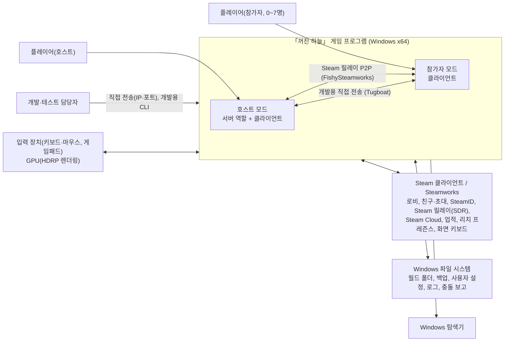

| 외부 요소 | 주고받는 것 | 관련 요구사항 |
|---|---|---|
| Steam 클라이언트 | 로비 생성·검색·메타데이터, 초대, SteamID·표시 이름, P2P 연결(SDR), 원격 저장소 파일, 업적, 리치 프레즌스, 화면 키보드 | NFR-006, NFR-007, NFR-009, FR-001~005, FR-144~145, FR-164, FR-165 |
| 다른 게임 프로그램(호스트↔참가자) | 게임 프로토콜 메시지(3.7.2) | FR-007~009, NFR-013~015 |
| 파일 시스템 | 월드 파일 1개 + 백업, 사용자 설정 JSON, 로그, 충돌 보고 압축 파일, 성능 측정 CSV | FR-014~022, NFR-024, NFR-036, NFR-045, NFR-047, FR-158, FR-163 |
| Windows 탐색기 | 월드 폴더·보고 폴더 열기 | FR-152, FR-158 |
| 입력 장치·GPU | 입력 이벤트, 렌더링 | NFR-004, NFR-005, FR-120, FR-121 |

시스템 경계 밖(만들지 않는 것): 전용 서버 프로그램, 웹 서비스, 자동 충돌 전송 서비스(C-43 해소: 로컬 파일만, 외부 전송 경로 없음), 음성 채팅(영구 제외), Steam 없이 하는 오프라인 플레이(SRS v0.9: Steam 실행 필수).

### 3.2 구성 관점

#### 3.2.1 하위 시스템

| 하위 시스템 | 책임 | 주요 설계 요소 | 처음 들어가는 마일스톤 |
|---|---|---|---|
| S1 세션·네트워크 | Steam 로비, 참가 조건, 접속 절차, 전송 계층 교체, 명령 수신·검증, 상태 복제 | DES-031, 050, 053, 054, 072, 080~085, 101~103 | M1 |
| S2 월드 생성 | 고정 큰 배치 + 시드로 네 지역 내부 생성, 결정론, 생성기 버전, 생성 검증, 요약값 | DES-040~047, 089 | M1(선행 검증), M3 |
| S3 월드 상태·저장 | 서버 시뮬레이션 루트, 월드 파일 읽기·쓰기, 백업, 이전, Steam Cloud | DES-030, 052, 055, 056, 098, 099, 106 | M3 |
| S4 플레이어·생존 | 이동, 상태 값, 쓰러짐·사망·부활, 섭취, 수면 | DES-002~004, 013, 060, 084, 086 | M1~M4 |
| S5 채집·아이템·제작·건축 | 자원 오브젝트, 인벤토리, 드롭, 제작(손 제작·제작대), 용광로 가공, 내구도, 건축, 보관함 | DES-005~012, 036, 057~059, 075, 087, 096 | M3~M4 |
| S6 정화·방어전 | 등광탑, 준비 단계, 웨이브, 보스, 정화 구역, 해금 | DES-015, 017, 018, 027, 061 | M6 |
| S7 생물·AI | 적·동물 정의, 판단, 스폰, 전투, 길 찾기(흐름장), 거리별 갱신 | DES-019~021, 062~064, 088, 105 | M1(시험용), M5 |
| S8 농사·요리·버프·환경 위협 | 작물, 요리 솥·보조 기구, 버프, 지역 위협과 대응 | DES-016, 022~024, 065, 066 | M7, M9a~c |
| S9 진행·안내 | 경험치 이벤트, 숙련도, 목표, 튜토리얼, 스토리, 업적, 리치 프레즌스 | DES-025~028, 035, 067, 068, 070, 071 | M3(이벤트)~M10 |
| S10 표현(Presentation) | 1인칭 카메라, 지형·자원·생물 표시, 조명·대기, UI, 입력, 다국어, 오디오, 접근성 | DES-086~097, 109 | M1~ |
| S11 플랫폼·운영 | Steam 연동, 설정 데이터, 로그·충돌 보고, 성능 측정, 사용자 설정, 빌드 구성, 시험 도구 | DES-100~113 | M1 |

#### 3.2.2 실행 구성 (호스트와 참가자)

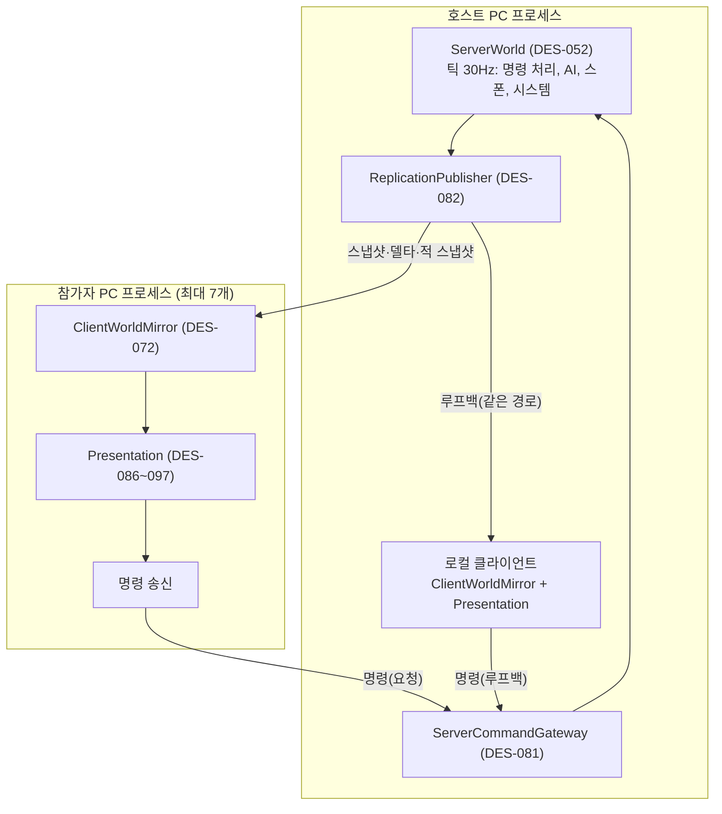

- 호스트 자신의 플레이어도 참가자와 **같은 명령 경로**(게이트웨이 → 검증 → 처리)를 탑니다. 서버 역할 코드가 「로컬 플레이어」를 전제하지 않으므로 전용 서버로 옮길 때 서버 쪽 코드를 고치지 않아도 됩니다(NFR-032).
- 호스트의 화면도 복제 결과(ClientWorldMirror)를 보고 그립니다. 표현 코드 경로가 하나라서 「호스트에서는 보이는데 참가자에게는 다르게 보이는」 결함을 줄입니다. M1 측정에서 이 루프백 비용이 크면 DES-072에 호스트 전용 직접 읽기 구현을 추가하는 것을 대안으로 둡니다(8장 R-05).

#### 3.2.3 Unity 씬 구성

| 씬 | 역할 | 비고 |
|---|---|---|
| `Boot` | 컴포지션 루트 생성(DES-100), Steam 초기화, 설정·콘텐츠 로드, 충돌 감지·광과민성 경고 | 항상 첫 씬. `DontDestroyOnLoad` 루트 1개 |
| `MainMenu` | 월드 만들기·불러오기·관리, 공개 세션 목록, 참가, 옵션 | |
| `World` | 런타임 생성 지형·자원, 고정 콘텐츠(마지막 등불, 장막의 근원) 프리팹 배치, 플레이 | 지형은 실행 중 생성(DES-089). 고정 콘텐츠는 `WorldLayout` 데이터가 가리키는 프리팹 |
| `Bench` (개발 빌드 전용) | P1/P8 측정 장면 재현, 시험용 AI 60체 | DES-113 |

### 3.3 논리 관점

#### 3.3.1 도메인 핵심 모델

도메인 타입은 UnityEngine·FishNet을 모릅니다. 위치·방향은 `System.Numerics.Vector3`(게임플레이)와 정수 좌표(월드 생성)를 씁니다.

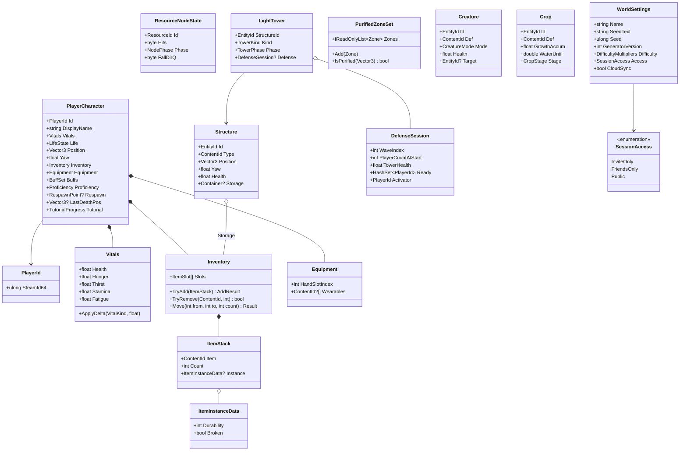

#### 3.3.2 서버 시뮬레이션과 명령 모델

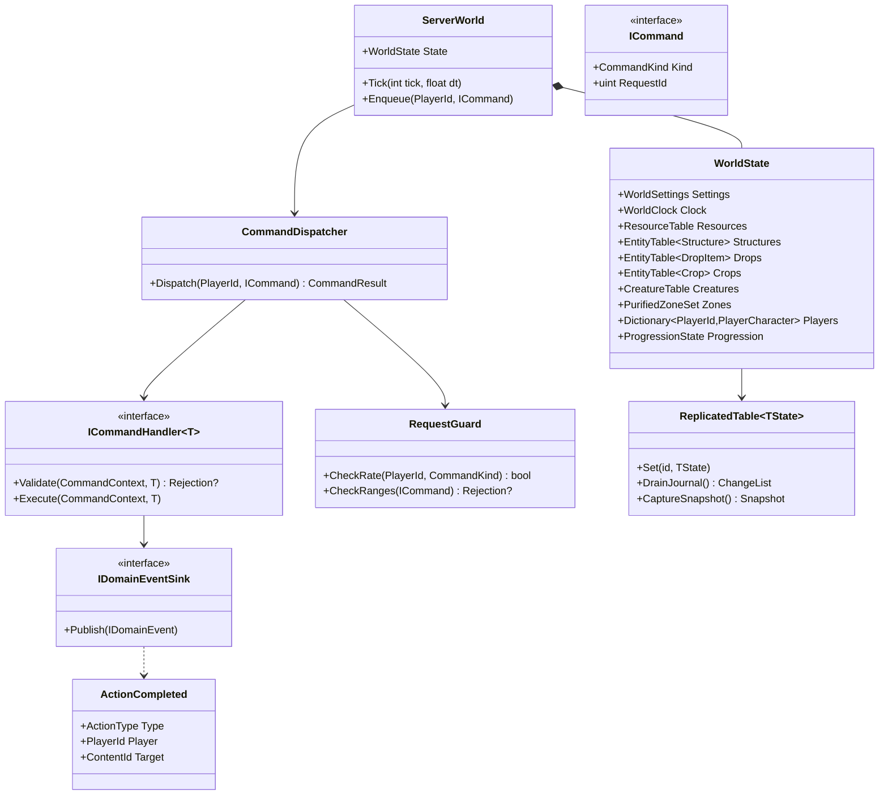

#### 3.3.3 주요 타입 목록

| 타입 | 종류 | 레이어 | 설명 |
|---|---|---|---|
| `PlayerId` | 값 객체 | 도메인 | SteamID 64비트를 감싼 값. 호스트용 특수 ID 없음(FR-015). 개발용 가짜 ID도 같은 타입(DES-103) |
| `ContentId` | 값 객체(ushort) | 도메인 | 콘텐츠 정의 번호. 문자열 키를 정렬해 부여하고 접속 때 콘텐츠 요약값으로 PC 간 일치 확인 |
| `ResourceId` | 값 객체(uint) | 월드 생성 | 생성기가 셀 좌표로 만든 안정적 ID. `지역(3비트)·셀X(8)·셀Z(8)·슬롯(5)` 압축, 손으로 만든 장막의 근원은 지역 7 대역 |
| `ResourceIndex` | ushort | 월드 생성 | 생성 결과를 ResourceId 순으로 정렬했을 때의 번호(0~65535). 네트워크 전송에만 사용(2바이트) |
| `EntityId` | uint | 도메인 | 호스트가 실행 중 발급하는 ID(건축물, 드롭, 작물, 생물). 저장 시 같이 저장 |
| `ReasonCode` | 열거형 | 도메인 | 거부 사유 코드. 화면 문장은 텍스트 키로 변환(NFR-003, 3.7.5) |
| `Rejection` | 값 객체 | 도메인 | `ReasonCode` + 부가 값(예: 부족한 재료 ID·수량) |
| `ActionType` | 열거형 | 도메인 | 경험치 이벤트 종류: 벌목, 채광, 채집, 제작, 건축, 처치, 사냥, 심기, 수확, 요리, 가공(용광로, v0.6 잠정) (NFR-046) |
| `FuelPoints` | 값 객체(int) | 도메인 | 연료 점수. 정수로만 계산(SRS v0.8 FR-176 설정값: 나무 1개 = 2점, 석탄 1개 = 16점, 숯 = 16점 후보(C-62), 광석 1개 가공 = 4점 → 나무 2개 = 광석 1개, 석탄 1개 = 광석 4개). 화면 표시 「광석 n개분」은 점수 ÷ 4를 0.5개분(2점) 단위로(STORYBOARD v1.3 SCR-038). v0.6 |
| `SessionAccess` | 열거형 | 도메인 | 참가 조건: 초대 전용 / 친구 전용 / 공개 (SRS v0.3). 월드 설정에 저장, 새 월드 기본값 친구 전용 |
| `GeneratedWorld` | 데이터 | 월드 생성 | 높이(정수 mm), 물 마스크, 자원 생성 표, 등광탑 후보 자리, 지역 마스크, 요약값 |
| `BalanceConfig` 계열 | 읽기 전용 레코드 | 도메인(타입)/인프라(로드) | SRS 부록 C.1 설정값. 도메인은 레코드만 보고, ScriptableObject는 인프라가 변환 |

### 3.4 의존 관점

#### 3.4.1 레이어와 의존 방향

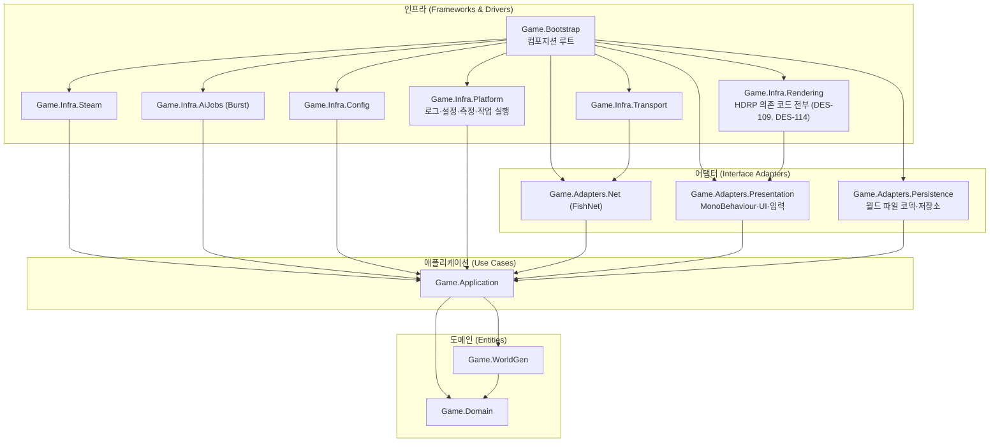

규칙
1. 화살표 방향(바깥 → 안쪽)으로만 참조합니다. 안쪽은 바깥 타입을 모르고, 필요한 기능은 포트(인터페이스)로 요구합니다.
2. `Game.Domain`, `Game.WorldGen`, `Game.Application`, `Game.Adapters.Persistence`는 **`noEngineReferences: true`** 로 UnityEngine 참조를 막습니다. 이 네 어셈블리는 순수 C#이며 FishNet·Steamworks.NET도 참조하지 않습니다.
3. FishNet(`FishNet.Runtime`)은 `Game.Adapters.Net`, `Game.Infra.Transport`, `Game.Bootstrap`만, FishySteamworks는 `Game.Infra.Transport`, `Game.Bootstrap`만, Steamworks.NET(`com.rlabrecque.steamworks.net`)은 `Game.Infra.Steam`, `Game.Bootstrap`만 참조합니다(v0.8: 실제 구성에 맞춤. `Game.Infra.Transport`는 FishySteamworks를 거쳐 Steam 전송을 설정하므로 Steamworks.NET을 직접 참조하지 않음). 시험 어셈블리는 시험 대상에 필요한 범위에서 예외입니다(3.4.2).
4. 어댑터끼리는 서로 참조하지 않습니다(Net ↔ Presentation 금지). 둘 사이 데이터는 애플리케이션의 `ClientWorldMirror`(DES-072)와 포트를 거칩니다.
5. 인프라 어셈블리끼리도 참조하지 않습니다. 연결은 `Game.Bootstrap`이 합니다. 예외: `Game.Infra.Transport` → `Game.Adapters.Net`(전송 선택기가 NetworkManager 구성 요소를 설정해야 하므로), `Game.Infra.Rendering` → `Game.Adapters.Presentation`(표현 어댑터가 정의한 `IRenderBackend`를 구현하므로).
6. 모든 게임 코드는 asmdef 안에 둡니다. `Assembly-CSharp`(기본 어셈블리)에는 코드를 두지 않습니다.
7. **HDRP 어셈블리(`Unity.RenderPipelines.HighDefinition.Runtime`, `Unity.RenderPipelines.Core.Runtime`)는 `Game.Infra.Rendering`만 참조합니다**(3.4.4, 사용자 결정 2026-11-02).

#### 3.4.2 asmdef 목록

v0.8: 이 표는 실제 asmdef 구성과 같습니다. 아키텍처 시험(DES-112)이 이 표와 실제 참조를 비교하므로, asmdef 참조를 바꿀 때는 이 표를 먼저 고칩니다. 참조 이름은 실제 어셈블리 이름(`FishNet.Runtime`, `FishySteamworks`, `com.rlabrecque.steamworks.net`)으로 적습니다. 게임 런타임 어셈블리는 아래 13개(`Game.Domain` ~ `Game.Bootstrap`)이고, 경로는 `Assets/_Game/Code/` 아래(3.8.2)입니다.

| asmdef | 레이어 | 참조 허용 | noEngineReferences | 비고 |
|---|---|---|---|---|
| `Game.Domain` | 도메인 | (없음) | true | 엔터티, 값 객체, 규칙, 도메인 이벤트, 규칙 교체 지점 인터페이스 |
| `Game.WorldGen` | 도메인(생성 규칙) | `Game.Domain` | true | 결정론 수학, 생성기(버전별 폴더), 검증, 요약값. `allowUnsafeCode: false` |
| `Game.Application` | 애플리케이션 | `Game.Domain`, `Game.WorldGen` | true | 유스케이스, 명령 처리, 서버 시뮬레이션, 복제 모델, 포트 |
| `Game.Adapters.Persistence` | 어댑터 | `Game.Application`, `Game.Domain` | true | 월드 파일 코덱·저장소(System.IO). 경로는 생성자로 받음 |
| `Game.Adapters.Net` | 어댑터 | `Game.Application`, `Game.Domain`, `Game.WorldGen`, `FishNet.Runtime` | false | 메시지·직렬화, 게이트웨이, 복제 송수신, 플레이어 NetworkObject |
| `Game.Adapters.Presentation` | 어댑터 | `Game.Application`, `Game.Domain`, `Game.WorldGen`, `Unity.InputSystem`, `Unity.Localization`. UI Toolkit은 엔진 내장 모듈이라 별도 참조 없음 (**HDRP 참조 금지**) | false | 뷰, UI 프리젠터, 입력, 조명 상태 계산, 오디오. 렌더링 적용은 `IRenderBackend`(이 어셈블리에 정의) 호출로만 |
| `Game.Infra.Steam` | 인프라 | `Game.Application`, `Game.Domain`, `com.rlabrecque.steamworks.net` | false | `IPlatformServices`, `ICloudSync` 구현 |
| `Game.Infra.Transport` | 인프라 | `Game.Adapters.Net`, `Game.Application`, `FishNet.Runtime`, `FishySteamworks` | false | 전송 선택(Steam/Tugboat), 네트워크 설정 적용 |
| `Game.Infra.AiJobs` | 인프라 | `Game.Application`, `Game.Domain`, `Unity.Burst`, `Unity.Collections`, `Unity.Mathematics` | false | `IAiNavigationBackend` 구현(흐름장, 이동, 공간 해시). v0.8: `Unity.Jobs` 참조 삭제(Unity 6에서 Job System은 엔진 내장이라 별도 어셈블리 참조가 필요 없음) |
| `Game.Infra.Config` | 인프라 | `Game.Application`, `Game.Domain`, `Game.WorldGen` | false | ScriptableObject 정의와 로더 |
| `Game.Infra.Platform` | 인프라 | `Game.Application`, `Game.Domain` | false | 로그, 충돌 보고, 성능 측정, 사용자 설정 저장, 백그라운드 작업 |
| `Game.Infra.Rendering` | 인프라 | `Game.Adapters.Presentation`, `Game.Application`, `Game.Domain`, `Unity.RenderPipelines.HighDefinition.Runtime`, `Unity.RenderPipelines.Core.Runtime` | false | **렌더 파이프라인 의존 코드 전부**: Volume 제어, 조명·태양 쿠키·광원 적용, 후처리(색각 보정·노출), 업스케일링, 셰이더 전역 변수 연결, 그래픽 프리셋·품질 단계 (DES-109, DES-114) |
| `Game.Bootstrap` | 인프라(조립) | 위 게임 어셈블리 12개 전부, `FishNet.Runtime`, `com.rlabrecque.steamworks.net`, `FishySteamworks`(필요 시 `Unity.InputSystem`, `Unity.Localization`). HDRP 어셈블리는 직접 참조 금지(규칙 7) | false | 컴포지션 루트, 씬 흐름, 개발 도구 |
| `Game.Editor` | 에디터 도구 (v0.8) | `Game.Domain`, `Game.Application`, `Game.Adapters.Presentation`, `Game.Infra.Config`, `Game.Bootstrap` | false | **`includePlatforms: Editor`**(플레이어 빌드 제외). 빌드 명령 `BuildCommands`, 출시 빌드 산출물 검사 `BuildArtifactInspector`(3.4.3), 프로젝트 설정 `ProjectConfigurator`, 씬·애셋 생성 스크립트(`BootSceneBuilder`, `DataAssetBuilder`). 게임 어셈블리는 이 어셈블리를 참조하지 않음. 경로 `Assets/_Game/Code/Editor/` |
| `Game.Tests.Domain` | 시험(EditMode) | `Game.Domain` + Test Runner·NUnit | false | 도메인 규칙 시험. 경로 `Assets/Tests/EditMode/Domain/` |
| `Game.Tests.Application` | 시험(EditMode) | `Game.Application`, `Game.Domain`, `Game.WorldGen` + Test Runner·NUnit | false | 유스케이스·명령·복제 모델 시험. 경로 `Assets/Tests/EditMode/Application/` |
| `Game.Tests.Infrastructure` | 시험(EditMode) | `Game.Application`, `Game.Domain`, `Game.Infra.Config`, `Game.Adapters.Presentation`, `Game.Infra.Transport`, `Game.Infra.Steam`, `Game.Bootstrap`, `Game.Editor`, `FishNet.Runtime` + Test Runner·NUnit | false | 설정 로더·전송 선택·Steam 확인·부트·빌드 도구 시험. 경로 `Assets/Tests/EditMode/Infrastructure/` |
| `Game.Tests.Architecture` | 시험(EditMode) | Test Runner·NUnit만(리플렉션·asmdef 파일 읽기로 검사) | false | 이 표와 실제 참조 비교, 의존 방향, 렌더링 격리, Pipeline 패키지 격리(3.4.3), 프로젝트 설정 검사(DES-112). 경로 `Assets/Tests/EditMode/Architecture/` |
| `Game.Tests.Integration` | 시험(PlayMode) | `Game.Application`, `Game.Infra.Transport`, `FishNet.Runtime`, `FishySteamworks` + Test Runner·NUnit | false | 루프백 호스트 + 클라이언트 통합 시험. 경로 `Assets/Tests/PlayMode/Integration/` |

- 시험 어셈블리는 모두 `defineConstraints: UNITY_INCLUDE_TESTS`, `overrideReferences: true` + `nunit.framework.dll`이고, EditMode 시험은 `includePlatforms: Editor`입니다. 아직 만들지 않은 계획 시험 어셈블리는 `Game.Tests.WorldGen`(골든 해시·결정론, M1-04)과 `Game.Tests.Persistence`(월드 파일 코덱, M3-08)이며, 만들 때 이 표에 행을 먼저 추가합니다.
- 타사 어셈블리(게임 코드 아님, 아키텍처 시험의 게임 어셈블리 검사 대상 아님): FishNet은 `Assets/ThirdParty/FishNet/` 아래 자체 asmdef(`FishNet.Runtime`, `GameKit.Dependencies`, `Synapse`, `Unity.FishNet.CodeGen`, `MonoFN.Cecil`), FishySteamworks는 `Assets/ThirdParty/FishySteamworks/FishySteamworks.asmdef`, Steamworks.NET은 UPM 패키지(`com.rlabrecque.steamworks.net`).

#### 3.4.3 의존 규칙의 강제 방법
- **컴파일 단계**: asmdef 참조 목록에 없는 어셈블리는 쓸 수 없습니다. `noEngineReferences: true`이면 `UnityEngine` 네임스페이스를 쓰는 순간 컴파일 오류가 납니다. 미리 컴파일된 DLL(Steamworks.NET 등)은 `overrideReferences: true` + 명시 목록으로만 허용합니다.
- **아키텍처 시험(EditMode, DES-112)**: 리플렉션으로 각 어셈블리의 참조 어셈블리 이름을 읽어 3.4.2 표와 다르면 실패합니다. 예: `Game.Domain`이 `UnityEngine*`, `FishNet*`, `Steamworks*` 중 하나라도 참조하면 실패. `Game.Editor`와 `Game.Tests.*`가 플레이어 어셈블리 목록에 없는지도 검사합니다.
- **Unity Pipeline 패키지 격리 (v0.8 갱신, 사용자 결정 2026-11-03)**: `com.unity.pipeline` 0.9.1-exp.1(Unity CLI·에디터 조작 MCP가 열린 에디터와 통신하는 패키지, D-03)은 v0.7에서 전제한 것과 달리 **에디터 전용이 아닙니다.** 그래서 다음 세 겹으로 막습니다.
  1. **런타임 기호 금지**: 모든 빌드 대상의 Scripting Define Symbols와 프로젝트 파일에 `ENABLE_RUNTIME_PIPELINE*` 기호가 없어야 합니다(아키텍처 시험). 패키지 어셈블리는 `includePlatforms: Editor`이거나 이 기호가 있어야만 플레이어에 들어가도록 되어 있는지도 검사합니다(패키지 버전을 올리면 다시 확인).
  2. **참조 금지**: `Game.*` 어셈블리는 `Unity.Pipeline*` 어셈블리를 하나도 참조하지 않습니다(아키텍처 시험). 플레이어 어셈블리 목록에 들어가도 되는 Pipeline 어셈블리는 런타임 기능이 없는 속성 정의 `Unity.Pipeline.Attributes`뿐입니다.
  3. **출시 빌드 산출물 검사**: `Game.Editor`의 `BuildCommands`가 빌드 직후 `BuildArtifactInspector`로 데이터 폴더(Managed 폴더, IL2CPP `global-metadata.dat`)를 훑어 `Unity.Pipeline.Attributes` 외 Pipeline 어셈블리(`Unity.Pipeline`, `Unity.Pipeline.IlInterpreter` 등)가 있으면 빌드를 실패로 처리합니다. 실제 출시 IL2CPP 빌드에서 0건 확인(2026-11-03).
- **코드 검사 기준**: 참가자 쪽 코드에서 `WorldState`를 직접 바꾸는 경로 0건(NFR-030). `WorldState` 변경 메서드는 `Game.Application` 내부(internal)로 두고, 서버 시뮬레이션과 명령 처리기만 호출합니다.
- **렌더링 격리 검사**: 아키텍처 시험에서 `Game.Infra.Rendering` 외 어셈블리가 `Unity.RenderPipelines.*`를 참조하면 실패합니다.

#### 3.4.4 렌더링 의존 코드 격리 (사용자 결정 2026-11-02, DES-114)

HDRP는 유지하되(5장 D-03, D-20), Unity의 HDRP 유지보수 모드 전환(8장 R-09)에 대비해 **나중에 URP로 옮길 때 고칠 코드를 한 어셈블리로 모읍니다.**

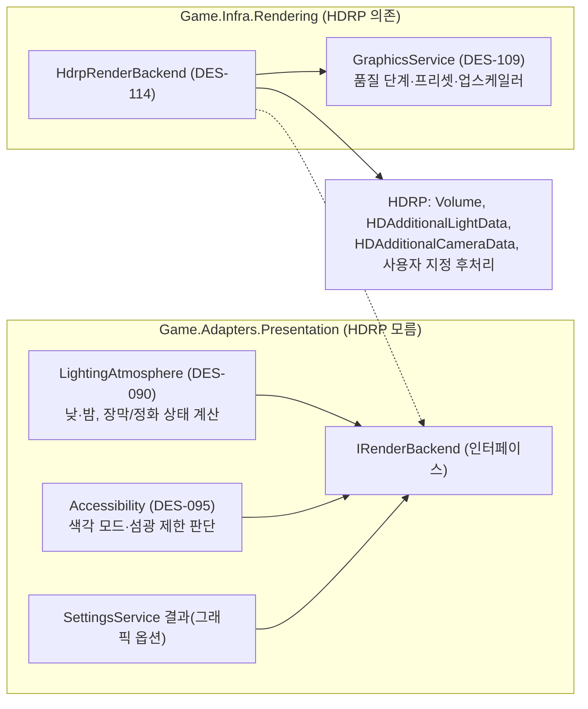

| 구분 | 격리 대상 | 표현 어댑터가 넘기는 값(파이프라인 무관) |
|---|---|---|
| Volume | 안개·노출·색 보정·하늘 Volume 프로필 혼합 | `AtmosphereState`(시각 비율, 장막 농도 0~1, 지역 위협 종류, 어둠 여부) |
| 조명 | 태양·달 방향광 설정, 정화 마스크 쿠키 텍스처 갱신, 광원(횃불·랜턴) 강도·범위·그림자 상한 | 태양 방향·세기, 정화 구역 원 목록, 광원 목록(위치·반경·종류) |
| 후처리 | 색각 보정 행렬, 섬광 완화(노출 변화 제한), 화면 흔들림은 카메라라 제외 | `ColorVisionMode`, 섬광 제한 켬/끔 |
| 업스케일링·품질 | 품질 단계, 동적 해상도, DLSS/FSR 품질 모드, 프리셋 세부 값 | `GraphicsOptions`(프리셋, 해상도, 화면 모드, 업스케일 켬/끔·품질) |
| 셰이더 연결 | 전역 셰이더 변수(장막 농도, 정화 마스크) 설정 | 위 값 |
| 1인칭 손·손목 소품 그리기 (v0.4, **v0.5부터 구현 보류**) | 손목 표시 방식 (A) 3D 소품을 고를 때만 필요: 손·손목 소품이 벽에 파묻히지 않게 그리는 HDRP 사용자 지정 패스(깊이 덮어쓰기·별도 시야각), 렌더 텍스처를 소품 재질에 연결. 현재 기본 (B) 화면 공간 평면은 UI Toolkit 안에서 끝나 이 항목을 쓰지 않음. `IRenderBackend`에 메서드 자리만 두고 구현하지 않음(M6-11 결정 뒤) | `FirstPersonLayerState`(손 시야각, 손목 올림 정도 0~1), 렌더 텍스처 핸들 |
| 시야 가장자리 위협 효과 (v0.4, v0.5 수정) | 월드 화면 쪽 **보조 색조**(약한 비네트·색 번짐, Volume 후처리)만. STORYBOARD v1.2는 위협 테두리·피격 호를 손목 계기보다 **위 레이어**에 두므로, 테두리·피격 호 본체는 UI Toolkit 레이어(DES-120)에서 그리고 HDRP와 무관함 | `ThreatEdgeState`(종류, 세기 0~1). 세기 변화는 DES-095 섬광 제한기를 거친 값만 받음(FR-131) |

- 메시·머티리얼·셰이더 그래프 같은 **애셋**은 HDRP 전용이라 URP로 옮길 때 변환 작업이 따로 필요합니다(코드 영향과 별개). 애셋은 `Assets/_Game/Art/`, `Materials/`, `Settings/`(HDRP 애셋·Volume 프로필)에 모아 범위를 파악하기 쉽게 둡니다.
- 재평가 시점: **M6 수직 슬라이스**(7장 M6-11). 성능 측정 결과, Unity 렌더 파이프라인 정책 변화, 6.7 LTS 상황을 보고 사용자가 HDRP 유지/URP 전환을 정합니다.

### 3.5 정보 관점

#### 3.5.1 데이터 분류

| 분류 | 내용 | 주인 | 저장 위치 | 수명 |
|---|---|---|---|---|
| 생성 데이터 | 지형 높이, 물, 자원 오브젝트 초기 배치, 등광탑 후보 자리 | 각 PC가 시드로 계산 | 저장 안 함(메모리) | 월드 로드~종료 |
| 월드 상태(바뀐 상태) | 자원 변화, 건축물, 드롭, 작물, 등광탑, 정화 구역, 시각, 해금, 스토리, 목표, 보관함 | 호스트 | 월드 파일 | 영구 |
| 플레이어 진행 | NFR-023 항목 전체 | 호스트 | 월드 파일 안(SteamID 키) | 영구 |
| 월드 설정 | 이름, 시드 문자열·값, 생성기 버전, 난이도, **참가 조건(SRS v0.3)**, Steam Cloud 켬/끔 | 호스트 | 월드 파일 | 영구 |
| 차단 목록 (v0.7) | 차단한 SteamID, 표시 이름, 차단 시각. **C-46 해소: 호스트의 모든 월드에 적용** | 호스트 PC | `bans.json`(사용자 데이터, 3.5.7) — 월드 파일에 넣지 않음 | 영구(PC별) |
| 세션 일시 데이터 | 접속자 목록, 재접속 자리 예약, 비밀번호, 비밀번호 시도 기록, 준비 상태, 채팅, 핑 | 호스트 메모리 | 저장 안 함 | 세션 동안 |
| 사용자 설정 | 입력 할당(장치별), 감도·시야각, 그래픽, 오디오, 접근성, 언어, 표시 옵션, 광과민성 경고 확인 여부 | 각 PC | `settings.json` | 영구(PC별) |
| 콘텐츠 정의·설정값 | 아이템, 제작법, 드롭 표, 웨이브, 스킬 노드, 부록 C.1 수치, 생성 프로필 | 빌드에 포함 | ScriptableObject 애셋 | 빌드별 |
| 운영 데이터 | 로그, 충돌 보고, 성능 측정 CSV, 세션 잠금 파일 | 각 PC | 로그 폴더 | 회전 보관 |

**세션 비밀번호는 월드 파일에 저장하지 않고 세션마다 입력합니다(확정, 사용자 결정 2026-11-02).** 참가 조건만 월드별로 저장합니다. NFR-042(개인정보 최소 저장)와도 맞습니다.

#### 3.5.2 월드 파일 형식 (DES-098)

파일 하나(`world.sav`)에 월드와 모든 플레이어 진행을 담습니다(NFR-024). 백업은 같은 형식의 별도 파일입니다(NFR-026).

```
[헤더 64바이트, 리틀 엔디언]
  magic          4B  "KHSV"
  saveFormatVer  u16      ← 저장 형식 버전 (NFR-025)
  generatorVer   u16      ← 생성기 버전 (NFR-054). 저장 형식 버전과 별개
  gameBuild      u32      ← 저장한 게임 빌드 번호(참고용)
  savedAtUtc     i64
  bodyLength     u32
  bodyHash       u64      ← 본문 xxHash64 (NFR-037 손상 감지)
  flags          u32      ← 압축 여부 등
  reserved       ...
[본문: 청크 나열]  각 청크 = id(4B) + chunkVer(u16) + length(u32) + payload
  WSET  월드 설정 (이름, 시드 문자열, 시드 값, 난이도 배율, 참가 조건, Cloud 켬/끔)
  CLCK  게임 내 시각·일수
  ZONE  정화 구역 목록 (중심 정수 좌표, 반경, 출처 등광탑)
  RSRC  바뀐 자원 오브젝트만: ResourceId, 상태(타격 수, 단계, 넘어진 방향), 재생성 타이머(C-08 결정 시)
  STRC  건축물: EntityId, 종류, 위치, 방향, 체력, 소유 정보 없음(SUG-018 보류)
  STOR  보관함 내용물: 건축물 EntityId → 칸 배열
  FURN  용광로 상태 (v0.6, 청크 버전 1, NFR-022): 건축물 EntityId, 연료 칸·광석(재료) 칸·결과물 칸 내용, 남은 연료 점수(이미 태운 연료의 나머지, 꺼낼 수 없음), 현재 가공(작업 종류: 제련/숯, 진행 경과 초), 마지막 투입자 SteamID(경험치 대상 후보, C-66), 불 켜짐 여부
        — 청크를 새로 더하는 변경이라 기존 청크 형식은 그대로이고, FURN이 없는 옛 파일은 「용광로 없음」으로 읽음. 이후 항목을 바꾸면 FURN 청크 버전을 올리고 변환기(IChunkMigration)를 둠(NFR-025)
  TOWR  등광탑: EntityId, 종류, 단계(비활성/정화 완료)
  CROP  작물: EntityId, 종류, 위치, 생장 누적, 물 유지 종료 시각, 단계
  DROP  드롭 아이템: EntityId, 아이템, 수량, 위치, 내구도
  PROG  해금 상태, 스토리 진행(결말 여부, 공개된 단서), 월드 목표 진행, 업적 공동 조건 진행
  (BANS  v0.7에서 제외 — C-46 해소로 차단 목록은 호스트 PC의 bans.json에 저장. 청크 id는 재사용하지 않음)
  EXPL  탐험 기록 (C-53 결정 전 기본: 공유 → 월드 단위)
  PLYR  플레이어 진행 n개: SteamID64, 표시 이름, NFR-023 항목
  (모르는 청크 id는 건너뛰고 보존 — 이후 버전 호환)
```

- 형식 버전이 파일보다 높으면 청크별 변환기(`IChunkMigration`)를 차례로 적용해 최신 형식으로 읽습니다. 파일 버전이 게임보다 높으면 열지 않고 「게임 업데이트 필요」(NFR-025).
- 채팅, 비밀번호, IP 주소, 옵션 설정은 어떤 청크에도 넣지 않습니다(NFR-042, NFR-047). 코덱 시험에서 청크 목록을 검사합니다.
- 압축: 본문을 Deflate로 압축할 수 있게 플래그를 둡니다. 예상 크기(5,000개 변경 + 건축물 2,000개 + 플레이어 8명)는 압축 전 약 200 KB입니다.

#### 3.5.3 ERD (저장 데이터)

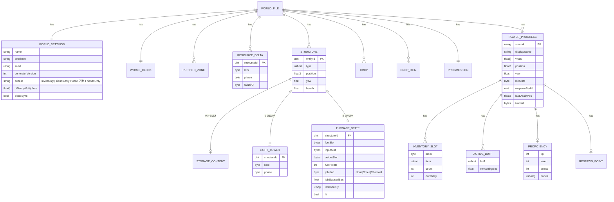

#### 3.5.4 데이터 생명 주기

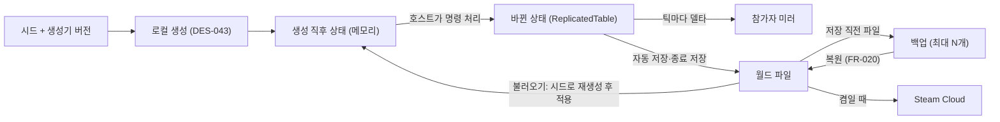

- **생성 데이터는 저장하지 않습니다.** 불러올 때 기록된 생성기 버전으로 다시 생성하고(NFR-054) 바뀐 상태만 덮어씁니다.
- **바뀐 상태 되돌림**: 자원 오브젝트가 재생성 규칙(C-08)으로 원래대로 돌아오면 그 항목을 델타 테이블에서 지웁니다(저장 크기 유지).
- **플레이어 진행**: 접속 중에는 `PlayerCharacter`가 메모리에 있고, 나가면(FR-011) 그 시점 값을 오프라인 진행 목록으로 옮깁니다. 저장 시 둘을 합칩니다.
- **세션 일시 데이터**는 세션이 끝나면 버립니다.

#### 3.5.5 실행 중 데이터 크기 (호스트 기준 추정)

| 데이터 | 크기 추정 | 비고 |
|---|---|---|
| 정수 높이 (3,073 × 3,073 × 4B) | 약 38 MB | 1 m 간격. 생성 후 Unity Terrain으로 넘기고, 게임플레이 질의용 사본 유지 |
| 물·지역 마스크 | 약 10 MB | 바이트 격자 |
| 자원 생성 표 (20,000 × 32B) | 약 0.7 MB | 위치는 mm 정수, 방향 16비트 |
| 자원 상태 배열 (20,000 × 4B) | 0.1 MB | 밀집 배열 + 바뀐 항목 집합 |
| AI 보행 격자 (2 m 칸, 1,536² × 2B) | 약 4.7 MB | 호스트만 |
| 흐름장 (최대 10개 × 128² × 4B) | 약 0.7 MB | 호스트만 |
| 엔터티 테이블(건축물·드롭·작물·생물) | 수 MB | |

#### 3.5.6 사용자 설정 파일 (DES-110)
`%USERPROFILE%\AppData\LocalLow\<회사>\<제품>\settings.json`. 항목: `formatVersion`, `language`, `input.keyboardMouse`(Input System 바인딩 덮어쓰기 JSON), `input.gamepad`(따로), `sensitivity`, `invertY`, `fov`, `graphics`(프리셋 또는 사용자 지정 값), `audio`(5개 볼륨), `accessibility`(자막, 글자 크기, 색각 모드, 흔들림, 섬광 줄이기), `display`(이름표, 목표 안내, 튜토리얼 안내), `photosensitivityAcknowledged`. 월드 파일과 완전히 분리합니다(NFR-047).

#### 3.5.7 폴더 배치

```
%USERPROFILE%\AppData\LocalLow\<회사>\<제품>\
  settings.json
  bans.json                     ← 호스트의 차단 목록(모든 월드 공통, C-46). formatVersion + [{steamId, displayName, bannedAtUtc}]. 원자적 저장(임시 파일 → 교체)
  Worlds\
    <worldFolderId>\            ← 월드마다 폴더 하나 (FR-152 「폴더 열기」 대상)
      world.sav                 ← 현재 월드 파일 (이것 하나만 옮기면 이전 완료, FR-022)
      backups\world_20261102_101500.sav ...
  Logs\  game_<실행시각>.log (최근 N회), perf_<실행시각>.csv (개발 빌드)
  CrashReports\ report_<시각>.zip
  session.lock                  ← 실행 중 표시. 남아 있으면 비정상 종료로 판단(FR-158)
```

### 3.6 패턴 사용 관점

#### 3.6.1 아키텍처 스타일: 클린 아키텍처 (Unity 적용)
- 도메인·월드 생성·애플리케이션은 순수 C#이라 Unity 없이 EditMode 시험(또는 일반 .NET 시험)으로 검증합니다. 결정론 시험과 규칙 시험의 대부분이 여기서 끝납니다.
- MonoBehaviour는 **어댑터(표현·네트워크)** 로 봅니다. 화면에 그리고 입력을 받아 유스케이스·명령으로 바꾸는 일만 하고, 규칙 판단은 하지 않습니다(Humble Object).
- 레이어 합침: Unity에서는 MonoBehaviour가 프레임워크이면서 어댑터이므로 「어댑터」와 「프레임워크 접착 코드」를 하나의 어셈블리(`Game.Adapters.Presentation`, `Game.Adapters.Net`)에 둡니다. 근거는 5장 D-02.

#### 3.6.2 적용한 디자인 패턴

| 패턴 | 적용 위치 | 목적 |
|---|---|---|
| 포트와 어댑터 | DES-051 포트, 인프라 구현 | 전송·플랫폼·저장 교체(NFR-031, NFR-032) |
| 커맨드 + 검증기 | DES-050 명령 파이프라인 | 모든 참가자 요청을 한 경로로 검증(FR-007, NFR-040, NFR-041) |
| 상태 기계 | 세션, 플레이어 생명 상태, 등광탑·방어전, 자원 오브젝트, 작물, 생물 AI | 상태 전이 규칙을 한곳에 모음(3.10) |
| 도메인 이벤트(관찰자) | `ActionCompleted`, `ZonePurified`, `PlayerDowned` 등 | 경험치·업적·알림·목표가 기능 코드를 몰라도 붙음(NFR-046) |
| 전략(규칙 교체 지점) | DES-033 | 미정 규칙(C 항목)을 코드 구조 변경 없이 교체 |
| 저장소 | `IWorldSaveStore`, `ICloudSync` | 저장 방식과 도메인 분리 |
| 엔터티 테이블 복제(스냅샷 + 델타) | DES-053, 082, 083 | 2만 개 자원 오브젝트·적·건축물을 객체별 NetworkObject 없이 복제 |
| 플라이웨이트 | 콘텐츠 정의(ItemDef 등) | 같은 정의를 수많은 인스턴스가 공유 |
| 객체 풀 | 자원 뷰, 생물 뷰, 드롭 뷰, 이펙트 | 생성·파괴 비용과 GC 제거 |
| 더블 버퍼 | 침식 계산, 흐름장 | 병렬 계산 결과가 실행 순서에 영향받지 않게 |
| 데이터 지향 + Job | DES-105 | 적 이동·흐름장을 Burst 잡으로 메인 스레드 밖에서 |
| 컴포지션 루트(수동 DI) | DES-100 | 외부 DI 라이브러리 없이 조립 한곳 |
| 버전별 동결 구현 | DES-044 | 옛 생성기 버전을 코드째 보존(NFR-054) |

### 3.7 인터페이스 관점

#### 3.7.1 외부 인터페이스: Steamworks (DES-102, DES-106)

| 기능 | Steamworks.NET API (대표) | 쓰는 곳 | 요구사항 |
|---|---|---|---|
| 초기화·App ID | `SteamAPI.Init`, `steam_appid.txt`(개발) / 빌드 설정의 App ID | Boot | NFR-006, NFR-009 |
| 사용자 식별 | `SteamUser.GetSteamID`, `SteamFriends.GetPersonaName` | 로그인 정보 | NFR-006 |
| 로비 | `SteamMatchmaking.CreateLobby`(유형: 초대 전용=Private, 친구 전용=FriendsOnly, 공개=Public), `SetLobbyType`, `SetLobbyData`, `RequestLobbyList` + `AddRequestLobbyListStringFilter`, `JoinLobby`, `GetLobbyMemberByIndex` | 세션 열기·목록·참가 | FR-001, FR-003, FR-144, FR-145, NFR-009 |
| 초대 | `SteamFriends.ActivateGameOverlayInviteDialog`, 콜백 `GameLobbyJoinRequested_t`, `GameRichPresenceJoinRequested_t` | 초대·친구 참가 | FR-002, FR-003 |
| P2P 연결 | FishySteamworks(Steam Networking Sockets, SDR) | 전송 | FR-005, NFR-008 |
| 원격 저장소 | `SteamRemoteStorage.FileWrite/FileRead/GetFileCount/GetFileNameAndSize/FileDelete` | 월드별 Cloud 동기화 | FR-021, NFR-007 |
| 업적 | `SteamUserStats.SetAchievement`, `StoreStats` | 업적 해제(각 클라이언트가 자기 계정에) | FR-164 |
| 리치 프레즌스 | `SteamFriends.SetRichPresence("steam_display"/"status"/"connect")` — `connect`는 참가 조건이 친구 전용·공개일 때만 설정 | 친구 목록 표시 | FR-165 |
| 화면 키보드 | `SteamUtils.ShowGamepadTextInput` / `ShowFloatingGamepadTextInput` | 게임패드 글자 입력 | NFR-004 |

로비 메타데이터 키(비밀번호 원문은 넣지 않음, FR-146)

| 키 | 값 |
|---|---|
| `kh_game` | 게임 식별 문자열(App ID 480에서 다른 게임 로비를 거르는 필터, NFR-009) |
| `kh_proto` | 프로토콜 버전 |
| `kh_build` | 게임 빌드 번호(목록의 버전 일치 표시, FR-145) |
| `kh_world` | 월드 이름 |
| `kh_host` | 호스트 표시 이름 |
| `kh_count` | 접속 인원 (`/8`은 화면에서 붙임) |
| `kh_resv` | 재접속 예약 자리 수(0~7). 공개 세션 목록에 `7/8 · 예약 1` 형식으로 표시(I-03, SRS v0.5). 0이면 화면에서 「예약」 부분 생략. 예약이 생기거나(연결 끊김) 풀릴 때(재접속, 유지 시간 만료) `SessionService`가 `ILobbyService.SetMeta`로 즉시 갱신. `kh_count + kh_resv = 8`이면 목록에서 「가득 참」으로 표시(FR-115의 인원 제한 계산과 같음) |
| `kh_pw` | 비밀번호 여부 `0/1` |
| `kh_access` | 참가 조건 `invite/friends/public` |

#### 3.7.2 네트워크 프로토콜 (DES-080)

FishNet Broadcast(NetworkObject에 묶이지 않는 메시지)를 기본으로 씁니다. 플레이어 아바타만 NetworkObject입니다(DES-084).

| 방향 | 메시지 | 주요 필드 | 채널 | 마일스톤 |
|---|---|---|---|---|
| C→S | `JoinRequest` | protocolVer, buildVer, contentHash(u64), supportedGenVersions[], joinPath(Invite/Friend/Public/Rejoin), password(선택), devPlayerId(개발 전송 전용) | 신뢰 | M1 |
| S→C | `JoinAccepted` | seedText, seed, generatorVer, expectedWorldHash, worldSettings(공개 필드), serverTick, clock | 신뢰 | M1 |
| S→C | `JoinRejected` | ReasonCode(인원 초과, 버전 불일치, 비밀번호 불일치, 차단됨, 참가 조건 밖, 시도 제한, 생성 불일치) | 신뢰 | M1 |
| C→S | `WorldReady` | computedWorldHash | 신뢰 | M1 |
| S→C | `SnapshotChunk` | snapshotTick, tableId, chunkIndex, chunkCount, payload(≤16 KB) | 신뢰 | M1 |
| S→C | `JoinComplete` | snapshotTick, yourPlayerSpawn | 신뢰 | M1 |
| S→C | `TableDelta` | tick, tableId, entries[] (자원은 ResourceIndex u16 + 상태 3B) | 신뢰·순서 | M1 |
| S→C | `CreatureSpawn` / `CreatureDespawn` | id, defId, pos, 상태 / id | 신뢰 | M1(시험용) |
| S→C | `CreatureSnapshot` | tick, n × (id u16, pos 3×u16 셀 기준 양자화, yaw u8, anim u8, hp% u8) | 비신뢰 | M1 |
| C→S | `Command` | kind(u8), requestId(u32), payload(명령별) | 신뢰 | M1~ |
| S→C | `CommandResult` | requestId, ok, Rejection(사유 코드 + 부가 값) | 신뢰 | M1~ |
| S→C | `PrivateState` (본인에게만) | 인벤토리 칸 변경, 상태 값, 버프, 숙련도 | 신뢰 | M2~ |
| S→C | `Notice` | 알림 종류, 인자(이름 등) — 문장은 받는 쪽 언어로 조립 | 신뢰 | M1 |
| C↔S | `ChatSend` / `ChatMessage` | text(≤`채팅 최대 글자 수`) / senderId, senderName, text | 신뢰 | M1 |
| S→C | `ClockSync` | tick, gameTime, dayCount | 신뢰(5초마다·변경 시) | M2 |
| S→C | `ShutdownNotice` | 남은 초, 취소 여부 | 신뢰 | M3 |
| S→C | `AchievementUnlock` | achievementKey | 신뢰 | M6 |
| S→C | `ContainerView` | 보관함 id, 칸 배열(열어 본 사람에게만, 변경 시 구독자에게) | 신뢰 | M4 |
| S→C | `FurnaceView` (v0.6) | 용광로 id, 연료·재료·결과물 칸, 남은 연료 점수, 현재 작업 종류, **작업 시작 서버 시각 + 가공 시간**, 정지 사유(결과물 가득/연료 없음/재료 없음). 열어 본 사람(구독자)에게만, **상태가 바뀔 때만**(칸 변경, 1개 완료, 시작·정지) 보냄. 진행 막대는 클라이언트가 서버 시각으로 계산 | 신뢰 | M4 |

명령(`Command.kind`) 목록 — 마일스톤 순: 이동 보정 요청 없음(이동은 아바타 동기화), `HitResource`, `Gather`, `Pickup`, `MoveItem`, `SplitItem`, `DropItem`, `Consume`, `SelectHand`, `Equip`, `Craft`(손 제작 또는 제작대 id 포함, v0.6), `Repair`, `Place`, `FurnacePut/Take/Open/Close`(v0.6, 칸 종류 포함), `Demolish`, `RepairStructure`, `ContainerPut/Take/Open/Close`, `Sleep/Wake`, `SetRespawn`, `Attack`, `Revive(Start/Stop)`, `GiveUp`, `Respawn`, `Ping`, `TowerActivate`, `TowerCancel`, `Ready`, `Plant`, `Water`, `Harvest`, `Cook`, `AcquireNode`, `ClearDeathMarker`, `HostOnly:Kick/Ban/Unban/ChangeAccess/Shutdown/CancelShutdown`.

메시지 공통 규칙
- 모든 C→S 메시지는 게이트웨이(DES-081)에서 (1) 크기 상한, (2) 빈도 상한(`초당 요청 상한`, 명령별 토큰 버킷), (3) 값 범위(아이템 ID 존재, 수량 ≥ 1, 칸 번호 범위, 좌표가 월드 안, 대상 ID 존재)를 검사합니다. 실패하면 무시하고 로그에 남기며, 예외가 나도 연결 처리 루프 밖으로 새지 않습니다(NFR-040).
- 연결의 SteamID는 **전송 계층이 알려 주는 원격 ID**를 씁니다(FishySteamworks 연결 주소). `JoinRequest`에 자기 SteamID를 적어 보내게 하지 않습니다. 개발 전송(Tugboat)에서만 `devPlayerId`를 씁니다(DES-103).
- 호스트는 Steam 전송에서 **로비 멤버이거나 재접속 예약이 있는 SteamID**의 연결만 받습니다. 로비를 거치지 않은 직접 연결 시도를 막습니다.

#### 3.7.3 내부 포트 (애플리케이션이 정의, DES-051)

| 포트 | 주요 메서드 | 구현 | 비고 |
|---|---|---|---|
| `INetServer` | `Send(connId, msg, channel)`, `Broadcast(msg, channel, filter)`, `Disconnect(connId, reason)`, 이벤트 `Connected/Disconnected/Received` | Adapters.Net | 전송 종류를 모름(NFR-031) |
| `INetClient` | `Connect(endpoint)`, `Send`, 이벤트 | Adapters.Net | |
| `IPlatformIdentity` | `LocalPlayerId`, `LocalDisplayName`, `ResolveName(PlayerId)` | Infra.Steam / DevIdentity | |
| `ILobbyService` | `Create(access, meta)`, `SetAccess`, `SetMeta`, `List(filter)`, `Join(lobbyId)`, `IsMember(PlayerId)`, `Leave`, `OpenInviteDialog` | Infra.Steam / 개발용 없음 | 참가 조건 → Steam 로비 유형 변환은 구현이 함 |
| `IPresenceService` | `SetPresence(state, joinable)` | Infra.Steam | |
| `IAchievementService` | `Unlock(key)` | Infra.Steam | |
| `ITextInputService` | `RequestText(maxLen, callback)` | Infra.Steam(화면 키보드) | |
| `IWorldSaveStore` | `List()`, `Load(id)`, `Save(id, snapshot)`, `Backups(id)`, `RestoreBackup(id, backup)`, `Rename`, `Duplicate`, `Delete`, `GetFolderPath` | Adapters.Persistence | |
| `ICloudSync` | `IsAvailable`, `Upload(path)`, `ListRemote()`, `Download(name)`, `Delete(name)` | Infra.Steam | |
| `IConfigProvider` | `Balance`, `Content`, `GenProfiles`, `Rules` | Infra.Config | 읽기 전용 |
| `IClock` | `RealtimeSeconds`, `UtcNow` | Infra.Platform | 시험에서 가짜 시계 |
| `ILog` | `Info/Warn/Error(category, message)` | Infra.Platform | 채팅·비밀번호를 넘기지 않는 것이 규칙. 구현이 한 번 더 걸러냄 |
| `IBackgroundRunner` | `Run(Func<T>, CancellationToken) → Task<T>` | Infra.Platform | 생성·저장 직렬화 |
| `IAiNavigationBackend` | `RebuildWalkGrid(region)`, `RequestFlowField(targets, radius) → handle`, `ScheduleSteering(agents, dt)`, `CompleteSteering()` | Infra.AiJobs | Burst 구현. 시험용 단순 구현(순수 C#) 별도 |
| `IPerfProbe` | `Begin/End(marker)`, `Count(name, value)` | Infra.Platform | ProfilerMarker 래퍼 |
| `IDomainEventSink` | `Publish(evt)`, `Subscribe<T>(handler)` | Application 내부 | 동기 호출 |
| `ILocalSettingsStore` | `Load()`, `Save(settings)` | Infra.Platform | |
| `IBanListStore` (v0.7) | `Load()`, `Add(PlayerId, name)`, `Remove(PlayerId)`, `Contains(PlayerId)` | Infra.Platform (`bans.json`) | 호스트의 모든 월드 공통(C-46) |

#### 3.7.4 개발용 실행 옵션 (DES-103, DES-113, 개발 빌드에서만)

| 옵션 | 뜻 |
|---|---|
| `-transport tugboat|steam` | 전송 선택(FR-006). 출시 빌드는 무시하고 Steam 고정 |
| `-host` / `-connect <ip:port>` | 직접 전송으로 호스트/참가 |
| `-devPlayerId <n>` | 같은 PC·같은 Steam 계정으로 여러 빌드를 띄울 때 플레이어 ID 대체(개발 전송 전용) |
| `-genhash <seeds.txt> -out <report.json> [-genver <v>]` | 화면 없이 시드 목록을 생성해 요약값 보고(NFR-053 다른 PC 비교) |
| `-genvalidate <count> -out <report.json>` | NFR-055 자동 시험(검증 조건 + 같은 PC 반복 결정론) |
| `-bench P1|P8 [-upscale on|off]` | 측정 장면 실행과 CSV 기록(NFR-021) |
| `-bot` | 봇 클라이언트(정해진 경로 이동·채집·공격 반복). M1 대체 측정(이 PC 1대 + 봇 7개)과 8인 사전 부하 시험용. `-batchmode -nographics`로 화면 없이 실행 가능(v0.8: 빌드한 플레이어의 batchmode라 에디터 프로젝트 잠금과 무관. 금지 대상은 에디터의 batchmode 실행뿐, D-22) |
| (선택) 다른 PC 결정론 비교 | M6 전에도 할 수 있는 선택 절차: 다른 PC(Intel/AMD)에서 같은 빌드로 `-genhash seeds.txt -out <PC이름>.json`을 실행해 결과 파일을 모으고, 개발 PC에서 비교 도구(`-genhash-compare a.json b.json ...`, 개발 빌드)로 불일치 시드·부분 요약값을 보고. 정식 판정은 M6-10 |
| Steam 없이 실행 | 출시·일반 개발 빌드는 Steam이 없으면 부트 안내 화면(SCR-001)에서 멈춤. 예외: 개발 빌드에서 `-transport tugboat`와 `-devPlayerId`를 함께 주면 Steam 초기화 없이 같은 PC 시험 가능(개발 빌드 전용) |
| `-perflog` | 성능 CSV 기록(FR-163) |

#### 3.7.5 거부 사유 코드 (NFR-003)

| 코드 | 화면 텍스트 키 예 | 주요 FR |
|---|---|---|
| `OutOfRange` | `reason.out_of_range` | FR-007, FR-044 |
| `TargetMissing` | `reason.target_missing` | FR-007, FR-041 |
| `InventoryFull` | `reason.inventory_full` | FR-039 |
| `MissingMaterials{item, n}` | `reason.missing_materials` (「{item} {n} 부족」) | FR-053, FR-137 |
| `ToolTierTooLow` / `WrongTool` | `reason.tool_tier` / `reason.wrong_tool` | FR-046, FR-045 |
| `PlacementBlocked{cause}` | `reason.placement.*` (겹침/지형/거리/정화 구역) | FR-058, FR-059 |
| `NotAllowedNow{cause}` | `reason.not_now.*` (방어전 중 철거, 쓰러짐 중 행동 등) | FR-138, FR-142 |
| `UtensilMissing{utensil}` | `reason.utensil_missing` | FR-093 |
| `StationRequired` (v0.6) | `reason.station_required` (「제작대 필요」) | FR-173, FR-174 |
| `FurnaceSlotMismatch` / `FurnaceFull` (v0.6) | `reason.furnace.slot` / `reason.furnace.full` | FR-175 |
| `NoPoints` / `PrereqMissing` | `reason.no_points` / `reason.prereq` | FR-101 |
| `RateLimited` | (표시 안 함, 로그만) | NFR-041 |
| `Join.*` | `join.full`, `join.version`, `join.password`, `join.banned`, `join.access`, `join.timeout`, `join.gen_mismatch`, `join.attempt_limit` | FR-003, FR-004, FR-146, FR-148, FR-169 |

#### 3.7.6 규칙 교체 지점 (미정 규칙, DES-033)

아직 정하지 않은 규칙(SRS 부록 C)은 **지금 정하지 않습니다.** 규칙마다 도메인에 인터페이스 하나와 잠정 구현 하나만 두고, 어느 구현을 쓸지는 `Data/Rules/RuleSelection` 애셋에서 고릅니다. 규칙이 정해지면 잠정 구현을 고치거나 새 구현을 추가하고 선택값만 바꿉니다. 인터페이스는 **해당 기능의 마일스톤에서** 만듭니다(미리 만들지 않음).

| 교체 지점 | 결정 항목 | 잠정 구현(결정 전 동작) | 마일스톤 |
|---|---|---|---|
| `IZeroVitalPenaltyRule` | C-04 | 해당 값 0 동안 체력 초당 감소(설정값) | M2 |
| `IDeathRule` (부활 대기, 소지품, 부활 후 상태, 시작 아이템) | C-05 | 대기 0초, 소지품 유지, 상태 최대의 50%, 시작 아이템 없음 | M2 |
| `IDownedDamageRule` | C-45 | 쓰러짐 중 적이 대상에서 제외 | M2 |
| `IResourceRegrowthRule` | C-08 | 재생성 없음 | M3 |
| `IWrongToolRule`, `IOreDropTimingRule`, `IToolTierEffectRule` | C-09 | 맞지 않는 도구 = 진행 없음, 파괴 시 일괄 드롭, 등급 효과 없음 | M3/M4 |
| `IPickupRule` (자동/키, 소멸 시간) | C-10 | 키로 줍기, 소멸 없음 | M3 |
| ~~`ICraftingStationRule`~~ → 확정 규칙 `CraftingStationRules` (v0.6) | C-11 **해소**(SRS v0.8, FR-173·FR-174) | 교체 지점 아님. 제작법 데이터의 `requiresStation` 플래그로 판정: 도구·무기·대응 장비 = 제작대 필요, 제작대·횃불 등 기본품 = 손 제작(어디서나). 제작대 제작은 「제작대 상호작용 거리 안 + 제작대 존재」를 호스트가 검증. 해금 방식·수리 장소는 SRS v0.8 부록 C에 남아 있으면 잠정 구현(모두 해금, 어디서나 수리) 유지 | M4 |
| `IFurnaceTimeRule` (v0.6) | C-65 월드가 닫혀 있을 때·밤 건너뛰기 때 가공 진행 여부 | 둘 다 진행하지 않음(서버 플레이 시간 기준이라 월드가 닫히면 자연히 멈추고, 밤 건너뛰기는 게임 시각만 옮기므로 가공은 앞당겨지지 않음) | M4 |
| `ISmeltXpRecipientRule` (v0.6) | C-66 가공 완료 경험치를 누구에게 기록할지 | 그 작업의 광석(재료)을 투입한 플레이어(용광로에 마지막 투입자 SteamID 보관) | M4 |
| `IStationUseRule` (v0.6) | C-60 제작대 동시 사용 | 여러 명 동시 사용 가능(제작대는 상태가 없어 잠금 없음). 불가로 정해지면 이 규칙에 사용 중 표시를 추가 | M4 |
| 용광로 제작 위치, 숯 연료 점수·비율·시간, 석탄 광맥 분포 지역 (v0.6) | C-61, C-62, C-63, C-64 | 교체 지점 아님 — 데이터·설정값: 용광로 제작법 `requiresStation = true`(후보 제작대, C-61), 숯 = 16점(C-62), 숯 1개 = 나무 4개 + 연료 4점(C-63), 석탄 광맥 = 모든 생성 지역(C-64). 분포는 생성 프로필 값이라 바꾸면 생성 결과가 바뀜(3.11.1) | M4 |
| `IStructureDamageRule` | C-12 | 적이 일반 건축물을 공격하지 않음 | M4/M5 |
| `ITowerPlacementRule` | C-13 | 생성된 후보 자리 + 반경 안에만 | M6 |
| `IDefenseFailureRule`, `INextWaveRule` | C-14 | 실패 = 탑 체력 0만, 남은 적 제거, 다음 웨이브 = 전멸 또는 간격 중 먼저 | M6 |
| `IPlayerCountChangeRule` | C-15 | 시작 인원 고정 | M6 |
| `ITowerActivationRule` (동시 활성화, 낮/밤) | C-16, C-17 | 동시 1개, 언제든 | M6 |
| `INightRaidRule` (대상 우선순위·규모) | C-18 | 플레이어만, 인원과 무관한 고정 규모 | M5 |
| `ILightRepelRule` | C-19 | 반경 안 접근 지연(이동 속도 감소) | M5 |
| `IBoundaryHoldRule` | C-20 | 경계에서 대기 후 시간 초과 시 배회, 경계 너머 원거리 공격 없음 | M6 |
| `IThreatPurificationRule` | C-21 | 정화 구역에서도 지역 위협 유지 | M9a |
| `IFarmingRule` (경작지, 심기 허용, 시듦) | C-22 | 경작지 불필요, 잠식 지역 심기 허용(생장 안 함), 시듦 없음 | M7 |
| `IBuffStackingRule`, 요리 시간, 요리법 해금 | C-23 | 같은 버프는 시간 갱신, 다른 버프는 공존, 요리 즉시, 모두 해금 | M7 |
| `IEnemyDropRule` | C-24 | 드롭 없음 | M5 |
| `IEndingConditionRule` | C-26 | 최종 등광탑 성공만 | M10 |
| `ISkipTimeRule` | C-42 | 작물·물은 게임 시간만큼 진행, 버프는 실시간 기준(변화 없음) | M5 |
| ~~`IBanScopeRule`~~ → 확정 (v0.7) | C-46 **해소** | 교체 지점 아님. 차단은 호스트의 모든 월드에 적용, `IBanListStore`(포트) → `bans.json`(DES-110) | M2 |
| `IDifficultyEditRule` | C-47 | 생성 후 변경 불가 | M3 |
| `IMapShareRule` | C-53 | 탐험 기록 공유 | M6 |
| `IProficiencyModel` | C-06 | M8 착수 전 결정(잠정 구현 없음, 이벤트 기록만) | M8 |
| `IGenRetryPolicy` | C-55 | 파생 시드로 최대 16회 재생성 | M3 |
| ~~`IWristRaisedActionRule`~~ → 확정 규칙 (v0.5) | C-59 **해소**(2026-11-02) | 교체 지점 아님. 손목을 올린 동안 **모든 행동 가능**(제한 없음). 다른 창이 열리면 자동으로 내림만 적용. 게임은 멈추지 않음 | M2 |
| `WristRaiseMode` (사용자 옵션, 교체 지점 아님) | C-58 **해소**(2026-11-02) | 기본 **토글**, 옵션에서 「누르는 동안」으로 바꿀 수 있음(사용자 설정, NFR-047) | M2 |
| ~~`IScalingRule`~~ → 확정 규칙 `ScalingRules` | FR-064/FR-156 해석 (**확정** 2026-11-02) | 교체 지점 아님. 인원 배율은 웨이브 적 수와 보스 체력에만 적용, 일반 적 체력에는 적용하지 않음. 난이도 배율은 모든 적에 적용 | M6 |

#### 3.7.7 설정값과 콘텐츠 데이터 (DES-104, NFR-033, NFR-034)

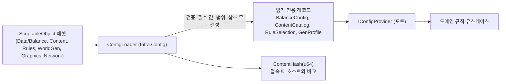

- 부록 C.1의 모든 설정값은 `BalanceConfig` 계열 애셋의 필드입니다. 코드에 숫자를 직접 쓰지 않습니다(상수 금지 검사: 코드 리뷰 체크 항목).
- 콘텐츠(아이템, 자원 종류와 타격 횟수·최소 도구 등급·드롭 표, 제작법, 건축물, 생물, 웨이브 구성, 작물, 요리법, 버프, 스킬 노드, 목표, 업적, 해금 조건)는 정의 애셋 하나에 한 항목입니다. 각 정의는 **문자열 키**(예: `item.wood_ash`)를 갖고, 로더가 키를 정렬해 `ContentId`를 붙입니다.
- 화면 이름은 정의에 텍스트 키만 두고 실제 글자는 String Table에 둡니다(NFR-034). 이름을 바꿀 때 코드·정의를 고치지 않습니다.
- `ContentHash`: 모든 정의의 키와 값의 직렬화 요약값. 호스트와 다르면 「게임 버전 불일치」로 참가를 거부합니다(PC마다 데이터가 달라 생기는 동기화 오류 방지).
- 생성에 영향을 주는 설정은 `GenProfile`에만 두고 생성기 버전에 묶습니다(3.11.1).
- 설정값을 바꿔 빌드하면 동작이 바뀌는지 확인하는 시험(NFR-033 표본 10개)은 EditMode 시험에서 가짜 `IConfigProvider`로 합니다.

#### 3.7.8 경험치 이벤트 (DES-025, DES-068, NFR-046)

```
record ActionCompleted(ActionType Type, PlayerId Player, ContentId Target, int Amount = 1)
// 발행 위치: 명령 처리기가 상태를 확정한 직후(호스트에서만). 거부된 요청은 발행하지 않음(FR-098 수용 기준)
//   벌목 → 나무 쓰러짐 확정, 채광 → 광석 파괴 확정(석탄 광맥 포함), 채집 → 손 채집 확정, 제작 → 결과물 지급(손 제작·제작대 모두),
//   가공(v0.6, SRS v0.8 NFR-046에 포함) → 용광로가 결과물 1개(제련품·숯)를 만든 시점. 받는 사람 = `ISmeltXpRecipientRule`(C-66, 잠정: 재료를 투입한 플레이어)
//     (그 플레이어가 접속하지 않았어도 이벤트는 대상 SteamID로 기록. M8 경험치 반영 방식은 C-06 결정 때 확인)
//   건축 → 배치 확정, 처치 → 적 체력 0(마지막 타격자), 사냥 → 동물 체력 0, 심기, 수확, 요리 → 요리 지급
// M3~M7: ActionEventRecorder 구독 → 플레이어·종류별 개수 집계(메모리), 개발 로그, 시험용 조회
// M8:    ProficiencyService 구독 → 행동 경험치 표로 경험치 → 레벨업 → 스탯 포인트 (기능 코드 수정 없음)
```
- 시험: 각 마일스톤 완료 때 그 마일스톤의 행동마다 이벤트가 1회씩 나오는지 확인하는 EditMode 시험을 추가합니다(NFR-046 수용 기준).
- **소급 없음(확정, 사용자 결정 2026-11-02)**: M3~M7의 이벤트 집계는 월드 파일에 저장하지 않습니다. M8 도입 전에 한 행동은 경험치로 바뀌지 않습니다.

#### 3.7.9 입력·다국어·접근성·그래픽 처리 위치

| 주제 | 설계 | 요소 |
|---|---|---|
| 입력 | Unity Input System. Input Actions 애셋 하나에 제어 체계 2개(`KeyboardMouse`, `Gamepad`). 재설정은 `PerformInteractiveRebinding`, 저장은 제어 체계별 바인딩 덮어쓰기 JSON을 따로(FR-117). 같은 체계 안 충돌 검사 후 「비우기/취소」. 마지막 입력 장치 감지(`InputUser.onChange`, 제어 체계 전환)로 `InputDeviceContext` 갱신 → 안내 아이콘 교체(FR-166, NFR-002). UI Toolkit 내비게이션으로 모든 메뉴를 게임패드로 이동. **v0.7: 기본 바인딩은 STORYBOARD 2.4의 기본 할당표(키보드·마우스 + Xbox 패드)를 그대로 따름. 안내 아이콘은 Xbox 계열을 먼저(M1), PlayStation 계열은 M2(C-28 해소)** — 아이콘 묶음은 장치 계열별 데이터라 추가해도 코드 변경 없음. v0.4: 손목 계기 올림/내림 Action `ToggleWrist` 추가(키보드·게임패드 기본 할당은 결정 대기. 동작 방식은 `WristRaiseMode` 기본 토글 / 옵션 누르는 동안, C-58 해소) | DES-092 |
| 게임패드 글자 입력 | `ITextInputService` → Steam 화면 키보드 | DES-102 |
| 다국어 | Unity Localization 패키지 String Table(ko, en). 도메인·애플리케이션은 텍스트 키와 인자만 다루고, 문장 조립은 받는 PC의 언어로(알림도 키 + 인자로 전송). 빌드 전 검사: 모든 키가 두 언어에 있는지(누락 0건, NFR-044). 첫 실행 언어(C-48 해소): 사용자 설정에 언어가 없을 때 Localization 초기화 단계에서 `SteamApps.GetCurrentGameLanguage()`(Steam 언어)를 읽어 한국어면 한국어, 그 밖은 영어로 정하고 사용자 설정에 저장 | DES-093, DES-102 |
| 사용자 입력 글자 | 채팅·월드 이름·Steam 이름은 리치 텍스트 해석 끔(UI Toolkit `enableRichText = false`), 제어 문자 제거는 호스트에서(NFR-050) | DES-034, DES-091 |
| 글자 크기 | 루트 USS 클래스(`text-small/normal/large`)가 글자 크기 배율 변수를 바꿔 일괄 변경. **M1 UI부터** 모든 글자 크기는 배율 변수로만 지정(3.7.10) | DES-095, DES-091 |
| 색각 보정 | 월드 화면: HDRP 사용자 지정 후처리(색 변환 행렬, DES-114). UI: 색 토큰 + 모양·아이콘 병행 규칙으로 색 없이도 구분(FR-130 수용 기준), **M1 UI부터** 적용(3.7.10) | DES-095, DES-091 |
| 흔들림·섬광 | 카메라 흔들림 세기 배율, 섬광 제한기(1초 창에서 큰 밝기 변화 3회 초과 연출을 완화) | DES-095 |
| 그래픽 | 프리셋 데이터 → HDRP 품질 단계 + 세부 값, 세부 변경 시 「사용자 지정」. HDRP 호출은 `Game.Infra.Rendering`에서만(3.4.4) | DES-109, DES-114 |

#### 3.7.10 UI 공통 기반 (v0.3, 디자인 결정 2026-11-02)

| 결정 | 설계 | 요소 |
|---|---|---|
| **I-04 접근성 기반을 M1 UI부터** | 공통 USS 파일 하나(`UI/Common/Base.uss`)에 (1) **글자 크기 배율** 변수(`--text-scale`, 글자 크기는 `기본값 × 배율`로만 지정, 고정 px 금지), (2) **색 토큰** 변수(`--color-bg`, `--color-surface`, `--color-text`, `--color-ally`, `--color-enemy`, `--color-warning`, `--color-danger` 등 — 화면에서 색 값 직접 사용 금지), (3) **모양 구분 규칙**(동료·적·경고·핑 등 색으로 구분하는 정보는 반드시 아이콘·모양·글자 중 하나를 함께 씀)을 둡니다. M1의 개발용 최소 화면(로비·접속·HUD 스태미나·성능 표시)부터 이 기반 위에 만들어 M2-01(글자 크기 옵션)·M5-08(색각 보정)·M6-08(글자 크기 재검증)에서 화면을 고치지 않게 합니다. 규칙 위반(고정 글자 크기, 직접 색 값)은 USS 검사 시험과 코드 리뷰 항목으로 찾습니다 | DES-091, DES-095 |
| **I-12 다크 단일 테마** | 색 토큰은 다크 테마 한 벌만 정의합니다. 테마 전환 구조(테마 선택 옵션, 토큰 세트 교체)는 만들지 않습니다. 색각 대응은 테마 교체가 아니라 모양 구분 규칙(UI)과 후처리(월드 화면)로 합니다 | DES-091 |
| **I-07 화면을 열어도 게임은 멈추지 않음** | 3.10.7 | DES-091, DES-052 |
| **디자인 결정 D-06 독립 레시피북** | 제작 화면은 키(게임패드 버튼)로 여는 독립 화면입니다(설계 근거 D-06 「서버 틱」과 다른, DESIGN_PROPOSAL의 결정 번호). 화면 열기는 `OpenRecipeBook(source)` 하나로 받습니다. **v0.6(C-11 해소, FR-173·FR-174)**: `source = Hotkey`(키로 열기)는 **열람 + 손 제작만** 가능하고 제작대가 필요한 항목은 「제작대 필요」로 표시합니다. `source = Station(entityId)`(제작대 상호작용)는 같은 화면을 팝업으로 열고 모든 항목을 제작할 수 있습니다. 판정은 확정 규칙 `CraftingStationRules`(3.7.6). `Craft` 명령에 제작대 id가 붙고 호스트가 거리·존재를 검증합니다 | DES-091, DES-058, DES-033 |

#### 3.7.11 HUD 구조: 장치형 기본 + 일반 HUD 옵션 (v0.4, 사용자 결정 2026-11-02)

두 HUD 방식은 **같은 HUD 뷰모델(DES-074)** 을 보고, 표시 방식(`IHudPresenter`)만 갈아 끼웁니다. 일반 HUD의 부품(상태 막대, 위협 표시, 버프 시간, 목표 한 줄, 동료 항목)은 UXML 템플릿으로 만들고, 장치형 HUD의 손목 계기 화면도 같은 템플릿을 씁니다.

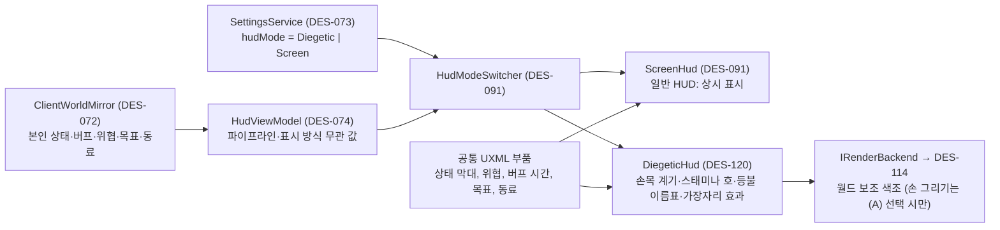

| 정보 | 장치형(기본) | 일반 HUD(옵션) |
|---|---|---|
| 체력·허기·갈증·피로 | 왼쪽 손목 계기(내림: 요약 표시, 올림: 수치 전체) | 화면 상시 막대 |
| 위협 상태·버프 남은 시간·목표 한 줄 | 손목 계기를 올렸을 때 | 화면 상시 |
| 스태미나 | 달리거나 소모할 때 십자선 둘레 호 | 같은 호 또는 막대(STORYBOARD) |
| 동료 | 머리 위 등불 이름표(체력 단계) | 이름표 + 동료 목록(FR-160) |
| 위협 | 시야 가장자리 효과 | 같은 효과 + 위협 아이콘 |

- **손목 계기 그리기 방식**: 계기 화면 내용은 UI Toolkit 패널을 **렌더 텍스처**(`PanelSettings.targetTexture`, 512²~1024², 설정값)로 그립니다. 손목 화면은 보여 주기만 하고 입력을 받지 않으므로 월드 공간 입력 처리가 필요 없습니다. 패널은 값이 바뀔 때만(최대 10 Hz) 다시 그립니다. 일반 HUD와 같은 UXML·USS를 쓰므로 글자 크기 배율·색 토큰(NFR-056)이 그대로 적용됩니다.
- **표시 면(`IWristSurface`) — 사용자 결정 2026-11-02: (B)로 시작**
  - (B) **화면 공간 기울인 평면 — 기본 구현, M2에서 만듦**: 같은 렌더 텍스처를 화면 왼쪽 아래에 원근 기울임을 준 평면으로 그리고, 올림/내림은 평면 위치·각도 보간으로 합니다. UI Toolkit 자체 변형은 2D(회전·크기·이동)만 지원하므로, 평면은 UI Toolkit 사용자 지정 메시(`generateVisualContent`로 렌더 텍스처를 입힌 사다리꼴, 어색하면 격자로 나눔)로 그립니다. UI 오버레이에서 끝나므로 **HDRP에 의존하지 않고 업스케일링 뒤에 그려져 흐려지지 않습니다**.
  - (A) **3D 손목 소품 — 교체 지점만 남김, 구현하지 않음**: 손목 옛 등광 계기 메시 재질에 같은 렌더 텍스처를 붙이고 손 애니메이션으로 올림/내림. 1인칭 손 그리기 패스(DES-114)와 소품 아트가 필요합니다. **M6 수직 슬라이스에서 (A)로 올릴지 사용자가 결정**합니다(M6-11).
  - 두 방식 모두 렌더 텍스처를 쓰므로 R-18(UI Toolkit 월드 공간 제약) 재검토는 필요 없습니다. 화면 내용·뷰모델이 같아 (A)로 바꿔도 표시 면 구현만 추가하면 됩니다.
- 대안으로 UI Toolkit의 월드 공간 패널 기능, uGUI 월드 공간 캔버스를 검토했으나 렌더 텍스처 방식을 기본으로 합니다(D-21). Unity 6000.3의 UI Toolkit 월드 공간 지원 범위는 **확인 필요**이며, 기본안에는 필요 없습니다.
- **레이어 순서(STORYBOARD v1.2)**: 월드 화면 → (월드 보조 색조, Volume) → 손목 계기 패널(불투명도 0.88 등 배치·수치는 STORYBOARD) → 피격 호·위협 테두리 → 다른 창. 손목 계기가 UI 오버레이이므로 계기 위에 그려야 하는 피격 호·위협 테두리는 UI Toolkit 요소로 그립니다(DES-120). HDRP를 쓰는 것은 월드 보조 색조(와 (A)를 고를 경우의 1인칭 손 그리기)뿐이며 `IRenderBackend`를 거쳐 DES-114에서만 다룹니다(3.4.4).
- **크기 기준**: 화면 배치 수치(계기 왼쪽 아래 폭 430px, 글자 「크게」 540px, 중앙 약 600×440px 비움)는 1920×1080 기준 UI 좌표로 보고, PanelSettings를 「화면 크기에 맞춰 크기 조절」(기준 해상도 1920×1080)로 둡니다. 계기 렌더 텍스처는 화면에 그려질 크기 이상(「크게」 540px 폭을 감당하도록 기본 1024 폭, 4K에서는 2048)으로 잡아 확대 흐림을 막습니다(R-22).
- **자동 내림 시간(결정 대기, STORYBOARD v1.2)**: 토글로 올린 손목을 일정 시간 뒤 자동으로 내릴지는 설정값 `손목 자동 내림 시간`(0 = 자동으로 내리지 않음)으로 둡니다. 기본값은 결정 뒤 데이터로 정하며 구조 변경은 없습니다.
- 머리 위 등불 이름표: 등불은 3D 소품·효과(DES-120), 이름 글자는 기존 화면 좌표 투영 이름표(DES-097)를 등불 위치에 붙입니다. 체력 단계(사용자 결정 2026-11-02): 살아 있는 동안 **4단계**(76% 이상 / 51~75% / 26~50% / 25% 이하) + **꺼짐**(쓰러짐). 단계 수는 설정값 `이름표 체력 단계 수`(기본 4)이고 경계는 균등 분할로 계산합니다.
- **NFR-001 「표시되고 있는 동안」**: 뷰모델은 표시 여부와 관계없이 항상 최신 값을 가집니다. 표시 중인 요소(손목을 올렸을 때의 수치, 일반 HUD 막대 등)는 값이 바뀐 뒤 0.5초 안에 갱신합니다.
- **HUD 방식 전환(FR-171)**: 옵션에서 바꾸면 재시작 없이 `HudModeSwitcher`가 표시 방식을 교체합니다. 사용자 설정(NFR-047)에 저장하며 기본값은 장치형입니다.
- **손목 올림/내림(FR-172)**: `ToggleWrist` 입력 → 올림 애니메이션 → 수치 전체 표시. 손목 올림은 창이 아니라 **HUD 상태**이므로 이동·시점 조작을 유지하고, 다른 창(인벤토리·레시피북 등)이 열리면 자동으로 내립니다. 올림 방식은 사용자 옵션 `WristRaiseMode`로 **기본 토글**, 옵션 「누르는 동안」입니다(C-58 해소). 올린 동안에도 **모든 행동이 가능**하며 행동 제한 규칙은 없습니다(C-59 해소, 확정 규칙). 서버 시뮬레이션·네트워크·시각은 계속 진행합니다(3.10.7). 손목 상태는 다른 플레이어에게 보이는 애니메이션으로만 공유할지 정하지 않았으므로, 이번 버전에서는 로컬 표시만 합니다.
- 요리 솥 화면은 「솥 도식 + 목록」으로 배치가 바뀌었지만, 받는 데이터(요리 가능 목록, 연결된 기구 상태, 3.11.16)는 같아 설계 변경이 없습니다.

### 3.8 구조 관점

#### 3.8.1 저장소 배치 결정
**Unity 프로젝트를 저장소의 하위 폴더 `src/`에 둡니다.** 저장소 루트는 git 루트이며 `docs/`, `.claude/`, `CLAUDE.md`가 `src/`와 나란히 있습니다. Unity Hub에서는 `src/` 폴더를 프로젝트로 엽니다.
- CLAUDE.md 기본값 `src/`와 같아 다른 에이전트(developer, code-reviewer, test-engineer)가 별도 안내 없이 코드 위치를 찾습니다.
- Unity가 루트에 만드는 `Library/`, `Temp/`, `Logs/`, `UserSettings/`, `*.sln`, `*.csproj`가 문서·에이전트 설정과 섞이지 않습니다.
- Unity는 프로젝트 폴더 안의 `Assets/`, `Packages/`만 가져오므로 `docs/`가 Unity 가져오기(.meta 생성) 대상이 되지 않습니다.
- 대안(저장소 루트 = Unity 프로젝트)과 비교는 5장 D-01.

#### 3.8.2 폴더 구조

```
/ (git 루트)
├─ CLAUDE.md
├─ .claude/
├─ docs/                                  SRS, SDD, 디자인, 테스트 문서, 측정 보고서(docs/test/perf/)
├─ .gitignore                             src/Library, src/Temp, src/Logs, src/UserSettings, src/Builds, *.csproj, *.sln
├─ .gitattributes                         Git LFS: *.fbx *.png *.tga *.psd *.wav *.exr *.asset(대용량 지형 데이터) 등. YAML 애셋의 `merge=unityyamlmerge` 지정은 남아 있으나 드라이버를 git 설정에 등록하지 않아 git 기본 병합으로 동작하고, 충돌 시 `git mergetool`로 UnityYAMLMerge 실행(M1-01 (4))
└─ src/                                   ← Unity 프로젝트 루트 (Unity 6000.3.27f2)
   ├─ Packages/manifest.json              패키지·버전 고정 (NFR-049, D-03)
   ├─ ProjectSettings/
   └─ Assets/
      ├─ _Game/
      │  ├─ Code/
      │  │  ├─ Domain/                    Game.Domain.asmdef
      │  │  │  ├─ Common/                 PlayerId, ContentId, Result, ReasonCode, DomainEvent
      │  │  │  ├─ Players/  Vitals/  Life/  Items/  Resources/  Crafting/  Building/
      │  │  │  ├─ World/                  WorldClock, PurifiedZoneSet, RegionMap, WorldSettings, Difficulty
      │  │  │  ├─ Defense/  Creatures/  Combat/  Farming/  Cooking/  Buffs/  Threats/
      │  │  │  ├─ Progression/            ActionCompleted, Proficiency, Unlocks, Objectives, Story, Tutorial
      │  │  │  ├─ Session/                SessionRules, SessionAccess, BanList
      │  │  │  ├─ Text/                   TextRules
      │  │  │  └─ Rules/                  규칙 교체 지점 인터페이스와 잠정 구현 (DES-033)
      │  │  ├─ WorldGen/                  Game.WorldGen.asmdef
      │  │  │  ├─ Common/                 DetMath(고정소수점, 해시, 난수, 노이즈) — 추가만 허용, 기존 함수 수정 금지
      │  │  │  ├─ Layout/                 WorldLayout 모델(고정 큰 배치)
      │  │  │  ├─ Validation/             GenerationValidator, 재생성 정책
      │  │  │  ├─ Hashing/                WorldHasher
      │  │  │  ├─ V0/                     M1 시험용 생성기 (출시 전 삭제 가능)
      │  │  │  └─ V1/ (V2/ ...)           버전별 생성기. 공개 배포 후 동결
      │  │  ├─ Application/               Game.Application.asmdef
      │  │  │  ├─ Ports/  Commands/  Server/  Replication/  Session/  WorldLifecycle/
      │  │  │  ├─ Gameplay/               채집·제작·건축·생존·방어전·전투·농사·요리·위협·숙련도
      │  │  │  ├─ Ai/                     AiScheduler, SpawnDirector
      │  │  │  ├─ Client/                 ClientSession, ClientWorldMirror
      │  │  │  └─ Settings/
      │  │  ├─ Adapters/
      │  │  │  ├─ Net/                    Game.Adapters.Net.asmdef (Messages/, Gateway/, Replication/, Avatar/, Join/)
      │  │  │  ├─ Presentation/           Game.Adapters.Presentation.asmdef
      │  │  │  │  ├─ Player/  World/(Terrain, Resources, Creatures, Lighting)  Interaction/
      │  │  │  │  ├─ UI/                  Screens/, Hud/(Common/ 공통 부품, Screen/ 일반 HUD, Diegetic/ 손목 계기·스태미나 호·등불 이름표), Presenters/
      │  │  │  │  ├─ Input/  Localization/  Audio/  Accessibility/
      │  │  │  └─ Persistence/            Game.Adapters.Persistence.asmdef (Codec/, Chunks/, Migrations/, Store/)
      │  │  ├─ Infrastructure/
      │  │  │  ├─ Steam/                  Game.Infra.Steam.asmdef
      │  │  │  ├─ Transport/              Game.Infra.Transport.asmdef
      │  │  │  ├─ AiJobs/                 Game.Infra.AiJobs.asmdef
      │  │  │  ├─ Config/                 Game.Infra.Config.asmdef (ScriptableObject 클래스, 로더)
      │  │  │  ├─ Platform/               Game.Infra.Platform.asmdef (Logging/, Crash/, Telemetry/, Settings/, Tasks/)
      │  │  │  └─ Rendering/              Game.Infra.Rendering.asmdef (HdrpRenderBackend, Graphics/, Upscaling/, PostProcess/) — HDRP 의존 코드는 여기만
      │  │  ├─ Bootstrap/                 Game.Bootstrap.asmdef (CompositionRoot, SceneFlow, DevTools/)
      │  │  └─ Editor/                    Game.Editor.asmdef (에디터 전용: BuildCommands, BuildArtifactInspector, ProjectConfigurator, 씬·애셋 생성 스크립트)
      │  ├─ Data/                         ScriptableObject 애셋 (코드 아님)
      │  │  ├─ Balance/                   부록 C.1 설정값 묶음
      │  │  ├─ Content/                   Items/, Resources/, Recipes/, Buildings/, Creatures/, Waves/, Crops/, Cooking/, Buffs/, Skills/, Objectives/, Achievements/
      │  │  ├─ Rules/                     규칙 교체 지점 선택값
      │  │  ├─ WorldGen/Profiles/V1/      생성 프로필(생성기 버전에 묶여 동결)
      │  │  ├─ Graphics/                  그래픽 프리셋 4종 + 기준 프리셋 지정
      │  │  └─ Network/                   틱·관심 범위·AI 주기 튜닝
      │  ├─ Localization/                 String Table(ko, en), 글꼴
      │  ├─ Art/  Audio/  Prefabs/  Materials/  VFX/
      │  ├─ Scenes/                       Boot, MainMenu, World, Bench
      │  ├─ UI/                           UXML, USS (화면 배치는 ui-ux-designer 결과를 따름)
      │  └─ Settings/                     HDRP 애셋(품질 단계별), Volume 프로필, Input Actions
      ├─ ThirdParty/
      │  ├─ FishNet/                      FishNet 4.7.4R (자체 asmdef: FishNet.Runtime, GameKit.Dependencies, Synapse, Unity.FishNet.CodeGen, MonoFN.Cecil)
      │  └─ FishySteamworks/              FishySteamworks 4.1.1 (FishySteamworks.asmdef)
      └─ Tests/
         ├─ EditMode/                     Domain/(Game.Tests.Domain), Application/(Game.Tests.Application), Infrastructure/(Game.Tests.Infrastructure), Architecture/(Game.Tests.Architecture). 계획: WorldGen/(Game.Tests.WorldGen, 골든 해시, M1-04), Persistence/(Game.Tests.Persistence, M3-08)
         └─ PlayMode/                     Integration/(Game.Tests.Integration, 루프백 호스트+클라이언트)
```

#### 3.8.3 이름 규칙
- 네임스페이스는 어셈블리 이름과 같게 시작합니다(`Game.Domain.Items`).
- 순수 C# 어셈블리 안의 클래스는 `MonoBehaviour`, `ScriptableObject`를 상속하지 않습니다.
- ScriptableObject 클래스 이름은 `…Def`(콘텐츠 하나) / `…Config`(설정값 묶음) / `…Profile`(생성 프로필)로 끝냅니다.
- 생성기 버전 폴더(`V1/`)의 클래스는 `V1` 접두사 또는 네임스페이스로 구분해 다른 버전과 이름이 겹치지 않게 합니다.

### 3.9 상호작용 관점

#### 3.9.1 새 월드 만들기와 세션 열기 (참가 조건 포함, SRS v0.3)

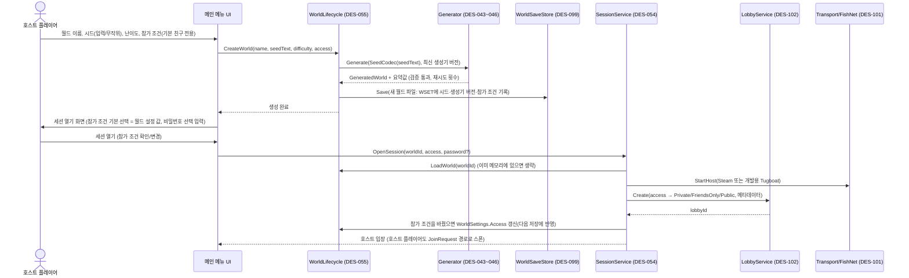

- 기존 월드를 열 때도 같은 화면에서 참가 조건 기본값은 그 월드에 저장된 값입니다. 세션 중 변경(FR-144)은 `ChangeAccess` 호스트 명령 → 로비 유형·리치 프레즌스 갱신 → 월드 설정 갱신 순입니다.
- 게임 안 행동 권한(SUG-018)은 보류이므로 참가 조건은 「누가 들어올 수 있는가」만 정합니다.

#### 3.9.2 중도 참가 (시드 → 로컬 생성 → 요약값 비교 → 바뀐 상태 적용)

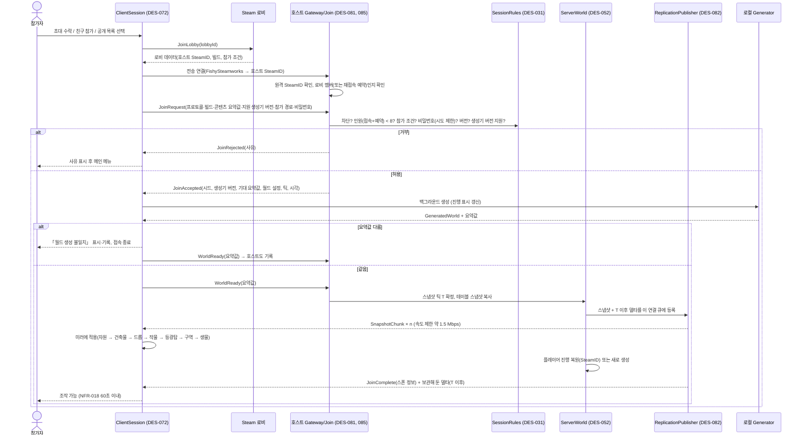

#### 3.9.3 자원 타격 → 쓰러짐 → 드롭 → 경험치 이벤트

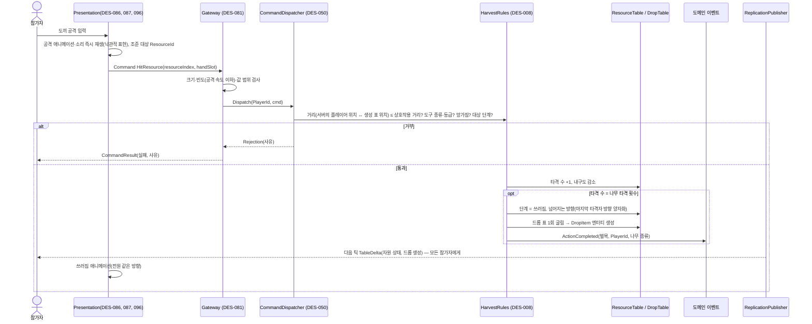

- 여러 명이 같은 나무를 때려도 호스트가 명령을 도착 순서대로 하나씩 처리하므로 쓰러짐·드롭은 한 번만 일어납니다(FR-051).

#### 3.9.4 자동 저장 (원자적 교체)

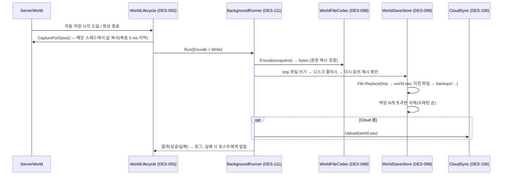

#### 3.9.5 등광탑 활성화 → 준비 단계 → 방어전 → 정화

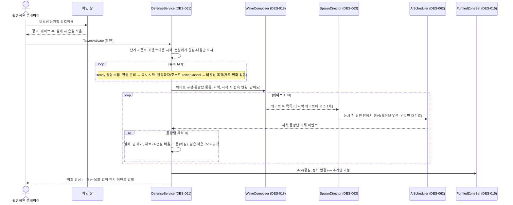

#### 3.9.6 재접속 (FR-115)

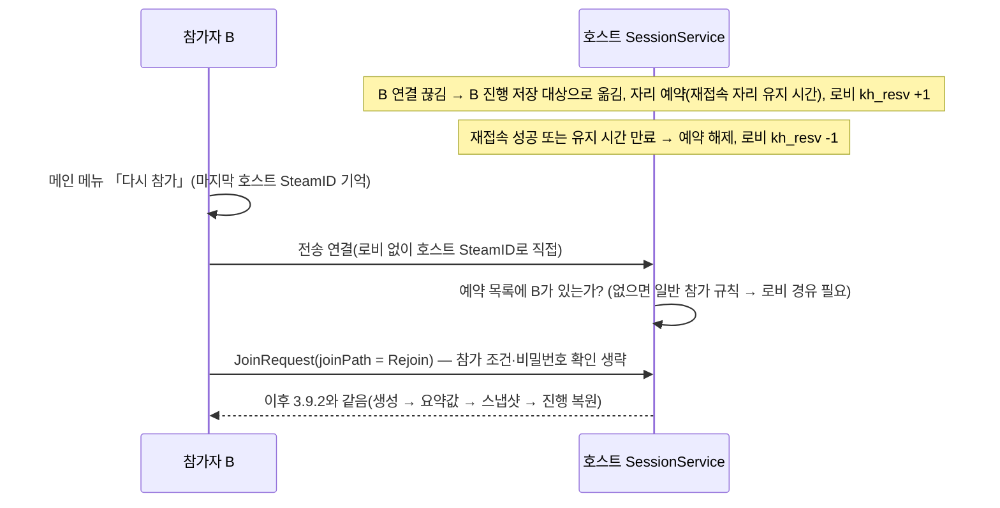

#### 3.9.7 호스트 종료 예고 (FR-116)

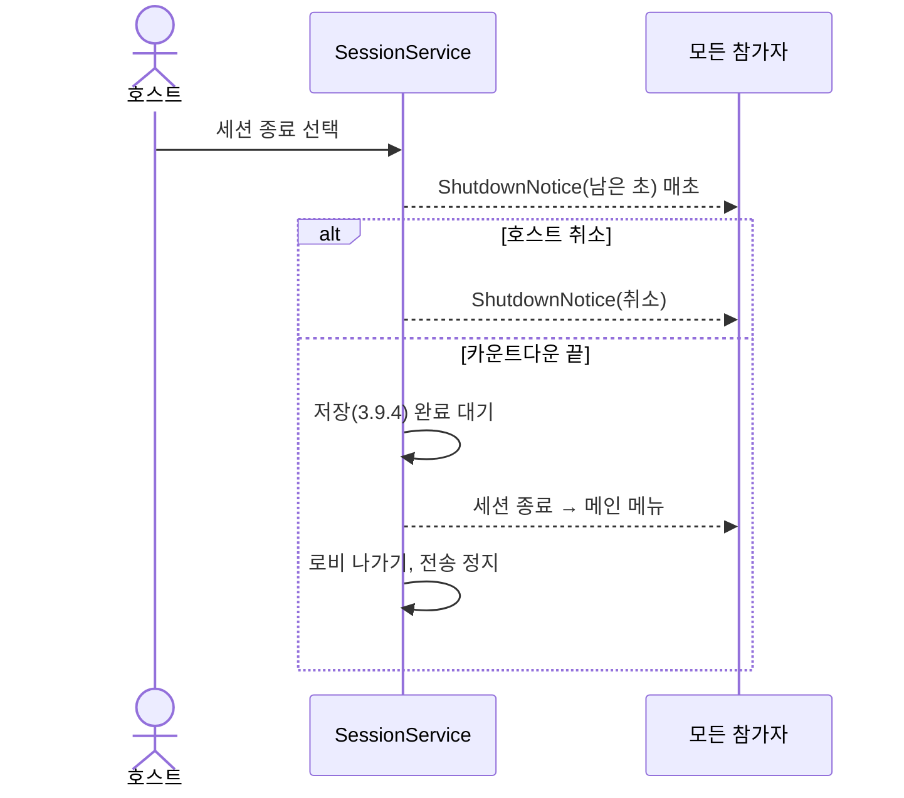

### 3.10 상태 동적 관점

#### 3.10.1 클라이언트 세션 상태

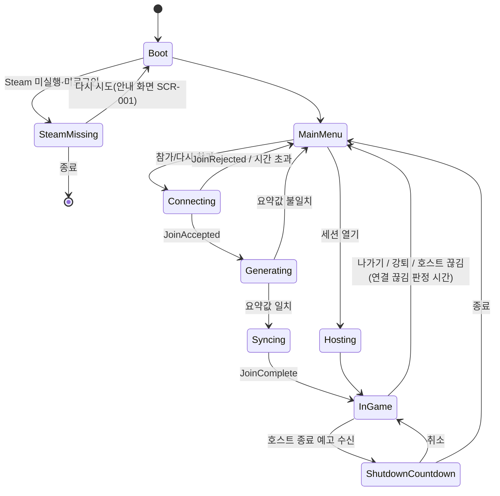
- **Steam 실행 필수(v0.7, SRS v0.9)**: 1인 플레이도 Steam이 실행·로그인된 상태에서만 합니다(1인 세션도 호스트 세션과 같은 경로). Steam이 없으면 부트에서 안내 화면(SCR-001)만 보이고 메인 메뉴로 가지 않습니다. 개발 빌드의 Tugboat 같은 PC 시험만 예외입니다(3.7.4).

#### 3.10.2 플레이어 생명 상태

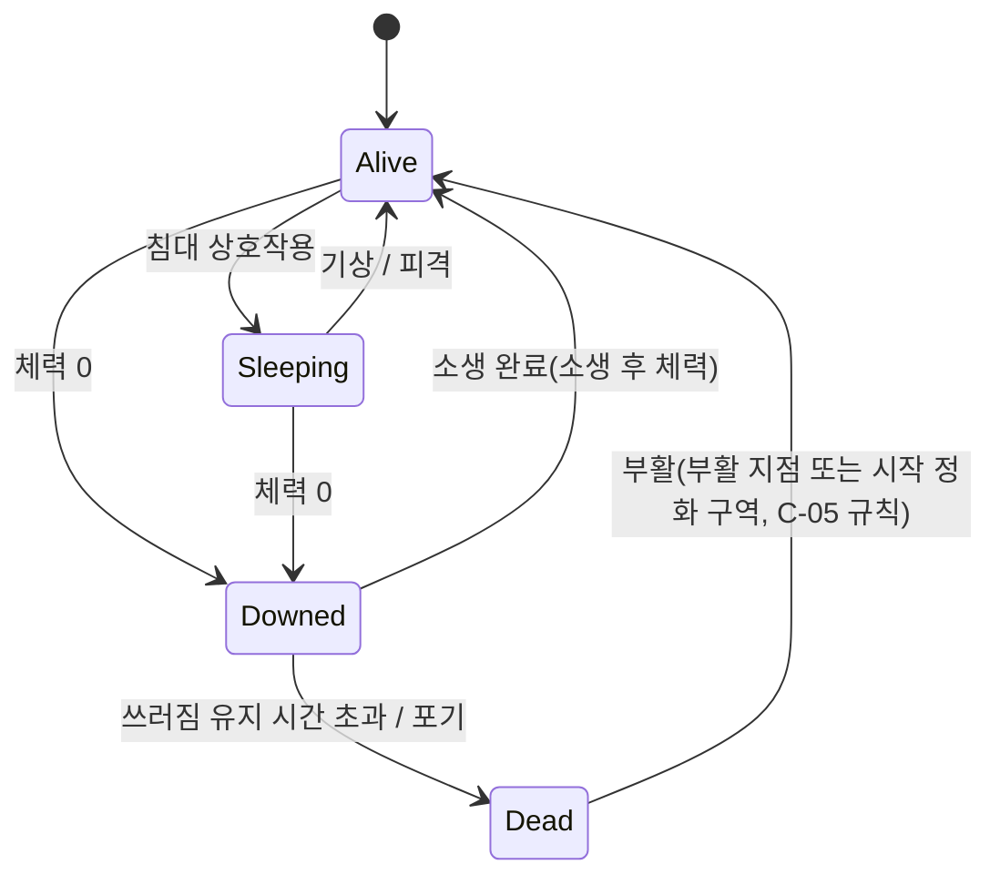

#### 3.10.3 등광탑과 방어전

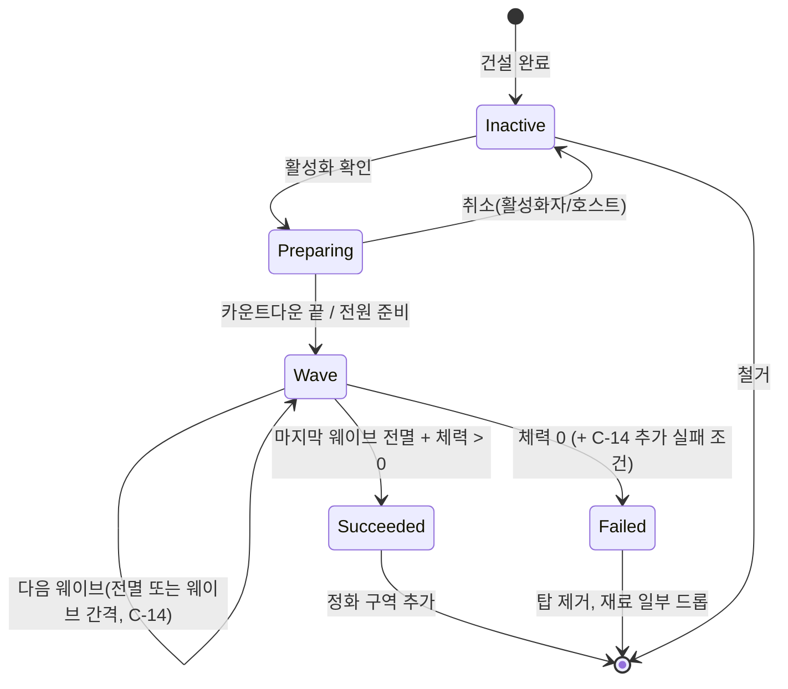

#### 3.10.4 자원 오브젝트

```mermaid
stateDiagram-v2
    [*] --> Pristine: 생성(델타 없음)
    Pristine --> Damaged: 타격
    Damaged --> Damaged: 타격(타격 수 < 필요 횟수)
    Damaged --> Felled: 나무 마지막 타격
    Damaged --> Broken: 광석 마지막 타격
    Pristine --> Harvested: 손 채집(E)
    Felled --> Pristine: 재생성(C-08, 결정 시)
    Broken --> Pristine: 재생성(C-08)
    Harvested --> Pristine: 재생성(C-08)
```

#### 3.10.5 작물

```mermaid
stateDiagram-v2
    [*] --> Growing: 심기
    Growing --> Paused: 물 없음 / 햇빛 조건 불충족
    Paused --> Growing: 조건 회복
    Growing --> Harvestable: 생장 누적 ≥ 생장 시간
    Harvestable --> [*]: 수확(제거)
    Harvestable --> Growing: 수확(다시 자라는 작물)
```

#### 3.10.6 생물(적) AI

```mermaid
stateDiagram-v2
    [*] --> Idle
    Idle --> Seek: 대상 발견(탐지 거리) / 웨이브 배정
    Seek --> Attack: 공격 사거리 안
    Attack --> Seek: 대상 이탈
    Seek --> HoldAtBoundary: 다음 칸이 정화 구역
    HoldAtBoundary --> Seek: 대상이 경계 밖으로 나옴
    HoldAtBoundary --> Idle: 대기 시간 초과(C-20)
    Seek --> Repelled: 광원 반경(C-19)
    Repelled --> Seek: 광원 퇴치 지속 시간 끝
    Seek --> Idle: 대상 상실
    Attack --> Dead: 체력 0
    Seek --> Dead: 체력 0
    Dead --> [*]
```

#### 3.10.7 UI 상태와 게임 진행의 분리 (I-07, SRS v0.5 3.2 공통 규칙)

**어떤 화면을 열어도 게임은 멈추지 않습니다. 1인 세션도 같습니다**(1인 일시정지 SUG-027은 보류).

```mermaid
stateDiagram-v2
    [*] --> Gameplay
    Gameplay --> Overlay: 인벤토리·레시피북·지도·보관함·옵션·채팅 등 화면 열기
    Overlay --> Overlay: 다른 화면으로 전환
    Overlay --> Gameplay: 닫기
    note right of Overlay
        로컬 입력 경로만 바뀜
        서버 틱·AI·네트워크·월드 시각은 계속 진행
    end note
```

- UI 상태(`Gameplay`/`Overlay`)는 **로컬 입력 경로만** 바꿉니다. 화면이 열려 있는 동안 이동·시점·공격 입력은 막고 UI 입력을 받습니다.
- `ServerWorld` 틱(DES-052), AI(DES-062), 복제(DES-082), 월드 시각, 상태 값 감소, 버프 시간은 UI 상태를 모릅니다. 애플리케이션 레이어에 「일시정지」 개념이나 API를 두지 않습니다.
- `Time.timeScale`을 바꾸지 않습니다. 메뉴 연출이 필요하면 UI 자체 시간(비스케일 시간)을 씁니다.
- 화면이 열려 있어도 플레이어 캐릭터는 월드에 남아 피해를 받고, 쓰러짐 등 상태 변화가 생기면 HUD 경고가 화면 위에 표시됩니다(배치는 STORYBOARD).
- 화면을 연 상태에서 보내는 명령(예: 레시피북에서 제작, 보관함에서 꺼내기)은 다른 명령과 같은 검증 경로를 거칩니다.
- **손목 계기 올림(FR-172, v0.4)** 도 같은 원칙입니다. 손목을 올린 상태는 `Gameplay` 안의 하위 상태로, 모든 행동이 가능하고(C-59 해소) 게임 진행은 멈추지 않습니다. `Overlay`(다른 창)로 들어가면 손목은 자동으로 내려갑니다.

#### 3.10.8 용광로 (v0.6, FR-175~178)

```mermaid
stateDiagram-v2
    [*] --> Idle: 배치
    Idle --> Working: 재료 있음 + 연료(점수 또는 연료 칸) 충분 + 결과물 칸 여유
    Working --> Working: 1개 완료 → 다음 재료 시작
    Working --> StoppedOutputFull: 결과물 칸 가득
    Working --> StoppedNoFuel: 다음 작업에 필요한 연료 부족
    Working --> Idle: 재료 소진
    StoppedOutputFull --> Working: 결과물을 꺼냄
    StoppedNoFuel --> Working: 연료를 넣음
    Idle --> [*]: 철거(칸 내용 드롭)
```
- 상태 전이는 호스트 서버 틱에서만 일어납니다. 플레이어가 떠나도(관심 범위 300 m 밖, 접속 종료 포함) 연료가 있는 동안 계속합니다. 월드가 닫혀 있으면 서버 플레이 시간이 흐르지 않아 진행하지 않고, 밤 건너뛰기로도 앞당겨지지 않습니다(`IFurnaceTimeRule`, C-65 잠정).

### 3.11 알고리즘 관점

#### 3.11.1 결정론 원칙 (DES-040~047에 공통 적용)

| 위험 원인 | 대응 규칙 |
|---|---|
| 부동소수점 차이(CPU, 컴파일러 최적화, FMA, Mono/IL2CPP/Burst 차이) | 생성 코드는 **정수와 고정소수점만** 씀. `float`, `double`, `Math.Sin` 등 금지. 높이는 정수 mm, 좌표는 Q16.16, 각도는 16비트 회전 단위(1/65536 바퀴). 부동소수점 변환은 결과를 Unity에 넘길 때(표현)만 하고, 요약값 계산에는 쓰지 않음 |
| 병렬 처리 순서 | 병렬 작업은 **자기 칸에만 쓰기**(입력 읽기 전용, 출력 칸 고정). 합계·목록 합치기는 단일 스레드에서 고정 순서(지역 → 셀Z → 셀X → 슬롯)로. 침식처럼 이웃을 읽는 반복은 더블 버퍼 |
| 난수 호출 순서 | 상태를 가진 난수(`System.Random`, `UnityEngine.Random`) 금지. **카운터 기반 난수** `Rand(스트림 키, a, b, c)`만 사용. 스트림 키는 (월드 시드, 지역, 단계, 재시도 번호)에서 파생 → 지역·단계마다 독립 |
| 컬렉션 순서 | `Dictionary`·`HashSet` 순회 결과를 생성 결과에 쓰지 않음. 정렬된 배열만 사용. 정렬은 키가 같은 경우가 없게(동률은 ID로) |
| 문화권·플랫폼 의존 API | `string.ToUpper`, `Normalize`, `GetHashCode`, `DateTime` 금지. 시드 문자열은 UTF-8 바이트 그대로 해시 |
| Unity·라이브러리 버전 | 생성 코드는 UnityEngine·Burst·Unity.Mathematics를 쓰지 않는 순수 C# 어셈블리(`Game.WorldGen`). 엔진을 올리면 골든 해시 시험(DES-113)으로 확인 |
| 설정값 변경 | 생성에 영향을 주는 설정값(경계 최대 단차, 통행 가능 최대 경사, 검증 기준 등)은 **생성 프로필**에 두고 생성기 버전에 묶음. 바꾸려면 새 생성기 버전을 만듦 |
| Unity Terrain 변환 | 정수 높이 → `TerrainData.SetHeights`(float 0~1) 변환은 표현용. 자원 오브젝트의 높이(Y)도 정수 높이에서 계산해 생성 표에 저장하므로 PC 간 차이 없음 |

#### 3.11.2 시드 처리 (DES-041, FR-167)

```
// 입력: 사용자가 입력한 문자열 또는 「무작위」
func SeedFromText(text):
    t = TrimAsciiWhitespace(text)                 // 앞뒤 ASCII 공백만 제거. 대소문자 구분
    if t.Length == 0 or Utf8Length(t) > 64: return Error(InvalidSeed)
    return XXH64(Utf8Bytes(t), seed: SEED_SALT)   // XXH64는 자체 구현 고정(라이브러리 교체로 값이 바뀌지 않게)

func RandomSeedText():
    // 생성 시점에만 쓰므로 결정론 불필요. 혼동되는 글자(0/O, 1/I) 제외 32자 알파벳에서 10글자
    return 10 x Alphabet32[CryptoRandom() % 32]    // 예: "K7QM-2RTX-9B" 형식으로 표시(하이픈은 표시용, 해시에 미포함)
// 월드 파일에는 seedText와 seed(u64)를 함께 기록. 화면에는 seedText를 보여 주고 복사하게 함
```

#### 3.11.3 카운터 기반 난수와 정수 노이즈 (DES-040)

```
func Mix64(x):                                    // SplitMix64 마무리 함수, 모든 연산은 unchecked uint64
    x ^= x >> 30; x *= 0xBF58476D1CE4E5B9
    x ^= x >> 27; x *= 0x94D049BB133111EB
    x ^= x >> 31; return x

func StreamKey(worldSeed, regionId, stageId, attempt):
    return Mix64(worldSeed ^ Mix64((regionId << 48) | (stageId << 32) | attempt))

func Rand(key, a, b, c):                          // a, b, c = 정수 좌표·번호
    return Mix64(key ^ Mix64(a * 0x9E3779B97F4A7C15 + b * 0xC2B2AE3D27D4EB4F + c * 0x165667B19E3779F9))

func RandBelow(key, a, b, c, n):                  // [0, n) 정수, 나눗셈·실수 없음
    return (uint)(((Rand(key, a, b, c) >> 32) * (ulong)n) >> 32)

// 고정소수점 Q16.16 (int). 곱셈은 long 중간값 후 >> 16 (산술 시프트)
func LatticeQ15(key, ix, iz): return (int)(Rand(key, ix, iz, 0) >> 49) - 16384   // [-16384, 16383]
func Smooth(tQ16): t2 = (tQ16 * tQ16) >> 16; t3 = (t2 * tQ16) >> 16; return 3*t2 - 2*t3
func ValueNoise(key, xQ16, zQ16):
    ix = xQ16 >> 16; iz = zQ16 >> 16
    sx = Smooth(xQ16 & 0xFFFF); sz = Smooth(zQ16 & 0xFFFF)
    a = LatticeQ15(key, ix, iz);     b = LatticeQ15(key, ix+1, iz)
    c = LatticeQ15(key, ix, iz+1);   d = LatticeQ15(key, ix+1, iz+1)
    ab = a + (((long)(b - a) * sx) >> 16); cd = c + (((long)(d - c) * sx) >> 16)
    return ab + (((long)(cd - ab) * sz) >> 16)
func Fbm(key, xQ16, zQ16, octaves, gainQ16):
    sum = 0; amp = 1 << 16
    for o in 0 .. octaves-1:
        sum += (ValueNoise(Rand(key, o, 0, 0), xQ16 << o, zQ16 << o) * amp) >> 16
        amp = (amp * gainQ16) >> 16
    return sum
// 노이즈 종류(값/기울기/도메인 왜곡)는 구현 때 고르되 위 규칙(정수, 카운터 난수, 산술 시프트)을 지킨다
```

#### 3.11.4 월드 생성 파이프라인 (DES-043, FR-168)

```
func Generate(seed, genVersion, layout, profile, retryPolicy) -> GenResult:
    for attempt in 0 .. retryPolicy.MaxAttempts - 1:
        s = retryPolicy.SeedFor(seed, attempt)                     // 기본: attempt 0 = seed, 이후 Mix64(seed ^ attempt*K)
        w = new GeneratedWorld(layout)
        // 1) 높이: 큰 배치 높이 + 지역 내부 노이즈. 경계는 고정 폭 구간에서 정수 가중치로 섞음
        ParallelFor(tile in layout.Tiles):                          // 각 타일은 자기 칸만 기록
            for (x, z) in tile:
                r = layout.RegionAt(x, z); wts = layout.BlendWeightsQ16(x, z)   // 고정 데이터, 정수
                h = layout.MacroHeightMm(x, z)
                for (region, wt) in wts: h += (RegionHeightMm(StreamKey(s, region, H, attempt), region, x, z) * wt) >> 16
                w.Height[x, z] = h
        // 2) 침식: 열 침식 K회, 더블 버퍼(이웃 읽기 → 다음 버퍼 쓰기)
        for i in 0 .. profile.ErosionIterations-1:
            ParallelFor(row): next[row] = ThermalStep(cur, row, profile.TalusMm)
            swap(cur, next)
        // 3) 물: 거친 격자(8 m)에서 단일 스레드, 정해진 순서
        lakes  = FillDepressions(coarse(w.Height))                 // 우선순위 큐, 동률은 (z, x) 작은 쪽 먼저
        rivers = TraceRivers(StreamKey(s, *, RIVER, attempt), coarse, lakes, profile)   // 수원 후보를 고정 순서로 정렬해 차례로 하강
        ParallelFor(tile): CarveWater(w, rivers, lakes, tile)
        // 4) 경계 단차 보정: 지역 경계 1 m 구간에서 높이 차 > 경계 최대 단차면 정수 보간으로 완화
        ParallelFor(boundaryTile): SmoothBoundary(w, profile.MaxBoundaryStepMm)
        // 5) 고정 콘텐츠: 장막의 근원 높이 덮어쓰기, 시작 정화 구역 평탄화 (손으로 만든 데이터)
        StampFixed(w, layout)
        // 6) 자원 오브젝트: 셀(16 m)마다 고정 슬롯 수만큼 후보 → 규칙 필터
        ParallelFor(cell): cand[cell] = PlaceInCell(StreamKey(s, cell.region, RES, attempt), cell, w, profile)
        w.Resources = []
        for cell in SortedCells(region, cz, cx):                   // 고정 순서로 합침
            for c in cand[cell] (slot 오름차순):
                if c.valid: w.Resources.Add(c with Id = Pack(cell.region, cell.cx, cell.cz, c.slot))
        w.Resources.AddRange(layout.FixedResources)                 // 근원·시작 지점의 손 배치 자원(지역 7 대역 ID)
        SortById(w.Resources); AssignDenseIndex(w.Resources)        // 네트워크용 ResourceIndex
        // 7) 일반 등광탑 후보 자리: 지역별 후보 점수 계산(병렬) → 점수·ID 순 정렬 → 최소 간격 탐욕 선택(단일 스레드)
        w.TowerSites = PickTowerSites(w, StreamKey(s, *, SITE, attempt), profile)
        // 8) 검증
        report = Validate(w, profile.Criteria)                     // 3.11.6
        if report.Ok:
            w.Hash = ComputeHash(w, genVersion, seed, attempt)      // 3.11.5
            return GenResult(w, attempt, report)
        log(report.Reasons)
    return retryPolicy.OnExhausted(seed)                            // 기본(잠정): 실패 → UI가 다른 시드 요청 (C-55)

func PlaceInCell(key, cell, w, profile):
    out = []
    for slot in 0 .. profile.SlotsPerCell-1:                       // 슬롯 번호가 ID에 들어감 → 안정적
        jx = RandBelow(key, cell.cx, cell.cz, slot*4+0, CELL_MM); jz = RandBelow(key, cell.cx, cell.cz, slot*4+1, CELL_MM)
        p = cell.originMm + (jx, jz)
        type = profile.Biome(cell.region).PickType(RandBelow(key, cell.cx, cell.cz, slot*4+2, 65536), w.SlopeQ16(p), w.WaterDist(p), w.HeightMm(p))
        valid = type != None and not w.IsWater(p) and not layout.IsReserved(p) and SpacingOk(out, p, type)
        yaw = (ushort)RandBelow(key, cell.cx, cell.cz, slot*4+3, 65536)
        out.Add(Candidate(slot, type, p, w.HeightMm(p), yaw, scaleQ8 = profile.ScaleFor(type, slot), valid))
    return out
```

**석탄 광맥(v0.6, FR-179)**: 생성 프로필의 지역별 자원 종류 표(`Biome(region).PickType`)에 석탄 광맥을 추가합니다(분포 후보: 모든 생성 지역, C-64). 생성 알고리즘은 바뀌지 않지만 프로필 값이 바뀌므로 생성 결과가 달라집니다. 개발 중 생성기 0.x라 버전 보존은 필요 없고(3.11.7), 골든 해시 갱신과 결정론 재시험(이 PC Mono·IL2CPP 교차, 다른 CPU는 M6-10)을 합니다. 석탄은 생성 검증 대상(진행 재료, SRS v0.8)이므로 검증 조건(3)의 `지역별 진행 재료 최소 수량`에 석탄을 넣습니다. 나무로도 가공할 수 있어 석탄이 적어도 진행이 막히지는 않지만, 검증 기준을 밑돌면 다른 진행 재료와 같이 재생성 대상입니다.

생성 시간 목표(NFR-052, 25초 이하)를 맞추는 방법: 타일·셀 단위 `Parallel.For`(6코어 12스레드 사용), 높이 1 m 간격, 침식 반복 수와 거친 격자 크기는 생성 프로필 값. 생성은 백그라운드 스레드에서 돌고 메인 스레드는 진행 표시만 갱신합니다(응답 없음 방지).

#### 3.11.5 생성 결과 요약값 (DES-046, FR-169, NFR-053)

```
func ComputeHash(w, genVersion, seed, attempt):
    h = XXH64Stream(seed: HASH_SALT)
    h.Write("KHWG"); h.Write(genVersion); h.Write(seed); h.Write(attempt)
    regionHashes = []
    for tile in Tiles (고정 순서): h.Write(w.Height[tile] as int32 little-endian 배열)
    h.Write(w.WaterMask bytes)
    for r in w.Resources (Id 오름차순): h.Write(r.Id, r.Type, r.PosXmm, r.PosYmm, r.PosZmm, r.Yaw, r.ScaleQ8)
    for t in w.TowerSites (Id 오름차순): h.Write(t.Id, t.PosXmm, t.PosZmm, t.Kind)
    // 디버깅용: 지역별·타일별 부분 요약값도 같이 계산해 불일치 위치를 좁힘
    return (h.Digest(), perRegion, perTile)
```
- 참가자는 `JoinAccepted`의 기대 요약값과 자기 결과를 비교하고, 다르면 부분 요약값과 함께 로그에 남깁니다(FR-169).

#### 3.11.6 생성 결과 검증과 재생성 (DES-045, FR-170)

```
func Validate(w, c) -> Report:
    g = CoarseGraph(w, cellMm = c.ValidationCellMm /*8 m*/, maxSlopeQ16 = TanQ16(c.MaxSlopeDeg /*35°*/), waterBlocks = true)
    reasons = []
    // (1) 지역 순서대로 걸어서 갈 수 있음: 지역 1..k만 허용한 BFS로 지역 k+1 경계에 닿는지
    for k in 1 .. 4:
        if not BfsReaches(g, layout.StartCell, allowed = regions ≤ k, goal = BoundaryCells(k, k+1)): reasons.Add(UNREACHABLE(k → k+1))
    // (4) 시작 지점 → 장막의 근원 입구
    if not BfsReaches(g, layout.StartCell, allowed = all, goal = layout.VeilSourceEntry): reasons.Add(NO_PATH_TO_SOURCE)
    // (2) 등광탑 후보 자리 수
    for r in regions 1..4: if count(w.TowerSites in r) < c.MinTowerSites[r]: reasons.Add(FEW_SITES(r))
    // (3) 진행 재료 수량: 자원 종류별 드롭 기대 최소량(드롭 표 최소값) 합계
    for r in regions 1..4: for (mat, need) in c.MinMaterials[r]:
        if Σ MinYield(res, mat) for res in w.Resources in r < need: reasons.Add(FEW_MATERIAL(r, mat))
    return Report(reasons.Count == 0, reasons)
// BFS는 4-이웃, 큐는 FIFO, 이웃 방문 순서 고정 → 결과(도달 여부)만 쓰므로 순서와 무관
// 재생성 정책은 IGenRetryPolicy (C-55 교체 지점): 기본 DerivedSeedRetry(최대 16회), 대안 RejectSeed(첫 실패 즉시 거부)
```

#### 3.11.7 생성기 버전 관리 (DES-044, NFR-054)

```
registry = { 0: V0PrototypeGenerator (개발 전용), 1: V1Generator, 2: V2Generator, ... }
latest = max(registry.keys where released or devBuild)

func GeneratorFor(version):
    if version not in registry: return Error(GeneratorUnsupported)   // 참가 거부 「게임 버전 불일치」(FR-169)
    return registry[version]
// 새 월드: latest. 불러오기·참가: 월드 파일/JoinAccepted의 version
```
동결 규칙
1. 생성기 버전 N의 코드(`WorldGen/VN/`)와 생성 프로필(`Data/WorldGen/Profiles/VN/`)은 공개 배포 후 수정하지 않습니다. 버그 수정도 새 버전 N+1로 합니다.
2. `WorldGen/Common/`의 결정론 수학은 **추가만** 합니다. 기존 함수의 동작을 바꾸면 모든 버전의 골든 해시가 깨지므로 시험에서 바로 드러납니다.
3. 버전마다 골든 해시(시드 32개의 요약값)를 `Tests/EditMode/WorldGen/Golden/VN.json`에 두고 매 빌드 비교합니다.
4. **(확정, 사용자 결정 2026-11-02)** 개발 중 생성기는 `0.x` 개발 버전이며 보존하지 않습니다. 0.x로 만든 월드는 새 빌드에서 「지원하지 않는 개발 버전 월드」로 안내하고 열지 않습니다. **첫 공개 빌드(외부 테스트 빌드 포함)에 들어가는 생성기를 V1로 동결**하고, 그때부터 위 1~3 규칙을 적용합니다. 외부 테스트 빌드를 내보내기 전 점검표에 「생성기 버전 동결 확인」을 넣습니다.
5. 지원을 끝낼 버전이 생기면 업데이트 전에 옮기는 방법을 정합니다(NFR-054). 이 설계는 옮기는 도구를 미리 만들지 않습니다.

#### 3.11.8 엔터티 테이블 복제 (DES-053, DES-082)

```
class ReplicatedTable<TState>:
    dense: TState[]                 // 자원처럼 ID가 미리 정해진 경우 / 또는 Dictionary<EntityId, TState> (실행 중 발급)
    dirty: OrderedSet<Id>           // 이번 틱에 바뀐 ID (삽입 순서 유지)
    removed: List<Id>
    func Set(id, state): dense[id] = state; dirty.Add(id)
    func DrainJournal(): changes = [(id, dense[id]) for id in dirty] + removed; dirty.Clear(); removed.Clear(); return changes
    func CaptureSnapshot(): return copy of (바뀐 상태 항목 전체)   // 자원은 Pristine이 아닌 것만

func OnServerTickEnd(tick):          // 30Hz
    for table in reliableTables:     // 자원, 드롭, 건축물, 작물, 등광탑, 정화 구역, 진행
        ch = table.DrainJournal()
        if ch.Any: for conn in readyConns: conn.Reliable.Enqueue(TableDelta(tick, table.Id, Encode(ch)))
        for conn in syncingConns: conn.Pending.Enqueue(ch)          // 스냅샷 받는 중인 연결은 보관
    CreatureReplication(tick)        // 3.11.9
    for conn in conns: conn.Flush()  // 메시지 묶어 보내기(FishNet이 MTU 단위로 분할)
```
- 자원 상태 인코딩: `ResourceIndex(u16) + hits(u8) + phase(4비트) + fallDir(4비트)` = 4바이트.
- 드롭 아이템·작물·건축물은 생성/변경/삭제 이벤트 단위로 보냅니다. 건축물은 위치(float 3개)·방향(u16)·종류(u16)·체력%(u8).
- **제작대·용광로(v0.6)**: 둘 다 건축물 테이블의 항목입니다(별도 테이블 없음). 제작대는 상태가 없습니다. 용광로는 건축물 항목에 `lit`(불 켜짐, 1비트)만 더해 모든 참가자에게 보내고(불빛·연기 표시), 칸 내용·연료 점수·작업 진행은 **열어 본 사람에게만** `FurnaceView`로 보냅니다(보관함 구독 방식). 진행률은 매 틱 보내지 않고 「작업 시작 서버 시각 + 가공 시간」만 보내 클라이언트가 계산합니다. 관심 범위 밖이어도 호스트는 계속 계산합니다(3.11.18). 중도 참가 스냅샷에는 `lit`만 들어갑니다.

#### 3.11.9 생물 복제와 관심 범위 (DES-082)

```
tiers = config.InterestTiers   // 기본: Near < 50 m: 매 틱(30Hz) / Mid < 150 m: 3틱마다(10Hz) / Far < 300 m: 15틱마다(2Hz) / Out ≥ 300 m: 보내지 않음(디스폰)
func CreatureReplication(tick):
    for conn in readyConns:
        p = conn.PlayerPosition
        batch = []
        for a in creatures:
            t = TierOf(Distance(p, a.Pos))
            if t == Out: if conn.Known(a): conn.Reliable.Enqueue(CreatureDespawn(a.Id)); conn.Forget(a); continue
            if not conn.Known(a): conn.Reliable.Enqueue(CreatureSpawn(a)); conn.Remember(a)
            if (tick + a.Id) % tiers[t].IntervalTicks == 0: batch.Add(Quantize(a))   // ID로 위상 분산 → 틱마다 고른 부하
        if batch.Any: conn.Unreliable.Enqueue(CreatureSnapshot(tick, batch))
// 클라이언트: 생물마다 스냅샷 버퍼, 렌더 시각 = 서버 시각 - 보간 지연(기본 100 ms + 등급 간격)으로 보간
// 양자화: 위치 = 월드 좌표를 2^16 단계(약 4.7 cm), 방향 8비트, 애니메이션 상태 8비트, 체력% 8비트
```
- 플레이어 아바타(최대 8개)는 FishNet NetworkObject + NetworkTransform으로 **항상 전원 관찰**합니다(나침반·동료 목록이 거리와 무관하게 필요, FR-125, FR-160).
- 자원·건축물 델타는 양이 작아 관심 범위 없이 전원에게 보냅니다(3.12.5 대역폭 추정).
- **동기화 범위(확정, 사용자 결정 2026-11-02)**: FR-008의 「모든 플레이어에게 같게」는 생물에 대해 「각 참가자의 관심 범위(기본 300 m, 설정값) 안에서 같게」로 적용합니다. 범위 밖 생물은 그 참가자에게 보내지 않습니다.

#### 3.11.10 서버 틱과 AI 일정 (DES-052, DES-062)

```
// 렌더 프레임과 분리: FishNet TimeManager OnTick (기본 30Hz, 설정값)
func OnTick(tick, dt):
    perf.Begin("Server.Total")
    aiBackend.CompleteSteering()                    // 지난 프레임 LateUpdate에 예약한 잡 완료 → 위치 반영
    ApplySteeringResults()                          // 생물 테이블 갱신, 정화 구역 진입 차단 확인
    commands.ProcessQueued(maxPerTick)              // 도착 순서대로, 명령별 처리 시간 측정
    group = tick % config.DecisionDivisor           // 기본 3 → 판단 10Hz
    for a in creatures where (a.Id % DecisionDivisor == group) and a.Lod.ShouldDecide(tick):
        a.Decide(ctx)                               // 도메인 규칙(순수 C#): 대상 선택, 공격 개시, 상태 전이
    ResolveAttacks(tick)                            // 거리·각도·쿨다운으로 판정(물리·애니메이션에 의존하지 않음)
    systems.Tick(dt)                                // 시각, 상태 값 감소, 버프, 작물, 위협, 스폰, 웨이브, 저장 일정
    OnServerTickEnd(tick)                           // 복제(3.11.8)
    perf.End("Server.Total")

func LateUpdate():                                  // 렌더 프레임마다
    if steeringPending: aiBackend.ScheduleSteering(creatures, tickDt)   // 잡을 렌더링 동안 워커 스레드에서 돌림
// AI LOD (가장 가까운 플레이어와의 거리): Near < 40 m 판단 10Hz·이동 매 틱 / Mid < 120 m 판단 5Hz·이동 매 틱 / Far 판단 2Hz·이동 3틱마다 / 플레이어 300 m 밖: 정지(웨이브 적 제외)
```

#### 3.11.11 흐름장 길 찾기 (DES-105)

```
// 보행 격자: 2 m 칸. 지형 경사·물·건축물·정화 구역(적 통행 금지) 반영. 호스트만 보유
func BuildWalkGrid(region):                                         // 월드 로드 시 1회 + 건축·정화 변경 시 해당 칸만
    ParallelFor(cell): walk[cell] = slope ≤ maxSlope and not water and not structureBlocked and not purified
// 흐름장: 목표(등광탑 둘레 칸들 / 대상 플레이어 칸) 기준 Dijkstra(정수 비용, 8-이웃) → 칸마다 다음 방향
job BuildFlowField(walk, targets, radiusCells) [Burst]:
    cost = INF; heap = targets with 0
    while heap: c = pop; for n in Neighbors8(c) within radius: if walk[n] and cost[c]+step < cost[n]: cost[n] = ...; push
    dir[c] = argmin_n cost[n]
// 사용: 웨이브 = 활성 등광탑마다 흐름장 1개(반경 200 m, 건축 변경 시 다시 계산)
//       밤 습격 = 대상 플레이어마다 흐름장 1개(반경 128 m, 1Hz 재계산, 최대 8개)
//       동물·배회 = 흐름장 없이 지역 조향(무작위 목표점 + 보행 격자 확인)
job Steering(agents, flowFields, spatialHash, dt) [Burst, IJobParallelFor]:
    desired = flow.dir[agent.cell] * speed + Separation(spatialHash, agent) + Arrive(target)
    next = agent.pos + desired * dt
    if Purified(next) and agent.IsHostile: next = agent.pos; agent.flags |= HoldAtBoundary   // FR-067: 경계를 넘는 위치는 만들지 않음
    next.y = SampleHeight(heightGrid, next)                  // 물리 레이캐스트 없이 높이 격자에서
    out[agent.index] = next                                   // 자기 칸에만 기록
```
- NavMesh를 쓰지 않는 이유: 3 km 생성 지형에 실행 중 NavMesh를 구우면 시간·메모리가 크고, 60체가 각자 경로를 구하면 메인 스레드 비용이 큽니다(5장 D-07).

#### 3.11.12 참가자 이동 검증 (DES-084, NFR-030)

```
// 이동은 클라이언트 권위(NetworkTransform 클라이언트 권한) + 호스트 검사
func OnAvatarUpdate(conn, pos, t):
    last = conn.LastAccepted
    dt = clamp(t - last.t, 0, 0.5)
    allowed = runSpeed * config.MoveTolerance(1.25) * dt + config.MoveSlack(0.5 m) + fallAllowance(dt)
    if Horizontal(pos - last.pos) > allowed or not InsideWorld(pos):
        SendCorrection(conn, last.pos); log.Warn("move_rejected", conn.Player); return
    conn.LastAccepted = (pos, t); serverPlayer.Position = pos      // 거리 검증(FR-007)은 이 서버 위치를 씀
```
- **확정(사용자 결정 2026-11-02)**: 이동은 클라이언트가 계산하고 호스트는 속도·범위만 검사합니다. 속도 한도 안의 위치 조작은 막지 못하므로 **Check 단계 보안 점검(security-auditor) 대상**으로 둡니다(8장 R-07). `move_rejected` 로그는 점검 근거 자료로 씁니다.

#### 3.11.13 요청 빈도 제한 (DES-050, NFR-041, NFR-050)

```
class TokenBucket(rate, burst): tokens = burst; last = now
    func TryTake(): tokens = min(burst, tokens + (now - last) * rate); last = now; if tokens >= 1: tokens -= 1; return true; return false
// 연결마다: 전체 버킷(초당 요청 상한) + 명령 종류별 버킷
// 공격·타격: rate = 들고 있는 도구의 공격 속도(초당) — 조작 클라이언트가 10배로 보내도 적용 수 ≤ 공격 속도
// 채팅: 채팅 빈도 상한
```

#### 3.11.14 원자적 저장 (DES-099, NFR-036)

```
func SaveAtomic(folder, bytes):
    tmp = folder/"world.sav.tmp"; cur = folder/"world.sav"
    WriteAll(tmp, bytes); FlushToDisk(tmp)
    if not Codec.VerifyBodyHash(ReadAll(tmp)): Delete(tmp); return Error(SaveVerifyFailed)
    if Exists(cur):
        bak = folder/"backups"/("world_" + UtcNow.ToString("yyyyMMdd_HHmmss", Invariant) + ".sav")
        File.Replace(tmp, cur, bak)          // 같은 볼륨에서 교체 + 이전 파일을 백업으로 이동
    else: File.Move(tmp, cur)
    PruneBackups(folder/"backups", keep = 백업 개수)    // 파일 이름의 시각 순, 오래된 것부터 삭제
// 불러오기: 헤더 magic·버전 확인 → 본문 해시 확인 → 실패 시 「파일 손상」 + 가장 최근 백업 복원 제안(NFR-037)
// 남은 .tmp는 다음 실행 때 삭제
```

#### 3.11.15 웨이브 규모와 배율 (DES-018, FR-064, FR-156)

```
func ComposeWave(tower, waveIndex, playerCountAtStart, difficulty, rules):
    def = tower.IsTutorial ? config.TutorialDefense : config.Defense[tower.Kind][tower.Region]
    w = def.Waves[waveIndex]
    countMul = config.WaveCountMul[playerCountAtStart]            // 인원별 웨이브 배율
    enemies = [ (type, floor(n * countMul)) for (type, n) in w.Composition ]
    if waveIndex == def.Waves.Count - 1: enemies.Add(boss = def.Boss)
    hp(e) = e.BaseHp * difficulty.EnemyHealthMul * (e.IsBoss ? config.BossHpMul[playerCountAtStart] : 1.0)
    dmg(e) = e.BaseDmg * difficulty.EnemyDamageMul
    return enemies
// 확정 규칙(사용자 결정 2026-11-02): 인원 배율은 웨이브 적 수와 보스 체력에만 적용. 일반 적 체력에는 적용하지 않음(교체 지점 아님)
// 방어전 중 인원 변화(C-15)는 IPlayerCountChangeRule: 기본 = 시작 시 인원 고정
```

#### 3.11.16 요리 가능 목록 (DES-023, FR-091~095)

```
func AvailableRecipes(pot, structures, inventory):
    utensils = { s.Kind for s in structures where s.IsUtensil and Distance(s.Pos, pot.Pos) ≤ 기구 인식 거리 }
    for r in recipes (해금된 것, C-23):
        missingUtensils = r.RequiredUtensils - utensils
        missingItems = [ (i, n - inventory.Count(i)) for (i, n) in r.Ingredients if inventory.Count(i) < n ]
        yield (r, state = missingUtensils.Any ? UtensilMissing : missingItems.Any ? MissingMaterials : Cookable, missingUtensils, missingItems)
// 실행(Cook 명령)은 호스트에서 같은 함수로 다시 판정한 뒤 재료 차감(FR-007). 정해진 요리법 외 조합을 넣는 명령은 존재하지 않음(FR-095)
```

#### 3.11.17 밤 건너뛰기 판정 (DES-013, FR-162)

```
func CanSkipNight(world):
    if not world.Clock.IsNight: return No(NotNight)
    present = world.ConnectedPlayers                              // 접속 인원 전원(예약 자리 제외)
    sleeping = present.Where(p => p.Life == Sleeping)
    if sleeping.Count < present.Count: return No(SleepingCount(sleeping.Count, present.Count))
    if sleeping.Any(p => not world.Zones.IsPurified(p.Bed.Pos)): return No(BedOutsidePurified)
    if world.Defense.AnyPreparingOrActive: return No(DefenseInProgress)
    return Yes   // 건너뛴 시간 처리(작물·버프·상태)는 ISkipTimeRule (C-42)
```

#### 3.11.18 용광로 연료와 가공 (DES-036, DES-075, FR-175~178)

```
// 설정값(BalanceConfig, 3.7.7, SRS v0.8 FR-176): fuelPoints[item] (나무 2, 석탄 16, 숯 16 후보 C-62), smeltCostPoints = 4 (광석 1개),
//   smeltSeconds[ore], charcoalRecipe(후보: 나무 4개 + 연료 4점 → 숯 1개, C-63), 숯 시간, 용광로 최대 수
// 정수만 사용: 나무 2개(4점) = 광석 1개(4점), 석탄 1개(16점) = 광석 4개, 나무 1개 = 0.5개분(2점)
// 태우고 남은 점수는 용광로에 남아 다음 가공에 쓰이며 꺼낼 수 없고 저장됨. 태우지 않은 연료 칸 아이템은 꺼낼 수 있음

func TryStartJob(f, now):                          // 칸이 바뀔 때, 작업이 끝날 때만 호출(매 틱 아님)
    job = f.Input.Any ? JobFor(f.Input.Item) : None // 광석 → 제련, 나무(숯 만들기 칸 또는 레시피) → 숯 — 구분 방법은 STORYBOARD/SRS를 따름
    if job == None: return Stop(f, Idle)
    if not f.Output.CanAccept(job.Result): return Stop(f, OutputFull)
    while f.FuelPoints < job.CostPoints and f.FuelSlot.Any:      // 남은 점수가 4점 미만일 때만 연료 아이템을 1개씩 태워 보충
        f.FuelPoints += fuelPoints[f.FuelSlot.Item]; f.FuelSlot.Remove(1)
    if f.FuelPoints < job.CostPoints: return Stop(f, NoFuel)
    f.FuelPoints -= job.CostPoints                  // 가공 1회 시작 때 4점 차감(중간 정지·철거 시 환불 없음 — 잠정)
    f.Input.Remove(job.InputCount); f.LastInputBy = f.InputOwnerOf(job)   // 경험치 대상(C-66 잠정: 재료 투입자)
    f.Job = (job, startAt = now, endAt = now + job.Seconds)
    scheduler.Push(f.Id, f.Job.endAt)               // 최소 힙(완료 시각 순)
    f.Lit = true; Notify(f)                         // 구독자에게 FurnaceView, 건축물 테이블의 lit 갱신

func OnServerTick(now):                             // FurnaceService, 30 Hz
    while scheduler.PeekTime() <= now:              // 이번 틱에 끝나는 것만 꺼냄 → 비용 = 완료 개수
        f = scheduler.Pop()
        f.Output.Add(f.Job.Result); events.Publish(ActionCompleted(Smelt, xpRule.RecipientOf(f), f.Job.Result))
        f.Job = None
        TryStartJob(f, f.PrevEndAt)                 // 끝난 시각 기준으로 이어서 시작 → 틱 단위 오차가 쌓이지 않음

// now = 서버 플레이 시간(월드가 열려 있는 동안만 증가, 저장됨. 밤 건너뛰기와 무관 — C-65). 저장 시 진행 경과 = now - startAt를 FURN 청크에 기록(NFR-022)
// 칸 조작(FurnacePut/Take)은 보관함과 같은 규칙: 호스트가 도착 순서대로 처리, 복제·소실 없음(FR-134 규칙 재사용)
// 클라이언트 진행 막대 = (서버 시각 추정 - startAt) / (endAt - startAt). 서버 시각 추정은 FishNet TimeManager 틱 기준
```

### 3.12 자원 관점

#### 3.12.1 실행 주기 (모두 설정값, `Data/Network/`)

| 주기 | 기본값 | 근거 |
|---|---|---|
| 렌더 프레임 | 제한 없음(목표 60 FPS 이상) | NFR-010~012 |
| 서버 틱(FishNet TimeManager) | 30 Hz | 명령 처리 지연 ≤ 33 ms로 NFR-015(RTT + 100 ms) 여유 확보 |
| AI 판단 | 10 Hz(틱 3분할, ID로 분산) | 생물 60체 × 10 = 초당 600회 판단, 틱마다 20체 |
| AI 이동(조향 잡) | 30 Hz(LOD에 따라 10 Hz) | |
| 흐름장 재계산 | 웨이브: 변경 시 / 밤 습격: 1 Hz | |
| 플레이어 아바타 전송 | 30 Hz | FishNet NetworkTransform |
| 생물 스냅샷 | 거리 등급 30/10/2 Hz | 3.11.9 |
| 시각 동기화 | 5초마다 + 변경 시 | FR-033 차이 1초 이내 |
| 자동 저장 | `자동 저장 간격`(10분 후보) | FR-018 |

#### 3.12.2 스레드 배치

| 스레드 | 하는 일 |
|---|---|
| 메인 스레드 | 입력, 로컬 플레이어, UI, 서버 틱 처리(명령·판단·시스템·복제 직렬화), 뷰 갱신, HDRP 메인 스레드 렌더 준비 |
| 렌더 스레드 | HDRP 명령 제출(Unity 기본) |
| Job 워커(코어 수 - 1) | AI 조향·흐름장·공간 해시(Burst), 애니메이션 잡, 컬링 |
| .NET 스레드 풀(로드 중) | 월드 생성 `Parallel.For`, 생성 검증, 요약값 |
| 백그라운드 작업 1개 | 저장 직렬화·파일 쓰기, Cloud 업로드, 충돌 보고 압축 |
| FishNet 전송 | 송수신(라이브러리 내부) |

#### 3.12.3 호스트 프레임 예산표 (P8 조건, 16.7 ms = 60 FPS)

**성능 판정 기준(C-52 확정, 사용자 결정 2026-11-02)**: 기준 프리셋 **「높음」**, 업스케일링 **허용** — NVIDIA GPU는 DLSS, 그 밖은 FSR, 둘 다 **품질 모드**. 8인 세션 호스트·참가자 모두 **평균 60 FPS 이상, 1% Low 45 FPS 이상**(최악 1% 프레임 평균 22.2 ms 이하). 업스케일링 품질 모드는 성능 측정과 기준 프리셋의 **기본 경로**입니다.

| 구분 | 항목 | 스레드 | 예산(평균) | 비고 |
|---|---|---|---|---|
| **서버 처리** | 명령 수신·검증·처리(7명 + 호스트) | 메인 | 0.6 ms | 명령 수 상한 `초당 요청 상한` |
| | AI 판단 + 잡 결과 반영 + 공격 판정 | 메인 | 0.8 ms | 틱당 20체 판단 |
| | 월드 시스템(시각, 상태 값, 버프, 작물, 위협, 스폰·웨이브, 용광로) | 메인 | 0.4 ms | 플레이어 8명, 작물·버프 수백 개. 용광로(v0.6)는 완료 시각 힙에서 끝난 작업만 꺼내므로 틱당 비용 = 그 틱의 완료 개수(설정값 `용광로 최대 수` 후보 64개가 모두 돌아도 틱당 완료는 보통 0~2개, 0.02 ms 이하 목표). 매 틱 용광로 전체를 돌지 않음 |
| | 복제 직렬화·송신(델타, 생물 스냅샷 7명분) | 메인 | 0.8 ms | 3.11.8~9 |
| | 예비 | 메인 | 0.4 ms | |
| | **서버 처리 합계 `Server.Total`** | 메인 | **≤ 3.0 ms (프레임당 평균), 틱 1회 ≤ 6.0 ms, p99 프레임 ≤ 5.0 ms** | 30 Hz 틱이 60 FPS의 두 프레임에 한 번 돌므로 틱 1회 상한은 평균의 2배 |
| **클라이언트 처리** | 입력·카메라·로컬 플레이어 | 메인 | 0.5 ms | |
| | 미러 적용, 생물 보간, 자원 뷰 스트리밍 | 메인 | 1.2 ms | |
| | 애니메이션(메인 부분) | 메인 | 0.7 ms | 화면 밖 생물은 애니메이션 갱신 안 함 |
| | 물리(로컬 캐릭터, 상호작용 레이캐스트) | 메인 | 0.5 ms | 생물은 물리 사용 안 함 |
| | UI(HUD, 이름표, 나침반) | 메인 | 0.8 ms | 손목 계기 렌더 텍스처는 값이 바뀔 때만 다시 그림(최대 10 Hz). 손 그리기 패스의 GPU 비용은 GPU 예산에 포함 |
| | HDRP 메인 스레드(컬링, 렌더 그래프 준비) | 메인 | 4.0 ms | GPU Resident Drawer로 줄임 |
| | 기타 스크립트·GC | 메인 | 0.5 ms | 틱 루프 할당 0 목표, 점진적 GC |
| | **메인 스레드 합계** | | **≤ 11.2 ms** | 여유 5.5 ms(급격한 변화·측정 오차) |
| 워커 | AI 조향·흐름장·공간 해시 | 워커 | ≤ 2.5 ms(틱당, 병렬 총합) | 렌더링 동안 실행 |
| 렌더 스레드 | 명령 제출 | 렌더 | ≤ 10 ms | |
| **GPU** | 1080p 출력, 기준 프리셋 「높음」 + 업스케일링 품질 모드(DLSS/FSR) | GPU | **≤ 14.5 ms** | 업스케일링이 기본 경로. 넘으면 3.12.9 순서로 대응 |
| **1% Low** | 최악 1% 프레임 | 전체 | **≤ 22.2 ms (45 FPS)** | 틱 몰림·GC·스트리밍 급증을 p99 표식으로 감시 |

참가자 PC는 서버 처리(3.0 ms)가 없고 나머지는 같으므로 메인 스레드 여유가 더 큽니다. 참가자 쪽 병목은 GPU입니다.

#### 3.12.4 호스트 서버 처리 예산 측정 방법
1. **표식**: 서버 처리 각 항목을 `ProfilerMarker`로 감쌉니다(`Server.Total`, `Server.Commands`, `Server.AiDecide`, `Server.AiApply`, `Server.Systems`, `Server.Replication`). 클라이언트 쪽도 `Client.Mirror`, `Client.Views`, `Client.UI`.
2. **수집**: `ProfilerRecorder`로 표식별 프레임 시간을 읽어 1초마다 평균·p95·p99·최댓값을 계산하고, 개발용 성능 표시(FR-163)와 CSV(`-perflog`)에 남깁니다. 메인 스레드 시간, GPU 프레임 시간(`FrameTimingManager`), GC 할당량, 송수신 대역폭(FishNet 통계), RTT, 활동 생물 수, 바뀐 자원 수도 같이 기록합니다.
3. **조건**: SRS 3.3 P8(권장 사양 8대, Steam 릴레이, `측정 기준 시드`, 자원 5,000개 변경, 활동 생물 = `동시 적 상한`, 5분).
   - **M1 (v0.7, 사용자 결정 2026-11-03)**: 이 PC 한 대에서 호스트 1 + 봇 7개(`-bot -batchmode -nographics`, Tugboat 직접 전송, 같은 PC)로 대체 측정합니다. 시험용 AI 60체 + `Bench` 씬. 판정 대상은 **호스트 서버 처리 예산(`Server.Total`)·대역폭(봇 연결별 송수신)·중도 참가 시간·메모리**이고, 호스트 FPS는 봇 프로세스가 같은 CPU를 나눠 써서 실제보다 낮게 나올 수 있으므로 참고값으로 기록합니다(봇 프로세스의 CPU 점유율을 함께 기록). Steam 릴레이 8인 접속은 이 PC + 가능한 다른 계정·PC로 기능 확인만 합니다. v0.8(D-22): 측정 빌드는 에디터를 닫고 만들며, 측정하는 동안에도 Unity 에디터를 닫아 둡니다(에디터 프로세스의 CPU·메모리 사용이 결과를 왜곡하지 않도록). 측정 보고서에 에디터를 닫은 상태였음을 적습니다.
   - **M6-10**: 실제 권장 사양 PC 8대 P8로 정식 판정합니다.
4. **판정** (C-52 확정): 기준 프리셋 「높음」 + 업스케일링 품질 모드(NVIDIA → DLSS, 그 밖 → FSR)로 측정합니다. 호스트 `Server.Total` 프레임당 평균 ≤ 3.0 ms, p99 ≤ 5.0 ms, 메인 스레드 평균 ≤ 13 ms. 호스트와 참가자 7명 모두 평균 FPS ≥ 60, 1% Low ≥ 45 FPS. 업스케일링을 끈 측정은 판정에 쓰지 않고 참고값으로만 기록합니다(GPU 여유 파악용). 측정 PC마다 GPU 종류와 쓴 업스케일러를 보고서에 적습니다.
5. **사전 측정**: M1~M5는 봇 클라이언트 7개(`-bot`, 직접 전송)로 서버 처리 예산을 측정합니다(M1은 이 PC 한 대). 다른 PC를 쓸 수 있으면 봇을 그 PC로 옮겨 호스트 FPS의 왜곡을 줄일 수 있습니다(선택).
6. **보고**: `docs/test/perf/M1_tech_verification.md`에 조건·결과·미달 항목·대응 제안을 남깁니다(NFR-021).

#### 3.12.5 대역폭 추정 (P8, 참가자 1명이 받는 양)

| 항목 | 계산 | 추정 |
|---|---|---|
| 다른 플레이어 7명 아바타 | 7 × 30 Hz × 약 16 B | 3.4 KB/s |
| 생물 스냅샷(60체, 등급 평균 약 12 Hz) | 60 × 12 × 약 11 B | 7.9 KB/s |
| 생물 생성·제거 이벤트 | 웨이브 중 초당 수 체 | 0.3 KB/s |
| 자원 델타(8명 동시 채집) | 초당 약 30건 × 4 B | 0.1 KB/s |
| 드롭·건축물·작물 이벤트 | | 0.5 KB/s |
| 본인 전용 상태(인벤토리·상태 값·버프) | | 0.5 KB/s |
| 알림·채팅·시각 | | 0.2 KB/s |
| 전송 계층 머리말·확인 응답(약 30%) | | 3.9 KB/s |
| **합계** | | **약 17 KB/s ≈ 136 kbps** (목표 512 kbps 이하, NFR-013) |

- 호스트 송신: 7명 × 약 136 kbps ≈ 0.95 Mbps (목표 4 Mbps 이하, NFR-014).
- 중도 참가 스냅샷: 자원 5,000건 × 7 B + 건축물 2,000 × 24 B + 드롭·작물 약 1,000 × 20 B ≈ 100 KB. 약 1.5 Mbps로 나눠 보내 1초 이내. 1초 최대 2 Mbps(NFR-013)를 넘지 않게 속도를 제한합니다.

#### 3.12.6 중도 참가 시간 예산 (NFR-018, 60초)

| 단계 | 예산 |
|---|---|
| 로비 참가·전송 연결·JoinRequest/Accepted | 5초 |
| 로컬 월드 생성 + 검증 + 요약값 (NFR-052) | 25초 |
| Unity Terrain 타일 만들기, 자원 뷰 초기화 | 8초 |
| 스냅샷 수신·적용 | 3초 |
| 플레이어 스폰, 보관 델타 적용 | 2초 |
| 여유 | 17초 |

참가자는 길 찾기 격자·흐름장을 만들지 않습니다(호스트만 AI 실행). 월드 불러오기(NFR-019)도 같은 구성에 AI 보행 격자 생성(약 2초)이 더해집니다.

#### 3.12.7 GPU 비용 조절과 업스케일링 적용 지점

| 항목 | 조절 수단 | 위치 |
|---|---|---|
| 그래픽 프리셋 4종 | HDRP 품질 단계(QualitySettings) 4개 + 프리셋 데이터(그림자 거리·단계, 볼류메트릭 안개 품질, SSAO·SSR, 지형 디테일 밀도, LOD 편향, 광원 그림자 수) | DES-109, `Data/Graphics/` |
| 기준 프리셋 | 프리셋 데이터에 `isBenchmarkPreset` 1개 = **「높음」(C-52 확정)**. 「높음」 프리셋의 업스케일링 기본값 = 켬, 품질 모드 | DES-109 |
| 업스케일링 | HDRP 동적 해상도 + 카메라별 설정(`HDAdditionalCameraData`의 DLSS·FSR 허용 플래그와 품질 모드). 방식은 GPU 종류로 고름(NVIDIA → DLSS, 그 밖 → FSR). 판정·기본 경로는 품질 모드. 옵션에서 끄거나 다른 품질 단계를 고를 수 있음(FR-121) | `IUpscalerService`(DES-109, `Game.Infra.Rendering`). 측정 시 `-upscale on`(판정)·`off`(참고) |
| 대량 렌더링 | GPU Resident Drawer(BatchRendererGroup 기반 자동 인스턴싱), 자원 오브젝트 LOD + 먼 거리 임포스터, 그림자 드리우는 국소 광원 수 상한(가까운 4개) | DES-087, DES-090, DES-114 |
| 조명 | 생성 지형이라 미리 굽는 GI 불가 → 실시간 조명. 장막 아래/정화 구역 구분은 태양 광원 쿠키(정화 마스크 텍스처)와 지역별 Volume 혼합으로 처리. 상태 계산은 DES-090, HDRP 적용은 DES-114 | DES-090, DES-114 |

업스케일링 허용과 측정 조건은 C-52로 확정됐습니다(2026-11-02).

#### 3.12.8 메모리 (NFR-048: 프로세스 10 GB, VRAM 7.5 GB — C-49 확정, 사용자 결정 2026-11-03)
- 시스템 메모리: 생성·게임 데이터 약 100 MB(3.5.5), Unity Terrain 36타일(512 m, 513² 높이 + 스플랫맵) 약 0.5 GB, 애셋(텍스처·메시·오디오)이 대부분. 지역별 애셋은 그 지역에 가까워질 때 읽는 방식(주소 지정 애셋 Addressables 도입)은 M9a에서 메모리 측정 후 결정합니다(지금은 넣지 않음).
- VRAM: 지형 텍스처 배열, 식생·자원 메시, 그림자 맵, 볼류메트릭 버퍼. 프리셋별 텍스처 품질로 조절.

#### 3.12.9 목표 미달 시 대응 순서 (M1·M6 측정 후)
업스케일링 품질 모드를 켠 기준 경로(C-52 확정)에서도 목표에 못 미칠 때의 순서입니다. 3~5는 사용자 결정이 필요합니다(NFR-021).
1. 코드로 줄이기: AI LOD 거리 조정, 생물 스냅샷 등급 조정, 틱 25 Hz, 판단 6~8 Hz(설정값만 바꿈)
2. GPU 세부 조정: 「높음」 프리셋 안의 비싼 항목(볼류메트릭 안개, 그림자 거리, 지형 디테일 밀도) 조정 — 기준 프리셋 이름은 유지
3. 업스케일링 단계를 품질 → 균형으로 낮추는 안(사용자 결정)
4. 범위: `동시 적 상한` 하향(웨이브 규모 표와 함께, 사용자 결정)
5. 구조: 호스트 화면을 서버 상태에서 직접 읽는 경로(3.2.2), 생물 판단 일부를 Burst로 이동

---

## 4. 설계 요소 목록

종류: 모듈 / 엔터티 / 값 객체 / 서비스(규칙) / 인터페이스 / 유스케이스 / 컴포넌트(MonoBehaviour) / 데이터 / 도구

### 4.1 도메인 (Game.Domain, DES-001~035)

| DES ID | 이름 | 종류 | 레이어 | 설명 | 관련 FR/NFR |
|---|---|---|---|---|---|
| DES-001 | 도메인 공통 기반 | 값 객체 모음 | 도메인 | PlayerId(SteamID), ContentId, EntityId, Result·Rejection·ReasonCode, IDomainEvent | FR-007, FR-015, NFR-003, NFR-030 |
| DES-002 | PlayerCharacter | 엔터티 | 도메인 | 플레이어 진행 집합체: 상태 값, 위치, 생명 상태, 인벤토리·장비·버프·숙련도·튜토리얼·부활 지점·사망 위치 | FR-015~017, FR-023~025, NFR-023 |
| DES-003 | VitalsRules | 서비스(규칙) | 도메인 | 스태미나 소모·회복 지연, 체력·허기·갈증·피로도 증감과 상한, 0일 때 불이익(교체 지점) | FR-024~029, NFR-001 |
| DES-004 | LifeStateRules | 서비스(규칙) | 도메인 | 쓰러짐 → 소생/사망, 사망 → 부활 위치 결정, 소생 중단 조건 | FR-026, FR-030, FR-031, FR-142, FR-143 |
| DES-005 | Inventory·ItemStack·Container | 엔터티 | 도메인 | 칸, 묶음 수, 이동·나누기, 가득 참, 보관함 칸(공용) | FR-038~040, FR-133, FR-134 |
| DES-006 | Equipment | 엔터티 | 도메인 | 손에 든 것, 착용 칸, 착용 효과 목록 | FR-042, FR-043, FR-107 |
| DES-007 | ContentCatalog | 인터페이스(읽기 전용) | 도메인 | ItemDef·ResourceTypeDef 등 정의 조회 | NFR-033, NFR-034 |
| DES-008 | ResourceNode·HarvestRules | 엔터티 + 규칙 | 도메인 | 타격 수, 단계, 도구 종류·등급 판정, 쓰러짐·파괴, 손 채집, 동시 타격 합산. 석탄 광맥도 같은 채광 규칙(v0.6) | FR-044~047, FR-049, FR-051, FR-054, FR-179 |
| DES-009 | DropTable·DropItem | 서비스 + 엔터티 | 도메인 | 드롭 표 굴림(호스트 난수), 드롭 아이템, 줍기 1명 보장 | FR-039, FR-041, FR-048, FR-050, FR-078, FR-088 |
| DES-010 | CraftingRules | 서비스(규칙) | 도메인 | 제작법 판정, 재료 부족 사유, 첫 등광탑 설계도 기본 해금. v0.6: 확정 규칙 `CraftingStationRules`(손 제작 / 제작대 필요, 사유 `StationRequired`) | FR-052, FR-053, FR-056, FR-173, FR-174 |
| DES-011 | DurabilityRules | 서비스(규칙) | 도메인 | 내구도 소모, 망가짐, 수리(대응 장비 제외) | FR-135~137 |
| DES-012 | Structure·PlacementRules | 엔터티 + 규칙 | 도메인 | 건축물, 겹침·지형·거리·정화 구역 판정, 철거 회수(버림), 수리, 솥·보조 기구 배치. v0.6: 기능 건축물 목록(SRS v0.8 FR-057) = 제작대, 용광로, 보관함, 침대, 요리 솥·보조 기구, 등광탑. 용광로 철거 시 칸 내용 드롭(남은 연료 점수는 사라짐) | FR-057, FR-058, FR-089, FR-090, FR-138, FR-139, FR-173, FR-175 |
| DES-013 | SleepAndRespawnRules | 서비스(규칙) | 도메인 | 수면 회복, 피격 시 기상, 부활 지점 지정·해제, 밤 건너뛰기 4조건 | FR-140, FR-161, FR-162 |
| DES-014 | WorldClock | 엔터티 | 도메인 | 하루 길이, 낮 비율, 일수, 밤 여부 | FR-033 |
| DES-015 | PurifiedZoneSet | 엔터티 | 도메인 | 정화 구역 목록(추가만 가능), 위치 질의(격자 가속), 시작 정화 구역 | FR-065~068, FR-071 |
| DES-016 | RegionMap·ThreatRules | 서비스(규칙) | 도메인 | 위치 → 지역, 지역 위협(독기·혹한·어둠), 대응 수단 판정, 근원 중첩 | FR-102, FR-104~106, FR-109 |
| DES-017 | LightTower·DefenseSession | 엔터티(상태 기계) | 도메인 | 비활성 → 준비 → 웨이브 → 성공/실패, 준비 상태, 취소 권한, 등광탑 체력, 실패 손실 | FR-059~063, FR-065, FR-069, FR-070, FR-072, FR-153~155 |
| DES-018 | WaveComposer | 서비스(규칙) | 도메인 | 웨이브 구성, 보스 선택(종류·지역), 인원·난이도 배율 | FR-062~064, FR-072, FR-073, FR-112, FR-156 |
| DES-019 | Creature·CreatureBrain | 엔터티 + 규칙 | 도메인 | 생물 정의, 모드(상태 기계), 판단 규칙(대상 선택·공격 개시), 지역 변형 | FR-077, FR-079~081 |
| DES-020 | SpawnRules | 서비스(규칙) | 도메인 | 동시 적 상한, 웨이브 우선 대기열, 정화 구역 생성 금지, 밤 습격·동물 생성 조건 | FR-066, FR-075, FR-077, FR-082, NFR-017 |
| DES-021 | CombatRules | 서비스(규칙) | 도메인 | 피해 계산(도구·버프·숙련도 보정), PvP 없음, 광원 퇴치(교체 지점) | FR-010, FR-037, FR-055, FR-076 |
| DES-022 | Crop·FarmingRules | 엔터티 + 규칙 | 도메인 | 심기, 물 유지, 생장 누적(물·햇빛 조건), 수확·재생장 | FR-083~088 |
| DES-023 | CookingRules | 서비스(규칙) | 도메인 | 기구 인식 거리, 조리 방식 해금, 요리법별 기구 조합, 가능 목록 | FR-089~095 |
| DES-024 | BuffSet | 엔터티 | 도메인 | 활성 버프, 남은 시간, 만료, 중첩(교체 지점), 위협 저항 효과 | FR-096, FR-097, FR-108 |
| DES-025 | ActionCompleted (경험치 이벤트) | 도메인 이벤트 | 도메인 | 행동 종류·SteamID·대상 종류. 호스트 확정 행동에서만 발행. v0.6: 가공(`Smelt`) 잠정 추가 | NFR-046, FR-098, FR-177 |
| DES-026 | Proficiency | 엔터티 | 도메인 | 경험치, 레벨, 스탯 포인트, 획득 노드, 선행 조건(모델은 C-06) | FR-098~101 |
| DES-027 | ProgressionState | 엔터티 | 도메인 | 해금(정화 성공 조건만), 월드 목표 순서, 정화 후 지도·자원 활성화 표시 | FR-056, FR-074, FR-075, FR-103, FR-122 |
| DES-028 | StoryState | 엔터티 | 도메인 | 도입 표시 여부(플레이어별), 공개 단서, 결말 여부, 하늘 열림 | FR-110, FR-111, FR-113, FR-114 |
| DES-029 | DifficultyMultipliers | 값 객체 | 도메인 | 상태 감소·적 체력·적 피해·실패 손실 배율, 프리셋(쉬움·보통·어려움), 손실 비율 100% 상한 | FR-156 |
| DES-030 | WorldSettings | 엔터티 | 도메인 | 이름, 시드 문자열·값, 생성기 버전, 난이도, **참가 조건(초대 전용/친구 전용/공개, 기본 친구 전용, SRS v0.3)**, Cloud 켬/끔 | FR-012, FR-021, FR-144, FR-149, FR-167 |
| DES-031 | SessionRules | 서비스(규칙) | 도메인 | 인원(접속 + 예약) 제한, 재접속 예약, 참가 경로 ↔ 참가 조건, 비밀번호 시도 제한, 차단 목록(호스트의 모든 월드 공통, `IBanListStore`로 읽음, C-46), 강퇴 권한 | FR-003, FR-004, FR-115, FR-144, FR-146~148 |
| DES-032 | MarkerRules | 서비스 + 엔터티 | 도메인 | 핑(개수 상한·유지 시간·대상 종류), 사망 위치, 탐험 기록(공유 여부 교체 지점) | FR-124~126, FR-141 |
| DES-033 | 규칙 교체 지점 | 인터페이스 모음 | 도메인 | 미정 규칙(C 항목)별 인터페이스 + 잠정 구현, 선택값으로 교체(3.7.6) | NFR-033, FR-025, FR-027~031, FR-037, FR-041, FR-044, FR-045, FR-050, FR-052, FR-059, FR-062, FR-064, FR-067, FR-069, FR-082, FR-083~087, FR-094~096, FR-104, FR-113, FR-148, FR-156, FR-162, FR-170, FR-173, FR-177 |
| DES-034 | TextRules | 서비스(규칙) | 도메인 | 길이 상한, 제어 문자 제거, 빈 메시지 거부, 채팅 빈도 | FR-127, NFR-050 |
| DES-035 | TutorialProgress | 엔터티 | 도메인 | 생존 튜토리얼 단계(이동 → 채집 → 제작 → 벌목·채광 → 건축 → 섭취), 건너뛰기 | FR-123 |
| DES-036 | FurnaceState·FurnaceRules | 엔터티 + 규칙 | 도메인 | 용광로 칸(연료·재료·결과물), 연료 점수(정수, `FuelPoints`), 작업 시작·완료·정지 규칙(결과물 가득·연료 없음), 숯 만들기. 비율·시간은 설정값. v0.6 신설 | FR-175~178 |

### 4.2 월드 생성 (Game.WorldGen, DES-040~047)

| DES ID | 이름 | 종류 | 레이어 | 설명 | 관련 FR/NFR |
|---|---|---|---|---|---|
| DES-040 | DetMath | 모듈 | 도메인(생성) | 고정소수점, Mix64·XXH64 자체 구현, 카운터 기반 난수, 정수 노이즈 | NFR-053, FR-169 |
| DES-041 | SeedCodec | 서비스 | 도메인(생성) | 시드 문자열 → u64, 무작위 시드 문자열 | FR-167 |
| DES-042 | WorldLayout | 데이터 모델 | 도메인(생성) | 고정 큰 배치(지역 순서·경계·높이 기반), 시작 지점, 마지막 등불, 장막의 근원 도장, 고정 자원 | FR-012, FR-071, FR-102, FR-168 |
| DES-043 | RegionGenerator (버전별) | 모듈 | 도메인(생성) | 지형·침식·물·경계 보정·자원 배치·등광탑 후보 자리 생성. v0.6: 생성 프로필 자원 표에 석탄 광맥 | FR-012, FR-102, FR-168, FR-179, NFR-052 |
| DES-044 | GeneratorRegistry | 서비스 | 도메인(생성) | 생성기 버전 → 구현, 최신 버전, 미지원 판정, 동결 규칙 | FR-169, NFR-054 |
| DES-045 | GenerationValidator·IGenRetryPolicy | 서비스 + 인터페이스 | 도메인(생성) | FR-170 4조건 검사, 결정론적 재생성 정책(C-55 교체 지점) | FR-170, NFR-055 |
| DES-046 | WorldHasher | 서비스 | 도메인(생성) | 전체·지역별·타일별 요약값 | FR-169, NFR-053, NFR-054 |
| DES-047 | GeneratedWorld | 데이터 | 도메인(생성) | 정수 높이, 물·지역 마스크, 자원 생성 표(ResourceId·Index), 후보 자리, 질의(높이·경사) | FR-168, FR-169, NFR-016 |

### 4.3 애플리케이션 (Game.Application, DES-050~073)

| DES ID | 이름 | 종류 | 레이어 | 설명 | 관련 FR/NFR |
|---|---|---|---|---|---|
| DES-050 | 명령 파이프라인 | 모듈 | 애플리케이션 | ICommand, 처리기(검증 + 실행), CommandDispatcher, RequestGuard(값 범위·토큰 버킷) | FR-007, NFR-003, NFR-040, NFR-041 |
| DES-051 | 포트 모음 | 인터페이스 | 애플리케이션 | 3.7.3의 포트 | NFR-031, NFR-032 |
| DES-052 | ServerWorld·TickScheduler | 모듈 | 애플리케이션 | 서버 시뮬레이션 루트, 틱 순서, 서버 처리 측정 표식. 로컬 플레이어 비의존 | NFR-011, NFR-030, NFR-032 |
| DES-053 | 복제 모델 | 모듈 | 애플리케이션 | ReplicatedTable, 변경 기록, 스냅샷, 관심 범위 정책(등급 표) | FR-008, FR-009, NFR-013~016 |
| DES-054 | SessionService | 유스케이스 | 애플리케이션 | 세션 열기(참가 조건 선택·월드에 저장), 참가 판정, 나가기, 강퇴, 차단·해제, 참가 조건 변경, 재접속 예약(생성·해제 시 로비 메타데이터 `kh_count`·`kh_resv` 갱신), 종료 예고, 연결 끊김 처리 | FR-001~004, FR-011, FR-115, FR-116, FR-144~148, NFR-038, NFR-039 |
| DES-055 | WorldLifecycle | 유스케이스 | 애플리케이션 | 새 월드(참가 조건 포함), 불러오기(재생성 + 바뀐 상태), 저장·자동 저장, 백업 복원, 이름 변경·복제·삭제·폴더, 형식 변환 | FR-012~014, FR-018~020, FR-022, FR-149~152, NFR-019, NFR-020, NFR-022, NFR-024~026, NFR-036, NFR-037, NFR-054 |
| DES-056 | PlayerProgressService | 유스케이스 | 애플리케이션 | SteamID로 복원·새로 생성, 퇴장 시 보존 | FR-011, FR-015~017 |
| DES-057 | GatheringAndItems | 유스케이스 | 애플리케이션 | 타격·손 채집·줍기·버리기·이동·나누기·손에 들기·섭취 명령 | FR-032, FR-038~042, FR-044~051 |
| DES-058 | CraftingAndRepair | 유스케이스 | 애플리케이션 | 제작(독립 레시피북에서 요청, 제작대 진입은 C-11 결정 시 추가), 도구 등급·공격 데이터 조회, 수리 | FR-052~055, FR-135~137 |
| DES-059 | BuildingAndStorage | 유스케이스 | 애플리케이션 | 배치, 철거, 건축물 수리, 보관함 열기·넣기·꺼내기(구독), 수면, 부활 지점, 밤 건너뛰기 | FR-057, FR-058, FR-133, FR-134, FR-138~140, FR-161, FR-162 |
| DES-060 | SurvivalSystems | 유스케이스(시스템) | 애플리케이션 | 상태 값 틱, 쓰러짐·소생·사망·부활, 섭취 효과 | FR-024~032, FR-142, FR-143 |
| DES-061 | DefenseService | 유스케이스 | 애플리케이션 | 등광탑 건설·활성화 확인·준비·준비 완료·취소·웨이브 진행·성공·실패·재도전, 정화 결과 | FR-059~075, FR-153~155 |
| DES-062 | AiScheduler | 모듈 | 애플리케이션 | 판단 분산(10 Hz), AI LOD, 공격 판정, IAiNavigationBackend 호출 | FR-079~082, NFR-011, NFR-017 |
| DES-063 | SpawnDirector | 모듈 | 애플리케이션 | 웨이브·밤 습격·동물 생성, 상한·대기열, 정화 구역 금지 | FR-062, FR-066, FR-075, FR-077, FR-082, NFR-017 |
| DES-064 | CombatService | 유스케이스 | 애플리케이션 | 플레이어 공격 요청 검증(사거리 + 지연 허용), 적 공격 적용, 처치·사냥 드롭 | FR-010, FR-037, FR-055, FR-076, FR-078 |
| DES-065 | FarmingAndCooking | 유스케이스 | 애플리케이션 | 심기·물 주기·수확, 작물 틱, 요리 목록·요리 실행 | FR-083~097 |
| DES-066 | ThreatAndBuffSystems | 유스케이스(시스템) | 애플리케이션 | 위치별 위협 적용, 장비·버프 대응, 버프 만료 | FR-043, FR-096, FR-097, FR-104~109 |
| DES-067 | ProficiencyService | 유스케이스 | 애플리케이션 | 경험치 이벤트 → 경험치·레벨업·포인트, 노드 획득 명령 | FR-098~101 |
| DES-068 | ActionEventRecorder | 모듈 | 애플리케이션 | M3~M7 경험치 이벤트 집계·기록·시험 조회 | NFR-046 |
| DES-069 | CommunicationService | 유스케이스 | 애플리케이션 | 채팅(검증·중계, 저장·로그 안 함), 시스템 알림 기록, 핑 | FR-126~128, NFR-042, NFR-050 |
| DES-070 | PlatformFeatures | 유스케이스 | 애플리케이션 | 업적 판정(호스트) → 대상에게 해제 요청, 리치 프레즌스 상태 | FR-164, FR-165 |
| DES-071 | GuidanceService | 유스케이스 | 애플리케이션 | 목표 안내, 생존 튜토리얼, 스토리 도입·단서·결말·결말 후, 지도 탐험 기록 | FR-110, FR-111, FR-113, FR-114, FR-122~124 |
| DES-072 | ClientSession·ClientWorldMirror | 모듈 | 애플리케이션 | 참가 흐름(로컬 생성·요약값 비교·스냅샷 적용·델타 보관), 화면이 읽는 월드 사본 | FR-003, FR-008, FR-009, FR-169, NFR-018 |
| DES-073 | SettingsService | 유스케이스 | 애플리케이션 | 옵션 읽기·적용·저장(로컬), HUD 표시 방식(v0.4) | FR-117~121, FR-129~132, FR-157, FR-171, NFR-047 |
| DES-074 | HudViewModel | 모듈 | 애플리케이션 | 두 HUD 방식이 공유하는 표시용 값: 상태 값(비율·수치), 위협 상태, 버프 남은 시간, 목표 한 줄, 동료(이름·체력 단계·쓰러짐), 스태미나 호 표시 여부. 미러에서 계산, 표시 방식과 무관(3.7.11). v0.4 신설 | NFR-001, FR-122, FR-159, FR-160, FR-171 |
| DES-075 | FurnaceService | 유스케이스 + 시스템 | 애플리케이션 | 용광로 열기·닫기(구독), 칸 넣기·꺼내기(보관함과 같은 동시 조작 규칙), 완료 시각 최소 힙으로 가공 진행(서버 틱, 관심 범위 무관), `FurnaceView` 상태 변화 때만 발행, 저장·불러오기 때 남은 시간 변환, 가공 완료 경험치 이벤트(잠정). v0.6 신설 | FR-175~178, NFR-046 |

### 4.4 어댑터 (DES-080~099)

| DES ID | 이름 | 종류 | 레이어 | 설명 | 관련 FR/NFR |
|---|---|---|---|---|---|
| DES-080 | NetMessages | 모듈 | 어댑터(Net) | Broadcast 구조체, 직렬화, 양자화, 크기 상한 | NFR-013, NFR-014, NFR-040 |
| DES-081 | ServerCommandGateway | 컴포넌트 | 어댑터(Net) | 연결 → PlayerId(전송 원격 ID), 디코드, 예외 격리, 디스패처 호출, 결과 회신 | FR-007, NFR-040, NFR-041 |
| DES-082 | ReplicationPublisher | 컴포넌트 | 어댑터(Net) | 테이블 델타·스냅샷 청크 송신, 생물 관심 범위 등급 송신, 연결별 큐·속도 제한 | FR-008, FR-009, NFR-013~016 |
| DES-083 | ClientReplicationReceiver | 컴포넌트 | 어댑터(Net) | 수신 → 미러 적용, 생물 보간 버퍼 | FR-008, NFR-015 |
| DES-084 | PlayerAvatar (NetworkObject) | 컴포넌트 | 어댑터(Net) | 클라이언트 권위 이동 + 호스트 검사, 손에 든 것·생명 상태·체력 비율 공유 | FR-023, FR-024, FR-042, FR-159, FR-160, NFR-030 |
| DES-085 | JoinHandshake | 컴포넌트 | 어댑터(Net) | JoinRequest/Accepted/Rejected, WorldReady, 로비 멤버 확인, 비밀번호 확인 | FR-003, FR-004, FR-009, FR-115, FR-146, FR-169 |
| DES-086 | FirstPersonController | 컴포넌트 | 어댑터(표현) | 1인칭 이동·달리기(CharacterController), 카메라, 감도·반전·시야각 | FR-023, FR-024, FR-118 |
| DES-087 | ResourceViewStreamer | 컴포넌트 | 어댑터(표현) | 셀 단위 근거리 GameObject 풀 + 원거리 인스턴싱, 쓰러짐·파괴 애니메이션 | FR-047, FR-049, NFR-011, NFR-012, NFR-016 |
| DES-088 | CreatureViews | 컴포넌트 | 어댑터(표현) | 생물 보간 표시, 애니메이터(화면 밖 정지), 피격 반응, 지역 변형 외형 | FR-076~081 |
| DES-089 | TerrainViewBuilder | 컴포넌트 | 어댑터(표현) | 정수 높이 → Unity Terrain 36타일, 물 표면, 스플랫·디테일 | FR-168, NFR-052 |
| DES-090 | LightingAtmosphere | 컴포넌트 | 어댑터(표현) | 낮·밤, 장막 아래 잿빛 조명, 정화 구역, 완전한 어둠, 광원(횃불·랜턴)의 **상태 계산**. 적용은 `IRenderBackend`(DES-114) 호출 | FR-033~036, FR-106 |
| DES-091 | UI (UI Toolkit) | 컴포넌트 모음 | 어댑터(표현) | 화면·HUD 프리젠터(배치는 STORYBOARD), 사유 메시지, 리치 텍스트 끔. 공통 USS 기반(글자 크기 배율·색 토큰·모양 구분 규칙, M1부터), 다크 단일 테마, 화면을 열어도 게임 진행 유지(로컬 입력 경로만 전환), 독립 레시피북(`OpenRecipeBook(source)`, v0.6: `Hotkey` = 열람 + 손 제작, `Station` = 제작대 팝업) (3.7.10, 3.10.7), 용광로 화면(v0.6, 진행 막대는 시작 시각 + 가공 시간으로 로컬 계산). v0.4: 일반 HUD(`ScreenHud`), HUD 공통 UXML 부품, `HudModeSwitcher`(재시작 없이 전환) (3.7.11) | NFR-001~003, NFR-056, NFR-057, FR-052, FR-094, FR-128, FR-171 |
| DES-092 | InputLayer | 컴포넌트 | 어댑터(표현) | Input Actions, 장치별 재설정·저장, 장치 전환 감지, 안내 아이콘 | NFR-002, NFR-004, FR-117, FR-166 |
| DES-093 | LocalizationLayer | 컴포넌트 | 어댑터(표현) | String Table 조회, 텍스트 키·인자 조립, 언어 전환(재시작 없음), 누락 키 검사. 첫 실행 언어 = Steam 언어(한국어면 한국어, 그 밖 영어, C-48) | NFR-034, NFR-044, FR-157 |
| DES-094 | AudioLayer | 컴포넌트 | 어댑터(표현) | Audio Mixer 5그룹 볼륨, 중요 소리 자막 이벤트 | FR-119, FR-129 |
| DES-095 | Accessibility | 컴포넌트 | 어댑터(표현) | 글자 크기(배율 변수 적용), 색각 보정 모드, 흔들림 배율, 섬광 제한 판단, 광과민성 경고. 후처리 적용은 DES-114 | FR-129~132, NFR-056 |
| DES-096 | InteractionAndPlacement | 컴포넌트 | 어댑터(표현) | 조준 대상 판정·안내, 건축 미리보기(배치 가능 표시) | NFR-002, FR-057, FR-058 |
| DES-097 | HudWorldMarkers | 컴포넌트 | 어댑터(표현) | 나침반, 지도, 이름표(화면 좌표 투영. 장치형 HUD에서는 등불 소품 위치에 붙임), 핑·사망 위치·부활 지점 표시 | FR-124~126, FR-141, FR-159 |
| DES-098 | WorldFileCodec | 모듈 | 어댑터(저장) | 헤더·청크 인코딩, 본문 해시, 청크별 형식 변환, 저장 금지 항목 검사. v0.6: `FURN` 청크 | NFR-022~025, NFR-037, NFR-042, FR-177 |
| DES-099 | WorldSaveStore | 모듈 | 어댑터(저장) | 월드 폴더, 원자적 저장, 백업 회전·복원, 이름 변경·복제·삭제 | FR-018~020, FR-022, FR-150~152, NFR-024, NFR-026, NFR-036 |
| DES-120 | DiegeticHud | 컴포넌트 | 어댑터(표현) | 장치형 HUD(기본): 왼쪽 손목 옛 등광 계기와 올림/내림, 계기 화면(UI Toolkit 패널 → 렌더 텍스처), 표시 면 `IWristSurface`(기본 구현 (B) 화면 공간 기울인 평면 = UI Toolkit 사용자 지정 메시. (A) 3D 손목 소품은 교체 지점만, M6-11에서 결정), 올림 방식 `WristRaiseMode`(기본 토글, 옵션 누르는 동안), 올린 동안 모든 행동 가능, 다른 창이 열리면 자동 내림, 십자선 둘레 스태미나 호, 머리 위 등불 이름표 소품(체력 4단계 + 꺼짐), 피격 호·위협 테두리(UI 레이어, 계기 위), `손목 자동 내림 시간` 설정값(기본값 결정 대기). 월드 보조 색조만 `IRenderBackend`(DES-114). 어댑터 대역(080~099)이 차서 120번 사용. v0.4 신설 | NFR-001, FR-159, FR-171, FR-172, FR-104~106 |

### 4.5 인프라 (DES-100~113)

| DES ID | 이름 | 종류 | 레이어 | 설명 | 관련 FR/NFR |
|---|---|---|---|---|---|
| DES-100 | CompositionRoot·SceneFlow | 모듈 | 인프라 | 구현 조립, 씬 전환, 호스트/참가자 구성. 부트에서 Steam 확인 → 없으면 안내 화면 SCR-001(오프라인 플레이 없음, 개발 빌드 Tugboat 예외) | NFR-006, NFR-031, NFR-032 |
| DES-101 | TransportSelector·NetworkConfig | 모듈 | 인프라 | FishySteamworks/Tugboat 선택, 틱·시간 초과(연결 끊김 판정 시간)·MTU 설정 | FR-005, FR-006, NFR-008, NFR-031, NFR-049 |
| DES-102 | SteamPlatformService | 모듈 | 인프라 | 초기화·App ID, 로비(참가 조건 → 로비 유형, 메타데이터 키 3.7.1 — 예약 자리 수 `kh_resv` 포함), 초대, 이름, 업적, 리치 프레즌스, 화면 키보드, Steam 언어 조회(C-48) | FR-001~003, FR-145, FR-164, FR-165, NFR-004, NFR-006, NFR-009 |
| DES-103 | DevTools | 도구 | 인프라 | 개발용 ID, 실행 옵션, 봇 클라이언트, 출시 빌드에서 제외 | FR-006, NFR-008 |
| DES-104 | ConfigData·ContentRegistry | 데이터 + 모듈 | 인프라 | ScriptableObject 정의, 로더·검증, ContentId 부여, ContentHash | NFR-033, NFR-034 |
| DES-105 | AiJobsBackend | 모듈 | 인프라 | 보행 격자, 흐름장, 조향, 공간 해시(Burst) | FR-067, NFR-011, NFR-017 |
| DES-106 | SteamCloudSync | 모듈 | 인프라 | 월드별 원격 저장소 업로드·목록·내려받기·삭제 | FR-021, FR-151, NFR-007 |
| DES-107 | Logging·CrashReporter | 모듈 | 인프라 | 파일 로그(회전, 민감 정보 제외), 세션 잠금 파일, 보고 압축 파일. C-43 해소: 로컬 압축 파일 생성과 폴더 열기까지만, 외부 전송 경로 없음(네트워크 호출 코드를 두지 않음) | FR-158, NFR-042, NFR-045 |
| DES-108 | PerfTelemetry | 모듈 | 인프라 | 표식·기록기, 서버 처리 예산 감시, 개발용 성능 표시, CSV | FR-163, NFR-010~021, NFR-048 |
| DES-109 | GraphicsService | 모듈 | 인프라(`Game.Infra.Rendering`) | HDRP 품질 단계·프리셋·세부 설정, 업스케일러(DLSS/FSR 품질 모드) 적용, 기준 프리셋 「높음」 | FR-120, FR-121, NFR-005, NFR-010~012, NFR-028 |
| DES-110 | LocalSettingsStore | 모듈 | 인프라 | settings.json 읽기·쓰기(형식 버전). v0.7: 호스트 차단 목록 `bans.json`(`IBanListStore` 구현, 모든 월드 공통, C-46) | NFR-047, FR-148 |
| DES-111 | BackgroundRunner | 모듈 | 인프라 | 생성·저장 직렬화·압축을 메인 스레드 밖에서, 결과는 메인 스레드로 | NFR-018~020, NFR-052 |
| DES-112 | BuildConfig·ArchitectureRules | 데이터 + 도구 | 인프라 | 개발/출시 정의 기호, App ID 설정 파일, 빌드 번호, 패키지 버전 고정, asmdef 규칙 시험(3.4.2 표 비교, Pipeline 패키지 격리 3.4.3), Unity Smart Merge 설정(v0.8: `git mergetool` 방식, M1-01 (4)). v0.8: 에디터 전용 어셈블리 `Game.Editor`의 빌드 명령(`BuildCommands`)·출시 빌드 산출물 검사(`BuildArtifactInspector`, Pipeline 런타임 어셈블리 0건 확인)·프로젝트 설정 적용을 이 요소에 포함 | NFR-009, NFR-027~029, NFR-035, NFR-043, NFR-049 |
| DES-113 | TestAndBenchHarness | 도구 | 인프라 | 골든 해시, `-genhash`(다른 PC 비교)·`-genhash-compare`(결과 파일 비교, v0.7), `-genvalidate`(NFR-055), Bench 씬(P1/P8), 봇 | NFR-021, NFR-051, NFR-053, NFR-055 |
| DES-114 | RenderBackend (HDRP) | 모듈(어댑터 인터페이스 구현) | 인프라(`Game.Infra.Rendering`) | `IRenderBackend` 구현. Volume 혼합, 태양·광원·정화 마스크 쿠키 적용, 후처리(색각 보정·섬광 완화), 셰이더 전역 변수. v0.4: 위협 시 월드 보조 색조(Volume. 테두리·피격 호 본체는 UI 레이어, v0.5). 1인칭 손·손목 소품 그리기 패스는 메서드 자리만(손목 표시 (A) 선택 시 구현, v0.5). HDRP 의존 코드가 모이는 유일한 곳(3.4.4). v0.2 신설 | FR-033~036, FR-106, FR-130, FR-131, FR-172, NFR-028 |

설계 요소 합계: **106개** (도메인 36, 월드 생성 8, 애플리케이션 26, 어댑터 21, 인프라 15). v0.4에서 DES-074, DES-120, v0.6에서 DES-036, DES-075 추가.

---

## 5. 설계 근거

### D-01 저장소 안 Unity 프로젝트 위치: `src/`
- 결정: 저장소 루트 아래 `src/`를 Unity 프로젝트 루트로 씁니다.
- 대안: (a) 저장소 루트 = Unity 프로젝트, (b) `game/` 등 다른 이름의 하위 폴더.
- 이유: CLAUDE.md 기본값과 같아 에이전트 간 안내가 필요 없음. Unity가 만드는 폴더·솔루션 파일이 문서와 섞이지 않음.
- 장점: 문서·도구·Unity가 분리됨. `.gitignore`가 단순. 단점: Unity Hub에서 하위 폴더를 열어야 하고, CI·명령줄에서 `-projectPath src`를 붙여야 함.

### D-02 클린 아키텍처의 Unity 적용과 레이어 합침
- 결정: 도메인·월드 생성·애플리케이션·저장 코덱은 순수 C# asmdef(`noEngineReferences: true`). 어댑터와 프레임워크 접착 코드는 합쳐 `Game.Adapters.Net`(FishNet), `Game.Adapters.Presentation`(MonoBehaviour)으로 둠. 인프라는 외부 SDK별로 나눔.
- 대안: (a) 레이어마다 어댑터·프레임워크를 따로 asmdef로 분리, (b) asmdef 없이 폴더 규칙만, (c) Unity DOTS(ECS) 중심 구조.
- 이유: Unity의 MonoBehaviour는 프레임워크 클래스를 상속해야만 동작하므로 「어댑터」와 「프레임워크 코드」를 나누면 같은 일을 하는 클래스가 두 겹이 됨. 순수 레이어만 엄격히 지키면 규칙 시험·결정론 시험·전송 교체 같은 핵심 이점은 모두 얻음. (b)는 위반을 막지 못함. (c)는 FishNet·HDRP 일반 워크플로·UI와 맞물림이 약하고 학습 비용이 큼(AI 이동만 Job/Burst로 부분 적용).
- 장점: 컴파일 단계에서 의존 방향 강제, Unity 없이 빠른 시험. 단점: 도메인에서 `Vector3` 대신 `System.Numerics.Vector3`를 써 어댑터에서 변환 필요. asmdef 수가 늘어 처음 설정이 번거로움.

### D-03 엔진·라이브러리 버전 (웹 확인 2026-11-02, v0.8: M1-01~M1-03에서 실제 고정한 버전으로 갱신 2026-11-03)

모든 버전은 `src/Packages/manifest.json`에 고정합니다(NFR-049). 올릴 때는 마일스톤 경계에서만, 이 표를 먼저 고치고 컴파일·EditMode·PlayMode·아키텍처 시험·골든 해시로 확인합니다.

| 구성 요소 | 고정 버전 | 확인 결과 | 비고 |
|---|---|---|---|
| Unity | **6000.3.27f2** (6.3 LTS, Windows IL2CPP 모듈 포함) | 6.3 LTS는 2025-12 출시, 2년 지원. 6.5(2026-06), 6.6 출시 확인. 6.7 LTS는 「2026년 말 예정」으로 보도됐으나 출시 여부 **확인 필요** | **6000.3.27f2로 고정(사용자 결정 2026-11-03, 개발 PC 설치 완료: `C:\Program Files\Unity\Hub\Editor\6000.3.27f2\Editor\Unity.exe`)**. 올릴 때는 마일스톤 경계에서만, 골든 해시·성능 재측정으로 확인. 6.7 LTS 검토는 M6-11 재평가에서 |
| HDRP (`com.unity.render-pipelines.high-definition`) | **17.3.0** | Unity 6부터 그래픽 패키지는 에디터 버전에 묶임. 6000.3.27f2에서 17.3.0으로 설치·컴파일 확인(M1-01, 2026-11-03) | Unity가 2026 전략에서 HDRP를 **유지보수 모드**(새 기능 없음, 안정성·회귀 수정만)로 발표 → **HDRP 유지 + 렌더링 코드 격리 + M6 재평가**(사용자 결정 2026-11-02, D-20, 8장 R-09) |
| FishNet | **4.7.4R** (10월 16일 배포) | Unity 6 지원 명시. 6000.3.27f2에서 컴파일 확인(M1-02) | `Assets/ThirdParty/FishNet/`에 소스로 가져옴. 자체 asmdef: `FishNet.Runtime`, `GameKit.Dependencies`, `Synapse`, `Unity.FishNet.CodeGen`, `MonoFN.Cecil`. 버전 고정, 올릴 때 회귀 시험(NFR-049) |
| 내장 모듈 `com.unity.modules.physics2d` | 1.0.0 | **필수**: FishNet 4.7.4R이 이 모듈 없이는 컴파일되지 않음(M1-02에서 확인) | 2D 물리를 쓰지 않더라도 **`manifest.json`에서 지우지 않음** |
| FishySteamworks | **4.1.1** | FishNet 4.7.4R·Steamworks.NET 2025.165.0과 **조합 컴파일 확인**(M1-02). 8인 Steam 릴레이 접속 확인은 M1-07·M1-12에서 | `Assets/ThirdParty/FishySteamworks/FishySteamworks.asmdef`로 별도 어셈블리. 4.0.0부터 App ID는 Steamworks.NET 쪽에서 처리 |
| Steamworks.NET (`com.rlabrecque.steamworks.net`) | **2025.165.0** (Steamworks SDK 1.65) | 조합 컴파일 확인(M1-02) | **UPM git URL + 태그로 고정**(`https://github.com/rlabrecque/Steamworks.NET.git?path=/com.rlabrecque.steamworks.net#2025.165.0`). 문제 시 2025.164.1로 내림 |
| Tugboat | FishNet 4.7.4R에 포함된 버전 | — | 개발용 직접 전송 |
| Input System | **1.20.1** | 설치·컴파일 확인 | |
| Test Framework | **1.6.0** | EditMode·PlayMode 시험 실행 확인 | |
| Burst / Collections / Mathematics | **1.8.31 / 2.7.1 / 1.3.3** | `manifest.json`에 고정 | Job System은 엔진 내장이라 별도 패키지·어셈블리 참조 없음(3.4.2) |
| Localization | **1.5.8** | `manifest.json`에 고정 | String Table 연결은 M2-01 |
| Unity Pipeline (`com.unity.pipeline`) | **0.9.1-exp.1** (실험 버전) | Unity 공식 CLI 1.0.0-beta.15와 에디터 조작 MCP가 이 패키지로 **열린 에디터와 통신**(D-22). **에디터 전용 패키지가 아님**을 확인 | **허용(사용자 결정 2026-11-03)**, 단 3.4.3의 안전장치 3가지(런타임 기호 금지, `Game.*` 참조 금지, 출시 빌드 산출물 검사)를 지킴. 출시 IL2CPP 빌드에서 Pipeline 런타임 어셈블리 0건 확인. 실험 버전이라 올릴 때 3.4.3 검사를 다시 통과해야 함(R-29) |

- 스크립팅 백엔드: 출시·측정 빌드 IL2CPP, 에디터 Mono. 생성 결정론은 둘 모두에서 골든 해시가 같아야 통과(D-08).
- 개발 도구: Unity CLI 1.0.0-beta.15 + Unity Pipeline 패키지로 열린 에디터를 조작합니다(실행 방식은 D-22).

### D-04 플레이어 이동: 클라이언트 권위 + 호스트 검사
- 결정: 플레이어 위치는 각자 계산해 보내고, 호스트는 속도·범위만 검사(3.11.12). 그 밖의 모든 게임 상태는 호스트 권위.
- 대안: FishNet 클라이언트 측 예측(CSP)으로 서버 권위 이동.
- 이유: CSP는 참가자 7명분 입력 재시뮬레이션을 호스트 메인 스레드에서 해야 해 서버 처리 예산(3 ms)을 크게 씀. 협동 전용(PvP 없음)이라 이동 조작의 피해가 작음. NFR-030의 판정 목록(인벤토리·월드·AI·피해·시간·정화·경험치)에 위치는 없음. 거리 검증(FR-007)은 호스트가 받은 위치로 함.
- 장점: 호스트 부하 최소, 반응성 좋음. 단점: 속도 한도 안의 위치 조작은 막지 못함.
- 상태: **확정(사용자 결정 2026-11-02)**. 위치 조작 위험은 Check 단계 보안 점검 대상(R-07).

### D-05 대량 월드 객체 복제: 엔터티 테이블(스냅샷 + 델타)
- 결정: 자원 오브젝트·생물·건축물·드롭·작물은 NetworkObject를 만들지 않고, 하나의 복제기가 「ID → 상태」 표의 변경만 보냄. 자원은 시드로 정해진 ID, 실행 중 객체는 호스트 발급 ID. 플레이어 아바타 8개만 NetworkObject.
- 대안: (a) 객체마다 NetworkObject + FishNet 관찰자 조건, (b) 자원만 테이블·생물은 NetworkObject.
- 이유: NetworkObject 2만 개는 생성·관찰자 계산·메모리 비용이 커 중도 참가 60초와 서버 처리 3 ms를 지키기 어려움. 테이블 방식은 바뀐 것만 보내므로 대역폭·스냅샷 크기가 작고, 거리 등급별 빈도를 직접 조절할 수 있음. (b)도 가능하지만 생물 60체의 스냅샷을 한 메시지로 묶는 편이 머리말 비용과 직렬화 비용이 적음.
- 장점: 성능·대역폭 예측 가능, 저장 데이터와 같은 모델. 단점: FishNet의 SyncVar·관찰자 기능을 직접 대신 만드는 코드가 생김(보간·생성/제거 이벤트). M1에서 측정해 (b)로 돌아갈 여지를 둠.

### D-06 서버 계산 주기 분리와 판단 분산
- 결정: 서버 처리는 30 Hz 틱에서만, AI 판단은 10 Hz를 ID로 3분할, 조향 잡은 LateUpdate에 예약해 렌더링 동안 워커에서 실행.
- 대안: 매 렌더 프레임 처리, 60 Hz 틱.
- 이유: 렌더 프레임 수와 무관하게 서버 부하가 일정하고, 프레임마다 고르게 퍼짐. 30 Hz면 명령 지연 33 ms로 NFR-015 여유가 큼.
- 장점: 예산 관리 쉬움. 단점: 30 Hz 틱이 60 FPS의 격 프레임에 몰려 프레임 시간이 번갈아 달라질 수 있음 → 틱 1회 상한(6 ms)과 p99로 감시, 필요하면 복제 직렬화를 다음 프레임으로 나눔.

### D-07 적 길 찾기: NavMesh 대신 격자 흐름장(Burst)
- 결정: 호스트만 2 m 보행 격자를 만들고, 등광탑·대상 플레이어 기준 흐름장을 Burst 잡으로 계산, 적은 흐름장 + 분리 조향으로 이동, 높이는 높이 격자에서 읽음.
- 대안: (a) Unity AI Navigation(NavMesh) 실행 중 굽기 + NavMeshAgent, (b) NavMesh + 경로 질의 분산.
- 이유: 3 km 생성 지형의 실행 중 NavMesh 굽기는 로드 시간·메모리를 크게 씀. NavMeshAgent 60개는 메인 스레드 비용이 큼. 실험 API(NavMeshQuery)는 Unity 6에서 사용 중단 예정이라 잡에서 쓰기 어려움. 웨이브는 목표가 하나(등광탑)라 흐름장 하나를 수십 체가 공유. 정화 구역을 「막힌 칸」으로 두면 FR-067(경계 진입 금지)이 구조적으로 보장됨.
- 장점: 비용이 적 수에 거의 비례하지 않음, 참가자 PC는 격자가 필요 없음. 단점: 동굴·다리처럼 층이 겹친 지형은 표현 못 함(생성 지형은 높이 격자라 문제없음, 손으로 만든 장막의 근원에 다층 구조가 있으면 M10에서 보완).

### D-08 결정론적 생성: 순수 C# 정수·고정소수점 + 카운터 난수
- 결정: 생성 코드는 UnityEngine·Burst·Unity.Mathematics 없이 정수와 Q16.16 고정소수점만 사용, 난수는 카운터 기반, 병렬은 자기 칸 쓰기 + 고정 순서 합치기.
- 대안: (a) Burst `FloatMode.Deterministic` + float, (b) `float`로 쓰고 결과를 반올림해 비교, (c) 호스트가 생성 결과를 전송.
- 이유: (a)는 Burst 결정론 모드의 지원 범위·버전 변화에 기대야 하고 Burst 업데이트 때 결과가 바뀔 위험. (b)는 반올림 경계에서 결과가 갈라질 수 있음. (c)는 지형 수십 MB 전송으로 중도 참가 60초·대역폭 목표와 충돌하고 사용자 결정(시드 + 바뀐 상태만)과 다름. 정수 연산은 x64 CPU 종류·컴파일러·Mono/IL2CPP와 무관하게 같은 결과.
- 장점: 결정론이 구조로 보장, 생성 시험을 Unity 없이 돌릴 수 있음. 단점: 노이즈·침식을 정수로 직접 구현해야 함, float보다 표현이 번거롭고 일부 알고리즘(예: 정밀한 수력 침식)은 단순화 필요. 생성 시간은 `Parallel.For`로 확보하며, 부족하면 같은 정수 알고리즘을 Burst로 옮기고 골든 해시로 같음을 확인.

### D-09 생성 검증 실패 처리: 교체 가능한 재생성 정책
- 결정: `IGenRetryPolicy` 기본 구현은 파생 시드로 최대 16회 재생성(SRS C-55 제안안). 대안(시드 거부)도 같은 인터페이스로 바꿀 수 있음.
- 이유: C-55가 미결이라 동작을 고정하지 않음. 재생성 번호는 요약값에 들어가 PC 간 결과가 같음.

### D-10 생성기 버전 보존 방식
- 결정(**확정, 사용자 결정 2026-11-02**): 개발 중 생성기(0.x)는 보존하지 않음. **첫 공개 빌드(외부 테스트 빌드 포함)의 생성기를 V1로 동결**하고, 그 뒤부터 버전별 폴더에 코드·프로필 동결, 공통 수학은 추가만, 골든 해시로 감시(3.11.7).
- 대안: 생성 결과(높이·배치)를 월드 파일에 저장해 버전 보존 문제 회피.
- 이유: 결과 저장은 월드 파일이 수십 MB가 되고 참가자에게도 보내야 해 혼합형 결정의 이점(작은 파일·적은 전송)을 잃음.
- 단점: 버전이 늘수록 빌드에 옛 생성기 코드가 쌓임(코드 크기는 작음). 공개 후에는 생성 버그도 「새 버전」으로만 고침.

### D-11 월드 파일 형식: 청크 기반 이진 형식 + 본문 해시
- 결정: 자체 이진 형식(헤더 + 청크, 청크별 버전, 모르는 청크 보존).
- 대안: (a) JSON(+압축), (b) MessagePack 등 외부 직렬화 라이브러리.
- 이유: 크기·속도가 예측 가능하고 IL2CPP에서 반사(reflection) 문제 없음. 청크별 버전으로 마일스톤마다 항목을 더해도 변환이 국소적. (a)는 디버깅이 쉬우나 크기·속도가 불리, (b)는 코드 생성·IL2CPP 설정과 외부 의존이 늘어남.
- 단점: 직렬화 코드를 직접 작성. 디버깅을 위해 개발 빌드에 「월드 파일 → JSON 덤프」 도구를 둠(DES-113).

### D-12 안전한 저장: 임시 파일 + `File.Replace`
- 결정: 다 쓴 임시 파일을 검증한 뒤 같은 볼륨에서 교체하고, 이전 파일은 교체와 동시에 백업으로 옮김.
- 이유: 교체 직전까지 기존 파일이 그대로라 강제 종료에도 직전 정상 파일 또는 최신 백업이 남음(NFR-036). 직렬화는 백그라운드라 프레임 끊김은 상태 복사 시간(목표 5 ms)뿐(NFR-020).

### D-13 Steam Cloud: 원격 저장소 API(월드별)
- 결정: `ISteamRemoteStorage` API로 켠 월드만 올리고 내려받음. 백업은 올리지 않음.
- 대안: Steam 자동 클라우드(Auto-Cloud, 폴더 경로 설정).
- 이유: 월드별 켬/끔(FR-021)과 「다른 PC 목록에 나타남」을 코드로 직접 제어 가능. Auto-Cloud는 Steamworks 파트너 사이트 설정이 필요해 App ID 480에서 시험 불가. 단, 480에서는 원격 저장소 용량·동작 검증에도 한계가 있음(C-34) → 정식 App ID 확보 뒤 재시험.

### D-14 참가자 신원: 전송 계층의 원격 SteamID + 로비 멤버 확인
- 결정: 호스트는 FishySteamworks 연결의 원격 SteamID를 플레이어 키로 쓰고, 로비 멤버 또는 재접속 예약자만 받음.
- 이유: 자기 SteamID를 메시지로 보내게 하면 다른 사람의 진행을 가로챌 수 있음. Steam 네트워킹 연결의 상대 ID는 Steam이 인증. 로비 확인으로 「초대 전용」 세션에 직접 연결로 들어오는 우회를 막음.
- 개발 전송(Tugboat)은 같은 PC·같은 계정으로 여러 빌드를 띄우므로 SteamID가 겹침 → `-devPlayerId`로 가짜 ID(개발 빌드 전용, DES-103).

### D-15 설정값·미정 규칙의 데이터 분리
- 결정: ScriptableObject(편집 쉬움, 에디터 검증) → 로더가 순수 레코드로 변환 → 도메인은 레코드만 봄. 미정 규칙은 인터페이스 + 잠정 구현 + 선택값.
- 대안: JSON/CSV 외부 파일(빌드 후에도 수정 가능), 원격 설정.
- 이유: 이번 버전은 「코드 수정 없이 데이터 수정 + 빌드」가 요구(NFR-033). 에디터에서 참조 무결성(아이템 키 존재 등)을 바로 검사할 수 있는 ScriptableObject가 실수가 적음. 빌드 없이 바꾸는 요구는 없음(필요 없는 확장성).
- 미정 규칙은 「정해지면 갈아 끼울 자리」만 두고 구현은 하나씩만. 마일스톤 전에 정해지면 잠정 구현 없이 바로 확정 구현.

### D-16 UI: UI Toolkit
- 결정: 메뉴·HUD 모두 UI Toolkit(UXML/USS).
- 대안: uGUI + TextMeshPro.
- 이유: USS 변수로 글자 크기 배율과 색 토큰을 한곳에서 관리하기 쉬움(FR-129, FR-130, NFR-056), 리치 텍스트 끄기가 간단(NFR-050), Unity 6에서 런타임·게임패드 내비게이션 지원. 단점: 월드 공간 UI(이름표 등)는 화면 좌표로 투영해 그리는 방식으로 구현해야 함. 손목 계기는 렌더 텍스처 방식이라 이 제약과 무관(D-21).
- v0.3 추가(디자인 결정 2026-11-02): (1) **I-04** 접근성 기반(글자 크기 배율 변수, 색 토큰, 모양 구분 규칙)을 **M1의 첫 UI부터** 공통 USS 위에 만듭니다. 나중에 붙이면 M2·M5·M6에서 모든 화면의 글자 크기·색 지정을 다시 고쳐야 하기 때문입니다(NFR-056). (2) **I-12** 다크 단일 테마이므로 색 토큰은 한 벌만 두고 테마 전환 구조는 만들지 않습니다(NFR-057, 필요 없는 확장성 배제). 상세는 3.7.10.

### D-17 조립: 수동 컴포지션 루트
- 결정: 외부 DI 컨테이너(VContainer, Zenject) 없이 `CompositionRoot`에서 생성자로 연결.
- 이유: 의존 그래프가 크지 않고, 외부 라이브러리 의존을 늘리지 않음. 단점: 조립 코드가 길어짐 → 하위 시스템별 조립 메서드로 나눔.

### D-18 조명: 실시간 + 정화 마스크 쿠키
- 결정: 미리 굽는 GI 없이 실시간 태양·하늘 조명. 장막 아래는 태양에 정화 마스크 쿠키(정화 구역만 직사광)와 지역별 Volume(안개·노출·색)으로 구분. 정화 구역은 도메인 `PurifiedZoneSet`이 원본이고 마스크 텍스처는 그 표현.
- 대안: 정화 구역마다 별도 방향광, 굽기 GI.
- 이유: 생성 지형은 시드마다 달라 미리 굽기 불가. 방향광 여러 개는 그림자 비용이 큼. 단점: 쿠키 해상도에 따라 경계가 흐릿 → 시각 연출은 M2·M6에서 디자인과 함께 조정.

### D-19 호스트도 같은 명령·복제 경로
- 결정: 호스트 플레이어의 행동도 게이트웨이와 디스패처를 거치고, 호스트 화면도 미러로 그림.
- 이유: NFR-032(서버 역할이 로컬 플레이어에 의존하지 않음)를 구조로 만족, 표현 경로 하나. 단점: 루프백 비용 → M1 측정 후 필요하면 화면 읽기만 직접 경로로(3.12.9).

### D-20 HDRP 유지와 렌더링 의존 코드 격리 (v0.2, 사용자 결정 2026-11-02)
- 결정: HDRP를 유지하고 Unity 6000.3 LTS로 고정합니다. HDRP를 부르는 코드(Volume, 조명, 후처리, 업스케일링, 셰이더 전역 변수, 품질 단계)는 모두 `Game.Infra.Rendering` 어셈블리의 DES-114·DES-109에만 둡니다. 표현 어댑터는 파이프라인과 무관한 값만 담은 `IRenderBackend`를 부릅니다(3.4.4). M6 수직 슬라이스에서 재평가합니다(M6-11).
- 대안: (a) 지금 URP로 전환, (b) 격리 없이 HDRP API를 표현 코드 곳곳에서 직접 사용.
- 이유: 실사 목표와 사용자 결정에 따라 HDRP를 쓰되, Unity의 HDRP 유지보수 모드 전환(R-09)에 대비해 전환 비용을 미리 줄입니다. (a)는 실사 품질 목표와 이미 정한 결정을 바꾸는 일이라 재평가 시점의 자료(성능·품질·Unity 정책)로 판단하는 편이 낫습니다. (b)는 나중에 전환할 때 고칠 곳이 흩어집니다.
- 장점: 전환 시 코드 수정 범위가 어셈블리 하나 + 애셋 변환으로 줄어듦. 아키텍처 시험으로 격리 위반을 바로 찾음. 단점: 인터페이스 한 겹이 늘고, HDRP 전용 기능을 쓸 때마다 `IRenderBackend`에 파이프라인 중립 값으로 표현해야 함. 머티리얼·셰이더 그래프 애셋은 격리 대상이 아니라서 전환 시 따로 변환 필요.

### D-21 HUD: 뷰모델 공유 + 표시 방식 교체, 손목 계기는 렌더 텍스처 (v0.4, 사용자 결정 2026-11-02)
- 결정: 장치형 HUD(기본)와 일반 HUD(옵션)가 HudViewModel(DES-074)을 공유하고 `IHudPresenter` 구현만 바꿉니다. 손목 계기 화면은 일반 HUD와 같은 UXML 부품을 UI Toolkit 패널로 렌더 텍스처에 그리고, 그 텍스처를 붙일 표시 면은 `IWristSurface`로 교체할 수 있게 둡니다. **v0.5 사용자 결정: (B) 화면 공간 기울인 평면(UI Toolkit 사용자 지정 메시)으로 시작**하고, (A) 3D 손목 소품은 교체 지점만 남겨 M6 수직 슬라이스에서 올릴지 결정합니다. 두 방식 모두 렌더 텍스처 기반이라 R-18 재검토는 필요 없습니다. (B)는 UI 오버레이에서 그려져 HDRP와 무관하고 업스케일링 영향을 받지 않습니다.
- 대안: (a) 두 HUD를 따로 구현, (b) 손목 계기를 UI Toolkit 월드 공간 패널로, (c) uGUI 월드 공간 캔버스로, (d) 손목 화면을 셰이더·3D 메시(바늘·눈금)만으로 표현.
- 이유: (a)는 정보 항목이 늘 때마다 두 곳을 고쳐야 함. (b)는 6000.3에서의 지원 범위가 확인되지 않았고, 손목 화면은 입력을 받지 않아 월드 공간 입력 처리가 필요 없음. (c)는 UI 기술이 둘로 나뉘고 USS 접근성 기반(NFR-056)을 다시 만들어야 함. (d)는 글자 크기 배율·다국어를 적용하기 어려움. 렌더 텍스처 방식은 같은 USS·다국어·글자 배율을 그대로 쓰고, 텍스처 연결은 파이프라인과 무관함(손 그리기 패스만 DES-114).
- 장점: 정보 항목 추가 시 뷰모델·부품 한 곳만 고침, R-18(UI Toolkit 월드 공간 제약)의 영향을 받지 않음. 단점: 렌더 텍스처가 3D 표면에 그려지므로 업스케일링·시야각·손목 각도에 따라 글자가 흐릴 수 있음(R-22) → 텍스처 해상도와 손목 계기의 최소 글자 크기를 설정값으로 두고 M2-12에서 확인.

### D-22 개발 실행 방식: 에디터를 열어 둔 채 Unity CLI로 조작 (v0.8, 사용자 결정 2026-11-03)
- 결정: 개발 중에는 Unity 에디터를 열어 둡니다. 에이전트(developer, test-engineer 등)는 batchmode 에디터를 따로 띄우지 않고, Unity CLI(1.0.0-beta.15)가 Unity Pipeline 패키지(D-03)를 통해 **열린 에디터를 조작**합니다. 명령은 `src/`에서 실행합니다.

  | 할 일 | 명령 |
  |---|---|
  | 컴파일 | `unity recompile` |
  | EditMode 시험 | `unity command test run --mode EditMode --timeout 600 --result-only` |
  | PlayMode 시험 | `unity command test run --mode PlayMode --async_tests true --result-only` → `unity command test status --result-only`를 완료될 때까지 반복 |
  | Console 확인 | `unity command console get` |

  - **쓰지 않는 실행**: batchmode 에디터를 띄우는 `unity build`, `unity test`, `Unity.exe -batchmode`. 열린 에디터와 프로젝트 잠금이 충돌합니다.
  - **에디터를 닫아야 하는 작업**: 플레이어 빌드(IL2CPP 출시·측정·개발 빌드)와 그 산출물 검사(`BuildCommands` + `BuildArtifactInspector`, 3.4.3). 이 작업 직전에 사용자에게 에디터를 닫아 달라고 요청하고, `Unity.exe -batchmode -quit -projectPath src -executeMethod Game.Editor.BuildCommands.BuildWindowsDevelopment`(또는 `BuildWindowsRelease`)로 빌드한 뒤 다시 열어 달라고 안내합니다. 산출물 검사는 두 빌드 명령 모두에서 자동으로 돕니다. 해당 작업: M1-04(IL2CPP 결정론 교차 비교), M1-12(측정 빌드. M1-05 측정 기반과 M1-06 업스케일러의 빌드 확인도 여기서 함께), M1-13과 각 마일스톤 완료 빌드, M3-03·M3-15·M4-09(IL2CPP 골든 해시 재확인), M6-10, M10-06. 빌드는 몰아서 한 번에 하도록 작업 순서를 잡습니다.
  - 만든 빌드(플레이어)를 `-batchmode -nographics`로 실행하는 것(봇 클라이언트 `-bot`, `-genhash` 등, 3.7.4)은 에디터 프로젝트를 잠그지 않으므로 에디터를 연 채로 해도 됩니다. 단, 성능 측정(M1-12, M6-10 등)은 에디터를 닫은 상태에서 합니다(3.12.4).
  - 시범 결과(2026-11-03): 컴파일 오류 0, EditMode 157/157, PlayMode 5/5 통과.
- 대안: (a) CLAUDE.md 기본 방식(작업마다 사용자가 에디터를 닫고 에이전트가 batchmode 실행), (b) 에이전트용 프로젝트 사본을 따로 두고 batchmode 실행.
- 이유: (a)는 컴파일·시험 때마다 에디터를 닫았다 여는 대기가 생겨 사용자 작업(씬 다듬기, 플레이 확인)과 번갈아 하기 어려움. (b)는 `Library/` 중복(수 GB)과 사본 동기화 문제가 생김. 열린 에디터 조작은 import 결과를 그대로 쓰므로 가장 빠름.
- 장점: 컴파일·시험 반복이 빠르고 사용자가 에디터를 계속 쓸 수 있음. 단점: 에디터 상태(열린 씬, 플레이 모드, 수정 중인 애셋)에 결과가 영향받을 수 있고, 실험 버전 패키지·베타 CLI에 의존함(R-29). 출시 빌드 검증은 여전히 에디터를 닫아야 함.

---

## 6. 요구사항 추적표

### 6.1 기능 요구사항

| FR | DES ID | 비고 |
|---|---|---|
| FR-001 | DES-054, DES-102, DES-055 | 세션 열기 시 참가 조건 선택(v0.3) |
| FR-002 | DES-102, DES-054 | 초대 대화상자·콜백 |
| FR-003 | DES-054, DES-072, DES-085, DES-031 | 참가 경로 ↔ 참가 조건 |
| FR-004 | DES-031, DES-085 | 접속 + 예약 < 8 |
| FR-005 | DES-101 | FishySteamworks(SDR) |
| FR-006 | DES-101, DES-103 | `-transport`, 출시 빌드 노출 안 함 |
| FR-007 | DES-050, DES-081, DES-001 | 4개 검증 항목 |
| FR-008 | DES-053, DES-082, DES-083, DES-072 | 생물은 관심 범위(기본 300 m) 안에서 같게(확정 2026-11-02) |
| FR-009 | DES-072, DES-085, DES-082, DES-053 | 3.9.2 |
| FR-010 | DES-021, DES-064 | 피해 대상에서 플레이어 제외 |
| FR-011 | DES-054, DES-056 | |
| FR-012 | DES-055, DES-030, DES-042, DES-043 | 참가 조건 포함(v0.3) |
| FR-013 | DES-055, DES-099, DES-098 | |
| FR-014 | DES-055, DES-098 | |
| FR-015 | DES-056, DES-002, DES-098 | 호스트 특수 ID 없음 |
| FR-016 | DES-056 | |
| FR-017 | DES-056, DES-002, DES-033 | 시작 아이템 C-05 |
| FR-018 | DES-055, DES-099, DES-111 | |
| FR-019 | DES-099 | |
| FR-020 | DES-055, DES-099 | |
| FR-021 | DES-106, DES-030 | |
| FR-022 | DES-099, DES-098, DES-056 | 단일 파일 |
| FR-023 | DES-086, DES-084, DES-002 | |
| FR-024 | DES-086, DES-003, DES-084 | |
| FR-025 | DES-003, DES-060, DES-033 | 0 불이익 C-04 |
| FR-026 | DES-003, DES-004 | |
| FR-027 | DES-003, DES-060, DES-033 | |
| FR-028 | DES-003, DES-060, DES-033 | |
| FR-029 | DES-003, DES-060, DES-033 | |
| FR-030 | DES-004, DES-060, DES-033 | |
| FR-031 | DES-004, DES-060, DES-033 | |
| FR-032 | DES-057, DES-060 | |
| FR-033 | DES-014, DES-090, DES-114 | |
| FR-034 | DES-090, DES-114 | |
| FR-035 | DES-090, DES-015, DES-114 | |
| FR-036 | DES-090, DES-006, DES-114 | |
| FR-037 | DES-021, DES-033, DES-064 | C-19 |
| FR-038 | DES-005, DES-057 | |
| FR-039 | DES-005, DES-009 | |
| FR-040 | DES-005, DES-057 | |
| FR-041 | DES-009, DES-057, DES-033 | C-10 |
| FR-042 | DES-006, DES-057, DES-084 | |
| FR-043 | DES-006, DES-066 | |
| FR-044 | DES-008, DES-057, DES-033 | C-08 |
| FR-045 | DES-008, DES-057, DES-033 | C-09 |
| FR-046 | DES-008 | |
| FR-047 | DES-008, DES-087 | |
| FR-048 | DES-009 | |
| FR-049 | DES-008, DES-087 | |
| FR-050 | DES-009, DES-033 | C-09 |
| FR-051 | DES-008, DES-050 | 도착 순서 처리 |
| FR-052 | DES-010, DES-058, DES-033, DES-091 | C-11 해소(v0.6). 제작 화면 = 독립 레시피북(3.7.10) |
| FR-053 | DES-010, DES-058 | |
| FR-054 | DES-008, DES-058 | |
| FR-055 | DES-021, DES-058 | |
| FR-056 | DES-010, DES-027 | |
| FR-057 | DES-012, DES-059, DES-096 | |
| FR-058 | DES-012, DES-059, DES-096 | |
| FR-059 | DES-017, DES-061, DES-033 | C-13 |
| FR-060 | DES-017, DES-061 | |
| FR-061 | DES-017, DES-061 | |
| FR-062 | DES-018, DES-061, DES-063, DES-033 | C-14 |
| FR-063 | DES-018, DES-061 | |
| FR-064 | DES-018, DES-033 | C-15. 인원 배율은 적 수·보스 체력에만(확정) |
| FR-065 | DES-015, DES-017, DES-061 | |
| FR-066 | DES-020, DES-063 | |
| FR-067 | DES-105, DES-033, DES-061 | 정화 구역 = 막힌 칸 |
| FR-068 | DES-015 | 추가만 가능 |
| FR-069 | DES-017, DES-061, DES-033 | C-14 |
| FR-070 | DES-017, DES-061 | |
| FR-071 | DES-015, DES-042 | |
| FR-072 | DES-017, DES-018, DES-061 | |
| FR-073 | DES-018, DES-061 | |
| FR-074 | DES-027, DES-061 | |
| FR-075 | DES-027, DES-061, DES-020 | |
| FR-076 | DES-021, DES-064, DES-088 | |
| FR-077 | DES-019, DES-020, DES-063 | |
| FR-078 | DES-009, DES-064 | |
| FR-079 | DES-019, DES-062 | |
| FR-080 | DES-019, DES-062 | |
| FR-081 | DES-019, DES-088 | |
| FR-082 | DES-020, DES-062, DES-063, DES-033 | C-18 |
| FR-083 | DES-022, DES-065, DES-033 | C-22 |
| FR-084 | DES-022, DES-065, DES-033 | |
| FR-085 | DES-022, DES-065, DES-033 | |
| FR-086 | DES-022, DES-015 | |
| FR-087 | DES-022, DES-033 | |
| FR-088 | DES-022, DES-009, DES-065 | |
| FR-089 | DES-012, DES-023, DES-065 | |
| FR-090 | DES-012, DES-023 | |
| FR-091 | DES-023 | |
| FR-092 | DES-023 | |
| FR-093 | DES-023 | |
| FR-094 | DES-023, DES-091, DES-033 | C-23. 화면 배치 「솥 도식 + 목록」으로 바뀌었으나 데이터는 같음(v0.4) |
| FR-095 | DES-023, DES-065, DES-033 | |
| FR-096 | DES-024, DES-066, DES-033 | |
| FR-097 | DES-024, DES-066 | |
| FR-098 | DES-025, DES-026, DES-067 | |
| FR-099 | DES-026, DES-067 | |
| FR-100 | DES-026, DES-067 | |
| FR-101 | DES-026, DES-067 | |
| FR-102 | DES-042, DES-043, DES-016 | |
| FR-103 | DES-027, DES-104 | 제작법 데이터 검사 |
| FR-104 | DES-016, DES-066, DES-033 | C-21 |
| FR-105 | DES-016, DES-066 | |
| FR-106 | DES-016, DES-066, DES-090, DES-114 | |
| FR-107 | DES-006, DES-066 | 내구도 없음 |
| FR-108 | DES-024, DES-066 | |
| FR-109 | DES-016, DES-066 | |
| FR-110 | DES-028, DES-071 | |
| FR-111 | DES-028, DES-071 | |
| FR-112 | DES-018 | |
| FR-113 | DES-028, DES-071, DES-033 | C-26 |
| FR-114 | DES-028, DES-071 | |
| FR-115 | DES-031, DES-054, DES-085, DES-102 | 로비 없이 직접 연결 + 예약 확인. 예약 수를 로비 `kh_resv`로 공개, 접속 + 예약 = 8이면 가득 참(SRS v0.5) |
| FR-116 | DES-054 | |
| FR-117 | DES-092, DES-073 | |
| FR-118 | DES-086, DES-073 | |
| FR-119 | DES-094, DES-073 | |
| FR-120 | DES-109, DES-073 | |
| FR-121 | DES-109, DES-073 | |
| FR-122 | DES-027, DES-071 | |
| FR-123 | DES-035, DES-071 | |
| FR-124 | DES-097, DES-032, DES-071 | |
| FR-125 | DES-097, DES-032 | |
| FR-126 | DES-032, DES-069, DES-097 | |
| FR-127 | DES-069, DES-034 | |
| FR-128 | DES-069, DES-091 | |
| FR-129 | DES-095, DES-094 | |
| FR-130 | DES-095, DES-114 | |
| FR-131 | DES-095, DES-114 | |
| FR-132 | DES-095, DES-073 | |
| FR-133 | DES-005, DES-059 | |
| FR-134 | DES-005, DES-059 | |
| FR-135 | DES-011, DES-058 | |
| FR-136 | DES-011, DES-058 | |
| FR-137 | DES-011, DES-058 | |
| FR-138 | DES-012, DES-059 | |
| FR-139 | DES-012, DES-059 | C-12, C-54 |
| FR-140 | DES-013, DES-059 | |
| FR-141 | DES-032, DES-097 | |
| FR-142 | DES-004, DES-060 | |
| FR-143 | DES-004, DES-060 | |
| FR-144 | DES-030, DES-031, DES-054, DES-102 | 명칭·월드별 저장·기본값 친구 전용(v0.3) |
| FR-145 | DES-102, DES-054 | 로비 필터, 예약 자리 수 표시(`kh_resv`, SRS v0.5) |
| FR-146 | DES-031, DES-085 | 비밀번호는 저장 안 함 |
| FR-147 | DES-031, DES-054 | |
| FR-148 | DES-031, DES-054, DES-110 | C-46 해소: 호스트의 모든 월드 공통, `bans.json` |
| FR-149 | DES-055, DES-030 | |
| FR-150 | DES-055, DES-099 | |
| FR-151 | DES-055, DES-099, DES-106 | |
| FR-152 | DES-055, DES-099 | |
| FR-153 | DES-017, DES-061 | |
| FR-154 | DES-017, DES-061 | |
| FR-155 | DES-017, DES-061 | |
| FR-156 | DES-029, DES-018, DES-033 | C-47 |
| FR-157 | DES-093, DES-073, DES-102 | 첫 실행 언어 = Steam 언어(C-48) |
| FR-158 | DES-107 | 로컬 파일만(C-43) |
| FR-159 | DES-097, DES-084, DES-120, DES-074 | 장치형 HUD: 머리 위 등불 이름표(체력 단계) |
| FR-160 | DES-084, DES-091 | |
| FR-161 | DES-013, DES-059 | |
| FR-162 | DES-013, DES-059, DES-033 | C-42 |
| FR-163 | DES-108 | |
| FR-164 | DES-070, DES-102 | |
| FR-165 | DES-070, DES-102 | |
| FR-166 | DES-092 | |
| FR-167 | DES-041, DES-030 | |
| FR-168 | DES-043, DES-042, DES-047, DES-089 | |
| FR-169 | DES-040, DES-044, DES-046, DES-072, DES-085 | |
| FR-170 | DES-045, DES-033 | C-55 |
| FR-171 | DES-074, DES-091, DES-120, DES-073, DES-110 | HUD 표시 방식 옵션(장치형 기본 / 일반 HUD), 재시작 없이 전환(3.7.11) |
| FR-172 | DES-120, DES-092, DES-073 | 손목 계기 올림/내림, `ToggleWrist`, `WristRaiseMode` 기본 토글(C-58), 올린 동안 모든 행동 가능(C-59), 다른 창이 열리면 자동 내림, 게임 진행 유지. 표시 면 (B) 기본 |
| FR-173 | DES-010, DES-012, DES-058, DES-059 | 제작대(손 제작으로 만들어 배치), 확정 규칙 `CraftingStationRules`(v0.6) |
| FR-174 | DES-091, DES-010, DES-058 | `OpenRecipeBook(Station)` 팝업, `Hotkey`는 열람 + 손 제작만, 「제작대 필요」 표시(3.7.10) |
| FR-175 | DES-036, DES-075, DES-012, DES-091 | 용광로 칸·공유(보관함 동시 조작 규칙), 구독 방식 `FurnaceView` |
| FR-176 | DES-036, DES-104 | 정수 연료 점수(나무 2, 석탄 16, 광석 1개 = 4점), 4점 미만이면 1개씩 태워 보충, 남은 점수는 꺼낼 수 없고 저장, 설정값 |
| FR-177 | DES-036, DES-075, DES-098, DES-052 | 완료 시각 힙, 떠나도 진행, 결과물 가득·연료 없음 정지, `FURN` 저장(진행 경과), 월드 닫힘·밤 건너뛰기 때 진행 안 함(`IFurnaceTimeRule`, C-65 잠정) |
| FR-178 | DES-036, DES-075 | 숯 작업 종류, 숯 연료 점수 16(C-62)·비율 나무 4개 + 연료 4점(C-63)·시간 설정값 |
| FR-179 | DES-008, DES-043, DES-045 | 생성 프로필 자원 표에 석탄 광맥(모든 생성 지역 후보, C-64), 생성 검증 진행 재료에 포함, 채광 규칙 재사용 |

### 6.2 비기능 요구사항

| NFR | DES ID | 비고 |
|---|---|---|
| NFR-001 | DES-003, DES-091, DES-066, DES-074, DES-120 | 환경 위협은 현재 상태 + 대응 버프 남은 시간만 표시, 누적 게이지 없음(SRS v0.5). 0.5초 갱신은 「표시되고 있는 동안」 기준(SRS v0.6, 3.7.11) |
| NFR-002 | DES-092, DES-096 | |
| NFR-003 | DES-001, DES-050, DES-091 | 3.7.5 사유 코드 |
| NFR-004 | DES-092, DES-102 | 화면 키보드 |
| NFR-005 | DES-109, DES-108 | |
| NFR-006 | DES-102, DES-100 | Steam 실행 필수, 없으면 SCR-001(v0.7) |
| NFR-007 | DES-106 | |
| NFR-008 | DES-101, DES-103 | |
| NFR-009 | DES-102, DES-112 | `kh_game` 필터 |
| NFR-010 | DES-108, DES-109 | |
| NFR-011 | DES-052, DES-062, DES-105, DES-108 | 3.12.3 |
| NFR-012 | DES-087, DES-108, DES-109 | |
| NFR-013 | DES-053, DES-080, DES-082 | 3.12.5 |
| NFR-014 | DES-053, DES-080, DES-082 | |
| NFR-015 | DES-052, DES-083 | 틱 30 Hz |
| NFR-016 | DES-047, DES-053, DES-087 | |
| NFR-017 | DES-020, DES-062, DES-063 | |
| NFR-018 | DES-072, DES-111, DES-108 | 3.12.6 |
| NFR-019 | DES-055, DES-111 | |
| NFR-020 | DES-055, DES-099, DES-111 | |
| NFR-021 | DES-108, DES-113 | v0.7: M1은 이 PC 1대 + 봇 7개 대체 측정, 실제 8대 P8은 M6-10 |
| NFR-022 | DES-055, DES-098, DES-036 | v0.6: 용광로 칸 내용·남은 연료 점수·진행 경과(`FURN`) |
| NFR-023 | DES-002, DES-098 | |
| NFR-024 | DES-098, DES-099 | |
| NFR-025 | DES-098 | |
| NFR-026 | DES-099 | |
| NFR-027 | DES-112 | |
| NFR-028 | DES-109, DES-112, DES-114 | HDRP 의존 코드 격리(3.4.4) |
| NFR-029 | DES-112 | |
| NFR-030 | DES-050, DES-052, DES-084 | 3.4.3 검사 |
| NFR-031 | DES-051, DES-101, DES-100 | |
| NFR-032 | DES-052, DES-100 | D-19 |
| NFR-033 | DES-104, DES-033 | |
| NFR-034 | DES-104, DES-093 | |
| NFR-035 | DES-112, DES-102 | |
| NFR-036 | DES-099 | |
| NFR-037 | DES-098, DES-055 | |
| NFR-038 | DES-054, DES-101 | |
| NFR-039 | DES-054, DES-072 | |
| NFR-040 | DES-050, DES-081, DES-080 | |
| NFR-041 | DES-050, DES-081 | |
| NFR-042 | DES-098, DES-107, DES-069 | |
| NFR-043 | DES-112, DES-113 | |
| NFR-044 | DES-093 | |
| NFR-045 | DES-107 | |
| NFR-046 | DES-025, DES-068, DES-075 | 3.7.8. v0.6: 용광로 가공 완료 포함(대상 C-66) |
| NFR-047 | DES-110, DES-073 | |
| NFR-048 | DES-108 | 3.12.8 |
| NFR-049 | DES-101, DES-112 | |
| NFR-050 | DES-034, DES-069, DES-091 | |
| NFR-051 | DES-113 | |
| NFR-052 | DES-043, DES-047, DES-111 | |
| NFR-053 | DES-040, DES-046, DES-113 | v0.7: 다른 CPU 교차 검증은 M6-10(M6 전에는 `-genhash` 결과 수집으로 선택 실시) |
| NFR-054 | DES-044, DES-046 | |
| NFR-055 | DES-045, DES-113 | |
| NFR-056 | DES-091, DES-095 | UI 접근성 기반(글자 크기 배율, 색 토큰, 색만으로 구분하지 않는 규칙)을 M1 첫 UI부터(3.7.10, SRS v0.5) |
| NFR-057 | DES-091 | 다크 단일 테마, 라이트 테마·테마 전환 구조 없음(3.7.10, SRS v0.5) |

설계 요소와 연결되지 않은 FR/NFR: **없음** (FR 179개, NFR 57개 모두 연결).

---

## 7. 구현 작업 목록

- developer는 마일스톤 하나씩 위에서 아래 순서로 구현합니다. 각 마일스톤 안에서 SRS 2.6.1 공통 원칙 6가지(동기화, 호스트 검증, 저장 항목, 경험치 이벤트, 한국어·영어 텍스트, 게임패드 조작)를 함께 끝냅니다.
- 「결정 필요」는 그 작업을 시작하기 전에 사용자에게 받아야 할 SRS 부록 C 항목입니다. 결정이 늦으면 잠정 구현(3.7.6)으로 진행하고 기록합니다.
- 마일스톤 마지막 작업은 항상 「완료 빌드 + 그 마일스톤 FR 시험 + 아키텍처 시험」입니다(NFR-043).
- **실행 방식 (v0.8, D-22)**: 컴파일·EditMode·PlayMode 시험·Console 확인은 열린 에디터에 Unity CLI(`unity recompile`, `unity command test run ...`, `unity command console get`)로 합니다. batchmode 에디터 실행(`unity build`, `unity test`, `Unity.exe -batchmode`)은 쓰지 않습니다. **플레이어 빌드(IL2CPP)가 필요한 작업에서만** 사용자에게 에디터를 닫아 달라고 요청한 뒤 `BuildCommands`를 batchmode로 실행합니다. M1은 해당 작업(M1-04, M1-12, M1-13)의 설명에 「에디터 닫음」 시점을 적었고, M2 이후에도 같은 규칙을 적용합니다(각 마일스톤 완료 빌드, IL2CPP 결정론 교차가 들어간 M3-03·M4-09, 측정·출시 작업 M3-15·M6-10·M10-06). 빌드는 한 번에 몰아 에디터를 닫는 횟수를 줄입니다.
- **버전 고정 (v0.8)**: 패키지 버전은 D-03 표 그대로 둡니다. 특히 `com.unity.modules.physics2d`(FishNet 컴파일 조건)를 지우지 않고, `com.unity.pipeline`을 올리면 3.4.3 격리 검사를 다시 통과해야 합니다.

### M1 기반 — 기술 검증과 그에 필요한 최소 기능만 (C-51 확정, 사용자 결정 2026-11-02)

M1 범위: 기술 검증(M1-01~M1-12)과 이를 위한 최소 기능(로비 생성·초대·참가, 이동, 측정 도구). 세션 관리 세부(참가 조건 선택, 공개 목록, 비밀번호, 강퇴, 차단), 채팅, 옵션·다국어·입력 재설정 기반, 광과민성 경고, 이름표, 리치 프레즌스, 충돌 보고는 **M2로 옮겼습니다**(M2-01, M2-07~M2-10). M1의 최소 화면은 개발용이며, 글자는 처음부터 텍스트 키로 써 두고 M2-01에서 String Table에 연결합니다. **M1의 모든 UI는 처음부터 공통 USS 기반(글자 크기 배율 변수, 다크 단일 테마 색 토큰, 모양 구분 규칙, 3.7.10)으로 만들고**, 화면을 열어도 게임 진행은 멈추지 않게 합니다(3.10.7).

| 순서 | 작업 | 관련 DES | 관련 FR/NFR | 선행 작업 |
|---|---|---|---|---|
| M1-01 | 프로젝트 골격: (1) `src/`에 **Unity 6000.3.27f2** + HDRP 프로젝트 생성(`C:\Program Files\Unity\Hub\Editor\6000.3.27f2\Editor\Unity.exe`), 스크립팅 백엔드 IL2CPP(출시·측정)·Mono(에디터), HDRP 패키지 버전을 `manifest.json`에서 확인해 기록(v0.8: 17.3.0, D-03). (2) asmdef 13개와 참조 규칙(HDRP 참조는 `Game.Infra.Rendering`만), 아키텍처 시험(렌더링 격리 검사 포함). v0.8: 에디터 전용 `Game.Editor`와 시험 어셈블리 5개 포함(3.4.2). (3) **Unity Pipeline 패키지 설치**: `unity pipeline install`(Unity CLI 1.0.0-beta.15) → 에디터 조작 MCP(`unity mcp --project-path src`) 연결 확인. v0.8 결과: `com.unity.pipeline` 0.9.1-exp.1은 에디터 전용이 아니었고, 사용자 결정(2026-11-03)으로 **허용 + 안전장치 3가지**(3.4.3: `ENABLE_RUNTIME_PIPELINE*` 기호 금지, `Game.*` 참조 금지, 출시 빌드 산출물 검사 `BuildArtifactInspector`)를 적용. 출시 IL2CPP 빌드에서 Pipeline 런타임 어셈블리 0건 확인. (4) **Unity Smart Merge (v0.8 변경)**: `.gitattributes`의 `merge=unityyamlmerge` 드라이버 방식은 UnityYAMLMerge가 git이 넘기는 확장자 없는 임시 파일을 처리하지 못해 실패함(실제 `Boot.unity`로 확인). 저장소 로컬 git 설정을 **`git mergetool` 방식**으로 바꿈: `merge.tool=unityyamlmerge`, `mergetool.unityyamlmerge.cmd='<에디터 폴더>/Data/Tools/UnityYAMLMerge.exe' merge -p "$BASE" "$REMOTE" "$LOCAL" "$MERGED"`, `mergetool.unityyamlmerge.trustExitCode=false`, `mergetool.keepBackup=false`. 병합 드라이버(`merge.unityyamlmerge.driver`)는 등록하지 않으며, 씬·프리팹 충돌이 나면 `git mergetool`로 실행. 절차 문서 `docs/dev/SMART_MERGE_SETUP.md`. 첫 실제 충돌 때 동작 확인(R-28). Unity 직렬화 「Force Text」·.meta 표시 설정. (5) 개발/출시 정의 기호, App ID 설정 파일, 빌드 번호, `.gitignore`·Git LFS (git init은 사용자 결정대로 Do 시작 전) | DES-100, DES-112, DES-114 | NFR-027~029, NFR-043 | — |
| M1-02 | 네트워크 라이브러리 도입·버전 고정(FishNet 4.7.4R, FishySteamworks 4.1.1, Steamworks.NET 2025.165.0 git URL 고정) 조합 컴파일 확인(v0.8: 확인됨, 내장 모듈 `com.unity.modules.physics2d` 필수, D-03), TransportSelector, DevTools(`-transport`, `-host`, `-connect`, `-devPlayerId`), Steam 초기화·App ID 480, 부트의 Steam 확인 → 없으면 안내 화면 SCR-001(오프라인 플레이 없음, 개발 빌드 `-transport tugboat -devPlayerId`만 예외) | DES-101, DES-102, DES-103, DES-100 | FR-005, FR-006, NFR-006, NFR-008, NFR-009, NFR-031, NFR-049 | M1-01 |
| M1-03 | 설정 데이터 기반: ConfigLoader·검증, Balance·Network 튜닝 애셋, ContentRegistry·ContentHash, IConfigProvider. 부록 C.1 설정값 후보로 시작(C-33 해소) | DES-104, DES-051 | NFR-033, NFR-034 | M1-01 |
| M1-04 | **결정론 선행 검증**: DetMath, SeedCodec, 시험용 생성기 V0(높이 + 자원 2만 개 + 후보 자리), WorldHasher, 골든 해시 시험, `-genhash`·`-genhash-compare`. **이 PC에서** 에디터(Mono)·IL2CPP 빌드 결과 교차 비교, 같은 PC 반복 생성 일치, 골든 해시 고정까지 보고. v0.8 실행 순서(D-22): 골든 해시 시험(Mono)은 열린 에디터에서 EditMode 시험으로 → **에디터 닫음**: IL2CPP 개발 빌드(`BuildWindowsDevelopment`) → 빌드한 플레이어로 `-genhash` 실행(에디터 다시 열어도 됨) → 결과 비교. 다른 CPU(Intel·AMD) 교차 검증은 M6-10으로 이동(다른 PC를 빌릴 수 있으면 `-genhash` 결과 파일 비교로 선택 실시) | DES-040, DES-041, DES-043, DES-046, DES-047, DES-113 | NFR-053(선행), FR-169(선행) | M1-01 |
| M1-05 | 측정 기반: 서버·클라이언트 ProfilerMarker, PerfTelemetry(서버 처리 예산 감시, 개발용 성능 표시, CSV), Bench 씬, 기본 파일 로그(민감 정보 제외. 보관 개수·충돌 보고는 M2-10). v0.8(D-22): 표식·기록기·CSV 형식은 열린 에디터에서 EditMode·PlayMode 시험으로 확인하고, 측정 빌드(IL2CPP)는 만들지 않음. 측정 빌드는 M1-12에서 한 번에 만듦(에디터를 닫는 횟수를 줄임) | DES-108, DES-113, DES-107 | FR-163, NFR-021, NFR-042 | M1-01 |
| M1-06 | 그래픽 기반: `IRenderBackend`·HdrpRenderBackend 골격, HDRP 품질 단계 4개, 프리셋 데이터, 업스케일러(DLSS/FSR 품질 모드) 적용, 기준 프리셋 「높음」 지정(C-52 확정). 옵션 화면은 M2-01. v0.8(D-22): 품질 단계·업스케일러 동작은 먼저 열린 에디터(플레이 모드)에서 확인하고, 플레이어 빌드에서의 최종 확인(R-19)은 M1-12 측정 빌드 때 함께 함(이 작업만을 위해 에디터를 닫지 않음) | DES-109, DES-114 | FR-120(데이터), FR-121(업스케일링), NFR-005, NFR-028 | M1-01 |
| M1-07 | **8인 Steam 접속(최소)**: 로비 생성(M1은 참가 조건 「친구 전용」 고정)·검색(`kh_game` 필터)·참가·초대, 최대 인원 8, JoinHandshake(버전·ContentHash·로비 멤버·원격 SteamID), 나가기·연결 끊김 처리 | DES-054, DES-085, DES-102, DES-031, DES-072 | FR-001~005, FR-011(퇴장), NFR-009, NFR-038, NFR-039 | M1-02, M1-03 |
| M1-08 | 1인칭 이동·달리기·스태미나(Input Actions 기본 바인딩 = STORYBOARD 2.4 기본 할당표, 키보드·마우스 + Xbox 패드. 안내 아이콘은 Xbox 계열만, C-28), PlayerAvatar(클라이언트 계산 + 호스트 검사), **UI 공통 기반 `Base.uss`(글자 크기 배율·다크 테마 색 토큰·모양 구분 규칙)와 USS 규칙 검사 시험**, 그 위에 HUD 스태미나·로비/접속 화면, UI 상태(Gameplay/Overlay)는 입력 경로만 전환 | DES-086, DES-084, DES-002, DES-003, DES-091, DES-092, DES-095 | FR-023~025, NFR-001(스태미나), NFR-056, NFR-057 | M1-07 |
| M1-09 | 명령·복제 기반: CommandDispatcher, RequestGuard, ServerCommandGateway, ServerWorld 틱, ReplicatedTable, ReplicationPublisher/Receiver, ClientWorldMirror | DES-050, DES-052, DES-053, DES-080~083, DES-072 | FR-007(구조), FR-008, NFR-030, NFR-040, NFR-041 | M1-07 |
| M1-10 | **자원 2만 개 동기화**: V0 월드 로컬 생성, 시험용 타격 명령(호스트 검증), 자원 델타, 중도 참가(시드 → 생성 → 요약값 → 스냅샷 → 델타), ResourceViewStreamer, 「5,000개 변경」 상태 만드는 개발 도구 | DES-008, DES-057, DES-087, DES-089, DES-072 | FR-009, NFR-016, NFR-018 | M1-04, M1-09 |
| M1-11 | **시험용 AI 60체 부하**: AiJobsBackend(보행 격자·흐름장·조향·공간 해시), AiScheduler(10 Hz 분산, LOD), 생물 복제(관심 범위 등급), CreatureViews(보간) | DES-105, DES-062, DES-082, DES-088, DES-019 | NFR-011, NFR-017 | M1-09 |
| M1-12 | **M1 기술 검증 측정·보고 (이 PC 1대 + 봇 7개)**: P8 대체 측정(호스트 + `-bot` 7개, 직접 전송, 기준 프리셋 「높음」 + 업스케일링 품질 모드)으로 호스트 서버 처리 예산·대역폭·중도 참가 시간·메모리(프로세스 10 GB / VRAM 7.5 GB)를 판정, 호스트 FPS·1% Low는 봇 CPU 점유와 함께 참고값으로 기록, P1(1인) 측정, Steam 릴레이 접속 기능 확인 → `docs/test/perf/M1_tech_verification.md`(측정 조건 한계 명시). 실제 8대 P8 판정과 다른 CPU 결정론은 M6-10. 미달 시 3.12.9 순서로 대응안 제시 후 사용자 결정. v0.8(D-22): 측정 전 **에디터 닫음** → IL2CPP 측정 빌드(개발 빌드 `BuildWindowsDevelopment`, 산출물 검사 포함) → 측정 중에도 **에디터는 닫아 둠**(에디터 프로세스가 CPU·메모리를 써 측정을 왜곡하므로) → 측정 끝난 뒤 다시 열기 | DES-108, DES-113 | NFR-010~018, NFR-021, NFR-048 | M1-05, M1-06, M1-08, M1-10, M1-11 |
| M1-13 | M1 완료 빌드, M1 FR 시험, 아키텍처 시험. v0.8(D-22): FR·아키텍처 시험은 열린 에디터에서 Unity CLI로 → **에디터 닫음** → 출시 IL2CPP 빌드(`BuildWindowsRelease`)와 산출물 검사(Pipeline 런타임 어셈블리 0건, 3.4.3) | DES-112, DES-113 | NFR-043 | M1-01~M1-12 |

### M2 생존 상태 + M1에서 옮긴 부가 기능

| 순서 | 작업 | 관련 DES | 관련 FR/NFR | 선행 작업 |
|---|---|---|---|---|
| M2-01 | (M1에서 이동) 다국어·입력·옵션 기반: Localization(ko/en, 누락 키 검사, M1 화면 텍스트 키 연결), Input System 2개 체계·장치 전환·안내 아이콘, SettingsService·LocalSettingsStore, 감도·반전·시야각·언어·그래픽 옵션 화면, 첫 실행 언어 = Steam 언어(C-48), PlayStation 계열 안내 아이콘 추가(C-28) | DES-093, DES-092, DES-073, DES-110, DES-109 | FR-118, FR-120, FR-121, FR-157, FR-166, NFR-004, NFR-044, NFR-047 | M1-13 |
| M2-02 | 체력·허기·갈증·피로도, SurvivalSystems 틱, 0 불이익(IZeroVitalPenaltyRule), 본인 상태 복제, HUD (결정 필요: C-04, C-37 남은 부분. 피로도 감소 속도 0으로 시험) | DES-003, DES-060, DES-033, DES-091 | FR-026~029, NFR-001 | M1-13 |
| M2-03 | 쓰러짐·소생·사망·부활(IDeathRule, IDownedDamageRule) (결정 필요: C-05 남은 부분, C-45) | DES-004, DES-060, DES-033 | FR-030, FR-031, FR-142, FR-143 | M2-02 |
| M2-04 | 낮/밤: WorldClock·시각 동기화, 장막 아래 조명·밤 가시 거리, 시작 정화 구역 햇빛 선적용(HDRP 적용은 DES-114) | DES-014, DES-090, DES-114, DES-015 | FR-033, FR-034, FR-035(시작 구역) | M1-13 |
| M2-05 | 입력 재설정(장치별 저장, 충돌 경고, 기본값 복원), 오디오 설정 | DES-092, DES-094, DES-073 | FR-117, FR-119 | M2-01 |
| M2-06 | 동료 상태 목록 | DES-091, DES-084 | FR-160 | M2-03 |
| M2-07 | (M1에서 이동) 세션 관리: 참가 조건 선택(초대 전용/친구 전용/공개, 세션 열기 때 선택, 세션 중 변경 → 로비 유형·프레즌스 갱신. 월드 파일 저장은 M3-12), 공개 세션 목록(접속 인원·예약 자리 수 `7/8 · 예약 1` 표시. M2에서는 `kh_resv` 필드와 표시만, 값은 M3-12 전까지 0), 비밀번호(저장 안 함, 시도 제한), 강퇴, 차단(호스트의 모든 월드 공통, `bans.json`·`IBanListStore`, C-46 해소) | DES-031, DES-054, DES-102, DES-030 | FR-003, FR-144~148 | M1-13 |
| M2-08 | (M1에서 이동) 텍스트 채팅·알림 기록, 텍스트 검증 | DES-069, DES-034, DES-091 | FR-127, FR-128, NFR-042, NFR-050 | M2-01 |
| M2-09 | (M1에서 이동) 광과민성 경고, 동료 이름표, 리치 프레즌스(메뉴·인원) | DES-095, DES-097, DES-070, DES-102 | FR-132, FR-159, FR-165 | M2-01, M2-07 |
| M2-10 | (M1에서 이동) 로그 보관 개수·회전, 충돌 보고(로컬 압축 파일 생성·폴더 열기까지만, 외부 전송 없음, C-43 해소) | DES-107 | FR-158, NFR-045, NFR-042 | M1-13 |
| M2-11 | (v0.4) HUD 뷰모델과 일반 HUD: HudViewModel, 공통 UXML 부품(상태 막대·위협·버프 시간·목표 자리·동료 항목), ScreenHud, HUD 표시 방식 옵션과 재시작 없는 전환(M2-02·M2-06의 HUD 표시를 이 구조로 정리) | DES-074, DES-091, DES-073, DES-110 | FR-171, NFR-001, FR-160 | M2-01, M2-02, M2-06 |
| M2-12 | (v0.4, v0.5 축소) 장치형 HUD: 계기 화면 렌더 텍스처, 표시 면 `IWristSurface` 인터페이스와 **(B) 화면 공간 기울인 평면 구현만**(UI Toolkit 사용자 지정 메시, 올림/내림은 위치·각도 보간), `ToggleWrist` Action(기본 할당 결정 대기)과 `WristRaiseMode`(기본 토글, 옵션 누르는 동안), 올린 동안 모든 행동 가능·다른 창이 열리면 자동 내림, 십자선 스태미나 호, 머리 위 등불 이름표(체력 4단계 + 꺼짐, 설정값), 피격 호·위협 테두리(UI 레이어, 계기 위)와 월드 보조 색조 골격(M2는 저체력·쓰러짐, 지역 위협은 M9a~c에서 연결)과 섬광 제한 적용, `손목 자동 내림 시간` 설정값, 손목 글자 가독성 확인(글자 크기 「크게」 포함). **제외**: (A)용 손 애니메이션·1인칭 손 그리기 패스·손목 소품 아트(M6-11 결정 뒤) | DES-120, DES-092, DES-114, DES-095, DES-097 | FR-172, FR-171, FR-159, NFR-001, FR-131 | M2-11, M2-09 |
| M2-13 | M2 완료 빌드·시험 | DES-113 | NFR-043 | M2-01~M2-12 |

### M3 채집·인벤토리·저장

| 순서 | 작업 | 관련 DES | 관련 FR/NFR | 선행 작업 |
|---|---|---|---|---|
| M3-01 | 고정 큰 배치 데이터(지역 순서·경계·시작 지점·근원 자리), 생성기 0.x(잿빛 숲 내부 + 다른 지역 자리표시 지형), 경계 보정 (결정 필요: C-13, C-56 위치) | DES-042, DES-043 | FR-102(틀), FR-168(잿빛 숲) | M1-04 |
| M3-02 | GeneratorRegistry·생성 프로필·골든 해시, GenerationValidator(잿빛 숲 조건), IGenRetryPolicy, `-genvalidate` (결정 필요: C-55, C-57) | DES-044, DES-045, DES-113 | FR-169, FR-170, NFR-054, NFR-055 | M3-01 |
| M3-03 | TerrainViewBuilder(36타일·물), 생성 진행 표시, 생성 시간 측정, 결정론 시험(이 PC에서 Mono·IL2CPP 교차 + 시드 100 반복 일치, 골든 해시 갱신. 다른 PC 3대 교차는 M6-10, 그 전에는 `-genhash` 결과 수집으로 선택 실시) | DES-089, DES-111, DES-113 | FR-168, NFR-052, NFR-053 | M3-01 |
| M3-04 | 아이템 기반: 콘텐츠 정의(아이템·자원 종류·드롭 표), 인벤토리, 줍기·버리기·이동·나누기·가득 참·손에 들기 (결정 필요: C-10) | DES-005, DES-006, DES-007, DES-009, DES-057 | FR-038~042 | M1-09 |
| M3-05 | 채집: E 채집, 도구 타격, 쓰러짐·파괴 애니메이션, 드롭, 동시 채집 (결정 필요: C-08, C-09) | DES-008, DES-009, DES-057, DES-087, DES-033 | FR-044, FR-045, FR-047~051 | M3-04 |
| M3-06 | 섭취 | DES-057, DES-060 | FR-032 | M3-04 |
| M3-07 | 경험치 이벤트 기록 시작(벌목·채광·채집), ActionEventRecorder, 이벤트 시험 (권장: C-06 중 행동 목록만 미리 확인) | DES-025, DES-068 | NFR-046 | M3-05 |
| M3-08 | 월드 파일: 코덱(헤더·청크·본문 해시·형식 버전·변환 틀), 저장소(원자적 저장·백업 회전), 저장 금지 항목 검사, JSON 덤프 도구 | DES-098, DES-099 | NFR-022~026, NFR-036, NFR-037, NFR-042 | M1-01 |
| M3-09 | 월드 생명 주기: 새 월드(이름·시드 입력/무작위·난이도·참가 조건 기본 친구 전용), 불러오기(재생성 + 바뀐 상태), 자동·종료 저장, 백업 복원, 저장 끊김 측정 (결정 필요: C-36) | DES-055, DES-030, DES-041, DES-029, DES-111 | FR-012~014, FR-018~020, FR-167, NFR-019, NFR-020 | M3-02, M3-08 |
| M3-10 | 플레이어 진행: SteamID 저장·복원·새로 생성, 퇴장 시 보존, 월드 파일 이전 시험 | DES-056, DES-002 | FR-011, FR-015~017, FR-022 | M3-09 |
| M3-11 | 월드 관리(이름 변경·복제·삭제·폴더 열기), Steam Cloud 월드별 동기화 (결정 필요: C-34) | DES-055, DES-099, DES-106 | FR-021, FR-149~152, NFR-007 | M3-09 |
| M3-12 | 세션 보강: 참가 조건 월드별 저장·다음 세션 기본값, 재접속(자리 예약·직접 연결, 예약 생성·해제 때 로비 `kh_resv` 갱신), 호스트 종료 예고 | DES-054, DES-031, DES-085, DES-030 | FR-115, FR-116, FR-144 | M3-09, M2-07 |
| M3-13 | 월드 난이도 구조(상태 배율) (결정 필요: C-47) | DES-029, DES-033 | FR-156(구조) | M3-09 |
| M3-14 | 나침반, 사망 위치 표시 | DES-097, DES-032 | FR-125, FR-141 | M2-03 |
| M3-15 | M3 완료: 생성 시간·결정론 측정 보고(NFR-021), 생성 지형 화면 사용자 확인, 빌드·시험 | DES-113 | NFR-021, NFR-043, NFR-053 | M3-01~M3-14 |

### M4 제작·도구·기본 건축

| 순서 | 작업 | 관련 DES | 관련 FR/NFR | 선행 작업 |
|---|---|---|---|---|
| M4-01 | 제작·재료 부족, 손 제작 / 제작대 구분(확정 규칙 `CraftingStationRules`, 제작법 데이터 `requiresStation`), 제작대(손 제작 후 배치), 레시피북 `Hotkey`(열람 + 손 제작, 「제작대 필요」 표시)·`Station`(제작대 팝업), `Craft` 명령의 제작대 거리·존재 검증, 제작대 동시 사용(`IStationUseRule`, 후보 가능), 경험치(제작) (결정 필요: C-60) | DES-010, DES-058, DES-012, DES-091, DES-025 | FR-052, FR-053, FR-173, FR-174 | M3-15, M4-04(제작대 배치) |
| M4-02 | 도구 등급·최소 도구 등급, 도구별 공격 모션·효과 | DES-008, DES-021, DES-058, DES-086 | FR-046, FR-054, FR-055 | M4-01 |
| M4-03 | 내구도·망가짐·수리 (결정 필요: C-40, C-41) | DES-011, DES-058 | FR-135~137 | M4-02 |
| M4-04 | 건축 배치·판정·미리보기, 경험치(건축), PvP 없음 시험 (결정 필요: C-12) | DES-012, DES-059, DES-096, DES-021 | FR-057, FR-058, FR-010 | M4-01 |
| M4-05 | 철거·건축물 수리 | DES-012, DES-059 | FR-138, FR-139 | M4-04 |
| M4-06 | 보관함(열람 구독, 동시 사용) (결정 필요: C-50) | DES-005, DES-059 | FR-133, FR-134 | M4-04 |
| M4-07 | 침대·수면·부활 지점 | DES-013, DES-059 | FR-140, FR-161 | M4-04 |
| M4-08 | 횃불 광원 | DES-090, DES-006 | FR-036 | M4-01 |
| M4-09 | (v0.6) 석탄 광맥: 생성 프로필 자원 표에 추가(분포 후보 모든 생성 지역, M4 시점에는 잿빛 숲만 생성됨, C-64), 생성기 0.x 갱신·골든 해시 갱신·결정론 재시험(이 PC Mono·IL2CPP 교차, 다른 PC는 M6-10), 검증 조건(진행 재료)에 석탄 추가, 채광 규칙·드롭 표 (결정 필요: C-64) | DES-043, DES-008, DES-045, DES-113 | FR-179, NFR-053, NFR-055 | M3-15 |
| M4-10 | (v0.6) 용광로: 배치형 건축물(제작 위치 후보 제작대, C-61), 연료·재료·결과물 칸(태우지 않은 연료는 꺼낼 수 있음), 여러 플레이어 공유(보관함과 같은 동시 조작 규칙), 열람 구독 `FurnaceView`, 건축물 테이블 `lit`, 철거 시 칸 내용 드롭, 용광로 화면 | DES-036, DES-075, DES-012, DES-091 | FR-175 | M4-04, M4-06 |
| M4-11 | (v0.6) 연료·가공 진행: 정수 연료 점수(나무 2·석탄 16·광석 1개 4점, 4점 미만이면 1개씩 태움, 남은 점수 저장·꺼낼 수 없음), 「남은 연료: 광석 n개분」 0.5개분 표시용 값, 완료 시각 최소 힙, 떠나도 진행·결과물 가득/연료 없음 정지, 「시작 시각 + 가공 시간」 전송·클라이언트 진행 막대, 저장 `FURN` 청크(진행 경과), 월드 닫힘·밤 건너뛰기 때 진행 안 함(`IFurnaceTimeRule`), 경험치(가공, `ISmeltXpRecipientRule` 잠정 = 재료 투입자), 용광로 다수 부하 측정(`용광로 최대 수`) (결정 필요: C-65, C-66) | DES-036, DES-075, DES-098, DES-025, DES-108 | FR-176, FR-177, NFR-046 | M4-10, M4-09 |
| M4-12 | (v0.6) 숯 만들기: 나무 → 숯 작업 종류, 숯 연료 점수(후보 16, C-62)·비율(후보 나무 4개 + 연료 4점 → 숯 1개, C-63)·시간 설정값 (결정 필요: C-62, C-63) | DES-036, DES-075 | FR-178 | M4-11 |
| M4-13 | M4 완료 빌드·시험(경험치 이벤트 포함) | DES-113 | NFR-043, NFR-046 | M4-01~M4-12 |

### M5 적·동물·전투

| 순서 | 작업 | 관련 DES | 관련 FR/NFR | 선행 작업 |
|---|---|---|---|---|
| M5-01 | 전투 피해 판정·처치, 경험치(처치) (결정 필요: C-24) | DES-021, DES-064, DES-033 | FR-076 | M4-02, M1-11 |
| M5-02 | 재에 물든 짐승, 재그림자 기본형(실제 판단 규칙) | DES-019, DES-062, DES-088 | FR-079, FR-080, FR-081(기본형) | M5-01 |
| M5-03 | 평범한 동물·사냥 드롭, 경험치(사냥) (결정 필요: C-38) | DES-019, DES-020, DES-063, DES-009 | FR-077, FR-078 | M5-02 |
| M5-04 | 스폰 감독: 동시 적 상한·웨이브 우선 대기열, 밤 습격, 정화 구역 생성 금지 (결정 필요: C-18) | DES-020, DES-063, DES-033 | FR-082, FR-066(선적용), NFR-017 | M5-02 |
| M5-05 | 광원 퇴치 (결정 필요: C-19) | DES-021, DES-033 | FR-037 | M5-02 |
| M5-06 | 핑 | DES-032, DES-069, DES-097 | FR-126 | M2-08 |
| M5-07 | 밤 건너뛰기 (결정 필요: C-42) | DES-013, DES-059 | FR-162 | M4-07 |
| M5-08 | 색각 보정, 흔들림·섬광 줄이기(후처리 적용은 DES-114) | DES-095, DES-114 | FR-130, FR-131 | M2-01 |
| M5-09 | M5 완료 빌드·시험 | DES-113 | NFR-043, NFR-046 | M5-01~M5-08 |

### M6 등광탑·정화 (수직 슬라이스)

| 순서 | 작업 | 관련 DES | 관련 FR/NFR | 선행 작업 |
|---|---|---|---|---|
| M6-01 | 정화 구역 완성: 추가만 가능, 보행 격자 반영(경계 진입 금지), 경계 대기, 정화 마스크 조명 (결정 필요: C-20) | DES-015, DES-105, DES-090, DES-033 | FR-035, FR-065~068, FR-071 | M5-09 |
| M6-02 | 등광탑 건설·활성화 확인·준비 단계·준비 완료·취소, 첫 등광탑 설계도 (결정 필요: C-13, C-16, C-17) | DES-017, DES-061, DES-010, DES-033 | FR-056, FR-059, FR-060, FR-153~155 | M4-04 |
| M6-03 | 웨이브·보스·인원 배율(적 수·보스 체력에만, 확정)·튜토리얼 방어전·난이도(적·손실 배율) (결정 필요: C-14, C-15) | DES-018, DES-061, DES-063, DES-029 | FR-061~064, FR-072, FR-073(잿빛 숲), FR-156 | M6-02, M5-04 |
| M6-04 | 방어 성공·실패·재도전 | DES-017, DES-061 | FR-065, FR-069, FR-070 | M6-03 |
| M6-05 | 정화 결과·해금·목표 안내 | DES-027, DES-061, DES-071 | FR-074, FR-075, FR-122 | M6-04 |
| M6-06 | 생존 튜토리얼, 스토리 도입 (결정 필요: C-25) | DES-035, DES-028, DES-071 | FR-110, FR-123 | M6-05 |
| M6-07 | 지도(탐험 기록) (결정 필요: C-53) | DES-097, DES-032, DES-071 | FR-124 | M6-01 |
| M6-08 | 자막·글자 크기, 방어전·보스 섬광 재검증 | DES-095, DES-094 | FR-129, FR-131 | M2-01 |
| M6-09 | 업적 구조, 리치 프레즌스(지역·방어전) (결정 필요: C-30, C-44) | DES-070, DES-102 | FR-164(구조), FR-165 | M6-04 |
| M6-10 | **수직 슬라이스**: 8인 플레이 시험, **실제 권장 사양 PC 8대 P8 정식 측정**(Steam 릴레이, 기준 프리셋 「높음」 + 업스케일링 품질 모드, 평균 60·1% Low 45 — M1 대체 측정 결과와 비교), **다른 CPU 결정론 교차 검증**(Intel·AMD 포함 PC 3대 이상, 시드 100, 생성기 0.x 현재 버전 + M1~M5 골든 해시 시드, NFR-053), 보고서. 불일치가 나오면 원인(연산·순서·런타임)을 찾아 고친 뒤 M3~M6 생성 결과 재확인(R-26) | DES-113, DES-108, DES-046 | NFR-051, NFR-021, NFR-053, NFR-011~014 | M6-01~M6-09 |
| M6-11 | **렌더 파이프라인 재평가 체크포인트** (사용자 결정 2026-11-02): M6-10 측정 결과(특히 GPU 시간), 실사 품질, Unity 렌더 파이프라인 정책·HDRP 지원 상황, 6.7 LTS 상태, 격리 상태(아키텍처 시험 결과, `Game.Infra.Rendering` 코드량, HDRP 전용 애셋 수)를 정리해 「HDRP 유지 / URP 전환 / Unity 버전 상승」 선택지와 영향(작업량·일정)을 보고 → 사용자 결정. **함께 결정(v0.5 추가)**: 손목 계기를 (B) 화면 공간 평면에서 (A) 3D 손목 소품으로 올릴지 — 수직 슬라이스 플레이 감상, 가독성(R-22), (A) 추가 작업량(손 애니메이션·1인칭 손 그리기 패스·소품 아트)과 URP 전환 시 영향(R-23)을 함께 보고. (A)로 정하면 그 작업을 다음 마일스톤에 추가 | DES-114, DES-109, DES-108, DES-112, DES-120 | NFR-028, NFR-011, NFR-012, FR-172 | M6-10 |

### M7 농사·요리

| 순서 | 작업 | 관련 DES | 관련 FR/NFR | 선행 작업 |
|---|---|---|---|---|
| M7-01 | 심기·물 주기·생장·햇빛 조건·그늘 작물·수확, 경험치(심기·수확) (결정 필요: C-22) | DES-022, DES-065, DES-033 | FR-083~088 | M6-10 |
| M7-02 | 요리 솥·보조 기구·인식 거리·조리 방식·요리법·목록·요리, 경험치(요리) (결정 필요: C-07, C-23) | DES-023, DES-065, DES-012, DES-091 | FR-089~095 | M4-04 |
| M7-03 | 요리 버프·만료·저장 후 유지 | DES-024, DES-066 | FR-096, FR-097 | M7-02 |
| M7-04 | M7 완료: 경험치 이벤트 누락 0건 검사, 빌드·시험 | DES-068, DES-113 | NFR-046, NFR-043 | M7-01~M7-03 |

### M8 숙련도

| 순서 | 작업 | 관련 DES | 관련 FR/NFR | 선행 작업 |
|---|---|---|---|---|
| M8-01 | 숙련도 모델·경험치·레벨업·스탯 포인트 (결정 필요: C-06) | DES-026, DES-067 | FR-098~100 | M7-04 |
| M8-02 | 스킬 트리·노드 획득 검증·효과 적용 | DES-026, DES-067, DES-021, DES-091 | FR-101 | M8-01 |
| M8-03 | M8 완료 빌드·시험 | DES-113 | NFR-043 | M8-01, M8-02 |

### M9a 잿물 늪·독기

| 순서 | 작업 | 관련 DES | 관련 FR/NFR | 선행 작업 |
|---|---|---|---|---|
| M9a-01 | 잿물 늪 생성 규칙·검증 기준(생성기 0.x 갱신, 골든 해시 갱신, 다중 PC 결정론 재시험) | DES-043, DES-045, DES-113 | FR-102, FR-168, FR-170, NFR-053 | M8-03 |
| M9a-02 | 장비 착용 칸 | DES-006, DES-066 | FR-043 | M8-03 |
| M9a-03 | 독기, 방독 마스크, 해독 절임 (결정 필요: C-21) | DES-016, DES-066, DES-024 | FR-104, FR-107, FR-108 | M9a-02, M7-03 |
| M9a-04 | 늪 재그림자(독), 늪 보스, 핵심 등광탑 고유 보스 | DES-019, DES-018, DES-088 | FR-073, FR-081 | M9a-01 |
| M9a-05 | 늪 단서, 제작법 의존 검사(n=2) (결정 필요: C-26) | DES-028, DES-071, DES-027 | FR-111, FR-103 | M9a-04 |
| M9a-06 | M9a 완료: 메모리 측정 후 지역별 애셋 읽기(Addressables) 도입 여부 결정, 빌드·시험 | DES-108, DES-113 | NFR-048, NFR-043 | M9a-01~M9a-05 |

### M9b 얼어붙은 고원·혹한

| 순서 | 작업 | 관련 DES | 관련 FR/NFR | 선행 작업 |
|---|---|---|---|---|
| M9b-01 | 고원 생성 규칙·검증 기준, 골든 해시·결정론 재시험 | DES-043, DES-045, DES-113 | FR-102, FR-168, FR-170 | M9a-06 |
| M9b-02 | 혹한(추가 불이익 C-04), 방한복, 따뜻한 수프 | DES-016, DES-066, DES-024 | FR-105, FR-107, FR-108 | M9b-01 |
| M9b-03 | 고원 재그림자(얼음), 고원 보스·핵심 보스 | DES-019, DES-018, DES-088 | FR-073, FR-081 | M9b-01 |
| M9b-04 | 고원 단서, 제작법 의존 검사(n=3) | DES-028, DES-071, DES-027 | FR-111, FR-103 | M9b-03 |
| M9b-05 | M9b 완료 빌드·시험 | DES-113 | NFR-043 | M9b-01~M9b-04 |

### M9c 검은 협곡·어둠

| 순서 | 작업 | 관련 DES | 관련 FR/NFR | 선행 작업 |
|---|---|---|---|---|
| M9c-01 | 협곡 생성 규칙·검증 기준, 골든 해시·결정론 재시험 (결정 필요: C-56 경계 접합 방식) | DES-043, DES-045, DES-113 | FR-102, FR-168, FR-170 | M9b-05 |
| M9c-02 | 완전한 어둠, 등광 랜턴, 야광 버섯 요리 (결정 필요: C-19 어둠 속 횃불) | DES-016, DES-066, DES-090, DES-024 | FR-106, FR-107, FR-108 | M9c-01 |
| M9c-03 | 협곡 재그림자(어둠 속 기습), 협곡 보스·핵심 보스 | DES-019, DES-018, DES-088 | FR-073, FR-081 | M9c-01 |
| M9c-04 | 협곡 단서, 제작법 의존 검사(n=4) | DES-028, DES-071, DES-027 | FR-111, FR-103 | M9c-03 |
| M9c-05 | M9c 완료 빌드·시험 | DES-113 | NFR-043 | M9c-01~M9c-04 |

### M10 최종 지역·결말

| 순서 | 작업 | 관련 DES | 관련 FR/NFR | 선행 작업 |
|---|---|---|---|---|
| M10-01 | 장막의 근원 고정 맵 배치·생성 지역과 경계 접합, 검증 조건(근원 연결) | DES-042, DES-043, DES-045 | FR-102, FR-168, FR-170 | M9c-05 |
| M10-02 | 세 위협 중첩 | DES-016, DES-066 | FR-109 | M9c-05 |
| M10-03 | 최종 등광탑·최종 보스(인원 배율) | DES-017, DES-018 | FR-112 | M10-01 |
| M10-04 | 결말 연출·하늘 열림 저장·결말 후 계속 플레이 | DES-028, DES-071, DES-033 | FR-113, FR-114 | M10-03 |
| M10-05 | 업적 목록 완성, 제작법 의존 검사(n=5) | DES-070, DES-027 | FR-164, FR-103 | M10-04 |
| M10-06 | 출시 전: 전체 성능 재측정, 생성기 V1 동결(공개 배포 시점), 출시 점검표(App ID, 로비 메타데이터, Cloud) | DES-113, DES-044, DES-112 | NFR-021, NFR-035, NFR-054 | M10-01~M10-05 |

### 마일스톤별 작업 수

| M1 | M2 | M3 | M4 | M5 | M6 | M7 | M8 | M9a | M9b | M9c | M10 | 합계 |
|---|---|---|---|---|---|---|---|---|---|---|---|---|
| 13 | 13 | 15 | 13 | 9 | 11 | 4 | 3 | 6 | 5 | 5 | 6 | 103 |

v0.2 변화: M1 18 → 13(부가 기능 5개 작업을 M2로 이동, 완료 작업 번호 변경), M2 6 → 11, M6 10 → 11(재평가 체크포인트 추가), 합계 96 → 97.
v0.4 변화: M2 11 → 13(HUD 뷰모델·일반 HUD M2-11, 장치형 HUD M2-12 추가, 완료 작업 M2-13으로 번호 변경), 합계 97 → 99.
v0.6 변화: M4 9 → 13(M4-01에 제작대·레시피북 진입 추가, 석탄 광맥 M4-09·용광로 M4-10·연료·가공 M4-11·숯 M4-12 추가, 완료 작업 M4-13으로 번호 변경), 합계 99 → 103. M4-01은 제작대 배치를 위해 M4-04(건축 배치) 뒤로 순서가 바뀜.

---

## 8. 위험 요소와 대응

| ID | 위험 | 영향 | 가능성 | 대응 (설계 반영) |
|---|---|---|---|---|
| R-01 | 호스트가 HDRP 렌더링 + 서버 처리(AI 60, 자원 2만, 7명 검증)를 16.7 ms 안에 못 함 | NFR-011 미달, 범위 축소 | 높음 | 틱 분리·판단 분산·Burst 흐름장·물리 미사용 AI·관심 범위(3.11.9~11), 서버 처리 예산 3 ms 감시(3.12.3~4), M1-12 조기 측정(v0.7: 이 PC + 봇 7개 대체 측정, R-27), M6-10 실제 8대 정식 측정, 대응 순서 3.12.9. 판정 조건 확정(C-52: 「높음」 + 업스케일링 품질 모드, 1% Low 45) |
| R-02 | 생성 결정론 실패(PC·런타임·엔진 버전 차이) | 참가 불가, 동기화 붕괴 | 중간 | 정수·고정소수점·카운터 난수·고정 순서 합치기(3.11.1), 순수 C# 어셈블리, 골든 해시, Mono·IL2CPP 교차 비교(M1-04, M3-03, 이 PC), 다른 CPU 교차는 M6-10(v0.7, 그 전은 `-genhash` 결과 수집으로 선택), 참가 시 요약값 비교로 조기 차단 |
| R-03 | 정수 기반 생성의 지형 품질 저하·생성 시간 25초 초과 | 실사 목표 약화, NFR-018 위험 | 중간 | 큰 배치·근원은 손으로 제작, 경계 보정, M3-15 사용자 화면 확인, `Parallel.For`, 필요 시 같은 정수 알고리즘을 Burst로 옮김(골든 해시로 동일성 확인). 최후 수단: 로비 메타데이터의 시드로 참가 수락 전 미리 생성 시작 |
| R-04 | FishySteamworks 4.1.1 ↔ FishNet 4.7.4R ↔ Steamworks.NET 2025.165.0 조합 비호환 | M1 지연 | 중간 → **낮음~중간**(v0.8) | M1-02에서 먼저 컴파일·접속 확인. v0.8: **조합 컴파일 확인 완료**(내장 모듈 `com.unity.modules.physics2d` 필요, D-03). 남은 확인은 실제 Steam 릴레이 접속(M1-07·M1-12). 실패 시 Steamworks.NET 2025.164.1로 내리거나 FishySteamworks 포크 수정. 전송은 `INetServer` 뒤에 있어 게임 로직 영향 없음 |
| R-05 | 호스트 화면도 루프백 복제를 거치는 비용 | 호스트 프레임 손실 | 낮음~중간 | M1-12 측정. 크면 호스트 전용 직접 읽기 구현 추가(DES-072 내부) |
| R-06 | FishNet·FishySteamworks 소수 관리자 의존 | 업데이트 중단 시 대응 어려움 | 중간 | 버전 고정·회귀 시험(NFR-049), 전송·복제를 어댑터에 가둠, 엔터티 테이블 방식이라 FishNet 의존 기능이 Broadcast·NetworkTransform·TimeManager로 적음 |
| R-07 | 클라이언트 권위 이동의 속도 한도 안 조작 | 거리 검증 우회 일부 가능 | 낮음 | 협동 전용이라 이 수준으로 충분하다고 사용자가 확정(2026-11-02). 속도·범위 검사·`move_rejected` 로그(3.11.12). **Check 단계 보안 점검(security-auditor) 대상**: 우회 가능 범위와 거리 검증(FR-007)에 미치는 영향을 SECURITY_REPORT에서 평가 |
| R-08 | App ID 480 한계(다른 게임 로비 섞임, Cloud 용량, 업적 시험 불가) | 시험 신뢰도 저하 | 높음 | `kh_game` 필터, Cloud·업적은 정식 App ID 확보 후 재시험(C-30, C-34) |
| R-09 | Unity가 HDRP를 유지보수 모드로 전환(2026 렌더 파이프라인 전략: 새 기능 없음, 안정성·회귀 수정만) | 장기적으로 새 그래픽 기능·최적화 부족, 향후 Unity 버전에서 지원 축소 가능 | 중간 | 사용자 결정(2026-11-02): **HDRP 유지 + 위험 대응**. (1) Unity 6000.3 LTS 고정, 마일스톤 경계에서만 올림. (2) HDRP 의존 코드를 `Game.Infra.Rendering`(DES-114, DES-109) 한 곳에 격리하고 아키텍처 시험으로 위반 검출(3.4.4, D-20). (3) **M6 수직 슬라이스에서 재평가**(M6-11): 유지 / URP 전환 / 버전 상승을 사용자가 결정 |
| R-10 | 개발 중 Unity 버전 상승(6.7 LTS 등)으로 생성·성능·패키지 변화 | 회귀 | 중간 | 마일스톤 경계에서만 올림, 골든 해시·성능 재측정, 패키지 고정 |
| R-11 | M1 범위 과다(기술 검증 + 세션 관리·채팅·옵션·게임패드 구조·충돌 보고·프레즌스) | M1 지연 | 중간(낮아짐) | C-51 확정(2026-11-02): 부가 기능을 M2로 옮겨 M1은 기술 검증 + 최소 기능만(M1 13개 작업). 대신 M2 작업이 11개로 늘어남 |
| R-12 | 개발 중(M3~M10) 생성 규칙이 바뀔 때마다 기존 시험 월드가 달라짐 | 개발 월드 재생성 필요 | 높음(예정된 일) | 확정(2026-11-02): 개발 생성기 0.x는 보존하지 않고, 첫 공개 빌드(외부 테스트 빌드 포함)의 생성기를 V1로 동결. 지역별 독립 난수 스트림으로 새 지역 추가가 기존 지역 결과를 바꾸지 않게 함. **주의**: 외부 테스트 빌드를 M9a~M10 전에 내보내면 그 뒤 지역을 추가할 때마다 새 생성기 버전이 필요해짐(외부 테스트 시점 결정 때 함께 고려) |
| R-13 | 엔터티 테이블 복제를 직접 구현하는 코드량과 결함 | 동기화 불일치 | 중간 | 복제 모델을 애플리케이션 레이어 순수 C#로 두고 EditMode 시험(스냅샷 + 델타 = 호스트 상태), PlayMode 루프백 시험, NFR-051 불일치 0건 확인 |
| R-14 | 저장 형식 변환 누락·파일 손상 | 월드 손실 | 낮음 | 청크별 버전·변환기, 본문 해시, 원자적 교체, 백업, 강제 종료 20회 시험(NFR-036) |
| R-15 | 관심 범위 때문에 먼 곳의 생물이 일부 참가자에게 보이지 않음이 FR-008과 충돌해 보일 수 있음 | 해석 차이 | 낮음 | 확정(2026-11-02): 「관심 범위(기본 300 m) 안에서 같게」(3.11.9). 해석 차이 위험 해소 |
| R-16 | GC 순간 정지로 프레임 튐 | 1% Low 저하 | 중간 | 틱 루프 할당 0 목표, 풀·구조체 배열, 점진적 GC, 측정 CSV에 GC 할당량 기록 |
| R-17 | 「초대 전용」 세션의 재접속을 로비 없이 직접 연결로 처리하는 방식이 FishySteamworks에서 동작하지 않을 가능성 | FR-115 구현 방식 변경 | 낮음~중간 | M3-12에서 확인. 대안: 호스트가 끊긴 플레이어에게 자동 초대(`InviteUserToLobby`) |
| R-18 | UI Toolkit의 월드 공간 표시(이름표·핑) 제약 | UI 구현 지연 | 낮음 | 화면 좌표 투영 방식, 필요 시 해당 요소만 uGUI 병용. v0.4: 손목 계기는 렌더 텍스처 방식이라 이 제약과 무관하고, 등불 이름표 글자는 기존 투영 방식을 그대로 씀 → 위험 수준 변화 없음 |
| R-19 | (v0.2 신규) 업스케일링이 판정 기본 경로가 되면서, 측정 PC의 GPU 종류에 따라 DLSS(NVIDIA)와 FSR(그 밖)의 GPU 비용·화질이 달라 결과 비교가 어려움. HDRP 17.3에서 DLSS·FSR 품질 모드 지원 방식(필요 패키지, DX12 요구 등)도 확인 필요 | 측정 재현성 저하, M1-06 지연 | 중간 | M1-06에서 두 방식 동작 확인을 먼저 함. 측정 보고서에 PC별 GPU·업스케일러 기록(3.12.4). 권장 사양 기준(RTX 3060)은 DLSS로 판정하고 FSR 결과는 함께 보고 |
| R-20 | (v0.2 신규) 다국어·입력 재설정 기반이 M2로 옮겨져, M1에서 만든 최소 화면·입력 처리를 M2에서 다시 손봐야 함 | 소규모 재작업 | 낮음 | M1부터 화면 글자는 텍스트 키, 입력은 Input Actions로만 작성(M1 머리말 규칙) |
| R-21 | (v0.4 신규) 장치형 HUD 추가로 M2 작업량 증가(작업 13개). M1에서 옮겨 온 부가 기능과 겹침 | M2 일정 지연 | **중간**(v0.5 재평가: 중간~높음 → 중간) | v0.5에서 (B) 화면 공간 평면으로 시작해 손목 3D 소품 아트·손 애니메이션·1인칭 손 그리기 패스가 M2에서 빠짐. 남은 위험은 UI 사용자 지정 메시·렌더 텍스처 구현과 M2 작업 수(13개) 자체. 일반 HUD(M2-11)를 먼저 끝내 다른 기능 시험이 장치형 HUD에 묶이지 않게 함. 지연 시 M2-12의 등불 이름표·가장자리 효과를 M5(전투)로 미루는 안을 사용자에게 제시 |
| R-22 | (v0.4 신규) 손목 계기 글자의 가독성: 기울인 평면은 원근으로 글자가 눌려 보이고, 렌더 텍스처 확대·축소로 흐릴 수 있음. 글자 크기 「크게」(FR-129)에서 잘림 가능. (A) 3D 소품으로 올리면 업스케일링·시야각·모션 블러 영향이 더해짐 | 정보 전달 실패, 접근성 저하 | **낮음~중간**(v0.5: (B)는 UI 오버레이라 업스케일링 영향 없음) | 텍스처 해상도·최소 글자 크기·기울임 각도를 설정값으로, 올렸을 때 기울임을 줄여 정면에 가깝게, M2-12에서 확인. 해결이 안 되면 사용자가 일반 HUD로 바꿀 수 있음(FR-171). (A) 전환 시 M6-11에서 다시 평가 |
| R-23 | (v0.4 신규) 위협 시 월드 보조 색조(와 (A)를 고를 경우의 1인칭 손 그리기 패스)가 HDRP 전용 기능에 기대 URP 전환 시 다시 만들어야 함 | 전환 비용 증가 | 낮음 | v0.5: (B) 기본이라 손 그리기 패스는 아직 만들지 않음. 위협 테두리·피격 호 본체도 UI 레이어로 옮겨(STORYBOARD v1.2 레이어 순서) HDRP 코드는 보조 색조뿐. DES-114에만 두는 격리 원칙 유지(3.4.4). M6-11에서 렌더 파이프라인과 손목 방식을 함께 결정 |
| R-24 | (v0.6 신규) M4 작업량 증가(9 → 13개): 제작대·레시피북 진입, 석탄 광맥 생성 변경, 용광로·연료·가공·숯이 기존 도구 등급·내구도·건축·보관함·침대·횃불과 한 마일스톤에 몰림. 미정 항목도 7개(C-60~C-66) | M4 일정 지연 | **중간~높음** | 용광로는 보관함(M4-06)의 동시 조작 규칙·구독 방식을 재사용하고, 가공 규칙은 순수 C#(DES-036)로 먼저 EditMode 시험. C-60~C-66은 모두 잠정 구현·설정값으로 진행해 결정 대기로 멈추지 않게 함. 지연 시 숯(M4-12)을 M5로 미루는 안을 사용자에게 제시(나무로도 가공 가능해 진행이 막히지 않음) |
| R-26 | (v0.7 신규) 다른 CPU(Intel·AMD) 결정론 교차 검증이 M6-10으로 늦어짐. M6에서 불일치가 나오면 M3~M6에 만든 생성 규칙·시험 월드·골든 해시·측정 기준 시드를 다시 만들어야 하고, 그동안의 다중 접속 시험(같은 PC Tugboat)은 이 문제를 드러내지 못함 | M3~M6 생성 결과 재작업, M6 지연 | 중간 | 결정론 규칙(3.11.1)을 코드 리뷰 체크 항목으로 두고(실수·`Dictionary` 순회·문화권 API 금지 검사), 이 PC의 Mono·IL2CPP 교차를 매 생성 변경마다 실시. 다른 PC를 빌릴 수 있으면 M3-15·M4-13 시점에 `-genhash` 결과 파일 비교를 선택 실시해 조기 발견. 불일치 시 부분 요약값(지역·타일)으로 위치를 좁힘. 생성기는 0.x라 고쳐도 버전 보존 부담은 없음 |
| R-27 | (v0.7 신규) M1 성능 측정을 이 PC 1대 + 봇 7개로 하면 봇 프로세스가 호스트와 CPU·메모리를 나눠 써 호스트 FPS가 실제보다 나쁘게, Steam 릴레이 지연·실제 참가자 렌더링 부하는 반영되지 않음. M1 결과가 M6 실측과 크게 다를 수 있음 | M1 판단 오류(과대·과소 대응), M6에서 성능 문제 늦게 발견 | 중간 | M1 판정은 서버 처리 예산·대역폭·중도 참가·메모리처럼 봇 영향이 작은 지표로 하고 FPS는 참고값. 봇은 `-batchmode -nographics`, 봇 CPU 점유를 기록. 다른 PC를 쓸 수 있으면 봇을 옮겨 재측정(선택). M6-10 실측 결과로 다시 판단 |
| R-25 | (v0.6 신규) 석탄 광맥 추가로 생성 결과가 바뀌어 M3에서 만든 시험 월드·골든 해시·측정 기준 시드 결과가 달라짐. 검증 조건에 석탄이 들어가 재생성 빈도가 늘 수 있음 | 시험 재작업, 생성 시간 증가 | 낮음~중간 | 생성기 0.x라 버전 보존 불필요(3.11.7). M4-09에서 골든 해시·결정론(이 PC)·`-genvalidate`(재생성 비율, NFR-052 생성 시간) 다시 측정. 석탄 최소 수량은 `지역별 진행 재료 최소 수량` 설정값으로 조정 |
| R-28 | (v0.8 신규) Unity Smart Merge의 `git mergetool` 방식이 실제 씬·프리팹 충돌에서 아직 검증되지 않음. 병합 드라이버 방식은 실패가 확인됨(확장자 없는 임시 파일). `.gitattributes`의 `merge=unityyamlmerge` 지정은 남아 있어, 누군가 CLAUDE.md 안내대로 `merge.unityyamlmerge.driver`를 등록하면 다시 실패 방식이 켜짐 | 씬·프리팹 병합 실패·손상, 수작업 병합 | 낮음~중간(혼자 개발이라 충돌 자체가 드묾) | 저장소 로컬 설정은 `git mergetool` 방식만(M1-01 (4), `docs/dev/SMART_MERGE_SETUP.md`), 드라이버는 등록하지 않음. **상태: 확인 대기** — 첫 실제 충돌 때 `git mergetool` 결과를 Unity에서 열어 확인하고 기록. 실패하면 충돌한 YAML 파일을 한쪽 버전으로 고르고 에디터에서 다시 작업 |
| R-29 | (v0.8 신규) 개발 실행이 실험 버전 패키지(`com.unity.pipeline` 0.9.1-exp.1)와 베타 CLI(1.0.0-beta.15)에 기대고, 이 패키지는 에디터 전용이 아님. 버전이 바뀌면 런타임 어셈블리 구성이 달라지거나 CLI 동작이 바뀔 수 있음. 열린 에디터 상태(열린 씬·플레이 모드)가 시험 결과에 영향을 줄 수 있음 | 출시 빌드에 개발 도구 코드가 섞임(보안·크기), 개발 흐름 중단 | 중간 | 안전장치 3가지(3.4.3)와 출시 빌드 산출물 검사로 매 출시 빌드마다 0건 확인, 패키지 버전 고정(D-03)·올릴 때 격리 검사 재통과. CLI가 동작하지 않으면 CLAUDE.md 기본 방식(에디터를 닫고 batchmode)으로 바로 돌아갈 수 있음(빌드·시험 명령은 `Game.Editor`와 Test Framework에 있어 CLI와 무관). 마일스톤 완료 시험은 에디터를 새로 연 깨끗한 상태에서 실행. Check 단계 보안 점검(security-auditor) 대상 |

