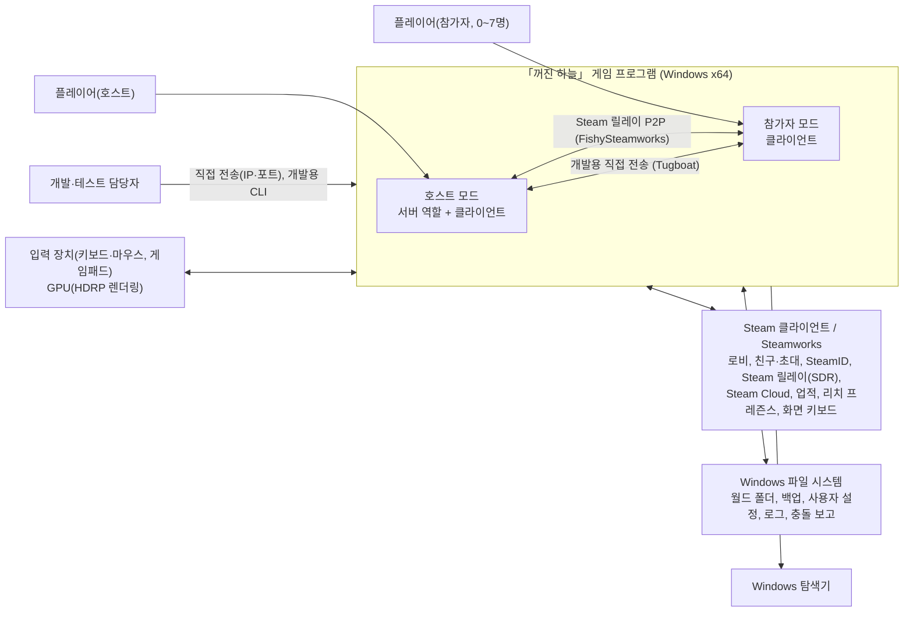
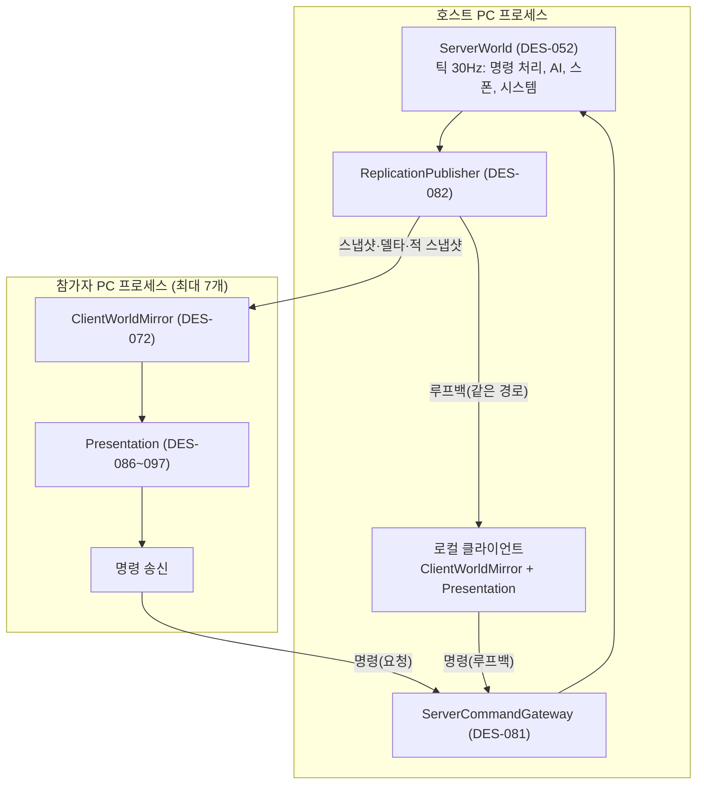
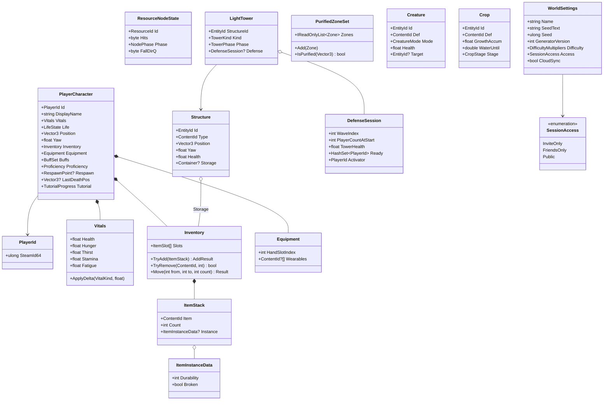
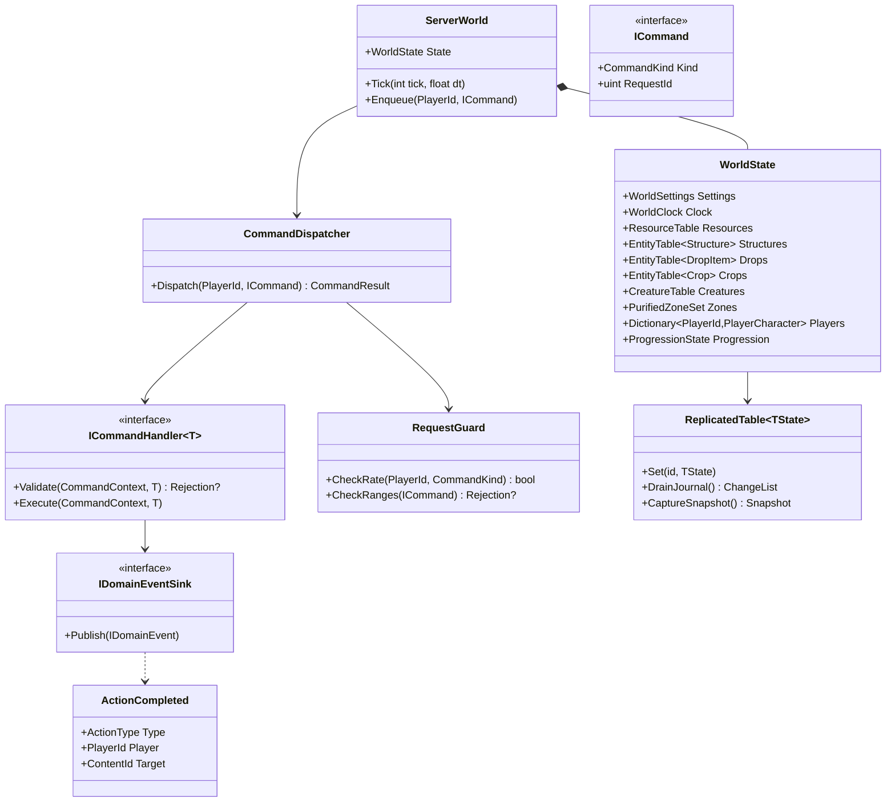

> SDD(소프트웨어 설계 명세서)의 일부 · 목차: [00-index.md](00-index.md)

## 3. 설계 관점별 설계 뷰

### 3.1 문맥 관점

시스템은 Windows PC에서 도는 게임 프로그램 하나입니다. 같은 실행 파일이 **호스트 모드**(서버 역할 + 자기 플레이어)와 **참가자 모드**(클라이언트만)로 동작합니다. 별도 운영 서버는 없습니다(SRS 2.1).

| 외부 요소 | 주고받는 것 | 관련 요구사항 |
|---|---|---|
| Steam 클라이언트 | 로비 생성·검색·메타데이터, 초대, SteamID·표시 이름, P2P 연결(SDR), 원격 저장소 파일, 업적, 리치 프레즌스, 화면 키보드 | NFR-006, NFR-007, NFR-009, FR-001~005, FR-144~145, FR-164, FR-165 |
| 다른 게임 프로그램(호스트↔참가자) | 게임 프로토콜 메시지(3.7.2) | FR-007~009, NFR-013~015 |
| 파일 시스템 | 월드 파일 1개 + 백업, 사용자 설정 JSON, 로그, 충돌 보고 압축 파일, 성능 측정 CSV | FR-014~022, NFR-024, NFR-036, NFR-045, NFR-047, FR-158, FR-163 |
| Windows 탐색기 | 월드 폴더·보고 폴더 열기 | FR-152, FR-158 |
| 입력 장치·GPU | 입력 이벤트, 렌더링 | NFR-004, NFR-005, FR-120, FR-121 |

시스템 경계 밖(만들지 않는 것): 전용 서버 프로그램, 웹 서비스, 자동 충돌 전송 서비스(C-43 해소: 로컬 파일만, 외부 전송 경로 없음), 음성 채팅(영구 제외), Steam 없이 하는 오프라인 플레이(SRS v0.9: Steam 실행 필수).

### 3.2 구성 관점

#### 3.2.1 하위 시스템

| 하위 시스템 | 책임 | 주요 설계 요소 | 처음 들어가는 마일스톤 |
|---|---|---|---|
| S1 세션·네트워크 | Steam 로비, 참가 조건, 접속 절차, 전송 계층 교체, 명령 수신·검증, 상태 복제 | DES-031, 050, 053, 054, 072, 080~085, 101~103, 121 | M1 |
| S2 월드 생성 | 고정 큰 배치 + 시드로 네 지역 내부 생성, 결정론, 생성기 버전, 생성 검증, 요약값 | DES-040~047, 089 | M1(선행 검증), M3 |
| S3 월드 상태·저장 | 서버 시뮬레이션 루트, 월드 파일 읽기·쓰기, 백업, 이전, Steam Cloud | DES-030, 052, 055, 056, 098, 099, 106 | M3 |
| S4 플레이어·생존 | 이동, 상태 값, 쓰러짐·사망·부활, 섭취, 수면 | DES-002~004, 013, 060, 084, 086 | M1~M4 |
| S5 채집·아이템·제작·건축 | 자원 오브젝트, 인벤토리, 드롭, 제작(손 제작·제작대), 용광로 가공, 내구도, 건축, 보관함 | DES-005~012, 036, 057~059, 075, 087, 096 | M3~M4 |
| S6 정화·방어전 | 등광탑, 준비 단계, 웨이브, 보스, 정화 구역, 해금 | DES-015, 017, 018, 027, 061 | M6 |
| S7 생물·AI | 적·동물 정의, 판단, 스폰, 전투, 길 찾기(흐름장), 거리별 갱신 | DES-019~021, 062~064, 088, 105 | M1(시험용), M5 |
| S8 농사·요리·버프·환경 위협 | 작물, 요리 솥·보조 기구, 버프, 지역 위협과 대응 | DES-016, 022~024, 065, 066 | M7, M9a~c |
| S9 진행·안내 | 경험치 이벤트, 숙련도, 목표, 튜토리얼, 스토리, 업적, 리치 프레즌스 | DES-025~028, 035, 067, 068, 070, 071 | M3(이벤트)~M10 |
| S10 표현(Presentation) | 1인칭 카메라, 지형·자원·생물 표시, 조명·대기, UI, 입력, 다국어, 오디오, 접근성 | DES-086~097, 109 | M1~ |
| S11 플랫폼·운영 | Steam 연동, 설정 데이터, 로그·충돌 보고, 성능 측정, 사용자 설정, 빌드 구성, 시험 도구 | DES-100~113 | M1 |

#### 3.2.2 실행 구성 (호스트와 참가자)

- 호스트 자신의 플레이어도 참가자와 **같은 명령 경로**(게이트웨이 → 검증 → 처리)를 탑니다. 서버 역할 코드가 「로컬 플레이어」를 전제하지 않으므로 전용 서버로 옮길 때 서버 쪽 코드를 고치지 않아도 됩니다(NFR-032).
- 호스트의 화면도 복제 결과(ClientWorldMirror)를 보고 그립니다. 표현 코드 경로가 하나라서 「호스트에서는 보이는데 참가자에게는 다르게 보이는」 결함을 줄입니다. M1 측정에서 이 루프백 비용이 크면 DES-072에 호스트 전용 직접 읽기 구현을 추가하는 것을 대안으로 둡니다(8장 R-05).

#### 3.2.3 Unity 씬 구성

| 씬 | 역할 | 비고 |
|---|---|---|
| `Boot` | 컴포지션 루트 생성(DES-100), Steam 초기화, 설정·콘텐츠 로드, 충돌 감지·광과민성 경고 | 항상 첫 씬. v0.11(M1 실제): 루트 오브젝트 = `Bootstrap`(GameBootstrap), **꺼진 상태의 `NetworkManager`**(전송을 정한 뒤 켬, 3.9.9), 메뉴 카메라, SCR-001 화면, 개발용 로비 화면, `GameHud`. World 씬을 Additive로 불러도 Boot 씬은 그대로 남아 조립 루트 역할을 계속함(`DontDestroyOnLoad`를 쓰지 않음). **v0.13(uGUI 전환 뒤)**: UI 루트 오브젝트는 모두 **프리팹 인스턴스** — `UiRoot`(`UiRoot` 컴포넌트 + 자식 `EventSystem`(EventSystem + `InputSystemUIInputModule`), 씬 전체에서 EventSystem은 이것 하나), `SteamRequiredScreen`, `DevLobbyScreen`, `GameHud`, `GameMenu`(ESC 메뉴, Hud에서 분리). 씬 파일이 원본이며 생성기는 씬이 없을 때만 만듦(3.8.2) |
| `MainMenu` | 월드 만들기·불러오기·관리, 공개 세션 목록, 참가, 옵션 | M1에는 없음(개발용 로비 화면이 Boot 씬 안에 있음). M2에서 만듦 |
| `World` | 런타임 생성 지형·자원, 고정 콘텐츠(마지막 등불, 장막의 근원) 프리팹 배치, 플레이 | 지형은 실행 중 생성(DES-089). 고정 콘텐츠는 `WorldLayout` 데이터가 가리키는 프리팹. v0.11(M1 실제): `WorldSceneBuilder`가 만든 개발용 장면 — 평평한 바닥(400 m), 햇빛, 기준 상자 8개, 1인칭 조작 장치 `PlayerRig`(CharacterController + 눈 높이 카메라 + `FirstPersonController`), 원격 플레이어 표시 `RemoteAvatarViews`. 접속이 끝나면 `GameFlow`가 Additive로 불러오고 나갈 때 내림. 지형 생성 표시는 M1-10부터. v0.13: UI 오브젝트(Canvas·EventSystem)를 두지 않음 — 게임 중 UI도 Boot 씬의 프리팹 인스턴스가 그림 |
| `Bench` (개발 빌드 전용) | P1/P8 측정 장면 재현, 시험용 AI 60체 | DES-113 |

### 3.3 논리 관점

#### 3.3.1 도메인 핵심 모델

도메인 타입은 UnityEngine·FishNet을 모릅니다. 위치·방향은 `System.Numerics.Vector3`(게임플레이)와 정수 좌표(월드 생성)를 씁니다.

#### 3.3.2 서버 시뮬레이션과 명령 모델

#### 3.3.3 주요 타입 목록

| 타입 | 종류 | 레이어 | 설명 |
|---|---|---|---|
| `PlayerId` | 값 객체 | 도메인 | SteamID 64비트를 감싼 값. 호스트용 특수 ID 없음(FR-015). 개발용 가짜 ID도 같은 타입(DES-103) |
| `ContentId` | 값 객체(ushort) | 도메인 | 콘텐츠 정의 번호. 문자열 키를 정렬해 부여하고 접속 때 콘텐츠 요약값으로 PC 간 일치 확인 |
| `ResourceId` | 값 객체(uint) | 월드 생성 | 생성기가 셀 좌표로 만든 안정적 ID. `지역(3비트)·셀X(8)·셀Z(8)·슬롯(5)` 압축, 손으로 만든 장막의 근원은 지역 7 대역 |
| `ResourceIndex` | ushort | 월드 생성 | 생성 결과를 ResourceId 순으로 정렬했을 때의 번호(0~65535). 네트워크 전송에만 사용(2바이트) |
| `EntityId` | uint | 도메인 | 호스트가 실행 중 발급하는 ID(건축물, 드롭, 작물, 생물). 저장 시 같이 저장 |
| `ReasonCode` | 열거형 | 도메인 | 거부 사유 코드. 화면 문장은 텍스트 키로 변환(NFR-003, 3.7.5) |
| `Rejection` | 값 객체 | 도메인 | `ReasonCode` + 부가 값(예: 부족한 재료 ID·수량) |
| `ActionType` | 열거형 | 도메인 | 경험치 이벤트 종류: 벌목, 채광, 채집, 제작, 건축, 처치, 사냥, 심기, 수확, 요리, 가공(용광로, v0.6 잠정) (NFR-046) |
| `FuelPoints` | 값 객체(int) | 도메인 | 연료 점수. 정수로만 계산(SRS v0.8 FR-176 설정값: 나무 1개 = 2점, 석탄 1개 = 16점, 숯 = 16점 후보(C-62), 광석 1개 가공 = 4점 → 나무 2개 = 광석 1개, 석탄 1개 = 광석 4개). 화면 표시 「광석 n개분」은 점수 ÷ 4를 0.5개분(2점) 단위로(STORYBOARD v1.3 SCR-038). v0.6 |
| `SessionAccess` | 열거형 | 도메인 | 참가 조건: 초대 전용 / 친구 전용 / 공개 (SRS v0.3). 월드 설정에 저장, 새 월드 기본값 친구 전용 |
| `GeneratedWorld` | 데이터 | 월드 생성 | 높이(정수 mm), 물 마스크, 자원 생성 표, 등광탑 후보 자리, 지역 마스크, 요약값 |
| `BalanceConfig` 계열 | 읽기 전용 레코드 | 도메인(타입)/인프라(로드) | SRS 부록 C.1 설정값. 도메인은 레코드만 보고, ScriptableObject는 인프라가 변환 |
| `MessageKind`·Protocol 메시지 (v0.10) | 열거형(u8) + 구조체 | 애플리케이션(`Protocol/`) | 3.7.2 표의 메시지 형식. FishNet 형식 없음. `MessageCodec`이 `ByteWriter`/`ByteReader`로 바이트와 서로 바꿈(DES-080) |
| `AvatarPose` (v0.10) | 구조체 | 애플리케이션(`Protocol/`) | 아바타 자세: 위치(양자화), 시점 yaw·pitch, 이동 플래그(달리기 여부 등), 클라이언트 시각. 아바타 RPC의 바이트 내용(3.9.8) |
