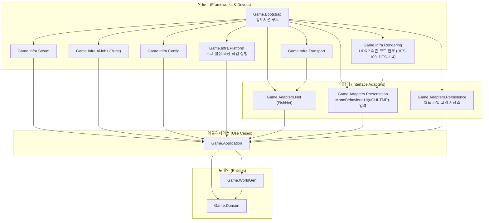
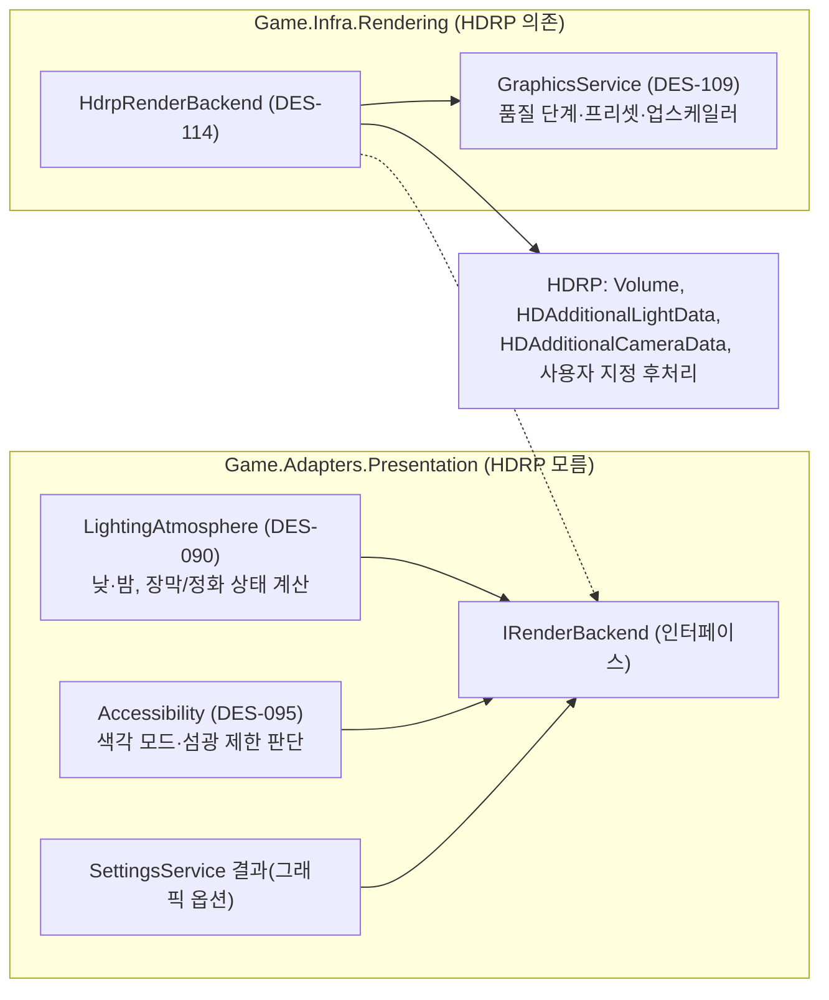

> SDD(소프트웨어 설계 명세서)의 일부 · 목차: [00-index.md](00-index.md)

### 3.4 의존 관점

#### 3.4.1 레이어와 의존 방향

규칙
1. 화살표 방향(바깥 → 안쪽)으로만 참조합니다. 안쪽은 바깥 타입을 모르고, 필요한 기능은 포트(인터페이스)로 요구합니다.
2. `Game.Domain`, `Game.WorldGen`, `Game.Application`, `Game.Adapters.Persistence`는 **`noEngineReferences: true`** 로 UnityEngine 참조를 막습니다. 이 네 어셈블리는 순수 C#이며 FishNet·Steamworks.NET도 참조하지 않습니다.
3. FishNet(`FishNet.Runtime`)은 `Game.Adapters.Net`, `Game.Infra.Transport`, `Game.Bootstrap`만, FishySteamworks는 `Game.Infra.Transport`, `Game.Bootstrap`만, Steamworks.NET(`com.rlabrecque.steamworks.net`)은 `Game.Infra.Steam`, `Game.Bootstrap`만 참조합니다(v0.8: 실제 구성에 맞춤. `Game.Infra.Transport`는 FishySteamworks를 거쳐 Steam 전송을 설정하므로 Steamworks.NET을 직접 참조하지 않음). 시험 어셈블리는 시험 대상에 필요한 범위에서 예외입니다(3.4.2). v0.11: 에디터 전용 `Game.Editor`도 FishNet·Net 어댑터를 참조하지 않으며, 씬·프리팹 생성 때 필요한 FishNet 형식은 형식 이름으로 찾아 붙입니다(D-25).
4. 어댑터끼리는 서로 참조하지 않습니다(Net ↔ Presentation 금지). 둘 사이 데이터는 애플리케이션의 `ClientWorldMirror`(DES-072)와 포트를 거칩니다. v0.10: 내 플레이어 자세는 표현 어댑터(DES-086)가 포트 `ILocalPlayerPose`에 쓰고 Net 어댑터(DES-084)가 읽어 보냅니다. 다른 참가자 자세는 Net 어댑터가 `ClientWorldMirror`에 넣고 표현 어댑터가 읽습니다(3.9.8).
5. 인프라 어셈블리끼리도 참조하지 않습니다. 연결은 `Game.Bootstrap`이 합니다. 예외: `Game.Infra.Transport` → `Game.Adapters.Net`(전송 선택기가 NetworkManager 구성 요소를 설정해야 하므로), `Game.Infra.Rendering` → `Game.Adapters.Presentation`(표현 어댑터가 정의한 `IRenderBackend`를 구현하므로).
6. 모든 게임 코드는 asmdef 안에 둡니다. `Assembly-CSharp`(기본 어셈블리)에는 코드를 두지 않습니다.
7. **HDRP 어셈블리(`Unity.RenderPipelines.HighDefinition.Runtime`, `Unity.RenderPipelines.Core.Runtime`)는 `Game.Infra.Rendering`만 참조합니다**(3.4.4, 사용자 결정 2026-11-02).
8. (v0.10, 사용자 결정 2026-11-03) 네트워크 메시지 형식과 바이트 인코딩은 `Game.Application`의 `Protocol/`(DES-080, 순수 C#)에 둡니다. Net 어댑터의 게이트웨이·복제 송수신·참가 절차(DES-081~083, 085)는 포트(`INetServer`/`INetClient`)와 Protocol 메시지에만 의존하고, FishNet 형식(`NetworkConnection`, Broadcast, `NetworkBehaviour`, `NetworkManager` 등)을 쓰는 코드는 DES-121(`FishNetServer`/`FishNetClient`/`PacketBroadcast`)과 DES-084(아바타 NetworkObject)로 한정합니다. 같은 어셈블리 안이라 컴파일러가 막지 못하므로 다음 두 가지로 확인합니다. v0.11(M1-07~09 실제): (a) **폴더 규칙 소스 검사**(아키텍처 시험 `NetAdapter_FishNetTypes_OnlyInTransportAndAvatarFolders`): `Adapters/Net/` 아래 `.cs` 중 `Transport/`(DES-121, `FishNetPacketTransport.cs`)와 `Avatar/`(DES-084, `PlayerAvatar.cs`) 밖의 파일은 주석이 아닌 줄에 `FishNet`이라는 글자가 있으면 실패합니다(`Gateway/`, `Join/`, `Replication/`, 어셈블리 정보 파일이 검사 대상). (b) **컴파일 확인**: `Game.Tests.Net`은 `FishNet.Runtime`을 참조하지 않고도 게이트웨이·참가 절차·복제 클래스를 쓰고 컴파일됩니다(공개 API·기반 클래스에 FishNet 형식이 있으면 컴파일 오류). 더해 Application·Domain·WorldGen 소스에는 `using FishNet`, `using Steamworks`, `using UnityEngine`이 없어야 합니다(아키텍처 시험 `ApplicationAndDomain_DoNotMentionFishNetOrSteamworks`, 규칙 2의 asmdef 검사와 별개로 소스 글자도 검사).
9. (v0.13, 사용자 결정 2026-11-04, D-27) **UI 패키지(`UnityEngine.UI`, `Unity.TextMeshPro`)는 게임 런타임 어셈블리 중 `Game.Adapters.Presentation`만 참조합니다.** 그 밖에는 에디터 전용 `Game.Editor`와 UI를 시험하는 시험 어셈블리(`Game.Tests.Infrastructure`, `Game.Tests.Integration`)만 허용합니다. `Game.Bootstrap`은 표현 어댑터의 화면 컴포넌트(`GameHud`, `DevLobbyScreen` 등)를 직렬화 필드로 받을 뿐 uGUI·TMP 형식을 직접 쓰지 않습니다. **UI Toolkit(`UnityEngine.UIElements`)은 게임 코드에서 쓰지 않습니다**(엔진 내장 모듈이라 asmdef로 막을 수 없으므로 소스 글자 검사, 3.4.3). 개발용 성능 표시(IMGUI `OnGUI`, DES-108)는 개발 빌드 전용 도구라 예외입니다.

#### 3.4.2 asmdef 목록

v0.8: 이 표는 실제 asmdef 구성과 같습니다. 아키텍처 시험(DES-112)이 이 표와 실제 참조를 비교하므로, asmdef 참조를 바꿀 때는 이 표를 먼저 고칩니다. 참조 이름은 실제 어셈블리 이름(`FishNet.Runtime`, `FishySteamworks`, `com.rlabrecque.steamworks.net`)으로 적습니다. 게임 런타임 어셈블리는 아래 13개(`Game.Domain` ~ `Game.Bootstrap`)이고, 경로는 `Assets/_Game/Code/` 아래(3.8.2)입니다. v0.9: 아키텍처 시험은 시험 어셈블리(`Game.Tests.*`)의 목록과 참조도 이 표와 비교합니다(Test Runner·NUnit 참조는 공통이라 비교에서 뺌). 시험 asmdef 참조를 바꿀 때도 이 표를 먼저 고칩니다. v0.11: 이 표를 실제 `.asmdef` 21개와 `ArchitectureRulesTests`의 `Expected`·`BootstrapAllowed`·`ExpectedTestReferences`에 다시 대조했습니다(2026-11-04). `Game.Bootstrap`은 시험이 「허용 목록 안인지」만 보고, 나머지는 목록이 정확히 같은지 봅니다. `Game.Editor`의 참조는 시험 비교 대상이 아니지만 아래 행과 같습니다. **v0.13(uGUI 전환, D-27)**: 아래 표의 `UnityEngine.UI`·`Unity.TextMeshPro` 참조(Presentation, Editor, Tests.Infrastructure, Tests.Integration)는 「M1 묶음 3 마무리 — UI uGUI 전환」(7장)에서 실제 asmdef와 `ArchitectureRulesTests`의 `Expected`·`ExpectedTestReferences`에 함께 넣습니다. 두 어셈블리는 `com.unity.ugui` 2.0.0 패키지 안에 있고(`Runtime/UGUI/UnityEngine.UI.asmdef`, `Runtime/TMP/Unity.TextMeshPro.asmdef`), Unity 6에서는 별도 TextMeshPro 패키지(`com.unity.textmeshpro`)를 설치하지 않습니다.

| asmdef | 레이어 | 참조 허용 | noEngineReferences | 비고 |
|---|---|---|---|---|
| `Game.Domain` | 도메인 | (없음) | true | 엔터티, 값 객체, 규칙, 도메인 이벤트, 규칙 교체 지점 인터페이스 |
| `Game.WorldGen` | 도메인(생성 규칙) | `Game.Domain` | true | 결정론 수학, 생성기(버전별 폴더), 검증, 요약값. `allowUnsafeCode: false` |
| `Game.Application` | 애플리케이션 | `Game.Domain`, `Game.WorldGen` | true | 유스케이스, 명령 처리, 서버 시뮬레이션, 복제 모델, 포트. v0.10: `Protocol/` — 네트워크 메시지 형식(`MessageKind`, 3.7.2 표의 메시지, `AvatarPose`)과 바이트 인코딩(`ByteWriter`/`ByteReader`, 양자화, 크기 상한 검사, `MessageCodec`)(DES-080). 아바타 이동 검사기 `AvatarMoveValidator`(DES-052) |
| `Game.Adapters.Persistence` | 어댑터 | `Game.Application`, `Game.Domain` | true | 월드 파일 코덱·저장소(System.IO). 경로는 생성자로 받음 |
| `Game.Adapters.Net` | 어댑터 | `Game.Application`, `Game.Domain`, `Game.WorldGen`, `FishNet.Runtime` | false | v0.10: 포트 구현 `FishNetServer`/`FishNetClient` + 바이트 래퍼 Broadcast 1종 `PacketBroadcast`(DES-121), 게이트웨이·복제 송수신·JoinHandshake(DES-081~083, 085 — **포트와 Protocol 메시지에만 의존**, FishNet 형식을 공개 API·기반 클래스에 쓰지 않음), 플레이어 아바타 NetworkObject(DES-084, ServerRpc/ObserversRpc). 메시지 정의·직렬화는 `Game.Application/Protocol/`로 옮김 |
| `Game.Adapters.Presentation` | 어댑터 | `Game.Application`, `Game.Domain`, `Game.WorldGen`, `Unity.InputSystem`, `Unity.Localization`, **`UnityEngine.UI`, `Unity.TextMeshPro`**(v0.13, uGUI·TMP. 게임 런타임 어셈블리 중 여기만, 3.4.1 규칙 9) (**HDRP 참조 금지**, v0.13: UI Toolkit `UnityEngine.UIElements` 사용 금지) | false | 뷰, UI 프리젠터, 입력, 조명 상태 계산, 오디오. 렌더링 적용은 `IRenderBackend`(이 어셈블리에 정의) 호출로만. v0.13: UI 공통 기반 `UI/Common/`(테마 `UiTheme`·`Themed*` 컴포넌트·`UiScreen`·`UiRoot`·`UiInputRouter`, DES-122) |
| `Game.Infra.Steam` | 인프라 | `Game.Application`, `Game.Domain`, `com.rlabrecque.steamworks.net` | false | `IPlatformServices`, `ICloudSync` 구현 |
| `Game.Infra.Transport` | 인프라 | `Game.Adapters.Net`, `Game.Application`, `FishNet.Runtime`, `FishySteamworks` | false | 전송 선택(Steam/Tugboat), 네트워크 설정 적용 |
| `Game.Infra.AiJobs` | 인프라 | `Game.Application`, `Game.Domain`, `Unity.Burst`, `Unity.Collections`, `Unity.Mathematics` | false | `IAiNavigationBackend` 구현(흐름장, 이동, 공간 해시). v0.8: `Unity.Jobs` 참조 삭제(Unity 6에서 Job System은 엔진 내장이라 별도 어셈블리 참조가 필요 없음) |
| `Game.Infra.Config` | 인프라 | `Game.Application`, `Game.Domain`, `Game.WorldGen` | false | ScriptableObject 정의와 로더. v0.9: 그래픽 프리셋 애셋 `GraphicsPresetConfig`도 여기에 두고 `GameDataConfig.Graphics`로 연결(순수 `GraphicsPresetCatalog`로 바꿔 넘김, 3.12.7) |
| `Game.Infra.Platform` | 인프라 | `Game.Application`, `Game.Domain` | false | 로그, 충돌 보고, 성능 측정, 사용자 설정 저장, 백그라운드 작업 |
| `Game.Infra.Rendering` | 인프라 | `Game.Adapters.Presentation`, `Game.Application`, `Game.Domain`, `Unity.RenderPipelines.HighDefinition.Runtime`, `Unity.RenderPipelines.Core.Runtime` | false | **렌더 파이프라인 의존 코드 전부**: Volume 제어, 조명·태양 쿠키·광원 적용, 후처리(색각 보정·노출), 업스케일링, 셰이더 전역 변수 연결, 그래픽 프리셋·품질 단계 (DES-109, DES-114). v0.9: 프리셋은 `Game.Application`의 순수 `GraphicsPresetCatalog`로만 받음(`Game.Infra.Config` 참조 금지, 인프라끼리 참조 금지) |
| `Game.Bootstrap` | 인프라(조립) | 위 게임 어셈블리 12개 전부, `FishNet.Runtime`, `com.rlabrecque.steamworks.net`, `FishySteamworks`(필요 시 `Unity.InputSystem`, `Unity.Localization`). HDRP 어셈블리는 직접 참조 금지(규칙 7). **v0.11 실제 참조**: 게임 어셈블리 12개 + `FishNet.Runtime`, `com.rlabrecque.steamworks.net`, `FishySteamworks`, **`Unity.InputSystem`**(「필요 시」 허용 범위 안. `GameBootstrap`이 Input Actions 애셋(`InputActionAsset`)을 직렬화 필드로 받아 `GameFlow`에 넘기기 때문). `Unity.Localization`은 허용만 하고 아직 참조하지 않음(M2-01에서 필요하면 추가, 표 변경 없음) | false | 컴포지션 루트, 씬 흐름, 개발 도구. v0.11: `Runtime/`(`GameFlow` 화면·씬 흐름, `SessionRuntime` 세션 조립, `RuntimeSupport` 빌드 번호·시계·로그 연결), `DevTools/`(실행 옵션, `SteamLobbySmoke`, 진단, Bench) |
| `Game.Editor` | 에디터 도구 (v0.8) | `Game.Domain`, `Game.Application`, `Game.Adapters.Presentation`, `Game.Infra.Config`, `Game.Bootstrap`, v0.13: `UnityEngine.UI`, `Unity.TextMeshPro`(테마 토큰 선택 드롭다운, 테마 다시 적용 메뉴, 씬이 없을 때 처음 만들기·검사) (v0.11 확인: **`Game.Adapters.Net`·`FishNet.Runtime` 참조 없음**. v0.13: `Unity.InputSystem`도 참조하지 않음 — EventSystem의 `InputSystemUIInputModule`은 프리팹에 들어 있고, 생성기가 붙여야 할 때만 D-25 방식(형식 이름)으로 붙임) | false | **`includePlatforms: Editor`**(플레이어 빌드 제외). 빌드 명령 `BuildCommands`(전체 생성 메뉴 `Game/Setup/Run All` 포함, 3.8.2), 출시 빌드 산출물 검사 `BuildArtifactInspector`(3.4.3), 프로젝트 설정 `ProjectConfigurator`, 씬·애셋 생성 스크립트(`BootSceneBuilder`, `DataAssetBuilder`. v0.9: `BenchSceneBuilder`, 품질 단계·HDRP 애셋 생성 `GraphicsAssetBuilder` — HDRP 형식 없이 SerializedObject 속성 경로로 수정. v0.11: `InputActionsBuilder`, `WorldAndNetworkBuilders`(`AvatarPrefabBuilder`, `WorldSceneBuilder`)). v0.11: FishNet 형식(`FishNet.Managing.NetworkManager`, `FishNet.Object.NetworkObject`)과 Net 어댑터 형식(`Game.Adapters.Net.Avatar.PlayerAvatar`)은 `Type.GetType("형식, 어셈블리")`로 찾아 `AddComponent`(리플렉션)하고, 찾지 못하면 예외로 메뉴 실행을 실패시킴(D-25). 게임 어셈블리는 이 어셈블리를 참조하지 않음. 경로 `Assets/_Game/Code/Editor/` |
| `Game.Tests.Domain` | 시험(EditMode) | `Game.Domain` + Test Runner·NUnit | false | 도메인 규칙 시험. 경로 `Assets/Tests/EditMode/Domain/` |
| `Game.Tests.Application` | 시험(EditMode) | `Game.Application`, `Game.Domain`, `Game.WorldGen` + Test Runner·NUnit | false | 유스케이스·명령·복제 모델 시험. v0.10: 메시지 코덱 왕복 시험(메시지마다 「쓰고 다시 읽으면 같은 값」, 고정 바이트 기대값, 크기 상한·잘린 입력 거부)과 `AvatarMoveValidator` 시험. 경로 `Assets/Tests/EditMode/Application/` |
| `Game.Tests.Net` | 시험(EditMode) (v0.10 신설) | `Game.Application`, `Game.Domain`, `Game.Adapters.Net` + Test Runner·NUnit | false | 가짜 `INetServer`/`INetClient`로 게이트웨이(DES-081)·JoinHandshake(DES-085)·복제 송수신(DES-082, 083) 시험. FishNet 없이 돌아야 하므로 `FishNet.Runtime`을 참조하지 않음 — 시험 대상 클래스는 FishNet 형식을 공개 API·기반 클래스에 쓰지 않음(3.4.1 규칙 8). 경로 `Assets/Tests/EditMode/Net/` |
| `Game.Tests.Infrastructure` | 시험(EditMode) | `Game.Application`, `Game.Domain`, `Game.Infra.Config`, `Game.Adapters.Presentation`, `Game.Infra.Transport`, `Game.Infra.Steam`, `Game.Infra.Platform`(v0.9), `Game.Bootstrap`, `Game.Editor`, `FishNet.Runtime`, v0.13: `UnityEngine.UI`, `Unity.TextMeshPro` + Test Runner·NUnit | false | 설정 로더·전송 선택·Steam 확인·부트·빌드 도구 시험, v0.9: 로그·측정(진단)·그래픽 프리셋 데이터 시험. v0.13: UI 프리팹·테마 규칙 검사(`UiPrefabRulesTests`, 3.4.3)와 화면 뷰 시험(프리팹을 불러 `Button.onClick.Invoke()`). 경로 `Assets/Tests/EditMode/Infrastructure/` |
| `Game.Tests.Architecture` | 시험(EditMode) | Test Runner·NUnit만(리플렉션·asmdef 파일 읽기로 검사) | false | 이 표와 실제 참조 비교(v0.9: 시험 어셈블리 포함), 의존 방향, 렌더링 격리, Pipeline 패키지 격리(3.4.3), 프로젝트 설정 검사(DES-112). 경로 `Assets/Tests/EditMode/Architecture/` |
| `Game.Tests.WorldGen` | 시험(EditMode) (v0.9 신설) | `Game.WorldGen`, `Game.Application` + Test Runner·NUnit | false | 결정론 수학, 생성기 V0, `-genhash` 도구, 골든 해시 시험(M1-04). 경로 `Assets/Tests/EditMode/WorldGen/` |
| `Game.Tests.Integration` | 시험(PlayMode) | `Game.Application`, `Game.Domain`(v0.11), `Game.Adapters.Net`(v0.11), `Game.Adapters.Presentation`(v0.9), `Game.Infra.Platform`(v0.9), `Game.Infra.Rendering`(v0.9), `Game.Bootstrap`(v0.9), `Game.Infra.Transport`, `FishNet.Runtime`, `FishySteamworks`, v0.13: `UnityEngine.UI`, `Unity.TextMeshPro`(화면 층 레이캐스트·포커스 시험) + Test Runner·NUnit | false | 루프백 호스트 + 클라이언트 통합 시험. v0.9: 그래픽·측정 플레이 모드 시험, Bench 씬 시험(M1-05, M1-06). v0.11: 실제 FishNet 경유 루프백 시험(`HostClientLoopbackPlayTests`)이 `SessionRuntime`(Bootstrap)·`FishNetClient`(Net 어댑터)·도메인 ID 형식을 직접 써서 `Game.Domain`·`Game.Adapters.Net` 추가, 전송 선택 시험(`TransportSelectorTests`). v0.13: 화면 층 시험(`UiLayerPlayTests` — 로비·게임·게임 + ESC 메뉴 상태마다 보이는 버튼 가운데로 `EventSystem.RaycastAll`을 쏘아 맨 위 결과가 그 화면의 버튼인지, 키보드·패드 내비게이션이 맨 위 화면 밖으로 나가지 않는지). 경로 `Assets/Tests/PlayMode/Integration/` |

- 시험 어셈블리는 모두 `defineConstraints: UNITY_INCLUDE_TESTS`, `overrideReferences: true` + `nunit.framework.dll`이고, EditMode 시험은 `includePlatforms: Editor`입니다. 시험 어셈블리는 7개(EditMode 6, PlayMode 1)입니다(v0.9: `Game.Tests.WorldGen`을 M1-04에서 만듦. v0.10: `Game.Tests.Net`을 M1-07에서 만듦). 아직 만들지 않은 계획 시험 어셈블리는 `Game.Tests.Persistence`(월드 파일 코덱, M3-08)이며, 만들 때 이 표에 행을 먼저 추가합니다.
- 타사 어셈블리(게임 코드 아님, 아키텍처 시험의 게임 어셈블리 검사 대상 아님): (v0.13) uGUI·TextMeshPro는 UPM 내장 패키지 `com.unity.ugui` 2.0.0(`UnityEngine.UI`, `Unity.TextMeshPro`), TMP 기본 자원(TMP Essential Resources)은 `Assets/TextMesh Pro/`(3.8.2). FishNet은 `Assets/ThirdParty/FishNet/` 아래 자체 asmdef(`FishNet.Runtime`, `GameKit.Dependencies`, `Synapse`, `Unity.FishNet.CodeGen`, `MonoFN.Cecil`), FishySteamworks는 `Assets/ThirdParty/FishySteamworks/FishySteamworks.asmdef`, Steamworks.NET은 UPM 패키지(`com.rlabrecque.steamworks.net`).

#### 3.4.3 의존 규칙의 강제 방법
- **컴파일 단계**: asmdef 참조 목록에 없는 어셈블리는 쓸 수 없습니다. `noEngineReferences: true`이면 `UnityEngine` 네임스페이스를 쓰는 순간 컴파일 오류가 납니다. 미리 컴파일된 DLL(Steamworks.NET 등)은 `overrideReferences: true` + 명시 목록으로만 허용합니다.
- **아키텍처 시험(EditMode, DES-112)**: 리플렉션으로 각 어셈블리의 참조 어셈블리 이름을 읽어 3.4.2 표와 다르면 실패합니다. 예: `Game.Domain`이 `UnityEngine*`, `FishNet*`, `Steamworks*` 중 하나라도 참조하면 실패. `Game.Editor`와 `Game.Tests.*`가 플레이어 어셈블리 목록에 없는지도 검사합니다.
- **Unity Pipeline 패키지 격리 (v0.8 갱신, 사용자 결정 2026-11-03)**: `com.unity.pipeline` 0.9.1-exp.1(Unity CLI·에디터 조작 MCP가 열린 에디터와 통신하는 패키지, D-03)은 v0.7에서 전제한 것과 달리 **에디터 전용이 아닙니다.** 그래서 다음 세 겹으로 막습니다.
  1. **런타임 기호 금지**: 모든 빌드 대상의 Scripting Define Symbols와 프로젝트 파일에 `ENABLE_RUNTIME_PIPELINE*` 기호가 없어야 합니다(아키텍처 시험). 패키지 어셈블리는 `includePlatforms: Editor`이거나 이 기호가 있어야만 플레이어에 들어가도록 되어 있는지도 검사합니다(패키지 버전을 올리면 다시 확인).
  2. **참조 금지**: `Game.*` 어셈블리는 `Unity.Pipeline*` 어셈블리를 하나도 참조하지 않습니다(아키텍처 시험). 플레이어 어셈블리 목록에 들어가도 되는 Pipeline 어셈블리는 런타임 기능이 없는 속성 정의 `Unity.Pipeline.Attributes`뿐입니다.
  3. **출시 빌드 산출물 검사**: `Game.Editor`의 `BuildCommands`가 빌드 직후 `BuildArtifactInspector`로 데이터 폴더(Managed 폴더, IL2CPP `global-metadata.dat`)를 훑어 `Unity.Pipeline.Attributes` 외 Pipeline 어셈블리(`Unity.Pipeline`, `Unity.Pipeline.IlInterpreter` 등)가 있으면 빌드를 실패로 처리합니다. 실제 출시 IL2CPP 빌드에서 0건 확인(2026-11-03).
- **코드 검사 기준**: 참가자 쪽 코드에서 `WorldState`를 직접 바꾸는 경로 0건(NFR-030). `WorldState` 변경 메서드는 `Game.Application` 내부(internal)로 두고, 서버 시뮬레이션과 명령 처리기만 호출합니다.
- **렌더링 격리 검사**: 아키텍처 시험에서 `Game.Infra.Rendering` 외 어셈블리가 `Unity.RenderPipelines.*`를 참조하면 실패합니다.
- **소스 글자 검사 (v0.11, M1-07~09에서 추가)**: 같은 어셈블리 안이라 asmdef로 막을 수 없는 규칙을 소스 파일을 읽어 검사합니다. (1) `Adapters/Net/`에서 FishNet 형식은 `Transport/`·`Avatar/` 폴더에서만(3.4.1 규칙 8). (2) `Application/`·`Domain/`·`WorldGen/` 소스에 `using FishNet`, `using Steamworks`, `using UnityEngine` 없음. 폴더를 옮기거나 새 폴더를 만들 때 이 검사가 함께 바뀌어야 하므로, Net 어댑터 폴더 구성을 바꿀 때는 3.8.2와 이 규칙을 먼저 고칩니다.
- **UI 패키지 격리 (v0.13, D-27)**: (1) 아키텍처 시험이 `UnityEngine.UI`·`Unity.TextMeshPro`를 참조하는 `Game.*` 어셈블리가 `Game.Adapters.Presentation`, `Game.Editor`, `Game.Tests.Infrastructure`, `Game.Tests.Integration`뿐인지 확인합니다(3.4.1 규칙 9). (2) 소스 글자 검사: `Assets/_Game/Code/**`와 `Assets/Tests/**`의 `.cs`에 `UnityEngine.UIElements`가 없어야 합니다. (3) 애셋 검사: `Assets/_Game/` 아래에 `.uxml`·`.uss`·`.tss`·`PanelSettings` 애셋이 없어야 합니다(전환 뒤 UI 기술이 둘로 섞이지 않게).
- **UI 프리팹·테마 규칙 검사 (v0.13, `UiPrefabRulesTests`, `Game.Tests.Infrastructure`)**: v0.12까지의 USS 규칙 검사(`UiAndInputRulesTests`의 USS 부분)를 대신합니다. 검사 대상은 `Assets/_Game/UI/Prefabs/` 아래 모든 프리팹과 `Boot.unity`의 UI 프리팹 인스턴스입니다. 항목은 3.7.10의 규칙과 1:1로 대응합니다.

  | 검사 | 실패 조건 | 근거 |
  |---|---|---|
  | 글자 테마 | `TMP_Text`(TextMeshProUGUI)에 `ThemedText`가 없음, 크기·색 토큰 이름이 테마에 없음, 실제 `fontSize`·`color`가 「토큰 값(보통 단계)」과 다름(인스펙터에서 직접 바꾼 값), `enableAutoSizing`이 켜짐 | FR-129, NFR-056 |
  | 리치 텍스트 | `TMP_Text.richText` 또는 `TMP_InputField.richText`가 켜짐. 동적 글자(`ThemedText.IsDynamic`)는 `parseCtrlCharacters`도 꺼짐 | NFR-050 |
  | 텍스트 키 | `ThemedText`가 키도 없고 동적 표시도 아님, 또는 키가 한국어·영어 표 중 하나에 없음 | NFR-034, NFR-044 |
  | 그래픽 테마 | `Image`·`RawImage`·사용자 지정 `Graphic`에 `ThemedGraphic`이 없음(아이콘 원본 색을 그대로 쓰는 경우는 `ThemedGraphic`의 `색 토큰 = 없음(흰색)`으로 명시), 실제 `color`가 토큰 값 × `alpha`와 다름. 글자가 올라가는 패널의 `alpha` < 0.72 | NFR-056, NFR-057, STORYBOARD 2.1 |
  | 레이캐스트 | `raycastTarget`이 켜진 `Graphic`이 Selectable의 `targetGraphic`도 아니고 `UiRaycastBlocker`(모달 뒤 막)도 붙지 않음 | 성능, 3.7.10 (5) |
  | 선택 요소 | Selectable의 `transition`이 None이 아님(색 블록에 색 값을 쓰지 않음), `ThemedSelectable`이 없음, 버튼이 `UiButton`이 아님, `navigation.mode`가 None(의도적으로 막는 경우는 `UiNavigationExempt` 표시) | NFR-002, NFR-004 |
  | 화면 루트 | 화면 프리팹 루트에 `UiScreen`·`Canvas`(Screen Space Overlay)·`CanvasScaler`(Scale With Screen Size, 1920×1080, Match 1)·`CanvasGroup`·`GraphicRaycaster`가 없음, `sortingOrder`가 `UiScreen.Layer`의 띠 값과 다름, 하위 캔버스에 `CanvasScaler`가 있음 | 3.7.10 (4)·(5) |
  | 테마 애셋 | 색 토큰 20개·글자 크기 토큰 6개·글꼴 토큰 3개 중 빠진 것, 배율이 0.9 / 1.0 / 1.25가 아님, 「작게」 계산값이 18 px 미만, 정해진 글자·배경 짝의 대비가 4.5 : 1 미만(큰 글자·아이콘·게이지 3 : 1) | FR-129, NFR-057, STORYBOARD 2.1·2.2 |
  | 테마 참조 | `Themed*` 컴포넌트가 `Assets/_Game/UI/Theme/UiTheme.asset` 외의 테마를 가리킴(테마는 한 벌, I-12) | NFR-057 |
  | 글꼴 | `UiGlyphs`의 모든 기호와 한국어·영어 문자열 표의 모든 글자가 글꼴 사슬(정적 아틀라스 + 대체 글꼴)에 있음 — 없으면 □로 보임 | NFR-044, R-37 |
  | 씬 구성 | `Boot.unity`의 EventSystem이 정확히 하나이고 `InputSystemUIInputModule`을 씀(`StandaloneInputModule` 없음, Active Input Handling = Input System), `World.unity`·`Bench.unity`에 Canvas·EventSystem 없음, UI 프리팹 인스턴스에 **추가된 오브젝트·컴포넌트가 없음**(화면 배치는 프리팹에서 고침) | 3.7.10, 3.8.2 |

  - 버튼 동작 시험은 프리팹을 불러 `Button.onClick.Invoke()`로 누르고 뷰 이벤트(`LeaveRequested` 등)를 확인합니다(UI Toolkit에서 리플렉션으로 `clicked`를 부르던 방식을 없앰). 「사용 불가」 버튼은 `ExecuteEvents.Execute(…, submitHandler)`로 눌러 `onClick`이 불리지 않고 사유 이벤트만 나오는지 봅니다.

#### 3.4.4 렌더링 의존 코드 격리 (사용자 결정 2026-11-02, DES-114)

HDRP는 유지하되(5장 D-03, D-20), Unity의 HDRP 유지보수 모드 전환(8장 R-09)에 대비해 **나중에 URP로 옮길 때 고칠 코드를 한 어셈블리로 모읍니다.**

| 구분 | 격리 대상 | 표현 어댑터가 넘기는 값(파이프라인 무관) |
|---|---|---|
| Volume | 안개·노출·색 보정·하늘 Volume 프로필 혼합 | `AtmosphereState`(시각 비율, 장막 농도 0~1, 지역 위협 종류, 어둠 여부) |
| 조명 | 태양·달 방향광 설정, 정화 마스크 쿠키 텍스처 갱신, 광원(횃불·랜턴) 강도·범위·그림자 상한 | 태양 방향·세기, 정화 구역 원 목록, 광원 목록(위치·반경·종류) |
| 후처리 | 색각 보정 행렬, 섬광 완화(노출 변화 제한), 화면 흔들림은 카메라라 제외 | `ColorVisionMode`, 섬광 제한 켬/끔 |
| 업스케일링·품질 | 품질 단계, 동적 해상도, DLSS/FSR 품질 모드, 프리셋 세부 값 | `GraphicsOptions`(프리셋, 해상도, 화면 모드, 업스케일 켬/끔·품질) |
| 셰이더 연결 | 전역 셰이더 변수(장막 농도, 정화 마스크) 설정 | 위 값 |
| 1인칭 손·손목 소품 그리기 (v0.4, **v0.5부터 구현 보류**) | 손목 표시 방식 (A) 3D 소품을 고를 때만 필요: 손·손목 소품이 벽에 파묻히지 않게 그리는 HDRP 사용자 지정 패스(깊이 덮어쓰기·별도 시야각), 렌더 텍스처를 소품 재질에 연결. 현재 기본 (B) 화면 공간 평면은 UI 오버레이(uGUI, v0.13)에서 끝나 이 항목을 쓰지 않음. `IRenderBackend`에 메서드 자리만 두고 구현하지 않음(M6-11 결정 뒤) | `FirstPersonLayerState`(손 시야각, 손목 올림 정도 0~1), 렌더 텍스처 핸들 |
| 시야 가장자리 위협 효과 (v0.4, v0.5 수정) | 월드 화면 쪽 **보조 색조**(약한 비네트·색 번짐, Volume 후처리)만. STORYBOARD v1.2는 위협 테두리·피격 호를 손목 계기보다 **위 레이어**에 두므로, 테두리·피격 호 본체는 UI 층(v0.13: uGUI 경고 층 캔버스, 정렬 300, DES-120)에서 그리고 HDRP와 무관함 | `ThreatEdgeState`(종류, 세기 0~1). 세기 변화는 DES-095 섬광 제한기를 거친 값만 받음(FR-131) |
| UI 캡처 카메라 (v0.13, M2-12부터) | 손목 계기 화면(uGUI 프리팹)을 렌더 텍스처에 그리는 **UI 전용 카메라**의 HDRP 설정: `HDAdditionalCameraData`의 사용자 지정 프레임 설정(조명·그림자·안개·볼륨·후처리·업스케일링 끔, 배경 투명), 값이 바뀔 때만 한 번 그리기 요청(`RenderPipeline.SubmitRenderRequest` 또는 `Camera.Render`, **6000.3·HDRP 17.3에서 확인 필요**, R-39). uGUI는 HDRP 형식을 몰라도 되도록 표현 어댑터는 카메라와 텍스처만 넘김 | `UiCaptureRequest`(카메라, 렌더 텍스처) |

- 메시·머티리얼·셰이더 그래프 같은 **애셋**은 HDRP 전용이라 URP로 옮길 때 변환 작업이 따로 필요합니다(코드 영향과 별개). 애셋은 `Assets/_Game/Art/`, `Materials/`, `Settings/`(HDRP 애셋·Volume 프로필)에 모아 범위를 파악하기 쉽게 둡니다.
- 재평가 시점: **M6 수직 슬라이스**(7장 M6-11). 성능 측정 결과, Unity 렌더 파이프라인 정책 변화, 6.7 LTS 상황을 보고 사용자가 HDRP 유지/URP 전환을 정합니다.
