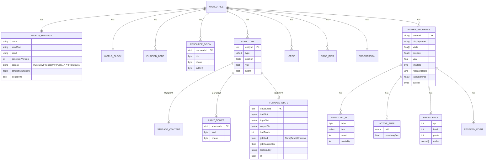
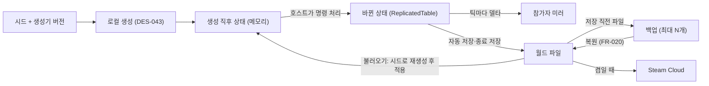

> SDD(소프트웨어 설계 명세서)의 일부 · 목차: [00-index.md](00-index.md)

### 3.5 정보 관점

#### 3.5.1 데이터 분류

| 분류 | 내용 | 주인 | 저장 위치 | 수명 |
|---|---|---|---|---|
| 생성 데이터 | 지형 높이, 물, 자원 오브젝트 초기 배치, 등광탑 후보 자리 | 각 PC가 시드로 계산 | 저장 안 함(메모리) | 월드 로드~종료 |
| 월드 상태(바뀐 상태) | 자원 변화, 건축물, 드롭, 작물, 등광탑, 정화 구역, 시각, 해금, 스토리, 목표, 보관함 | 호스트 | 월드 파일 | 영구 |
| 플레이어 진행 | NFR-023 항목 전체 | 호스트 | 월드 파일 안(SteamID 키) | 영구 |
| 월드 설정 | 이름, 시드 문자열·값, 생성기 버전, 난이도, **참가 조건(SRS v0.3)**, Steam Cloud 켬/끔 | 호스트 | 월드 파일 | 영구 |
| 차단 목록 (v0.7) | 차단한 SteamID, 표시 이름, 차단 시각. **C-46 해소: 호스트의 모든 월드에 적용** | 호스트 PC | `bans.json`(사용자 데이터, 3.5.7) — 월드 파일에 넣지 않음 | 영구(PC별) |
| 세션 일시 데이터 | 접속자 목록, 재접속 자리 예약, 비밀번호, 비밀번호 시도 기록, 준비 상태, 채팅, 핑 | 호스트 메모리 | 저장 안 함 | 세션 동안 |
| 사용자 설정 | 입력 할당(장치별), 감도·시야각, 그래픽, 오디오, 접근성, 언어, 표시 옵션, 광과민성 경고 확인 여부 | 각 PC | `settings.json` | 영구(PC별) |
| 콘텐츠 정의·설정값 | 아이템, 제작법, 드롭 표, 웨이브, 스킬 노드, 부록 C.1 수치, 생성 프로필 | 빌드에 포함 | ScriptableObject 애셋 | 빌드별 |
| 운영 데이터 | 로그, 충돌 보고, 성능 측정 CSV, 세션 잠금 파일 | 각 PC | 로그 폴더 | 회전 보관 |

**세션 비밀번호는 월드 파일에 저장하지 않고 세션마다 입력합니다(확정, 사용자 결정 2026-11-02).** 참가 조건만 월드별로 저장합니다. NFR-042(개인정보 최소 저장)와도 맞습니다.

#### 3.5.2 월드 파일 형식 (DES-098)

파일 하나(`world.sav`)에 월드와 모든 플레이어 진행을 담습니다(NFR-024). 백업은 같은 형식의 별도 파일입니다(NFR-026).

```
[헤더 64바이트, 리틀 엔디언]
  magic          4B  "KHSV"
  saveFormatVer  u16      ← 저장 형식 버전 (NFR-025)
  generatorVer   u16      ← 생성기 버전 (NFR-054). 저장 형식 버전과 별개
  gameVer        u16×3    ← 저장한 게임 버전 MAJOR, MINOR, PATCH(참고용, 판정에 쓰지 않음). v0.12: u32 숫자 인코딩 `gameBuild`에서 바꿈(3.7.12)
  savedAtUtc     i64
  bodyLength     u32
  bodyHash       u64      ← 본문 xxHash64 (NFR-037 손상 감지)
  flags          u32      ← 압축 여부 등
  reserved       ...
[본문: 청크 나열]  각 청크 = id(4B) + chunkVer(u16) + length(u32) + payload
  WSET  월드 설정 (이름, 시드 문자열, 시드 값, 난이도 배율, 참가 조건, Cloud 켬/끔)
  CLCK  게임 내 시각·일수
  ZONE  정화 구역 목록 (중심 정수 좌표, 반경, 출처 등광탑)
  RSRC  바뀐 자원 오브젝트만: ResourceId, 상태(타격 수, 단계, 넘어진 방향), 재생성 타이머(C-08 결정 시)
  STRC  건축물: EntityId, 종류, 위치, 방향, 체력, 소유 정보 없음(SUG-018 보류)
  STOR  보관함 내용물: 건축물 EntityId → 칸 배열
  FURN  용광로 상태 (v0.6, 청크 버전 1, NFR-022): 건축물 EntityId, 연료 칸·광석(재료) 칸·결과물 칸 내용, 남은 연료 점수(이미 태운 연료의 나머지, 꺼낼 수 없음), 현재 가공(작업 종류: 제련/숯, 진행 경과 초), 마지막 투입자 SteamID(경험치 대상 후보, C-66), 불 켜짐 여부
        — 청크를 새로 더하는 변경이라 기존 청크 형식은 그대로이고, FURN이 없는 옛 파일은 「용광로 없음」으로 읽음. 이후 항목을 바꾸면 FURN 청크 버전을 올리고 변환기(IChunkMigration)를 둠(NFR-025)
  TOWR  등광탑: EntityId, 종류, 단계(비활성/정화 완료)
  CROP  작물: EntityId, 종류, 위치, 생장 누적, 물 유지 종료 시각, 단계
  DROP  드롭 아이템: EntityId, 아이템, 수량, 위치, 내구도
  PROG  해금 상태, 스토리 진행(결말 여부, 공개된 단서), 월드 목표 진행, 업적 공동 조건 진행
  (BANS  v0.7에서 제외 — C-46 해소로 차단 목록은 호스트 PC의 bans.json에 저장. 청크 id는 재사용하지 않음)
  EXPL  탐험 기록 (C-53 결정 전 기본: 공유 → 월드 단위)
  PLYR  플레이어 진행 n개: SteamID64, 표시 이름, NFR-023 항목
  (모르는 청크 id는 건너뛰고 보존 — 이후 버전 호환)
```

- 형식 버전이 파일보다 높으면 청크별 변환기(`IChunkMigration`)를 차례로 적용해 최신 형식으로 읽습니다. 파일 버전이 게임보다 높으면 열지 않고 「게임 업데이트 필요」(NFR-025).
- 채팅, 비밀번호, IP 주소, 옵션 설정은 어떤 청크에도 넣지 않습니다(NFR-042, NFR-047). 코덱 시험에서 청크 목록을 검사합니다.
- 압축: 본문을 Deflate로 압축할 수 있게 플래그를 둡니다. 예상 크기(5,000개 변경 + 건축물 2,000개 + 플레이어 8명)는 압축 전 약 200 KB입니다.

#### 3.5.3 ERD (저장 데이터)



#### 3.5.4 데이터 생명 주기



- **생성 데이터는 저장하지 않습니다.** 불러올 때 기록된 생성기 버전으로 다시 생성하고(NFR-054) 바뀐 상태만 덮어씁니다.
- **바뀐 상태 되돌림**: 자원 오브젝트가 재생성 규칙(C-08)으로 원래대로 돌아오면 그 항목을 델타 테이블에서 지웁니다(저장 크기 유지).
- **플레이어 진행**: 접속 중에는 `PlayerCharacter`가 메모리에 있고, 나가면(FR-011) 그 시점 값을 오프라인 진행 목록으로 옮깁니다. 저장 시 둘을 합칩니다.
- **세션 일시 데이터**는 세션이 끝나면 버립니다.

#### 3.5.5 실행 중 데이터 크기 (호스트 기준 추정)

| 데이터 | 크기 추정 | 비고 |
|---|---|---|
| 정수 높이 (3,073 × 3,073 × 4B) | 약 38 MB | 1 m 간격. 생성 후 Unity Terrain으로 넘기고, 게임플레이 질의용 사본 유지 |
| 물·지역 마스크 | 약 10 MB | 바이트 격자 |
| 자원 생성 표 (20,000 × 32B) | 약 0.7 MB | 위치는 mm 정수, 방향 16비트 |
| 자원 상태 배열 (20,000 × 4B) | 0.1 MB | 밀집 배열 + 바뀐 항목 집합 |
| AI 보행 격자 (2 m 칸, 1,536² × 2B) | 약 4.7 MB | 호스트만 |
| 흐름장 (최대 10개 × 128² × 4B) | 약 0.7 MB | 호스트만 |
| 엔터티 테이블(건축물·드롭·작물·생물) | 수 MB | |

#### 3.5.6 사용자 설정 파일 (DES-110)
`%USERPROFILE%\AppData\LocalLow\<회사>\<제품>\settings.json`. 항목: `formatVersion`, `language`, `input.keyboardMouse`(Input System 바인딩 덮어쓰기 JSON), `input.gamepad`(따로), `sensitivity`, `invertY`, `fov`, `graphics`(프리셋 또는 사용자 지정 값), `audio`(5개 볼륨), `accessibility`(자막, 글자 크기, 색각 모드, 흔들림, 섬광 줄이기), `display`(이름표, 목표 안내, 튜토리얼 안내), `photosensitivityAcknowledged`. 월드 파일과 완전히 분리합니다(NFR-047).

#### 3.5.7 폴더 배치

```
%USERPROFILE%\AppData\LocalLow\<회사>\<제품>\
  settings.json
  bans.json                     ← 호스트의 차단 목록(모든 월드 공통, C-46). formatVersion + [{steamId, displayName, bannedAtUtc}]. 원자적 저장(임시 파일 → 교체)
  Worlds\
    <worldFolderId>\            ← 월드마다 폴더 하나 (FR-152 「폴더 열기」 대상)
      world.sav                 ← 현재 월드 파일 (이것 하나만 옮기면 이전 완료, FR-022)
      backups\world_20261102_101500.sav ...
  Logs\  game_<실행시각>.log (최근 N회), perf_<실행시각>.csv (개발 빌드)
  CrashReports\ report_<시각>.zip
  session.lock                  ← 실행 중 표시. 남아 있으면 비정상 종료로 판단(FR-158)
```

### 3.6 패턴 사용 관점

#### 3.6.1 아키텍처 스타일: 클린 아키텍처 (Unity 적용)
- 도메인·월드 생성·애플리케이션은 순수 C#이라 Unity 없이 EditMode 시험(또는 일반 .NET 시험)으로 검증합니다. 결정론 시험과 규칙 시험의 대부분이 여기서 끝납니다.
- MonoBehaviour는 **어댑터(표현·네트워크)** 로 봅니다. 화면에 그리고 입력을 받아 유스케이스·명령으로 바꾸는 일만 하고, 규칙 판단은 하지 않습니다(Humble Object).
- 레이어 합침: Unity에서는 MonoBehaviour가 프레임워크이면서 어댑터이므로 「어댑터」와 「프레임워크 접착 코드」를 하나의 어셈블리(`Game.Adapters.Presentation`, `Game.Adapters.Net`)에 둡니다. 근거는 5장 D-02.

#### 3.6.2 적용한 디자인 패턴

| 패턴 | 적용 위치 | 목적 |
|---|---|---|
| 포트와 어댑터 | DES-051 포트, 인프라 구현 | 전송·플랫폼·저장 교체(NFR-031, NFR-032) |
| 커맨드 + 검증기 | DES-050 명령 파이프라인 | 모든 참가자 요청을 한 경로로 검증(FR-007, NFR-040, NFR-041) |
| 상태 기계 | 세션, 플레이어 생명 상태, 등광탑·방어전, 자원 오브젝트, 작물, 생물 AI | 상태 전이 규칙을 한곳에 모음(3.10) |
| 도메인 이벤트(관찰자) | `ActionCompleted`, `ZonePurified`, `PlayerDowned` 등 | 경험치·업적·알림·목표가 기능 코드를 몰라도 붙음(NFR-046) |
| 전략(규칙 교체 지점) | DES-033 | 미정 규칙(C 항목)을 코드 구조 변경 없이 교체 |
| 저장소 | `IWorldSaveStore`, `ICloudSync` | 저장 방식과 도메인 분리 |
| 엔터티 테이블 복제(스냅샷 + 델타) | DES-053, 082, 083 | 2만 개 자원 오브젝트·적·건축물을 객체별 NetworkObject 없이 복제 |
| 프로토콜 코덱 + 전송 래퍼 (v0.10) | DES-080(코덱, 애플리케이션), DES-121(래퍼, Net 어댑터) | 메시지를 라이브러리와 무관한 값으로 정의하고 바이트 배치를 직접 정함. FishNet에는 바이트 묶음 하나(`PacketBroadcast`)만 보여 전송 라이브러리 의존을 한 클래스에 가둠(D-23) |
| 플라이웨이트 | 콘텐츠 정의(ItemDef 등) | 같은 정의를 수많은 인스턴스가 공유 |
| 객체 풀 | 자원 뷰, 생물 뷰, 드롭 뷰, 이펙트 | 생성·파괴 비용과 GC 제거 |
| 더블 버퍼 | 침식 계산, 흐름장 | 병렬 계산 결과가 실행 순서에 영향받지 않게 |
| 데이터 지향 + Job | DES-105 | 적 이동·흐름장을 Burst 잡으로 메인 스레드 밖에서 |
| 컴포지션 루트(수동 DI) | DES-100 | 외부 DI 라이브러리 없이 조립 한곳 |
| 패시브 뷰(MVP) (v0.13 명시) | DES-091 화면마다 `…View`(일반 C# 클래스, 프리팹의 컴포넌트 참조를 받아 표시·이벤트만) + `…Screen`(MonoBehaviour, 프리팹 루트) | 화면 배치는 프리팹(하이어라키)이 원본, 로직은 뷰 클래스·애플리케이션 모델(`UiState`, `StaminaHudModel` 등)에 두어 프리팹을 고쳐도 코드가 바뀌지 않음 |
| 디자인 토큰 + 적용 컴포넌트 (v0.13) | DES-122 `UiTheme` + `Themed*` | 색·글자 크기를 토큰 이름으로만 참조해 한곳(테마 애셋)에서 바꿈(NFR-056) |
| 화면 스택 (v0.13) | DES-122 `UiRoot`의 `UiScreenStack` | 열린 화면 순서, 맨 위 화면만 입력(닫기·탭 이동)을 받음, 닫으면 이전 포커스 복원 |
| 버전별 동결 구현 | DES-044 | 옛 생성기 버전을 코드째 보존(NFR-054) |
