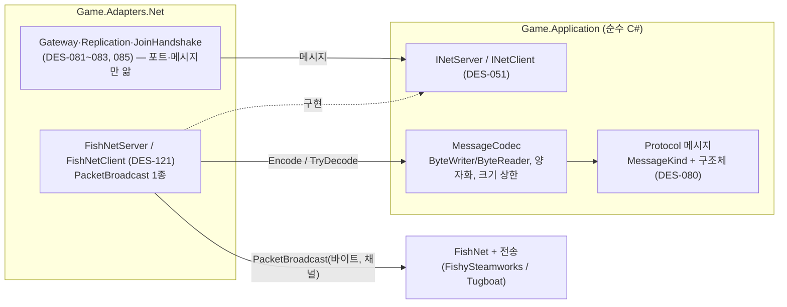
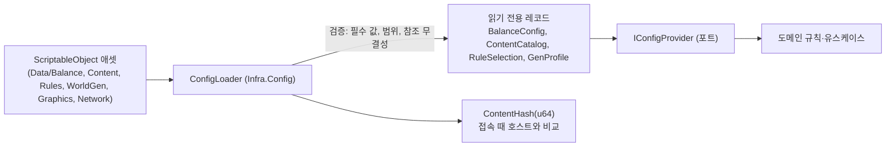
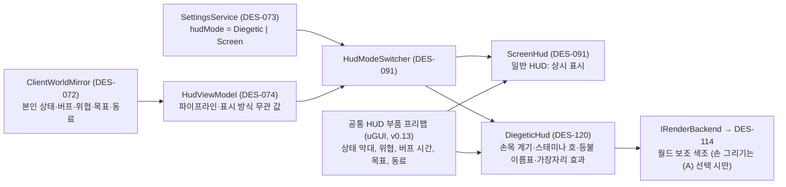

> SDD(소프트웨어 설계 명세서)의 일부 · 목차: [00-index.md](00-index.md)

### 3.7 인터페이스 관점

#### 3.7.1 외부 인터페이스: Steamworks (DES-102, DES-106)

| 기능 | Steamworks.NET API (대표) | 쓰는 곳 | 요구사항 |
|---|---|---|---|
| 초기화·App ID | `SteamAPI.Init`, `steam_appid.txt`(개발) / 빌드 설정의 App ID | Boot | NFR-006, NFR-009 |
| 사용자 식별 | `SteamUser.GetSteamID`, `SteamFriends.GetPersonaName` | 로그인 정보 | NFR-006 |
| 로비 | `SteamMatchmaking.CreateLobby`(유형: 초대 전용=Private, 친구 전용=FriendsOnly, 공개=Public), `SetLobbyType`, `SetLobbyData`, `RequestLobbyList` + `AddRequestLobbyListStringFilter`, `JoinLobby`, `GetLobbyMemberByIndex` | 세션 열기·목록·참가 | FR-001, FR-003, FR-144, FR-145, NFR-009 |
| 초대 | `SteamFriends.ActivateGameOverlayInviteDialog`, 콜백 `GameLobbyJoinRequested_t`, `GameRichPresenceJoinRequested_t` | 초대·친구 참가 | FR-002, FR-003 |
| P2P 연결 | FishySteamworks(Steam Networking Sockets, SDR) | 전송 | FR-005, NFR-008 |
| 원격 저장소 | `SteamRemoteStorage.FileWrite/FileRead/GetFileCount/GetFileNameAndSize/FileDelete` | 월드별 Cloud 동기화 | FR-021, NFR-007 |
| 업적 | `SteamUserStats.SetAchievement`, `StoreStats` | 업적 해제(각 클라이언트가 자기 계정에) | FR-164 |
| 리치 프레즌스 | `SteamFriends.SetRichPresence("steam_display"/"status"/"connect")` — `connect`는 참가 조건이 친구 전용·공개일 때만 설정 | 친구 목록 표시 | FR-165 |
| 화면 키보드 | `SteamUtils.ShowGamepadTextInput` / `ShowFloatingGamepadTextInput` | 게임패드 글자 입력 | NFR-004 |

로비 메타데이터 키(비밀번호 원문은 넣지 않음, FR-146)

| 키 | 값 |
|---|---|
| `kh_game` | 게임 식별 문자열(App ID 480에서 다른 게임 로비를 거르는 필터, NFR-009) |
| `kh_proto` | 프로토콜 버전 |
| `kh_build` | 게임 버전 전체 문자열 `GameVersion.Full`(예 `0.1.0+dev.20261104153012.a1b2c3d`). 목록의 버전 일치 표시(FR-145)는 `kh_proto`와 이 값이 내 것과 같은지로 판정. v0.12: 숫자 빌드 번호에서 바꿈, 키 이름은 유지(3.7.12) |
| `kh_world` | 월드 이름 |
| `kh_host` | 호스트 표시 이름 |
| `kh_count` | 접속 인원 (`/8`은 화면에서 붙임) |
| `kh_resv` | 재접속 예약 자리 수(0~7). 공개 세션 목록에 `7/8 · 예약 1` 형식으로 표시(I-03, SRS v0.5). 0이면 화면에서 「예약」 부분 생략. 예약이 생기거나(연결 끊김) 풀릴 때(재접속, 유지 시간 만료) `SessionService`가 `ILobbyService.SetMeta`로 즉시 갱신. `kh_count + kh_resv = 8`이면 목록에서 「가득 참」으로 표시(FR-115의 인원 제한 계산과 같음) |
| `kh_pw` | 비밀번호 여부 `0/1` |
| `kh_access` | 참가 조건 `invite/friends/public` |

#### 3.7.2 네트워크 프로토콜 (DES-080)

**v0.10 (사용자 결정 2026-11-03)**: 아래 표의 메시지 형식과 바이트 인코딩은 **`Game.Application`의 `Protocol/`**(DES-080)에 순수 C#으로 정의합니다. FishNet 형식은 쓰지 않습니다. FishNet에는 바이트 묶음을 담는 Broadcast **한 종류(`PacketBroadcast`)** 만 등록하고, Net 어댑터의 `FishNetServer`/`FishNetClient`(DES-121)가 포트 `INetServer`/`INetClient`(3.7.3)를 구현해 메시지 ↔ 바이트 변환을 `MessageCodec`에 맡깁니다. FishNet은 연결 관리, 전송(FishySteamworks/Tugboat), 신뢰·비신뢰 채널, 바이트 전달, 호스트 모드, 서버 틱(TimeManager), 플레이어 아바타 NetworkObject(DES-084)에 계속 씁니다. 플레이어 아바타만 NetworkObject이고, 자세는 아바타의 RPC로 오갑니다(3.9.8).



| 방향 | 메시지 | 주요 필드 | 채널 | 마일스톤 |
|---|---|---|---|---|
| C→S | `JoinRequest` | protocolVer(u16, **첫 필드 위치 고정**), gameVersion(길이 접두 UTF-8 ≤ 64 B, SemVer 전체 문자열), contentHash(u64), joinPath(Invite/Friend/Public/Rejoin), devPlayerId(개발 전송 전용), supportedGenVersions[], password(선택, M2). v0.12: u32 `buildVer` → 문자열 `gameVersion`, 프로토콜 버전 2(3.7.12 (5)) | 신뢰 | M1 |
| S→C | `JoinAccepted` | seedText, seed, generatorVer, expectedWorldHash, worldSettings(공개 필드), serverTick, clock | 신뢰 | M1 |
| S→C | `JoinRejected` | ReasonCode(인원 초과, 버전 불일치, 비밀번호 불일치, 차단됨, 참가 조건 밖, 시도 제한, 생성 불일치) | 신뢰 | M1 |
| C→S | `WorldReady` | computedWorldHash | 신뢰 | M1 |
| S→C | `SnapshotChunk` | snapshotTick, tableId, chunkIndex, chunkCount, payload(≤16 KB) | 신뢰 | M1 |
| S→C | `JoinComplete` | snapshotTick, yourPlayerSpawn | 신뢰 | M1 |
| S→C | `TableDelta` | tick, tableId, entries[] (자원은 ResourceIndex u16 + 상태 2B = 4B, 3.11.8. v0.10: v0.9까지 이 칸만 「상태 3B」로 달랐던 것을 맞춤) | 신뢰·순서 | M1 |
| S→C | `CreatureSpawn` / `CreatureDespawn` | id, defId, pos, 상태 / id | 신뢰 | M1(시험용) |
| S→C | `CreatureSnapshot` | tick, n × (id u16, pos 3×u16 셀 기준 양자화, yaw u8, anim u8, hp% u8) | 비신뢰 | M1 |
| C→S | `Command` | kind(u8), requestId(u32), payload(명령별) | 신뢰 | M1~ |
| S→C | `CommandResult` | requestId, ok, Rejection(사유 코드 + 부가 값) | 신뢰 | M1~ |
| S→C | `PrivateState` (본인에게만) | 인벤토리 칸 변경, 상태 값, 버프, 숙련도 | 신뢰 | M2~ |
| S→C | `Notice` | 알림 종류, 인자(이름 등) — 문장은 받는 쪽 언어로 조립 | 신뢰 | M1 |
| C↔S | `ChatSend` / `ChatMessage` | text(≤`채팅 최대 글자 수`) / senderId, senderName, text | 신뢰 | M1 |
| S→C | `ClockSync` | tick, gameTime, dayCount | 신뢰(5초마다·변경 시) | M2 |
| S→C | `ShutdownNotice` | 남은 초, 취소 여부 | 신뢰 | M3 |
| S→C | `AchievementUnlock` | achievementKey | 신뢰 | M6 |
| S→C | `ContainerView` | 보관함 id, 칸 배열(열어 본 사람에게만, 변경 시 구독자에게) | 신뢰 | M4 |
| S→C | `FurnaceView` (v0.6) | 용광로 id, 연료·재료·결과물 칸, 남은 연료 점수, 현재 작업 종류, **작업 시작 서버 시각 + 가공 시간**, 정지 사유(결과물 가득/연료 없음/재료 없음). 열어 본 사람(구독자)에게만, **상태가 바뀔 때만**(칸 변경, 1개 완료, 시작·정지) 보냄. 진행 막대는 클라이언트가 서버 시각으로 계산 | 신뢰 | M4 |

명령(`Command.kind`) 목록 — 마일스톤 순: 이동 보정 요청 없음(이동은 아바타 RPC, 3.9.8), `HitResource`, `Gather`, `Pickup`, `MoveItem`, `SplitItem`, `DropItem`, `Consume`, `SelectHand`, `Equip`, `Craft`(손 제작 또는 제작대 id 포함, v0.6), `Repair`, `Place`, `FurnacePut/Take/Open/Close`(v0.6, 칸 종류 포함), `Demolish`, `RepairStructure`, `ContainerPut/Take/Open/Close`, `Sleep/Wake`, `SetRespawn`, `Attack`, `Revive(Start/Stop)`, `GiveUp`, `Respawn`, `Ping`, `TowerActivate`, `TowerCancel`, `Ready`, `Plant`, `Water`, `Harvest`, `Cook`, `AcquireNode`, `ClearDeathMarker`, `HostOnly:Kick/Ban/Unban/ChangeAccess/Shutdown/CancelShutdown`.

메시지 공통 규칙
- **형식과 인코딩 (v0.10)**: 모든 메시지는 `Game.Application/Protocol/`의 구조체이고 첫 바이트는 `MessageKind`(u8)입니다. 바이트 배치는 `MessageCodec`이 `ByteWriter`/`ByteReader`로 직접 정합니다(리틀 엔디언, 가변 길이 정수는 쓰는 곳을 명시, 문자열은 길이 접두 UTF-8). 양자화(위치 2^16 단계, 방향 8비트 등, 3.11.9)도 코덱에서 합니다. 쓰기 쪽은 메시지 종류별 크기 상한을 넘으면 예외 대신 실패를 돌려주고, 읽기 쪽 `TryDecode`는 모르는 종류·잘린 입력·상한 초과·남는 바이트를 모두 거부합니다(예외를 던지지 않음). 새 메시지를 더할 때는 `MessageKind` 값을 뒤에 붙이고 기존 값은 바꾸지 않으며, 프로토콜이 바뀌면 `protocolVer`(`JoinRequest`, 로비 `kh_proto`)를 올립니다. v0.12: 현재 `protocolVer` = **2**(`JoinRequest`의 버전 필드가 문자열로 바뀜). `JoinRequest`의 첫 필드 `protocolVer`(u16)·`MessageKind.JoinRequest/JoinRejected` 값·`JoinRejected` 배치는 프로토콜을 올려도 바꾸지 않고, 디코더는 `protocolVer`가 다르면 나머지를 해석하지 않고 거부 경로로 넘깁니다(옛 빌드 참가자가 시간 초과 대신 「게임 버전 불일치」를 보게 함, 3.7.12 (5)).
- **시험 (v0.10)**: 메시지마다 「쓰고 다시 읽으면 같은 값」 왕복 시험과, 쓰기·읽기가 같은 잘못을 함께 저질러도 잡히도록 고정 입력에 대한 **고정 바이트 기대값** 시험을 `Game.Tests.Application`에 둡니다. 잘린 입력·상한 초과·모르는 종류 거부 시험도 같이 둡니다.
- **전송 (v0.10)**: `FishNetServer`/`FishNetClient`(DES-121)는 인코딩된 바이트를 `PacketBroadcast` 하나에 담아 표의 채널(신뢰/비신뢰)로 보내고, 받은 바이트는 `TryDecode`로 메시지로 바꿔 포트 이벤트 `Received(connId, message)`로 넘깁니다. 디코드 실패는 무시하고 로그(연결별 실패 횟수 집계)에 남깁니다. 송수신 버퍼는 재사용해 틱 루프 할당을 0에 가깝게 둡니다(R-16, R-31). v0.11 관찰(M1-07~09, 에디터 측정): `PacketBroadcast` 송신 1건당 관리 힙 할당이 **약 81 B** 남아 있어 0이 아닙니다. 플레이어 빌드 값과 틱당 송신 건수(8인 기준)는 M1-12에서 재고, 줄이는 방법은 R-31 대응을 따릅니다(변경은 DES-121 안에서 끝남).
- 모든 C→S 메시지는 (1) 크기 상한(v0.10: 디코드 단계에서 `MessageCodec`이 검사, DES-121이 호출), (2) 빈도 상한(`초당 요청 상한`, 명령별 토큰 버킷), (3) 값 범위(아이템 ID 존재, 수량 ≥ 1, 칸 번호 범위, 좌표가 월드 안, 대상 ID 존재)를 검사합니다. (2)·(3)은 게이트웨이(DES-081)가 디코드된 메시지로 합니다(FishNet 없이 `Game.Tests.Net`에서 시험). 실패하면 무시하고 로그에 남기며, 예외가 나도 연결 처리 루프 밖으로 새지 않습니다(NFR-040).
- 연결의 SteamID는 **전송 계층이 알려 주는 원격 ID**를 씁니다(FishySteamworks 연결 주소. v0.10: DES-121이 연결 시 원격 ID를 읽어 포트의 `Connected(connId, remoteId)`로 넘김). `JoinRequest`에 자기 SteamID를 적어 보내게 하지 않습니다. 개발 전송(Tugboat)에서만 `devPlayerId`를 씁니다(DES-103).
- 호스트는 Steam 전송에서 **로비 멤버이거나 재접속 예약이 있는 SteamID**의 연결만 받습니다. 로비를 거치지 않은 직접 연결 시도를 막습니다.

#### 3.7.3 내부 포트 (애플리케이션이 정의, DES-051)

| 포트 | 주요 메서드 | 구현 | 비고 |
|---|---|---|---|
| `INetServer` | `Send(connId, msg, channel)`, `Broadcast(msg, channel, filter)`, `Disconnect(connId, reason)`, 이벤트 `Connected(connId, remoteId)/Disconnected/Received(connId, msg)` | Adapters.Net — `FishNetServer`(DES-121) | 전송 종류를 모름(NFR-031). v0.10: `msg`는 `Protocol/` 메시지, `channel`은 `NetChannel{Reliable, Unreliable}`(Application 정의). FishNet 형식이 시그니처에 없음 → 시험은 가짜 구현 |
| `INetClient` | `Connect(endpoint)`, `Send(msg, channel)`, 이벤트 `Connected/Disconnected/Received(msg)` | Adapters.Net — `FishNetClient`(DES-121) | v0.10: `INetServer`와 같은 규칙 |
| `ILocalPlayerPose` (v0.10) | `Write(AvatarPose)`(표현 쪽), `TryRead(out AvatarPose)`(Net 쪽), `ApplyCorrection(pos)`(호스트 보정을 표현 쪽에 알림) | Application의 단순 보관 구현(`LocalPlayerPoseBuffer`) 하나를 조립 루트가 두 어댑터에 넘김 | 내 플레이어 자세를 표현 어댑터(DES-086) → Net 어댑터(DES-084)로 넘김. 어댑터끼리 참조 금지(3.4.1 규칙 4) |
| `IPlatformIdentity` | `LocalPlayerId`, `LocalDisplayName`, `ResolveName(PlayerId)` | Infra.Steam / DevIdentity | |
| `ILobbyService` | `Create(access, meta)`, `SetAccess`, `SetMeta`, `List(filter)`, `Join(lobbyId)`, `IsMember(PlayerId)`, `Leave`, `OpenInviteDialog` | Infra.Steam / 개발용 없음 | 참가 조건 → Steam 로비 유형 변환은 구현이 함 |
| `IPresenceService` | `SetPresence(state, joinable)` | Infra.Steam | |
| `IAchievementService` | `Unlock(key)` | Infra.Steam | |
| `ITextInputService` | `RequestText(maxLen, callback)` | Infra.Steam(화면 키보드) | |
| `IWorldSaveStore` | `List()`, `Load(id)`, `Save(id, snapshot)`, `Backups(id)`, `RestoreBackup(id, backup)`, `Rename`, `Duplicate`, `Delete`, `GetFolderPath` | Adapters.Persistence | |
| `ICloudSync` | `IsAvailable`, `Upload(path)`, `ListRemote()`, `Download(name)`, `Delete(name)` | Infra.Steam | |
| `IConfigProvider` | `Balance`, `Content`, `GenProfiles`, `Rules` | Infra.Config | 읽기 전용 |
| `IClock` | `RealtimeSeconds`, `UtcNow` | Infra.Platform | 시험에서 가짜 시계 |
| `ILog` | `Info/Warn/Error(category, message)` | Infra.Platform | 채팅·비밀번호를 넘기지 않는 것이 규칙. 구현이 한 번 더 걸러냄 |
| `IBackgroundRunner` | `Run(Func<T>, CancellationToken) → Task<T>` | Infra.Platform | 생성·저장 직렬화 |
| `IAiNavigationBackend` | `RebuildWalkGrid(region)`, `RequestFlowField(targets, radius) → handle`, `ScheduleSteering(agents, dt)`, `CompleteSteering()` | Infra.AiJobs | Burst 구현. 시험용 단순 구현(순수 C#) 별도 |
| `IPerfProbe` | `Begin/End(marker)`, `Count(name, value)` | Infra.Platform | 구간 시간 측정기. v0.9: Stopwatch 자체 측정이 기본(출시 설정 빌드에서도 값이 남음), ProfilerMarker는 Profiler 창용 보조(3.12.4) |
| `IDomainEventSink` | `Publish(evt)`, `Subscribe<T>(handler)` | Application 내부 | 동기 호출 |
| `ILocalSettingsStore` | `Load()`, `Save(settings)` | Infra.Platform | |
| `IBanListStore` (v0.7) | `Load()`, `Add(PlayerId, name)`, `Remove(PlayerId)`, `Contains(PlayerId)` | Infra.Platform (`bans.json`) | 호스트의 모든 월드 공통(C-46) |

#### 3.7.4 개발용 실행 옵션 (DES-103, DES-113, 개발 빌드에서만)

| 옵션 | 뜻 |
|---|---|
| `-transport tugboat|steam` | 전송 선택(FR-006). 출시 빌드는 무시하고 Steam 고정 |
| `-host` / `-connect <ip:port>` | 부트 판정 뒤 바로 호스트/참가(개발 로비 화면을 거치지 않음). v0.11(실제 `LaunchOptionsParser`): `-transport`를 주지 않으면 **Tugboat**로 봅니다. `-transport steam`과 함께 주면 「`-host/-connect`는 `-transport tugboat`와 함께」 옵션 오류를 로그에 남기지만 **중단하지 않고** Steam 전송으로 진행합니다 — Steam 호스트 경로 시험은 `-transport steam -host`로 합니다(Steam 전송의 참가는 로비·초대를 거치므로 `-connect`(ip:port)는 Tugboat에서만 씀). `-host`와 `-connect`를 함께 주면 옵션 오류(호스트가 우선) |
| `-devPlayerId <n>` | 같은 PC·같은 Steam 계정으로 여러 빌드를 띄울 때 플레이어 ID 대체(개발 전송 전용) |
| `-genhash <seeds.txt> -out <report.json> [-genver <v>]` | 화면 없이 시드 목록을 생성해 요약값 보고(NFR-053 다른 PC 비교) |
| `-genvalidate <count> -out <report.json>` | NFR-055 자동 시험(검증 조건 + 같은 PC 반복 결정론) |
| `-bench P1|P8 [-upscale on|off]` | 측정 장면 실행과 CSV 기록(NFR-021) |
| `-bot` | 봇 클라이언트(정해진 경로 이동·채집·공격 반복). M1 대체 측정(이 PC 1대 + 봇 7개)과 8인 사전 부하 시험용. `-batchmode -nographics`로 화면 없이 실행 가능(v0.8: 빌드한 플레이어의 batchmode라 에디터 프로젝트 잠금과 무관. 금지 대상은 에디터의 batchmode 실행뿐, D-22) |
| (선택) 다른 PC 결정론 비교 | M6 전에도 할 수 있는 선택 절차: 다른 PC(Intel/AMD)에서 같은 빌드로 `-genhash seeds.txt -out <PC이름>.json`을 실행해 결과 파일을 모으고, 개발 PC에서 비교 도구(`-genhash-compare a.json b.json ...`, 개발 빌드)로 불일치 시드·부분 요약값을 보고. 정식 판정은 M6-10 |
| Steam 없이 실행 | 출시·일반 개발 빌드는 Steam이 없으면 부트 안내 화면(SCR-001)에서 멈춤. 예외: 개발 빌드에서 `-transport tugboat`와 `-devPlayerId`를 함께 주면 Steam 초기화 없이 같은 PC 시험 가능(개발 빌드 전용) |
| `-perflog` | 성능 CSV 기록(FR-163) |
| `-bootsmoke` (v0.11 표에 추가, M1-02부터 있음) | 부트 판정을 한 번 하고 종료 코드로 끝냄: 0 = 메인 메뉴로 진행 가능, 1 = 설정 오류, 2 = SCR-001(Steam 필요). 자동 시험·빌드 확인용 |
| `-steamlobbytest` (v0.11) | 실제 Steam 로비 점검을 계정 하나로 돌리고 종료 코드(0 = 통과)로 끝냄(`SteamLobbySmoke`): 친구 전용 로비 생성 → 메타데이터·멤버 확인 → 검색(친구 전용 로비가 목록에 **0개인 것이 정상**, R-33 해소 — 사용자 확인 2026-11-04) → 공개 로비 생성 → `kh_game` 필터 검색으로 찾기(Steam 색인 지연 때문에 간격을 두고 여러 번 재시도) → 메타데이터 확인. Steam을 실제로 초기화한 경우에만 동작하고 개발용 신원(`-devPlayerId`)일 때는 무시 |
| `-autowalk` (v0.11) | 입력 없이 자동으로 걷기(화면 없는 다중 프로세스 시험에서 이동·복제 부하를 만들기 위함). M1-12의 `-bot`이 생기기 전 임시 수단 |
| `-autoquit <N>` (v0.11) | N초 뒤 스스로 종료(여러 프로세스 시험 정리용). N은 0보다 큰 실수 |
| 빌드 명령의 버전 처리 (v0.12) | `Game/Build/Windows Development`·`Windows Release`(`BuildCommands`, 열린 에디터에서 `unity command build run`)는 `bundleVersion`의 SemVer 핵심을 덮어쓰지 않고, 빌드하는 동안만 `+<rel|dev>.<UTC 시각>.<커밋 7자>[.dirty]`를 붙였다가 되돌립니다. 출시 빌드는 태그 `v<핵심>`이 다른 커밋을 가리키면 실패. **`-buildNumber` 인자와 `GAME_BUILD_NUMBER` 환경 변수는 폐지**(3.7.12 (2)) |
| 공통 (v0.11) | 위 개발 옵션은 모두 `BuildFlags.IsDevelopment`(에디터·개발 빌드)에서만 동작. 출시 빌드는 개발 옵션이 있으면 「무시합니다」 경고만 로그에 남김. 값 오류는 예외 없이 오류 목록으로 모아 경고 로그로 남김 |

#### 3.7.5 거부 사유 코드 (NFR-003)

| 코드 | 화면 텍스트 키 예 | 주요 FR |
|---|---|---|
| `OutOfRange` | `reason.out_of_range` | FR-007, FR-044 |
| `TargetMissing` | `reason.target_missing` | FR-007, FR-041 |
| `InventoryFull` | `reason.inventory_full` | FR-039 |
| `MissingMaterials{item, n}` | `reason.missing_materials` (「{item} {n} 부족」) | FR-053, FR-137 |
| `ToolTierTooLow` / `WrongTool` | `reason.tool_tier` / `reason.wrong_tool` | FR-046, FR-045 |
| `PlacementBlocked{cause}` | `reason.placement.*` (겹침/지형/거리/정화 구역) | FR-058, FR-059 |
| `NotAllowedNow{cause}` | `reason.not_now.*` (방어전 중 철거, 쓰러짐 중 행동 등) | FR-138, FR-142 |
| `UtensilMissing{utensil}` | `reason.utensil_missing` | FR-093 |
| `StationRequired` (v0.6) | `reason.station_required` (「제작대 필요」) | FR-173, FR-174 |
| `FurnaceSlotMismatch` / `FurnaceFull` (v0.6) | `reason.furnace.slot` / `reason.furnace.full` | FR-175 |
| `NoPoints` / `PrereqMissing` | `reason.no_points` / `reason.prereq` | FR-101 |
| `RateLimited` | (표시 안 함, 로그만) | NFR-041 |
| `Join.*` | `join.full`, `join.version`, `join.password`, `join.banned`, `join.access`, `join.timeout`, `join.gen_mismatch`, `join.attempt_limit` | FR-003, FR-004, FR-146, FR-148, FR-169 |

#### 3.7.6 규칙 교체 지점 (미정 규칙, DES-033)

아직 정하지 않은 규칙(SRS 부록 C)은 **지금 정하지 않습니다.** 규칙마다 도메인에 인터페이스 하나와 잠정 구현 하나만 두고, 어느 구현을 쓸지는 `Data/Rules/RuleSelection` 애셋에서 고릅니다. 규칙이 정해지면 잠정 구현을 고치거나 새 구현을 추가하고 선택값만 바꿉니다. 인터페이스는 **해당 기능의 마일스톤에서** 만듭니다(미리 만들지 않음).

| 교체 지점 | 결정 항목 | 잠정 구현(결정 전 동작) | 마일스톤 |
|---|---|---|---|
| `IZeroVitalPenaltyRule` | C-04 중 **허기·갈증·피로도·혹한 추가 불이익**(미결) | 해당 값 0 동안 체력 초당 감소(설정값). v0.10: **스태미나는 이 교체 지점에서 뺌** — 스태미나 부분은 해소(SRS v0.10, 사용자 결정 2026-11-03)되어 확정 규칙 `VitalsRules`(DES-003)가 처리: 0이 돼도 불이익 없음(달리기 입력이 있어도 걷기 속도로만 이동, 그 외 불이익 없음) | M2 |
| `IDeathRule` (부활 대기, 소지품, 부활 후 상태, 시작 아이템) | C-05 | 대기 0초, 소지품 유지, 상태 최대의 50%, 시작 아이템 없음 | M2 |
| `IDownedDamageRule` | C-45 | 쓰러짐 중 적이 대상에서 제외 | M2 |
| `IResourceRegrowthRule` | C-08 | 재생성 없음 | M3 |
| `IWrongToolRule`, `IOreDropTimingRule`, `IToolTierEffectRule` | C-09 | 맞지 않는 도구 = 진행 없음, 파괴 시 일괄 드롭, 등급 효과 없음 | M3/M4 |
| `IPickupRule` (자동/키, 소멸 시간) | C-10 | 키로 줍기, 소멸 없음 | M3 |
| ~~`ICraftingStationRule`~~ → 확정 규칙 `CraftingStationRules` (v0.6) | C-11 **해소**(SRS v0.8, FR-173·FR-174) | 교체 지점 아님. 제작법 데이터의 `requiresStation` 플래그로 판정: 도구·무기·대응 장비 = 제작대 필요, 제작대·횃불 등 기본품 = 손 제작(어디서나). 제작대 제작은 「제작대 상호작용 거리 안 + 제작대 존재」를 호스트가 검증. 해금 방식·수리 장소는 SRS v0.8 부록 C에 남아 있으면 잠정 구현(모두 해금, 어디서나 수리) 유지 | M4 |
| `IFurnaceTimeRule` (v0.6) | C-65 월드가 닫혀 있을 때·밤 건너뛰기 때 가공 진행 여부 | 둘 다 진행하지 않음(서버 플레이 시간 기준이라 월드가 닫히면 자연히 멈추고, 밤 건너뛰기는 게임 시각만 옮기므로 가공은 앞당겨지지 않음) | M4 |
| `ISmeltXpRecipientRule` (v0.6) | C-66 가공 완료 경험치를 누구에게 기록할지 | 그 작업의 광석(재료)을 투입한 플레이어(용광로에 마지막 투입자 SteamID 보관) | M4 |
| `IStationUseRule` (v0.6) | C-60 제작대 동시 사용 | 여러 명 동시 사용 가능(제작대는 상태가 없어 잠금 없음). 불가로 정해지면 이 규칙에 사용 중 표시를 추가 | M4 |
| 용광로 제작 위치, 숯 연료 점수·비율·시간, 석탄 광맥 분포 지역 (v0.6) | C-61, C-62, C-63, C-64 | 교체 지점 아님 — 데이터·설정값: 용광로 제작법 `requiresStation = true`(후보 제작대, C-61), 숯 = 16점(C-62), 숯 1개 = 나무 4개 + 연료 4점(C-63), 석탄 광맥 = 모든 생성 지역(C-64). 분포는 생성 프로필 값이라 바꾸면 생성 결과가 바뀜(3.11.1) | M4 |
| `IStructureDamageRule` | C-12 | 적이 일반 건축물을 공격하지 않음 | M4/M5 |
| `ITowerPlacementRule` | C-13 | 생성된 후보 자리 + 반경 안에만 | M6 |
| `IDefenseFailureRule`, `INextWaveRule` | C-14 | 실패 = 탑 체력 0만, 남은 적 제거, 다음 웨이브 = 전멸 또는 간격 중 먼저 | M6 |
| `IPlayerCountChangeRule` | C-15 | 시작 인원 고정 | M6 |
| `ITowerActivationRule` (동시 활성화, 낮/밤) | C-16, C-17 | 동시 1개, 언제든 | M6 |
| `INightRaidRule` (대상 우선순위·규모) | C-18 | 플레이어만, 인원과 무관한 고정 규모 | M5 |
| `ILightRepelRule` | C-19 | 반경 안 접근 지연(이동 속도 감소) | M5 |
| `IBoundaryHoldRule` | C-20 | 경계에서 대기 후 시간 초과 시 배회, 경계 너머 원거리 공격 없음 | M6 |
| `IThreatPurificationRule` | C-21 | 정화 구역에서도 지역 위협 유지 | M9a |
| `IFarmingRule` (경작지, 심기 허용, 시듦) | C-22 | 경작지 불필요, 잠식 지역 심기 허용(생장 안 함), 시듦 없음 | M7 |
| `IBuffStackingRule`, 요리 시간, 요리법 해금 | C-23 | 같은 버프는 시간 갱신, 다른 버프는 공존, 요리 즉시, 모두 해금 | M7 |
| `IEnemyDropRule` | C-24 | 드롭 없음 | M5 |
| `IEndingConditionRule` | C-26 | 최종 등광탑 성공만 | M10 |
| `ISkipTimeRule` | C-42 | 작물·물은 게임 시간만큼 진행, 버프는 실시간 기준(변화 없음) | M5 |
| ~~`IBanScopeRule`~~ → 확정 (v0.7) | C-46 **해소** | 교체 지점 아님. 차단은 호스트의 모든 월드에 적용, `IBanListStore`(포트) → `bans.json`(DES-110) | M2 |
| `IDifficultyEditRule` | C-47 | 생성 후 변경 불가 | M3 |
| `IMapShareRule` | C-53 | 탐험 기록 공유 | M6 |
| `IProficiencyModel` | C-06 | M8 착수 전 결정(잠정 구현 없음, 이벤트 기록만) | M8 |
| `IGenRetryPolicy` | C-55 | 파생 시드로 최대 16회 재생성 | M3 |
| ~~`IWristRaisedActionRule`~~ → 확정 규칙 (v0.5) | C-59 **해소**(2026-11-02) | 교체 지점 아님. 손목을 올린 동안 **모든 행동 가능**(제한 없음). 다른 창이 열리면 자동으로 내림만 적용. 게임은 멈추지 않음 | M2 |
| `WristRaiseMode` (사용자 옵션, 교체 지점 아님) | C-58 **해소**(2026-11-02) | 기본 **토글**, 옵션에서 「누르는 동안」으로 바꿀 수 있음(사용자 설정, NFR-047) | M2 |
| ~~`IScalingRule`~~ → 확정 규칙 `ScalingRules` | FR-064/FR-156 해석 (**확정** 2026-11-02) | 교체 지점 아님. 인원 배율은 웨이브 적 수와 보스 체력에만 적용, 일반 적 체력에는 적용하지 않음. 난이도 배율은 모든 적에 적용 | M6 |

#### 3.7.7 설정값과 콘텐츠 데이터 (DES-104, NFR-033, NFR-034)



- 부록 C.1의 모든 설정값은 `BalanceConfig` 계열 애셋의 필드입니다. 코드에 숫자를 직접 쓰지 않습니다(상수 금지 검사: 코드 리뷰 체크 항목).
- 콘텐츠(아이템, 자원 종류와 타격 횟수·최소 도구 등급·드롭 표, 제작법, 건축물, 생물, 웨이브 구성, 작물, 요리법, 버프, 스킬 노드, 목표, 업적, 해금 조건)는 정의 애셋 하나에 한 항목입니다. 각 정의는 **문자열 키**(예: `item.wood_ash`)를 갖고, 로더가 키를 정렬해 `ContentId`를 붙입니다.
- 화면 이름은 정의에 텍스트 키만 두고 실제 글자는 String Table에 둡니다(NFR-034). 이름을 바꿀 때 코드·정의를 고치지 않습니다.
- `ContentHash`: 모든 정의의 키와 값의 직렬화 요약값. 호스트와 다르면 「게임 버전 불일치」로 참가를 거부합니다(PC마다 데이터가 달라 생기는 동기화 오류 방지).
- 생성에 영향을 주는 설정은 `GenProfile`에만 두고 생성기 버전에 묶습니다(3.11.1).
- 설정값을 바꿔 빌드하면 동작이 바뀌는지 확인하는 시험(NFR-033 표본 10개)은 EditMode 시험에서 가짜 `IConfigProvider`로 합니다.

#### 3.7.8 경험치 이벤트 (DES-025, DES-068, NFR-046)

```
record ActionCompleted(ActionType Type, PlayerId Player, ContentId Target, int Amount = 1)
// 발행 위치: 명령 처리기가 상태를 확정한 직후(호스트에서만). 거부된 요청은 발행하지 않음(FR-098 수용 기준)
//   벌목 → 나무 쓰러짐 확정, 채광 → 광석 파괴 확정(석탄 광맥 포함), 채집 → 손 채집 확정, 제작 → 결과물 지급(손 제작·제작대 모두),
//   가공(v0.6, SRS v0.8 NFR-046에 포함) → 용광로가 결과물 1개(제련품·숯)를 만든 시점. 받는 사람 = `ISmeltXpRecipientRule`(C-66, 잠정: 재료를 투입한 플레이어)
//     (그 플레이어가 접속하지 않았어도 이벤트는 대상 SteamID로 기록. M8 경험치 반영 방식은 C-06 결정 때 확인)
//   건축 → 배치 확정, 처치 → 적 체력 0(마지막 타격자), 사냥 → 동물 체력 0, 심기, 수확, 요리 → 요리 지급
// M3~M7: ActionEventRecorder 구독 → 플레이어·종류별 개수 집계(메모리), 개발 로그, 시험용 조회
// M8:    ProficiencyService 구독 → 행동 경험치 표로 경험치 → 레벨업 → 스탯 포인트 (기능 코드 수정 없음)
```
- 시험: 각 마일스톤 완료 때 그 마일스톤의 행동마다 이벤트가 1회씩 나오는지 확인하는 EditMode 시험을 추가합니다(NFR-046 수용 기준).
- **소급 없음(확정, 사용자 결정 2026-11-02)**: M3~M7의 이벤트 집계는 월드 파일에 저장하지 않습니다. M8 도입 전에 한 행동은 경험치로 바뀌지 않습니다.

#### 3.7.9 입력·다국어·접근성·그래픽 처리 위치

| 주제 | 설계 | 요소 |
|---|---|---|
| 입력 | Unity Input System. Input Actions 애셋 하나에 제어 체계 2개(`KeyboardMouse`, `Gamepad`). 재설정은 `PerformInteractiveRebinding`, 저장은 제어 체계별 바인딩 덮어쓰기 JSON을 따로(FR-117). 같은 체계 안 충돌 검사 후 「비우기/취소」. 마지막 입력 장치 감지(`InputUser.onChange`, 제어 체계 전환)로 `InputDeviceContext` 갱신 → 안내 아이콘 교체(FR-166, NFR-002). ~~UI Toolkit 내비게이션으로 모든 메뉴를 게임패드로 이동.~~ **v0.13(D-27)**: 메뉴 이동은 uGUI 내비게이션(Selectable `Navigation`, EventSystem 선택 요소)과 `InputSystemUIInputModule`(UI 동작 지도의 `Navigate`·`Submit`·`Point`·`Click`·`ScrollWheel`), 닫기(`Cancel`)·탭 이동(`TabPrev`/`TabNext`)은 `UiInputRouter`가 맨 위 화면에 전달(3.7.10 (6)). 키캡은 `KeycapView`가 장치 전환 이벤트로 교체. **v0.7: 기본 바인딩은 STORYBOARD 2.4의 기본 할당표(키보드·마우스 + Xbox 패드)를 그대로 따름. 안내 아이콘은 Xbox 계열을 먼저(M1), PlayStation 계열은 M2(C-28 해소)** — 아이콘 묶음은 장치 계열별 데이터라 추가해도 코드 변경 없음. **v0.10 (사용자 결정 2026-11-03)**: 게임패드에서 버튼이 겹치는 채팅·핑·퀵슬롯 등의 할당은 **추후 다시 정의(보류)**. M1-08 기본 바인딩은 키보드·마우스 전체 + 게임패드는 겹치지 않는 기본 행동(이동·시점·달리기·상호작용·공격 등)만 넣고, 보류 항목의 게임패드 바인딩은 비워 둡니다(그 Action이 있으면 키보드·마우스 바인딩만 둠). 나중에 정하면 Input Actions 애셋 데이터만 바꾸면 되고 코드는 바뀌지 않습니다. v0.4: 손목 계기 올림/내림 Action `ToggleWrist` 추가(키보드·게임패드 기본 할당은 결정 대기. 동작 방식은 `WristRaiseMode` 기본 토글 / 옵션 누르는 동안, C-58 해소) | DES-092 |
| 게임패드 글자 입력 | `ITextInputService` → Steam 화면 키보드 | DES-102 |
| 다국어 | Unity Localization 패키지 String Table(ko, en). 도메인·애플리케이션은 텍스트 키와 인자만 다루고, 문장 조립은 받는 PC의 언어로(알림도 키 + 인자로 전송). 빌드 전 검사: 모든 키가 두 언어에 있는지(누락 0건, NFR-044). 첫 실행 언어(C-48 해소): 사용자 설정에 언어가 없을 때 Localization 초기화 단계에서 `SteamApps.GetCurrentGameLanguage()`(Steam 언어)를 읽어 한국어면 한국어, 그 밖은 영어로 정하고 사용자 설정에 저장 | DES-093, DES-102 |
| 사용자 입력 글자 | 채팅·월드 이름·Steam 이름은 리치 텍스트 해석 끔, 제어 문자 제거는 호스트에서(NFR-050). v0.13: **모든** TextMeshPro 글자(`TMP_Text.richText = false`)와 입력칸(`TMP_InputField.richText = false`)에서 끔 — 게임 문장도 태그를 쓰지 않으므로 예외 없음. 동적 글자(이름·채팅)는 `parseCtrlCharacters = false`도 함께. `ThemedText`가 켜질 때 강제하고 프리팹 규칙 검사가 확인(3.4.3) | DES-034, DES-091, DES-122 |
| 글자 크기 | v0.13: 테마 애셋 `UiTheme`의 글자 크기 토큰(`fs-*`) × 단계 배율(작게 0.9 / 보통 1.0 / 크게 1.25)을 `ThemedText`가 적용하고, 단계를 바꾸면 `UiRoot`가 켜진 모든 `ThemedText`에 다시 적용. **M1 UI부터** 모든 글자 크기는 토큰으로만 지정(3.7.10). (v0.12까지: 루트 USS 클래스 `text-small/normal/large`가 `--fs-*` 변수를 바꿈) | DES-095, DES-091, DES-122 |
| 색각 보정 | 월드 화면: HDRP 사용자 지정 후처리(색 변환 행렬, DES-114). UI: 색 토큰 + 모양·아이콘 병행 규칙으로 색 없이도 구분(FR-130 수용 기준), **M1 UI부터** 적용(3.7.10). v0.13: UI는 Screen Space Overlay라 HDRP 후처리를 거치지 않으므로 색각 보정 행렬이 UI에 걸리지 않음 — UI는 모양 구분 규칙으로만 대응(설계 의도와 같음) | DES-095, DES-091, DES-122 |
| 흔들림·섬광 | 카메라 흔들림 세기 배율, 섬광 제한기(1초 창에서 큰 밝기 변화 3회 초과 연출을 완화) | DES-095 |
| 그래픽 | 프리셋 데이터 → HDRP 품질 단계 + 세부 값, 세부 변경 시 「사용자 지정」. HDRP 호출은 `Game.Infra.Rendering`에서만(3.4.4) | DES-109, DES-114 |

#### 3.7.10 UI 공통 기반 (v0.3, 디자인 결정 2026-11-02. v0.13: uGUI 기준으로 다시 씀, 사용자 결정 2026-11-04, D-27)

**v0.13 요약**: UI는 **uGUI(Canvas + TextMeshPro)** 로 만들고, **하이어라키·프리팹의 게임 오브젝트가 원본**입니다. 아래 결정 표의 (1)~(3)(글자 크기 단계, 색 토큰, 모양 구분 규칙)은 그대로 지키되, 구현 수단을 USS 변수에서 **테마 애셋 `UiTheme` + 적용 컴포넌트**(DES-122)로 바꿉니다. 결정 표 다음의 (1)~(9)가 uGUI 구성 규칙입니다. 결정 표 첫 행의 USS 설명은 v0.12까지의 기록입니다.

| 결정 | 설계 | 요소 |
|---|---|---|
| **I-04 접근성 기반을 M1 UI부터** | **v0.13: 테마 애셋 `UiTheme`의 글자 크기 토큰·색 토큰과 `Themed*` 컴포넌트, 모양 구분 규칙(아래 (2)~(3)). 규칙 위반은 프리팹·테마 규칙 검사(3.4.3)와 코드 리뷰로 찾음.** (v0.12까지의 기록) 공통 USS 파일 하나(`UI/Common/Base.uss`)에 (1) **글자 크기 단계 변수**(v0.11 실제: `--fs-caption`, `--fs-body`, `--fs-button`, `--fs-heading`, `--fs-hud`. 글자 크기는 이 변수로만 지정, 고정 px 금지. 패널 루트에 단계 클래스 `text-small`(×0.9)/`text-normal`(×1.0, 기본)/`text-large`(×1.25) 중 하나를 붙이면 클래스가 변수 값을 바꾸고 하위 요소가 상속. v0.10까지 적었던 단일 배율 변수 `--text-scale`은 만들지 않았고, 단계마다 계산해 둔 px 값을 클래스에 직접 둠. 단계를 더하면 클래스 하나를 추가), (2) **색 토큰** 변수(`--color-*`, 아래 표 — 화면에서 색 값 직접 사용 금지), (3) **모양 구분 규칙**(동료·적·경고·핑 등 색으로 구분하는 정보는 반드시 아이콘·모양·글자 중 하나를 함께 씀)을 둡니다. M1의 개발용 최소 화면(로비·접속·HUD 스태미나·성능 표시)부터 이 기반 위에 만들어 M2-01(글자 크기 옵션)·M5-08(색각 보정)·M6-08(글자 크기 재검증)에서 화면을 고치지 않게 합니다. 규칙 위반(고정 글자 크기, 직접 색 값)은 USS 검사 시험과 코드 리뷰 항목으로 찾습니다 | DES-091, DES-095 |
| **I-12 다크 단일 테마** | 색 토큰은 다크 테마 한 벌만 정의합니다. 테마 전환 구조(테마 선택 옵션, 토큰 세트 교체)는 만들지 않습니다. 색각 대응은 테마 교체가 아니라 모양 구분 규칙(UI)과 후처리(월드 화면)로 합니다 | DES-091 |
| **I-07 화면을 열어도 게임은 멈추지 않음** | 3.10.7 | DES-091, DES-052 |
| **디자인 결정 D-06 독립 레시피북** | 제작 화면은 키(게임패드 버튼)로 여는 독립 화면입니다(설계 근거 D-06 「서버 틱」과 다른, DESIGN_PROPOSAL의 결정 번호). 화면 열기는 `OpenRecipeBook(source)` 하나로 받습니다. **v0.6(C-11 해소, FR-173·FR-174)**: `source = Hotkey`(키로 열기)는 **열람 + 손 제작만** 가능하고 제작대가 필요한 항목은 「제작대 필요」로 표시합니다. `source = Station(entityId)`(제작대 상호작용)는 같은 화면을 팝업으로 열고 모든 항목을 제작할 수 있습니다. 판정은 확정 규칙 `CraftingStationRules`(3.7.6). `Craft` 명령에 제작대 id가 붙고 호스트가 거리·존재를 검증합니다 | DES-091, DES-058, DES-033 |

**(1) 색 토큰 (v0.13 확정 — `UiTheme` 애셋의 이름)**: 토큰 이름은 v0.11~v0.12의 USS 변수 이름(`--color-*`)에서 **`--`만 뺀 것**이고, STORYBOARD v1.7 2.1 대응표와 같은 이름입니다. **값은 STORYBOARD 2.1의 색**을 그대로 씁니다. 색 값은 `UiTheme.asset` 안에만 있고, 프리팹의 그래픽·글자는 토큰 이름으로만 참조합니다(실제 `Graphic.color` 값은 `Themed*` 컴포넌트가 토큰에서 계산해 넣은 결과이며, 인스펙터에서 직접 바꾸면 규칙 검사가 실패, 3.4.3). 코드에서 토큰을 바꿀 때는 문자열 대신 상수 클래스 `UiTokens`(예: `UiTokens.ColorDanger = "color-danger"`)를 씁니다.

| 토큰 (`UiTheme`) | v0.12 USS 이름 | STORYBOARD 2.1 | 값 | 쓰임 |
|---|---|---|---|---|
| `color-surface` | `--color-surface` | `--panel` | #14151A | 패널·모달 배경 |
| `color-text` | `--color-text` | `--text` | #E8E4DC | 본문 글자, 상태 줄 글자(STORYBOARD v1.6) |
| `color-text-dim` | `--color-text-dim` | `--text2` | #A9A59C | 보조 글자 |
| `color-light` | `--color-light` | `--light` | #F2A53A | 빛: 선택·활성·진행 막대 |
| `color-focus`, `color-primary` | `--color-focus`, `--color-primary` | `--light` | #F2A53A | 포커스 외곽선, 주 버튼 채움(같은 값, 쓰임별 이름) |
| `color-warning` | `--color-warning` | (`--light`와 같은 값) | #F2A53A | 경고 상태 글자(기호와 함께) |
| `color-danger`, `color-enemy` | `--color-danger`, `--color-enemy` | `--danger` | #E5594F | 위험·거부·오류 / 적 표시 |
| `color-pure` | `--color-pure` | `--pure` | #6FD1B0 | 정화·성공·연결됨·「게임 진행 중」 배지 |
| `color-ally` | `--color-ally` | (`--cold`와 같은 값) | #6DB8F0 | 동료 표시(◆ 기호·이름과 함께) |
| `color-stamina` | `--color-stamina` | `--sp` | #A8D45A | 스태미나 |
| `color-sand` | `--color-sand` | `--sand` | #D8CBB0 | 허기·갈증·피로도 |
| `color-track` | `--color-track` | `--track` | #2C2E36 | 게이지 빈 부분 |
| `color-disabled` | `--color-disabled` | `--disabled` | #6B6A66 | 비활성 글자 |
| `color-bg` | `--color-bg` | (STORYBOARD v1.6 추가) | #0E1014 | 화면 바닥색 |
| `color-backdrop` | `--color-backdrop` | (STORYBOARD v1.6 추가) | 검정, 알파 0.88 | 모달 뒤 어둡게 |
| `color-surface-raised` | `--color-surface-raised` | (STORYBOARD v1.6 추가, `--track`과 같은 값) | #2C2E36 | 버튼·목록 행·입력칸 배경 |
| `color-border` | `--color-border` | (STORYBOARD v1.6 추가) | #585C68 | 장식용 경계선 |
| `color-primary-text` | `--color-primary-text` | `--panel`(주 버튼 글자) | #14151A | 주 버튼 위 어두운 글자 |

- 합계 20개(같은 값을 쓰는 쓰임별 이름 포함). STORYBOARD 2.1의 환경 위협 색 `--toxic`·`--cold`·`--dark`는 해당 화면이 생길 때(M9a~c) `color-toxic`·`color-cold`·`color-dark`로 테마 애셋에 추가합니다(코드 변경 없이 데이터 추가 + `UiTokens` 상수 추가).
- **대비 검사 짝**: 테마 애셋에 「글자 토큰 ↔ 바탕 토큰 ↔ 기준(4.5 또는 3.0)」 목록을 두고 시험이 WCAG 상대 휘도로 계산합니다. 기본 짝: `color-text`·`color-text-dim`·`color-light`·`color-danger`·`color-pure`·`color-ally`·`color-stamina`·`color-sand` ↔ `color-surface`·`color-bg`(4.5), `color-text` ↔ `color-surface-raised`(4.5), `color-primary-text` ↔ `color-primary`(4.5), `color-disabled` ↔ `color-surface`(3.0, 비활성 예외). `color-border`는 장식용이라 짝에 넣지 않습니다(STORYBOARD 2.1).

**(2) 글자 크기 토큰과 단계 (v0.13 확정)**: 토큰 이름은 v0.12의 `--fs-*`에서 `--`를 뺀 것입니다. 테마 애셋은 **보통 단계 기준값(1080p px)** 과 **단계 배율**만 갖고, 실제 크기 = `round(기준값 × 배율)`(소수 .5는 올림, `MidpointRounding.AwayFromZero`)입니다. 이 계산은 v0.12 `Base.uss`의 단계별 값과 같습니다(전환 전후 화면 크기 동일).

| 토큰 | STORYBOARD 2.2 이름(v1.7 예시) | 쓰임 | 보통(×1.0) | 작게(×0.9) | 크게(×1.25) |
|---|---|---|---|---|---|
| `fs-caption` | `fs-sub` | 보조 글자 | 20 | 18 | 25 |
| `fs-body` | `fs-body` | 본문 | 24 | 22 | 30 |
| `fs-button` | (없음, 구현 이름) | 버튼 글자 | 24 | 22 | 30 |
| `fs-heading` | `fs-title` | 제목 | 30 | 27 | 38 |
| `fs-heading-lg` (**v0.13 신설**) | `fs-title-lg` | 큰 제목(메인 메뉴 등, M2부터) | 40 | 36 | 50 |
| `fs-hud` | `fs-hud` | HUD 숫자(굵게) | 22 | 20 | 28 |

- 단계는 기존 열거형 `UiTextScale`(Small/Normal/Large)을 그대로 씁니다. 「작게」의 가장 작은 글자 18 px(STORYBOARD 2.2), 단계를 더하면 배율 한 줄을 추가합니다.
- STORYBOARD v1.7의 예시 이름(`fs-sub`, `fs-title`, `fs-title-lg`)은 위 표의 구현 이름으로 맞춥니다(총괄이 STORYBOARD 수정, 보고서 참고).
- **글꼴 토큰** `font-regular`(400), `font-semibold`(600), `font-bold`(700): Pretendard의 TMP 글꼴 애셋 3개를 가리킵니다. `ThemedText`는 `weight` 값으로 고르고, TMP의 가짜 굵게(`FontStyles.Bold`)는 쓰지 않습니다.

**(3) 테마 컴포넌트 (DES-122)** — 모두 `Game.Adapters.Presentation/UI/Common/`, `[ExecuteAlways]`로 에디터에서도 결과가 보입니다(하이어라키에서 고칠 때 바로 확인).

| 컴포넌트 | 붙이는 곳 | 인스펙터 필드 | 동작 |
|---|---|---|---|
| `UiTheme` (ScriptableObject) | `Assets/_Game/UI/Theme/UiTheme.asset` 한 벌 | 색 토큰 목록(이름, 색), 글자 크기 토큰 목록(이름, 기준 px), 단계 배율 3개, 글꼴 토큰 3개, 대비 검사 짝 | 이름 → 값 사전을 처음 읽을 때 한 번 만듦. 다크 단일 테마(I-12): 토큰 세트 교체·테마 선택 구조 없음 |
| `ThemedText` | 모든 `TextMeshProUGUI` | 테마, 크기 토큰, 색 토큰, 굵기, **텍스트 키**(빈칸이면 `IsDynamic` 체크 필수) | 켜질 때·단계 변경·언어 변경 때 `fontSize`·`color`·`font`·글자를 적용. `richText = false`, `enableAutoSizing = false`, `raycastTarget = false`를 강제. 글자 내용을 코드가 넣는 동적 글자는 `SetDynamicText`(같은 값이면 무시)·TMP `SetText(형식, 숫자)`(할당 없음)를 씀 |
| `ThemedGraphic` | 모든 `Image`·`RawImage`·사용자 지정 `Graphic` | 테마, 색 토큰(또는 「없음 = 흰색」), `alpha`(0~1, 불투명도 — 색 값이 아님) | 켜질 때 `color = 토큰 색 × alpha`. 상태에 따라 색을 바꿀 때는 `SetColorToken(UiTokens.…)` |
| `ThemedSelectable` | 모든 Selectable(버튼·토글·슬라이더·드롭다운·입력칸·목록 행) | 변형(주/보조/위험/목록 행), 배경·테두리·글자·포커스 표시 오브젝트 참조 | 같은 오브젝트에서 포인터·선택 이벤트(`IPointerEnter/Exit/Down/Up`, `ISelect/IDeselect`)를 받아 STORYBOARD 2.5의 상태(기본·호버·포커스·눌림·사용 불가)를 토큰으로 그림. **포커스 = 3px `color-focus` 외곽선 + 왼쪽 ▶**(색에만 의존하지 않음). Selectable의 `transition`은 None(색 블록 미사용) |
| `UiButton` (`Button` 상속) | 모든 버튼 | 사용 불가 여부, 사유 텍스트 키 | **사용 불가여도 `interactable`을 끄지 않음**(포커스를 받아 사유를 읽을 수 있게, STORYBOARD 2.5). 사용 불가면 점선 테두리 + 🔒 + `color-disabled` 글자로 그리고, 누르면 `onClick` 대신 `UnavailablePressed(사유 키)` 이벤트 → 도움말 줄에 사유 표시 |
| `UiRaycastBlocker` | 모달 뒤 어둡게 막(`color-backdrop`) 등 아래 화면 입력을 막아야 하는 그래픽 | — | 「이 그래픽은 일부러 레이캐스트를 받음」 표시. 규칙 검사가 이 표시 없이 켜진 `raycastTarget`을 실패로 봄 |
| `UiSafeArea16x9` | 화면 프리팹 루트 캔버스 바로 아래 `Content` | — | 크기 = (min(부모 폭, 부모 높이 × 16/9), 부모 높이), 가운데 정렬. 배경·막은 이 밖(캔버스 전체), HUD·창은 이 안 |
| `KeycapView` | 키캡 자리 | Input Action 이름 | 현재 장치(마지막 입력 장치)의 할당을 아이콘(Xbox 세트, M2에 PlayStation) 또는 키 이름으로 보임. 장치 전환 이벤트에서 1초 안에 교체(FR-166). 할당 없음(패드 보류 행동)은 「미지정」. 리치 텍스트를 끄므로 문장 안에 키캡을 넣을 때는 글자와 키캡을 가로 레이아웃으로 나란히 둠 |
| `UiArcGraphic` (`MaskableGraphic` 상속) | 스태미나 호(SCR-015 ⑱) 등 | 두께, 점선 조각 수 | `OnPopulateMesh`로 호를 그림(스프라이트 불필요). 25% 이하에서는 점선(모양 구분). 비율이 바뀔 때만 `SetVerticesDirty` |

- 에디터 보조(`Game.Editor`): 토큰 이름 드롭다운(`UiTokenAttribute` 속성 그리기), 메뉴 `Game/UI/Apply Theme To Prefabs`(테마 값을 바꾼 뒤 모든 UI 프리팹의 `Themed*`가 계산 결과를 다시 써 넣음 — 구조는 건드리지 않고 색·크기 값만).

**(4) 캔버스 구성**

| 항목 | 규칙 |
|---|---|
| 렌더 모드 | 모든 화면 캔버스는 **Screen Space - Overlay**. HDRP 후처리·업스케일링 뒤에 그려져 흐려지지 않음. 예외는 손목 계기 내용 캔버스 하나(UI 캡처 카메라, 3.7.11) |
| 크기 조절 | 화면 프리팹 루트 `CanvasScaler`: **Scale With Screen Size, 기준 1920×1080, Screen Match Mode = Match Width Or Height, Match = 1(높이 기준)**(STORYBOARD 2.3). 1440p ×1.333, 4K ×2.0. Reference Pixels Per Unit 100(기본). 하위 캔버스에는 `CanvasScaler`를 두지 않음 |
| 16:9 영역 | 루트 아래 `Content`(`UiSafeArea16x9`)에 HUD·창을 둠. 21:9는 좌우에 배경만, 16:10은 높이 기준이라 폭이 줄어듦(좌우 여백 40px 유지는 화면 배치 규칙) |
| 배치 수치 | 간격·최소 높이(56px)·가장자리 여백(40px) 같은 배치 수치는 1080p 기준 값으로 RectTransform·Layout 컴포넌트에 둡니다(토큰 대상은 색·글자 크기·글꼴). |
| 레이아웃 | 글자가 커지거나 영어로 길어져도 잘리지 않도록 버튼·목록·대화상자는 `Horizontal/VerticalLayoutGroup` + `ContentSizeFitter`(또는 `LayoutElement` 최소 크기)로 내용에 맞춰 늘어나게 함(STORYBOARD 2.2). 줄바꿈 허용(`textWrappingMode` 켬), 이름류만 말줄임(`overflowMode = Ellipsis`). 긴 목록은 `ScrollRect` |
| 정적·동적 분리 | 화면마다 루트 캔버스(정적) + 자주 바뀌는 요소용 **하위 캔버스(`Canvas` 컴포넌트만, 동적)**. 예: HUD의 스태미나 호·경고·연결 상태 줄은 `HudDynamic` 하위 캔버스, 십자선·명단 틀은 정적. 하위 캔버스 안에는 Layout Group을 두지 않음(매 프레임 레이아웃 재계산 방지). 값이 같으면 글자·정점을 다시 쓰지 않음 |
| Raycast Target | 상호작용하지 않는 모든 `Graphic`·TMP 글자는 `raycastTarget = false`. 켜는 것은 Selectable의 `targetGraphic`과 `UiRaycastBlocker`뿐. TMP Settings의 「Enable Raycast Target」 기본값도 끔 |
| 픽셀 맞춤 | `pixelPerfect` 끔(움직이는 HUD 비용) |

**(5) 화면 층(정렬 순서)과 숨김 규칙** — `UiScreen.Layer` 값이 `Canvas.sortingOrder`를 정합니다(프리팹에서 `OnValidate`로 맞추고 규칙 검사로 확인).

| 층 | `sortingOrder` | 화면 | 비고 |
|---|---|---|---|
| WorldMarkers | 0 | 이름표·핑·사망 위치·부활 지점(화면 좌표 투영, DES-097) | M2-09부터 |
| Hud | 100 | `GameHud`(십자선, 스태미나 호, 명단·연결 상태(개발용), 일반 HUD 막대, 손목 계기 표시 면) | 상호작용 없음 → `GraphicRaycaster` 끔, `CanvasGroup.blocksRaycasts = false` |
| Window | 200 | 개발용 로비·접속 중(M1), 메인 메뉴 계열(M2), `GameMenu`(ESC, SCR-016), 인벤토리·레시피북 등 게임 안 창 | 게임 안 창은 열리면 `UiState` Overlay(3.10.7) |
| Alert | 300 | 피격 방향 호·위협 테두리·쓰러짐 전환(DES-120) | **창 위**에 보임(STORYBOARD 2.6) — 입력 없음 |
| Modal | 400 | 확인 대화상자, 오류 모달, 토스트 | `UiRaycastBlocker` 막으로 아래 입력 차단 |
| System | 500 | SCR-001 Steam 필요 안내, SCR-002 광과민성 경고 | 부트 단계 화면 |

- **숨김 = 세 가지를 함께 끕니다**: `UiScreen.SetVisible(false)`는 `Canvas.enabled = false`, `GraphicRaycaster.enabled = false`, `CanvasGroup.interactable = false`·`blocksRaycasts = false`를 한 번에 합니다. `Canvas`만 끄면 Selectable이 살아 있어 키보드·패드 자동 내비게이션이 숨은 화면으로 넘어가고, 레이캐스터만 남으면 보이지 않는 전체 화면 막이 아래 화면 클릭을 가로챕니다(v0.12 때 ESC 메뉴 결함 — 로비 전체 화면 배경이 HUD 위를 덮음 — 의 재발 방지). 오브젝트 자체(`SetActive`)는 끄지 않아 참조와 레이아웃이 유지됩니다.
- **전체 화면 막은 그 화면 프리팹 안에만** 둡니다(막이 화면 밖에 따로 떠 있지 않게). 게임 밖 화면(로비·메인 메뉴)은 게임에 들어가면 `GameFlow`가 숨기고, 나가면 HUD·게임 안 창을 숨깁니다.
- **`UiScreenStack`(`UiRoot` 안)**: 보이는 Window·Modal·System 층 화면을 연 순서로 쌓습니다. 맨 위 화면만 닫기·탭 이동을 받고, 닫으면 아래 화면의 마지막 선택 요소로 포커스를 되돌립니다. 열 때 화면의 `FirstSelected`를 선택합니다. 시험: PlayMode `UiLayerPlayTests`(3.4.2).

**(6) 입력과 내비게이션 (NFR-002, NFR-004, FR-166)**

- **EventSystem은 Boot 씬에 하나**(`UiRoot` 프리팹의 자식)이고 입력 모듈은 **`InputSystemUIInputModule`**(프로젝트의 Active Input Handling = Input System만이라 `StandaloneInputModule`은 쓰지 않음). 모듈의 `actionsAsset`은 게임과 **같은 `GameInput.inputactions` 인스턴스**(복제하지 않음 — 재설정한 바인딩(FR-117)이 메뉴 조작에도 적용되게, `UiRoot`가 초기화 때 다시 확인). 모듈 동작 연결: `Navigate`·`Submit`·`Point`·`LeftClick`(= UI 지도 `Click`)·`ScrollWheel`. **`Cancel` 칸은 비워 둠**(닫기는 아래 라우터 한 곳에서만 처리해 두 번 닫힘 방지), `deselectOnBackgroundClick` 끔(패드로 바꿨을 때 선택이 남게).
- **Input Actions UI 지도에 `Point`(마우스 위치)·`Click`(마우스 왼쪽)·`ScrollWheel`(마우스 휠)을 추가**합니다(`InputActionsBuilder`, `KeyboardMouse` 체계). 이미 있는 `Navigate`·`Submit`·`Cancel`·`TabPrev`/`TabNext`(키보드 Q/E, 패드 LB/RB)는 그대로입니다.
- **`UiInputRouter`(`UiRoot` 안)**: UI 지도의 `Cancel`(Esc·Ⓑ)과 `TabPrev`/`TabNext`를 구독해 `UiScreenStack` 맨 위 화면의 `OnCancel()`·`OnTab(-1/+1)`을 부릅니다. 기본 `OnCancel`은 닫기(STORYBOARD 2.6 「닫기까지 한 번의 입력」). 게임 중 Esc·메뉴 버튼으로 ESC 메뉴를 **여는** 것은 Gameplay 지도의 `Menu` 동작이고, 창이 열리면 Gameplay 지도를 끄고 UI 지도를 켜므로 같은 키가 두 번 처리되지 않습니다(3.10.7). Gameplay로 돌아갈 때 `EventSystem.SetSelectedGameObject(null)`.
- **내비게이션**: 기본은 Selectable `Navigation = Automatic`, STORYBOARD 「접근성」 항목에 순서 예외가 있는 화면은 `Explicit`. 숨은 화면은 `CanvasGroup.interactable = false`라 자동 내비게이션 후보에서 빠지므로 포커스가 창 밖으로 나가지 않습니다(STORYBOARD 2.7).
- **포커스 표시**: 선택된 요소는 `ThemedSelectable`이 3px 외곽선 + ▶로 그립니다. 마지막 입력이 마우스이면 호버 모양을 우선하고, 키보드·패드 입력이 들어오면 현재 선택 요소에 포커스 모양을 보입니다(선택이 없으면 맨 위 화면의 `FirstSelected`를 선택).
- **글자 입력칸**: `TMP_InputField`(리치 텍스트 끔). 게임패드로 선택하면 Steam 화면 키보드(`ITextInputService`, DES-102).

**(7) 다국어 텍스트 키**: `ThemedText`의 텍스트 키는 지금 `ILocalizedText`(`TableLocalizedText`, `Localization/strings.ko.txt`·`strings.en.txt`)로 찾고, M2-01에서 같은 포트 뒤를 Unity Localization String Table로 바꿉니다(프리팹 변경 없음). 언어를 바꾸면 `UiRoot`가 켜진 모든 키 글자를 다시 채웁니다. 키 상수(`LobbyTextKeys`, `HudTextKeys` 등)는 코드가 동적으로 고르는 글자에 계속 씁니다. STORYBOARD 2.7 「스크린리더 라벨」(요소 이름 = 텍스트 키 규칙)은 오브젝트 이름 규칙으로 지킵니다.

**(8) 글꼴 (STORYBOARD 2.2, R-37)**: Pretendard(OFL 1.1, 라이선스 원문 동봉) 3굵기를 TMP 글꼴 애셋으로 만듭니다. 사슬: **정적 SDF 아틀라스**(ASCII + KS X 1001 한글 2,350자 + 게임 문장에 쓰는 글자, 굵기별) → **동적 대체 글꼴**(Pretendard 원본, 그 밖의 한글 11,172자·Steam 이름·채팅용, 실행 중 아틀라스 추가) → **기호 대체 글꼴**(정적, `UiGlyphs` 기호 중 Pretendard에 없는 것, OFL 글꼴 부분 집합). 리치 텍스트를 끄므로 TMP 스프라이트 태그(`<sprite>`)로 아이콘을 넣지 않고, 아이콘은 기호 글꼴 또는 별도 `Image`로 그립니다. 글꼴 파일은 `Assets/_Game/UI/Fonts/`. TMP Settings(`Assets/TextMesh Pro/Resources/TMP Settings.asset`)의 기본 글꼴 = Pretendard Regular, 대체 목록 = 위 사슬. 어떤 문자가 사슬에 없으면 □로 보입니다(규칙 검사로 게임 문장은 0건, Steam 이름의 중국어·일본어·이모지 등은 R-37).

**(9) 성능 규칙 (3.12.3 UI 0.8 ms)**: 매 프레임 갱신하는 UI 코드는 관리 힙 할당 0(문자열 연결·`string.Format`·LINQ 금지, TMP `SetText(형식, 값)`, 값이 바뀔 때만 갱신). 캔버스 다시 만들기(rebuild)는 동적 하위 캔버스 안에서만 일어나게 합니다. 측정 구간 `Client.UI`(3.12.4).

#### 3.7.11 HUD 구조: 장치형 기본 + 일반 HUD 옵션 (v0.4, 사용자 결정 2026-11-02)

두 HUD 방식은 **같은 HUD 뷰모델(DES-074)** 을 보고, 표시 방식(`IHudPresenter`)만 갈아 끼웁니다. 일반 HUD의 부품(상태 막대, 위협 표시, 버프 시간, 목표 한 줄, 동료 항목)은 ~~UXML 템플릿~~ **v0.13: uGUI 부품 프리팹**(`UI/Prefabs/Hud/Parts/`, 예: `StatusBar.prefab`, `ThreatChip.prefab`, `BuffTimer.prefab`, `ObjectiveLine.prefab`, `AllyEntry.prefab`)으로 만들고, 장치형 HUD의 손목 계기 화면도 같은 부품 프리팹을 씁니다(부품을 고치면 두 HUD에 함께 반영 — 중첩 프리팹).



| 정보 | 장치형(기본) | 일반 HUD(옵션) |
|---|---|---|
| 체력·허기·갈증·피로 | 왼쪽 손목 계기(내림: 요약 표시, 올림: 수치 전체) | 화면 상시 막대 |
| 위협 상태·버프 남은 시간·목표 한 줄 | 손목 계기를 올렸을 때 | 화면 상시 |
| 스태미나 | 달리거나 소모할 때 십자선 둘레 호 | 같은 호 또는 막대(STORYBOARD) |
| 동료 | 머리 위 등불 이름표(체력 단계) | 이름표 + 동료 목록(FR-160) |
| 위협 | 시야 가장자리 효과 | 같은 효과 + 위협 아이콘 |

- **손목 계기 그리기 방식 (v0.13: uGUI 기준으로 고침)**: 계기 화면 내용은 uGUI 프리팹 `Hud/WristPanel.prefab`(위 부품 프리팹 + `Themed*`)을 **UI 전용 캡처 카메라**가 **렌더 텍스처**(512²~1024², 설정값)에 그립니다. 이 캔버스만 렌더 모드가 Screen Space - Camera(캡처 카메라 지정, 전용 레이어 `UiCapture`, 주 카메라는 이 레이어를 그리지 않음)입니다. uGUI 캔버스는 스스로 텍스처에 그리는 기능이 없어 카메라가 필요하며(UI Toolkit의 `PanelSettings.targetTexture`에 해당하는 기능이 없음), 캡처 카메라는 평소 꺼 두고 **값이 바뀔 때만(최대 10 Hz) 한 번 그리기 요청**을 합니다. HDRP 카메라 설정(사용자 지정 프레임 설정으로 조명·그림자·후처리·업스케일링 끔)과 그리기 요청은 `IRenderBackend`를 거쳐 DES-114에서만 합니다(3.4.4 「UI 캡처 카메라」). 손목 화면은 보여 주기만 하고 입력을 받지 않으므로 이 캔버스의 `GraphicRaycaster`는 없습니다. 일반 HUD와 같은 부품 프리팹·테마 토큰을 쓰므로 글자 크기 단계·색 토큰(NFR-056)이 그대로 적용됩니다.
- **표시 면(`IWristSurface`) — 사용자 결정 2026-11-02: (B)로 시작**
  - (B) **화면 공간 기울인 평면 — 기본 구현, M2에서 만듦**: 같은 렌더 텍스처를 화면 왼쪽 아래에 원근 기울임을 준 평면으로 그리고, 올림/내림은 평면 위치·각도 보간으로 합니다. v0.13: Screen Space Overlay 캔버스는 정사영이라 RectTransform 회전으로는 사다리꼴(원근)이 나오지 않으므로, HUD 캔버스 안의 **`UiWarpedRawImage`**(`RawImage` 상속, `OnPopulateMesh`로 렌더 텍스처를 입힌 사다리꼴, 어색하면 격자로 나눔)로 그립니다. UI 오버레이에서 끝나므로 **업스케일링 뒤에 그려져 흐려지지 않습니다**(캡처 카메라만 HDRP 설정이 필요).
  - (A) **3D 손목 소품 — 교체 지점만 남김, 구현하지 않음**: 손목 옛 등광 계기 메시 재질에 같은 렌더 텍스처를 붙이고 손 애니메이션으로 올림/내림. 1인칭 손 그리기 패스(DES-114)와 소품 아트가 필요합니다. **M6 수직 슬라이스에서 (A)로 올릴지 사용자가 결정**합니다(M6-11).
  - 두 방식 모두 렌더 텍스처를 쓰므로 화면 내용·뷰모델이 같고, (A)로 바꿔도 표시 면 구현만 추가하면 됩니다.
  - **대체안(R-39, M2-12 첫 시작품에서 판단)**: 캡처 카메라의 비용이나 HDRP에서의 TMP 표시에 문제가 있으면, 렌더 텍스처 없이 계기 내용을 HUD 오버레이 캔버스에 직접 그리고 기울임은 RectTransform 회전(원근 없는 눌림)으로 줄입니다. 이 경우 (A)로 올릴 때 캡처 카메라를 다시 붙입니다. 바꿀 때는 사용자에게 화면을 보여 확인받습니다.
- 대안으로 uGUI 월드 공간 캔버스(손목 소품 위)를 다시 검토했습니다. v0.13에서는 UI 기술이 같아져 「접근성 기반을 다시 만들어야 함」이라는 v0.4의 반대 이유는 사라졌지만, 월드 공간 캔버스는 HDRP 후처리·노출·업스케일링을 거쳐 글자가 흐려지고(R-22) 벽에 파묻히지 않게 하는 손 그리기 패스가 필요해, (B) 기본에는 렌더 텍스처 방식을 유지합니다(D-21).
- **레이어 순서(STORYBOARD v1.2)**: 월드 화면 → (월드 보조 색조, Volume) → 손목 계기 표시 면(HUD 캔버스, 정렬 100, 불투명도 0.88 등 배치·수치는 STORYBOARD) → 피격 호·위협 테두리(경고 층 캔버스, 정렬 300 — 다른 창보다도 위, STORYBOARD 2.6) → 창(정렬 200)은 경고 층 아래. 피격 호·위협 테두리는 uGUI 요소(`UiArcGraphic`·`ThemedGraphic`)로 그립니다(DES-120). HDRP를 쓰는 것은 월드 보조 색조, 캡처 카메라 설정(와 (A)를 고를 경우의 1인칭 손 그리기)뿐이며 `IRenderBackend`를 거쳐 DES-114에서만 다룹니다(3.4.4).
- **크기 기준**: 화면 배치 수치(계기 왼쪽 아래 폭 430px, 글자 「크게」 540px, 중앙 약 600×440px 비움)는 1920×1080 기준 UI 좌표로 보고, v0.13: 화면 캔버스의 `CanvasScaler`(1920×1080, 높이 기준, 3.7.10 (4))를 따릅니다. 손목 내용 캔버스는 렌더 텍스처 크기를 기준 해상도로 두는 고정 배치입니다. 계기 렌더 텍스처는 화면에 그려질 크기 이상(「크게」 540px 폭을 감당하도록 기본 1024 폭, 4K에서는 2048)으로 잡아 확대 흐림을 막습니다(R-22).
- **자동 내림 시간(결정 대기, STORYBOARD v1.2)**: 토글로 올린 손목을 일정 시간 뒤 자동으로 내릴지는 설정값 `손목 자동 내림 시간`(0 = 자동으로 내리지 않음)으로 둡니다. 기본값은 결정 뒤 데이터로 정하며 구조 변경은 없습니다.
- 머리 위 등불 이름표: 등불은 3D 소품·효과(DES-120), 이름 글자는 기존 화면 좌표 투영 이름표(DES-097)를 등불 위치에 붙입니다(v0.13: 월드 표시 층 캔버스(정렬 0)에 미리 만들어 둔 이름표 오브젝트 풀을 `Camera.WorldToScreenPoint` 결과로 옮김, 이름 글자는 이름이 바뀔 때만 다시 씀). 체력 단계(사용자 결정 2026-11-02): 살아 있는 동안 **4단계**(76% 이상 / 51~75% / 26~50% / 25% 이하) + **꺼짐**(쓰러짐). 단계 수는 설정값 `이름표 체력 단계 수`(기본 4)이고 경계는 균등 분할로 계산합니다.
- **NFR-001 「표시되고 있는 동안」**: 뷰모델은 표시 여부와 관계없이 항상 최신 값을 가집니다. 표시 중인 요소(손목을 올렸을 때의 수치, 일반 HUD 막대 등)는 값이 바뀐 뒤 0.5초 안에 갱신합니다.
- **HUD 방식 전환(FR-171)**: 옵션에서 바꾸면 재시작 없이 `HudModeSwitcher`가 표시 방식을 교체합니다. 사용자 설정(NFR-047)에 저장하며 기본값은 장치형입니다.
- **손목 올림/내림(FR-172)**: `ToggleWrist` 입력 → 올림 애니메이션 → 수치 전체 표시. 손목 올림은 창이 아니라 **HUD 상태**이므로 이동·시점 조작을 유지하고, 다른 창(인벤토리·레시피북 등)이 열리면 자동으로 내립니다. 올림 방식은 사용자 옵션 `WristRaiseMode`로 **기본 토글**, 옵션 「누르는 동안」입니다(C-58 해소). 올린 동안에도 **모든 행동이 가능**하며 행동 제한 규칙은 없습니다(C-59 해소, 확정 규칙). 서버 시뮬레이션·네트워크·시각은 계속 진행합니다(3.10.7). 손목 상태는 다른 플레이어에게 보이는 애니메이션으로만 공유할지 정하지 않았으므로, 이번 버전에서는 로컬 표시만 합니다.
- 요리 솥 화면은 「솥 도식 + 목록」으로 배치가 바뀌었지만, 받는 데이터(요리 가능 목록, 연결된 기구 상태, 3.11.16)는 같아 설계 변경이 없습니다.

#### 3.7.12 게임 버전 규칙 (v0.12, 사용자 결정 2026-11-04, NFR-058, DES-037·DES-112·DES-031, D-26)

R-34(빌드 번호 규칙 미정)를 이 절로 해소합니다. 게임 버전은 저장 형식 버전(NFR-025)·생성기 버전(NFR-054)·프로토콜 버전(`protocolVer`)과 따로 관리합니다.

**(1) 번호 규칙 — 시맨틱 버저닝(SemVer 2.0.0)**

| 부분 | 뜻 | 올리는 때 |
|---|---|---|
| `MAJOR` | 하위 호환이 깨지는 변경 | 공개 출시(`1.0.0`) 뒤 하위 호환이 깨질 때. MINOR·PATCH는 0으로 |
| `MINOR` | 하위 호환을 지키는 새 기능 | **PDCA 사이클 하나마다**(사이클 태그 `v0.1.0`, `v0.2.0` …). PATCH는 0으로. 출시 전(`0.y.z`)에는 MINOR를 올려 가며 진행 |
| `PATCH` | 하위 호환을 지키는 버그 수정·리팩터링 | `fix/` 브랜치 병합(태그 `v0.1.1` …) |
| 사전 릴리스 `-…` | 정식 배포 전 시험 빌드 | 외부 시험 빌드 등에 필요할 때 사람이 붙임. 예 `0.3.0-alpha.1`, `1.0.0-rc.1` |
| 빌드 메타데이터 `+…` | 산출물 식별 정보 | **빌드 스크립트만 붙임**(아래 (2)). 사람이 적지 않음 |

- 출시 전은 `0.y.z`(0.1.0부터), 공개 출시는 `1.0.0`(시점은 사용자 결정). **한 번 배포한 번호는 다른 내용에 다시 쓰지 않습니다**(바뀌면 새 번호).
- 지금(사이클 1 진행 중) 버전은 **`0.1.0`** 입니다. 사이클을 시작하면 그 사이클의 첫 Do 작업에서 developer가 다음 MINOR로 올리고(예: 사이클 2 = `0.2.0`), `fix/` 브랜치에서는 첫 작업에서 PATCH를 올립니다. 진행 중인 사이클의 버전은 그 사이클이 끝나면 붙일 태그 번호와 같습니다.
- 「하위 호환」은 번호의 뜻을 정할 때만 씁니다. **세션 참가는 번호의 크기와 무관하게 같은 빌드끼리만 허용**합니다((4)).

**(2) 단일 출처와 빌드 메타데이터**

- **원본은 `PlayerSettings.bundleVersion` 하나**입니다. 값은 SemVer 핵심 `MAJOR.MINOR.PATCH` + (있으면) 사전 릴리스이고, 사람이 Project Settings → Player → Version에서 정해 `ProjectSettings.asset`과 함께 커밋합니다. 이 값에는 `+`를 넣지 않습니다.
- `ProjectConfigurator.Apply`(`Game/Setup/Run All` 1단계): `bundleVersion`이 **비어 있을 때만** `0.1.0`을 넣고, 그 밖에는 바꾸지 않습니다(v0.11의 「`0.1.`로 시작하지 않으면 0.1.0으로 되돌림」과 `VersionPrefix` 폐지 — 0.2.0으로 올린 값을 되돌리는 문제 때문). 형식이 틀리면 오류 로그만 남깁니다.
- `BuildCommands.Build`(개발·출시 공통) 순서:
  1. `bundleVersion`을 읽고, `+` 뒤가 남아 있으면(이전 빌드가 되돌리기 전에 중단된 경우) 떼어 내고 경고합니다.
  2. 핵심을 `GameVersion.TryParse`로 검사합니다. 실패하거나 메타데이터가 있으면 빌드를 실패시킵니다(`[Build] 게임 버전 형식 오류: …`).
  3. git 정보를 읽습니다: 저장소 루트(`src/`의 부모 폴더)에서 `git rev-parse --short=7 HEAD`(커밋 7자), `git status --porcelain --untracked-files=no`(출력이 있으면 dirty). 명령마다 시간 제한 5초. git이 없거나 실패하면 커밋 = `nogit`으로 두고 경고합니다.
  4. **출시 빌드만**: 태그 `v<핵심>`(예 `v0.1.0`)가 있고 그 커밋이 HEAD와 다르면 빌드를 실패시킵니다(이미 배포한 번호를 다른 내용에 다시 쓰는 것을 막음. 태그가 없으면 통과). 작업 트리가 dirty이면 경고만 합니다 — Steam에 올리거나 외부에 나눠 주는 출시 빌드는 깨끗한 트리에서 만든다는 항목을 출시 점검표(M10-06)에 둡니다.
  5. `bundleVersion = 핵심 + "+" + 메타데이터`로 바꾸고 `BuildPipeline.BuildPlayer`를 부른 뒤, **`finally`에서 핵심으로 되돌립니다**(빌드가 끝나면 `ProjectSettings.asset`은 바뀌지 않음). 빌드 로그에 `[Build] 게임 버전=<전체 문자열>`을 남깁니다.
  - **폐지**: `ReadBuildNumber()`, 명령줄 `-buildNumber`, 환경 변수 `GAME_BUILD_NUMBER`. 빌드 일련번호는 UTC 시각으로 대신합니다.
- **빌드 메타데이터 형식**: `<채널>.<UTC 시각 yyyyMMddHHmmss>.<커밋 7자>[.dirty]`
  - 채널: 출시 빌드 `rel`, 개발 빌드 `dev`. 에디터 재생은 빌드하지 않으므로 런타임이 `editor`를 붙입니다(메타데이터 = `editor` 한 단어).
  - 예: `0.1.0+dev.20261104153012.a1b2c3d.dirty`, `0.1.0+rel.20261110090000.9f8e7d6`, `1.0.0-rc.1+rel.20270301120000.0c1d2e3`, 에디터 `0.1.0+editor`.
  - 모두 SemVer 메타데이터 문법(점으로 나눈 `[0-9A-Za-z-]` 식별자) 안입니다. 조립은 순수 함수 `GameVersion.ComposeBuildMetadata(channel, utc, commit, dirty)`(DES-037)가 하고, `BuildCommands`는 git·시각만 모아 넘깁니다(시험 가능).
- **런타임 읽기**: `BuildInfo.Version`(`Game.Bootstrap/Runtime/RuntimeSupport.cs`)이 플레이어에서는 `Application.version`(= 빌드 때의 전체 문자열)을, 에디터에서는 `Application.version + "+editor"`를 `GameVersion.TryParse`로 읽습니다. 해석에 실패하면 부트 판정을 「설정 오류」로 끝냅니다(`-bootsmoke` 종료 코드 1). `BuildInfo.Number`·`Parse`(`주×10000 + 부×100 + 끝자리`)는 폐지합니다 — 자리 넘침(0.1.100 = 0.2.0) 문제가 사라집니다.

**(3) `GameVersion` 값 객체 (DES-037, `Game.Domain/Common/`, 순수 C#)**

| 멤버 | 내용 |
|---|---|
| `Major`, `Minor`, `Patch` | `int`, 각각 **0~65535**(이 게임의 제한. 월드 파일 헤더에 u16으로 담음, 3.5.2) |
| `PreRelease`, `BuildMetadata` | 문자열(없으면 빈 문자열) |
| `Core` | `MAJOR.MINOR.PATCH[-PreRelease]` |
| `Full` | `Core[+BuildMetadata]` — 원래 문자열 그대로 |
| `Channel` | 메타데이터 첫 식별자(`rel`/`dev`/`editor`, 그 밖·없음은 빈 값) |
| `static bool TryParse(string, out GameVersion)` | SemVer 2.0.0 문법을 엄격히 검사(숫자 식별자 앞자리 0 금지, 빈 식별자 금지, 허용 글자 `[0-9A-Za-z-]`와 구분자 `.` `-` `+`만), 전체 **64바이트 이하**, 각 자리 65535 이하. 예외를 던지지 않음 |
| `bool IsSameBuild(GameVersion other)` | `Full`의 서수(ordinal) 비교가 같으면 true — 참가 검사 규칙((4)) |
| `string ToDisplayString()` | 채널이 `rel`이면 `"v" + Core`, 그 밖에는 `"v" + Full`((6)) |
| `static string ComposeBuildMetadata(...)` | (2)의 메타데이터 형식 조립 |

- 버전 우선순위(어느 쪽이 더 새 버전인가) 비교는 만들지 않습니다. 지금 쓰는 곳이 없습니다(월드 파일의 「더 새로운 게임에서 만든 월드」 판정은 저장 형식 버전·생성기 버전으로 함, NFR-025·NFR-054).

**(4) 참가 호환 검사 (호스트 `SessionRules`, DES-031)**

판정 순서는 그대로(차단 → 아래 1~4 → 참가 조건 → 인원)이고, 1~4 중 하나라도 다르면 `VersionMismatch`(화면 「게임 버전 불일치」)입니다.

| 순서 | 검사 | 규칙 |
|---|---|---|
| 1 | 프로토콜 | `protocolVer`가 같음 |
| 2 | 게임 버전 | `gameVersion` **전체 문자열**(핵심 + 사전 릴리스 + 메타데이터)이 서수 비교로 같음(`IsSameBuild`). 참가자가 보낸 값이 `TryParse`에 실패해도 불일치 |
| 3 | 콘텐츠 | `contentHash`가 같음(v0.11과 같음) |
| 4 | 생성기 | 참가자 지원 목록에 호스트 월드의 생성기 버전이 있음(v0.11과 같음) |

빌드 종류별로 이 규칙이 뜻하는 것:

| 빌드 | 2번 규칙의 뜻 | 근거 |
|---|---|---|
| 출시(`rel`) | 같은 배포 버전(핵심 + 사전 릴리스)의 **같은 산출물**. 배포한 번호는 불변이고 Steam은 한 번호에 산출물 하나만 배포하므로, 정상 배포에서는 「핵심 + 사전 릴리스 일치」와 결과가 같습니다. 같은 번호로 잘못 다시 만든 빌드(불변 규칙 위반)만 추가로 걸러집니다 | 번호 규칙만으로도 충분하지만, 규칙을 둘로 나누지 않아 시험·구현이 단순하고 실수에도 안전함 |
| 개발(`dev`) | **같은 빌드 산출물끼리만**(시각·커밋·dirty까지 같음). 같은 커밋이라도 다시 빌드했거나 커밋 전 수정이 섞인 빌드끼리는 거부 | 이 게임은 시드 + 바뀐 상태만 보내는 결정론 동기화(D-05, D-08)라 **같은 코드**가 필요합니다. 개발 중에는 생성기·이동 검사·복제 코드가 바뀌어도 `protocolVer`·ContentHash가 그대로일 수 있어, 핵심 번호만 보면 R-34의 「다른 빌드끼리 일치로 통과」가 다시 생깁니다 |
| 섞임 | 출시 ↔ 개발, 에디터 ↔ 플레이어는 채널이 달라 **항상 거부** | 개발 정의 기호(`DEVELOPMENT_BUILD`)로 들어가는 코드가 다름. 에디터 코드는 빌드된 플레이어와 같다는 보장이 없음 |

- SemVer의 「빌드 메타데이터는 무시한다」는 **우선순위(어느 쪽이 새 버전인가)** 규칙이고, 함께 플레이할 수 있는지 판정하는 규칙이 아닙니다. 이 게임은 판정을 「같은 빌드인가」로 하므로 메타데이터까지 비교합니다(D-26).
- 같은 PC에서 여러 프로세스를 띄우는 시험, 다른 PC를 쓰는 시험(M1-12의 봇, M6-10 실제 8대)은 **한 번 만든 빌드 폴더를 복사해** 씁니다. 에디터 재생 ↔ 빌드한 플레이어 접속은 거부되므로, 그런 시험은 빌드한 플레이어끼리 또는 에디터 안 PlayMode 루프백(`Game.Tests.Integration`)으로 합니다(R-35).

**(5) 프로토콜·로비·저장 필드 형식**

- **`JoinRequest`**(3.7.2): v0.11의 `buildVer`(u32 숫자 인코딩)를 **`gameVersion` 문자열**(길이 접두 UTF-8, 최대 **64바이트** `ProtocolConstants.MaxGameVersionBytes`)로 바꿉니다. 필드 순서: `protocolVer`(u16) → `gameVersion` → `contentHash`(u64) → `joinPath`(u8) → `devPlayerId`(u64) → `supportedGenVersions`(u8 개수 + u16 ×n). 길이 접두 값은 읽기 전에 상한을 확인하고, 넘으면 디코드 실패입니다(R-30).
- **`ProtocolConstants.ProtocolVersion`을 1 → 2로 올립니다**(메시지 배치가 바뀜, 3.7.2 공통 규칙).
- **`protocolVer` 위치 고정 규칙(v0.12 신설)**: `JoinRequest` 본문의 첫 필드 `protocolVer`(u16)는 **앞으로 모든 프로토콜 버전에서 같은 위치·형식**으로 둡니다. 디코더는 이 값을 먼저 읽고, 현재 값과 다르면 나머지를 해석하지 않고(크기 상한 안의 남은 바이트는 버림) `ProtocolVersion`만 담은 요청을 돌려줍니다 → 호스트가 1번 검사에서 `VersionMismatch`로 거부합니다. `MessageKind`의 `JoinRequest`·`JoinRejected` 값, `JoinRejected` 배치(종류 바이트 + 사유 u8), 사유 코드 `VersionMismatch`(= 2)의 값도 바꾸지 않습니다. 그래서 다음에 프로토콜을 올려도 옛 빌드 참가자는 시간 초과가 아니라 「게임 버전 불일치」를 봅니다. (프로토콜 1인 지금까지의 빌드는 이 규칙 이전이라 2와 섞이면 시간 초과로 끝날 수 있음 — 개발 빌드끼리라 허용, R-35.)
- **로비 메타데이터**(3.7.1): 키 `kh_build`는 이름을 그대로 두고, 값을 호스트의 `GameVersion.Full`로 바꿉니다. `kh_proto`는 그대로입니다. 공개 세션 목록(M2-07, FR-145)의 「게임 버전 일치」는 `kh_proto`가 같고 `kh_build`가 내 `Full`과 같을 때입니다(참가 검사 1·2와 같은 규칙. ContentHash는 로비에 없고 참가 때 호스트가 확인). `kh_build`가 `TryParse`에 실패하면 불일치로 봅니다.
- **월드 파일 헤더**(3.5.2, M3): `gameBuild` u32를 **`gameVer` = u16 ×3(MAJOR, MINOR, PATCH, 각 자리 따로)** 로 바꿉니다. 참고용이며 읽기 판정에 쓰지 않습니다(사전 릴리스·메타데이터는 담지 않음).
- 로그 첫 줄(부트), 오류 보고 파일(M2-10, FR-158)에는 `Full`을 남깁니다.

**(6) 화면 표시 형식** (배치·글자 모양은 ui-ux-designer, STORYBOARD)

| 위치 | 형식 | 예 |
|---|---|---|
| M1 개발용 로비 화면(DevLobby), 메인 메뉴 SCR-004 ⑧(M2) | 출시 빌드 `v{Core}`, 개발 빌드·에디터 `v{Full}` (`ToDisplayString`) | `v0.1.0`, `v0.3.0-rc.1`, `v0.1.0+dev.20261104153012.a1b2c3d` |
| 공개 세션 목록 SCR-010 「게임 버전」 칸(M2-07) | STORYBOARD 그대로 「일치 / 불일치 ✕」. 호스트 버전을 함께 보일 때는 같은 표시 규칙(`kh_build`를 해석해 `ToDisplayString`), 해석 실패는 `?` | `불일치 ✕ (v0.2.0)` |
| 로그, 오류 보고 | `Full` | |

- 버전 문자열은 언어와 무관한 데이터라 텍스트 키를 거치지 않습니다(접두사 `v` 고정). 다른 PC에서 온 `kh_build`는 `TryParse`를 통과한 값만 표시하므로(허용 글자만) 리치 텍스트·제어 문자 문제가 없습니다.

**(7) 바뀌는 코드 (developer, M1 묶음 3 마무리 작업, 7장)**

| 파일 | 변경 |
|---|---|
| `Domain/Common/GameVersion.cs` (새 파일) | (3)의 값 객체 |
| `Domain/Session/SessionRules.cs` | `JoinFacts.BuildNumber`(uint) → 참가자 버전 문자열, `SessionRules` 생성자의 `buildNumber` → 호스트 `GameVersion`, 2번 검사를 `IsSameBuild`로 |
| `Application/Protocol/Messages.cs`(+ 필요 시 `MessageCodec`) | `ProtocolVersion` 2, `MaxGameVersionBytes` 64, `JoinRequest.BuildNumber` → `GameVersion` 문자열, `protocolVer` 먼저 읽기 규칙 |
| `Application/Session/SessionService.cs`, `ClientSession.cs` | `HostWorldInfo.BuildNumber`·`ClientHandshakeInfo.BuildNumber` → 버전 문자열 |
| `Application/Ports/ILobbyService.cs` | `LobbyMetaBuilder.Build`의 `uint buildNumber` → 버전 문자열, `kh_build` 주석 |
| `Bootstrap/Runtime/RuntimeSupport.cs`, `SessionRuntime.cs`, `GameFlow.cs` | `BuildInfo.Number`·`Parse` 폐지 → `BuildInfo.Version`, 부트 로그 첫 줄, 해석 실패 시 설정 오류, DevLobby에 표시 문자열 넘김 |
| `Adapters/Presentation/UI/Screens/DevLobbyScreen.cs` | 버전 한 줄 표시 |
| `Editor/BuildCommands.cs`, `Editor/ProjectConfigurator.cs` | (2)의 빌드 절차, `ReadBuildNumber`·`-buildNumber`·`GAME_BUILD_NUMBER`·`VersionPrefix` 폐지, 파일 머리 주석의 배치 모드 예 갱신 |
| 시험 | `Game.Tests.Domain`에 `GameVersionTests`(올바른 예·틀린 예 — `01.0.0`, `1.0`, `1.0.0-`, `1.0.0-01`, `1.0.0+`, `1.0.0+a..b`, 65536, 65바이트, 공백·한글 —, 메타데이터만 다르면 `IsSameBuild` false, 표시 형식, 메타데이터 조립), `SessionRules` 버전 불일치·해석 실패 시험, `JoinRequest` 왕복·**고정 바이트 기대값 갱신**·64바이트 초과 거부·다른 `protocolVer` 요청은 나머지를 해석하지 않음. `UiAndInputRulesTests`의 `BuildInfo_Parse` 삭제, `NetTestDoubles`·`ServerAndSessionTests`의 숫자 빌드 번호를 문자열로 |
