> SDD(소프트웨어 설계 명세서)의 일부 · 목차: [00-index.md](00-index.md)

### 3.9 상호작용 관점

#### 3.9.1 새 월드 만들기와 세션 열기 (참가 조건 포함, SRS v0.3)

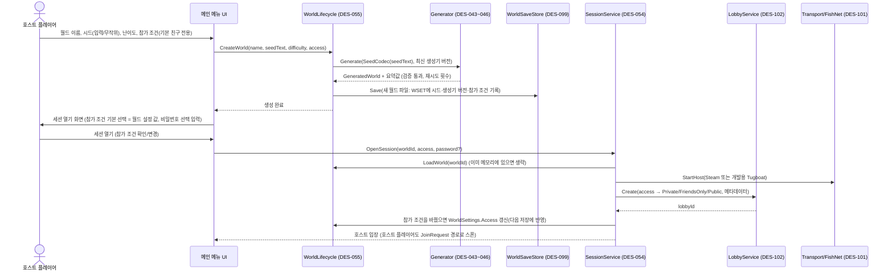

- 기존 월드를 열 때도 같은 화면에서 참가 조건 기본값은 그 월드에 저장된 값입니다. 세션 중 변경(FR-144)은 `ChangeAccess` 호스트 명령 → 로비 유형·리치 프레즌스 갱신 → 월드 설정 갱신 순입니다.
- 게임 안 행동 권한(SUG-018)은 보류이므로 참가 조건은 「누가 들어올 수 있는가」만 정합니다.

#### 3.9.2 중도 참가 (시드 → 로컬 생성 → 요약값 비교 → 바뀐 상태 적용)

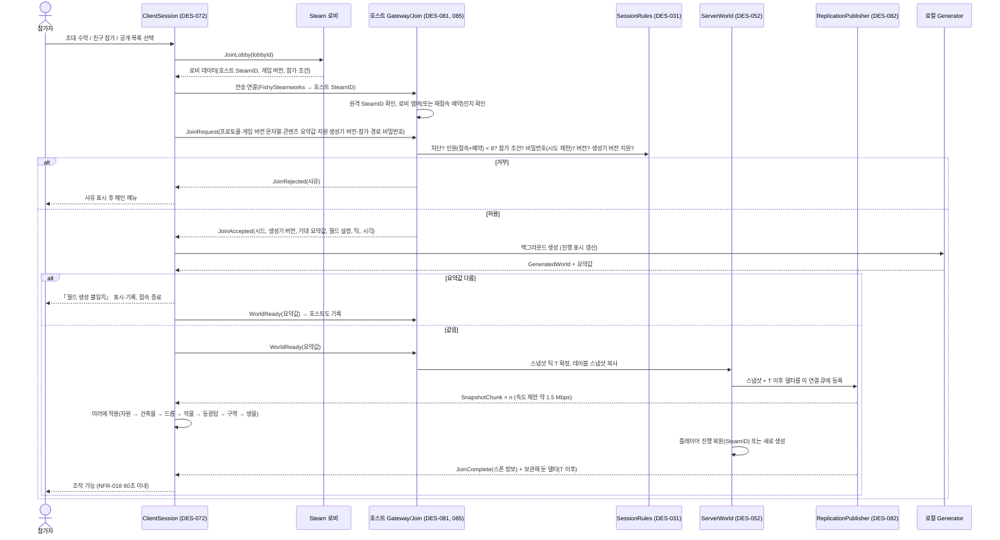

- v0.10: 위 메시지(`JoinRequest`~`JoinComplete`, `SnapshotChunk`, `TableDelta`)는 모두 `Protocol/` 메시지입니다. GW(DES-081, 085)와 RP(DES-082)는 `INetServer`로만 주고받고, 실제 바이트 전송은 `FishNetServer`/`FishNetClient`(DES-121)가 `PacketBroadcast`로 합니다. 그래서 참가 판정·스냅샷·델타 보관 흐름은 가짜 `INetServer`로 FishNet 없이 시험합니다(`Game.Tests.Net`).

#### 3.9.3 자원 타격 → 쓰러짐 → 드롭 → 경험치 이벤트

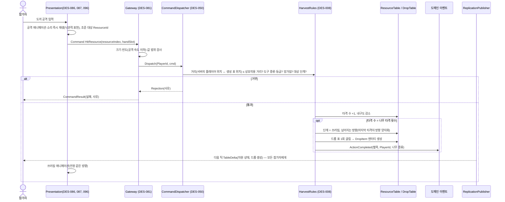

- 여러 명이 같은 나무를 때려도 호스트가 명령을 도착 순서대로 하나씩 처리하므로 쓰러짐·드롭은 한 번만 일어납니다(FR-051).

#### 3.9.4 자동 저장 (원자적 교체)

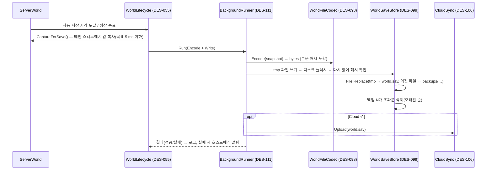

#### 3.9.5 등광탑 활성화 → 준비 단계 → 방어전 → 정화

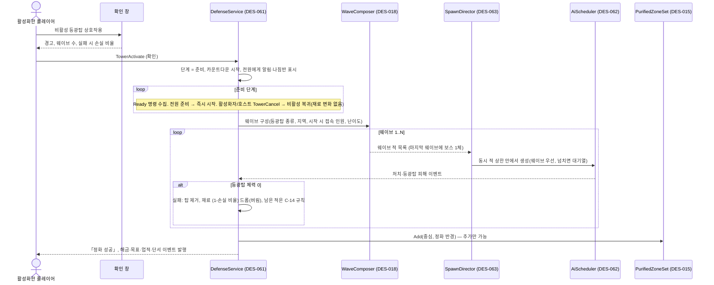

#### 3.9.6 재접속 (FR-115)

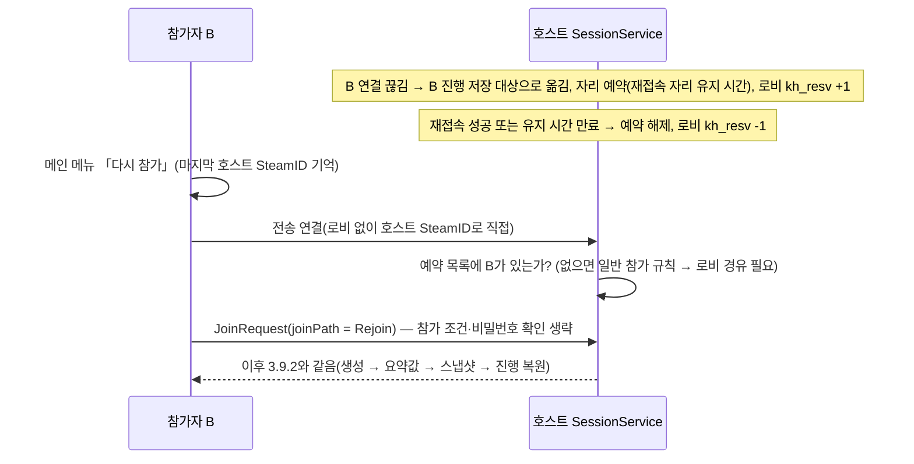

#### 3.9.7 호스트 종료 예고 (FR-116)

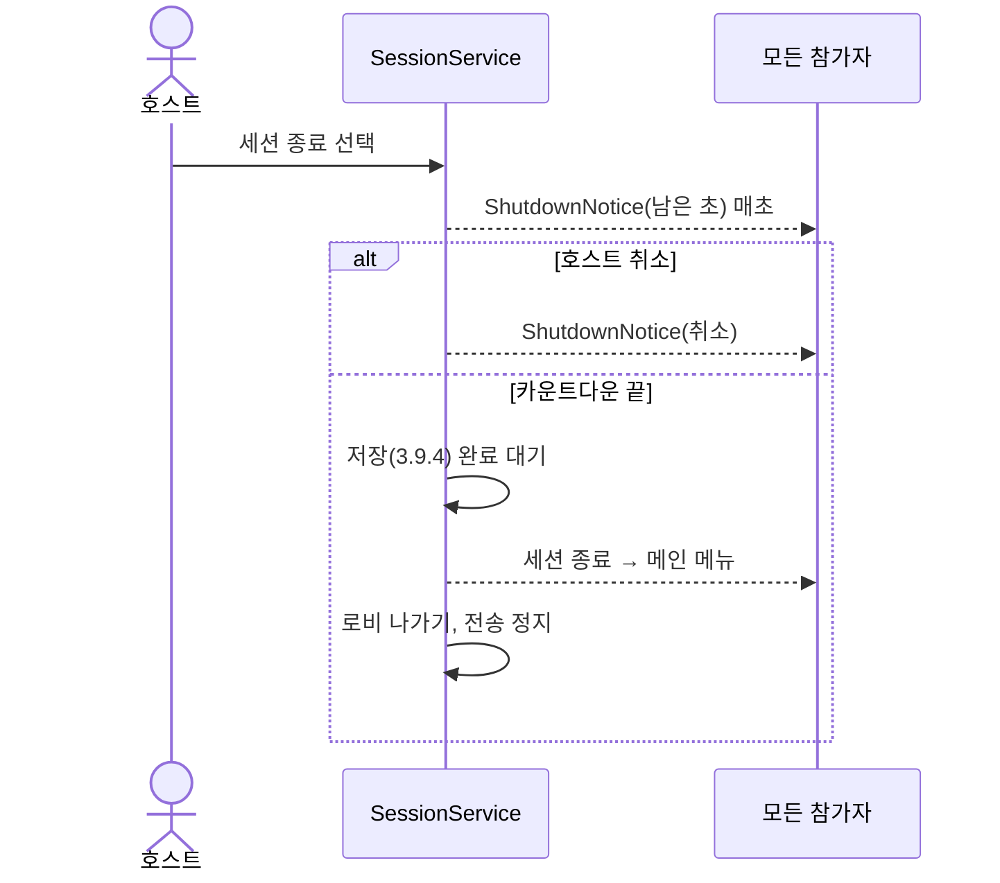

#### 3.9.8 플레이어 아바타 이동 (v0.10, DES-084, 사용자 결정 2026-11-03)

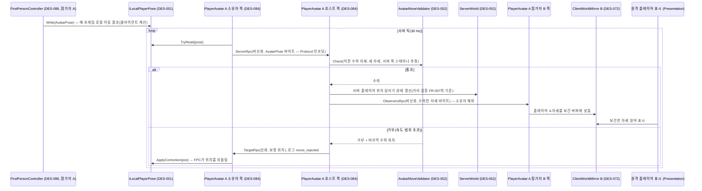

- NetworkTransform을 쓰지 않는 이유: NetworkTransform(클라이언트 권한)은 소유자의 위치를 다른 참가자에게 바로 퍼뜨려 호스트가 중간에 검사·보정할 지점이 없습니다. RPC 경로는 호스트가 검사를 통과한 자세만 중계합니다(D-24).
- 검사 로직 `AvatarMoveValidator`(3.11.12)는 `Game.Application`의 순수 C#이라 EditMode에서 시험합니다(`Game.Tests.Application`). PlayerAvatar는 RPC 수신·송신과 호출만 합니다.
- 서버 쪽 스태미나 추정: 호스트는 수락한 자세의 달리기 플래그로 `VitalsRules`(DES-003)를 같이 돌려 스태미나를 추정하고, 추정값이 0이면 허용 속도를 걷기 속도 기준으로 낮춥니다(3.11.12). 추정이 클라이언트 값과 조금 달라도 허용 오차(`MoveTolerance`, `MoveSlackMeters`, `MoveStaminaGraceSeconds`) 안에서 흡수합니다.
- 손에 든 것·생명 상태·체력 비율 같은 아바타 표시 상태(FR-042, FR-159, FR-160)는 호스트 권위 값이므로 클라이언트 자세 RPC에 싣지 않고, 호스트가 정해 ObserversRpc(신뢰, 바뀔 때만) 또는 복제 메시지로 보냅니다.
- 아바타 RPC의 인자는 FishNet 형식이 아닌 Protocol 바이트(`AvatarPose` 인코딩)이므로, 자세 형식·양자화도 다른 메시지와 같은 코덱·왕복 시험을 따릅니다.

#### 3.9.9 부트와 네트워크 시작 순서 (v0.11, M1-07 실제, DES-100·101)

FishNet `NetworkManager`는 **깨어날 때(Awake) 그때 연결된 전송을 초기화**하고, 깨어난 뒤 전송을 바꾸면 전송 이벤트가 이어지지 않습니다. 그래서 Boot 씬의 `NetworkManager`는 **꺼진 상태로 저장**하고(`BootSceneBuilder`), 전송을 정한 뒤에 켭니다.

```mermaid
sequenceDiagram
    participant GB as GameBootstrap (DES-100)
    participant OPT as LaunchOptionsParser·DevCommandLine (DES-103)
    participant CFG as ConfigLoader (DES-104)
    participant CPR as CheckPlatformReady + SteamPlatformService (DES-102)
    participant TS as TransportSelector (DES-101)
    participant NM as NetworkManager (Boot 씬, 꺼진 상태)
    participant GF as GameFlow·SessionRuntime (DES-100)
    GB->>OPT: 명령줄 해석(-genhash·-bench면 해당 도구로 분기, -autoquit 예약)
    GB->>CFG: 설정 로드·검증 (실패 → 오류 로그, 시작 안 함)
    GB->>CPR: Steam 확인 → 경로·전송·신원 결정
    alt Steam 없음
        CPR-->>GB: ShowSteamRequired → SCR-001 (다시 확인 시 이 단계부터 반복)
    else -steamlobbytest (개발, 실제 Steam)
        GB->>GB: SteamLobbySmoke 실행 → 종료 코드로 끝냄
    else 계속
        GB->>TS: Apply(요청 전송) — 출시 빌드는 Steam 고정
        TS->>NM: 전송 구성 요소(Tugboat / FishySteamworks + P2P 켬) 붙임
        TS->>NM: TransportManager가 없으면 직접 AddComponent, Transport 지정
        GB->>NM: gameObject.SetActive(true) — Awake에서 지정된 전송으로 초기화
        GB->>TS: ApplyTuning(서버 틱, 연결 끊김 판정 시간), ApplyConnectionLimit(최대 인원 + 여유 2)
        GB->>GF: 시작(Steam 전송이고 실제 Steam일 때만 로비 서비스 연결)
        opt 개발 빌드 -host / -connect
            GB->>GF: AutoHost() / AutoConnect(ip:port)
        end
        GF->>GF: 접속 완료 → World 씬 Additive 로드, HUD·입력 전환
    end
```

- `TransportSelector`는 전송 선택 규칙(순수 C# `TransportPolicy`)의 결과를 FishNet 구성 요소에 적용하는 일만 합니다. 꺼진 `NetworkManager`는 아직 보조 관리자(`TransportManager`)를 만들지 않았으므로 선택기가 먼저 붙여 두고, FishNet은 깨어날 때 같은 오브젝트의 기존 구성 요소를 재사용합니다.
- **연결 수 여유(NFR-038)**: 전송은 `최대 인원 + 2` 연결까지 받고, 세션 규칙이 초과분에 `JoinRejected(인원 초과)`를 보내 사유를 알린 뒤 끊습니다. M1-07에서 Tugboat 8인 접속과 9번째 참가자의 인원 초과 거부를 확인했습니다.
- 호스트 본인의 연결은 전송이 원격 ID를 주지 못하므로 로컬 플레이어 ID를 씁니다(`SessionRuntime`). 참가자 원격 ID 규칙은 3.7.2와 같습니다.

### 3.10 상태 동적 관점

#### 3.10.1 클라이언트 세션 상태

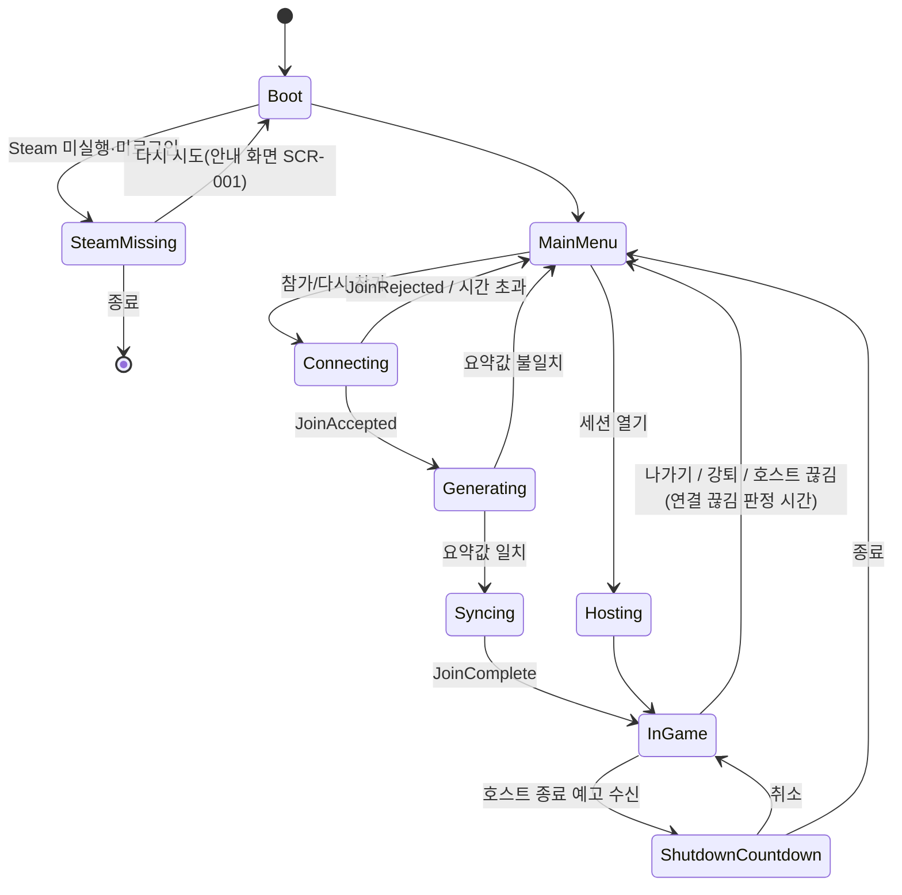
- **Steam 실행 필수(v0.7, SRS v0.9)**: 1인 플레이도 Steam이 실행·로그인된 상태에서만 합니다(1인 세션도 호스트 세션과 같은 경로). Steam이 없으면 부트에서 안내 화면(SCR-001)만 보이고 메인 메뉴로 가지 않습니다. 개발 빌드의 Tugboat 같은 PC 시험만 예외입니다(3.7.4).
- **참가 시간 제한(v0.11)**: `Connecting → MainMenu`의 「시간 초과」는 설정값 `NetworkTuning.JoinTimeoutSeconds`(기본 15초)입니다. 호스트는 연결 뒤 이 시간 안에 `JoinRequest`가 없거나, 요청 뒤 이 시간 안에 `JoinComplete`까지 끝나지 않으면 연결을 끊고(`JoinHandshake`), 참가자도 같은 값으로 기다림을 끝냅니다(`ClientSession`)(NFR-039).

#### 3.10.2 플레이어 생명 상태

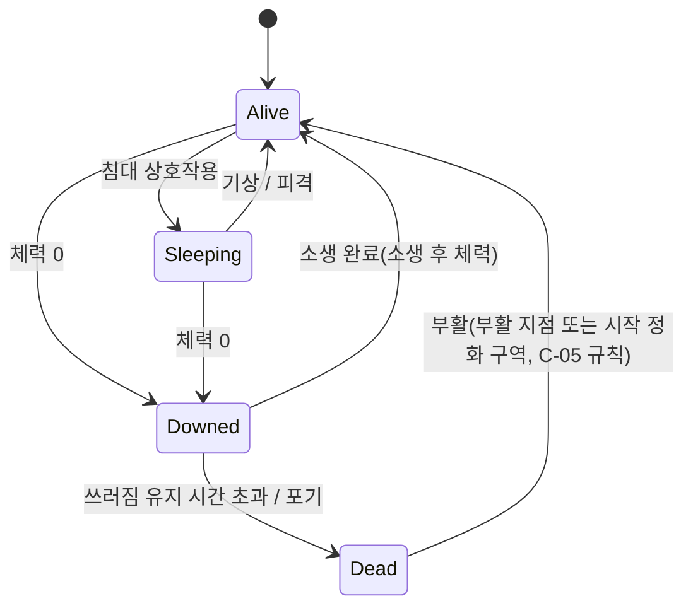

#### 3.10.3 등광탑과 방어전

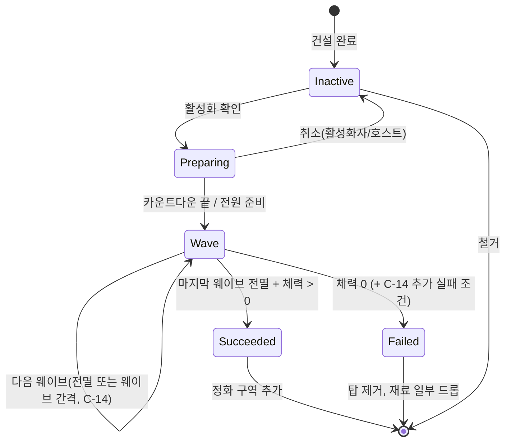

#### 3.10.4 자원 오브젝트

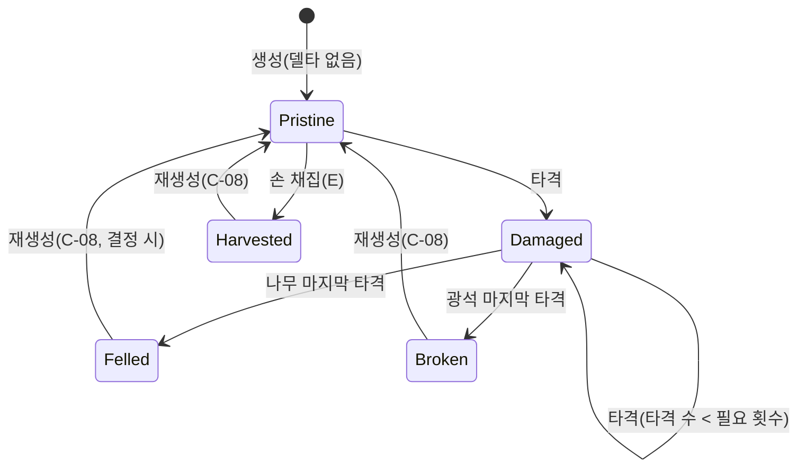

#### 3.10.5 작물

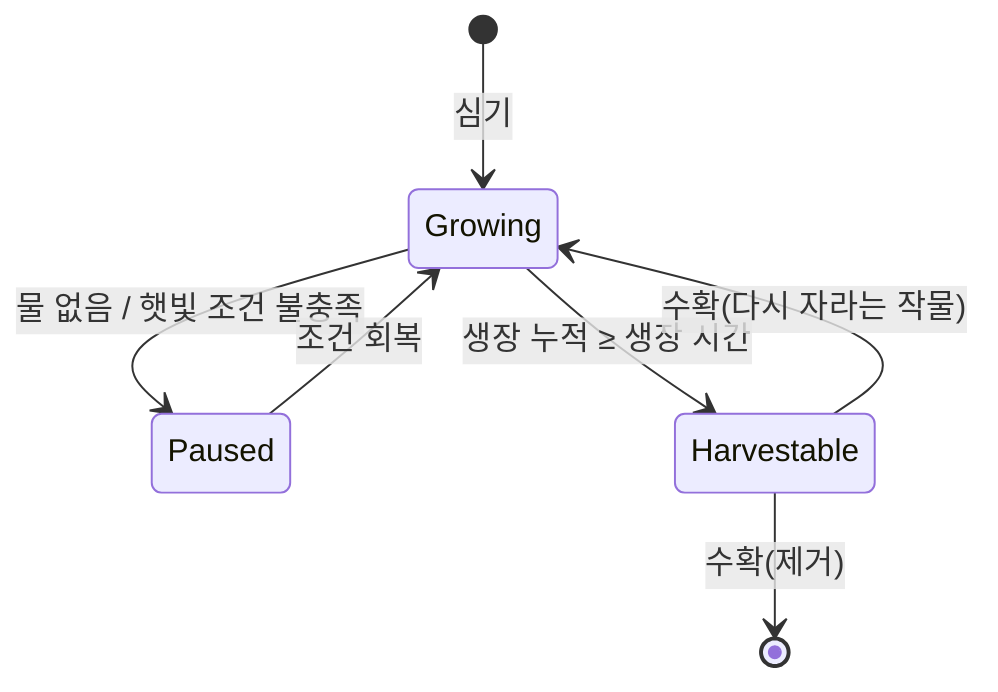

#### 3.10.6 생물(적) AI

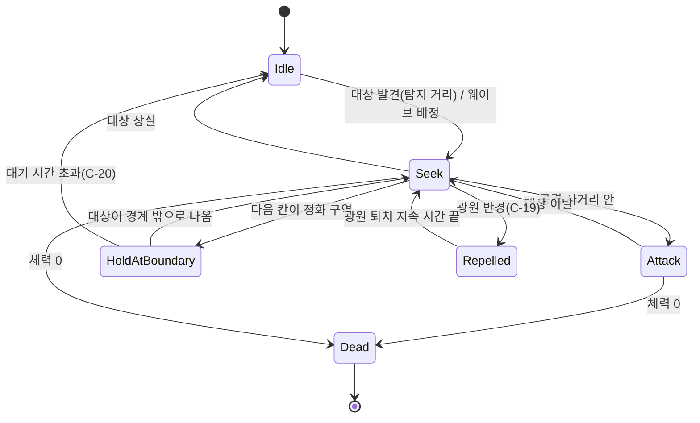

#### 3.10.7 UI 상태와 게임 진행의 분리 (I-07, SRS v0.5 3.2 공통 규칙)

**어떤 화면을 열어도 게임은 멈추지 않습니다. 1인 세션도 같습니다**(1인 일시정지 SUG-027은 보류).

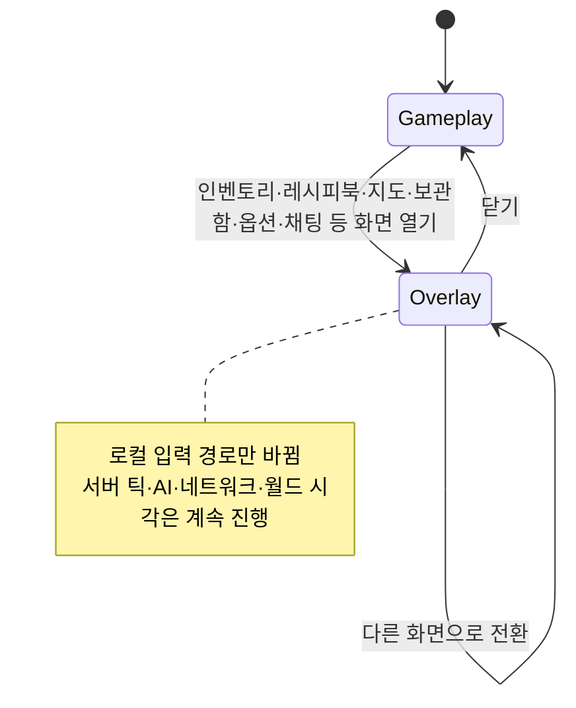

- UI 상태(`Gameplay`/`Overlay`)는 **로컬 입력 경로만** 바꿉니다. 화면이 열려 있는 동안 이동·시점·공격 입력은 막고 UI 입력을 받습니다.
- `ServerWorld` 틱(DES-052), AI(DES-062), 복제(DES-082), 월드 시각, 상태 값 감소, 버프 시간은 UI 상태를 모릅니다. 애플리케이션 레이어에 「일시정지」 개념이나 API를 두지 않습니다.
- `Time.timeScale`을 바꾸지 않습니다. 메뉴 연출이 필요하면 UI 자체 시간(비스케일 시간)을 씁니다.
- 화면이 열려 있어도 플레이어 캐릭터는 월드에 남아 피해를 받고, 쓰러짐 등 상태 변화가 생기면 HUD 경고가 화면 위에 표시됩니다(배치는 STORYBOARD).
- 화면을 연 상태에서 보내는 명령(예: 레시피북에서 제작, 보관함에서 꺼내기)은 다른 명령과 같은 검증 경로를 거칩니다.
- (v0.13, uGUI) 화면 열기·닫기는 `UiScreenStack`(DES-122)이 하고, 게임 안 창(Window 층)이 하나라도 열려 있으면 `UiState`가 Overlay입니다. Overlay ↔ Gameplay 전환 때 Input Actions 지도(Gameplay ↔ UI)와 커서 잠금만 바꿉니다. 화면 숨김·층 규칙은 3.7.10 (5), 메뉴 연출(열림 애니메이션 등)은 비스케일 시간(`Time.unscaledDeltaTime`)을 씁니다.
- **손목 계기 올림(FR-172, v0.4)** 도 같은 원칙입니다. 손목을 올린 상태는 `Gameplay` 안의 하위 상태로, 모든 행동이 가능하고(C-59 해소) 게임 진행은 멈추지 않습니다. `Overlay`(다른 창)로 들어가면 손목은 자동으로 내려갑니다.

#### 3.10.8 용광로 (v0.6, FR-175~178)

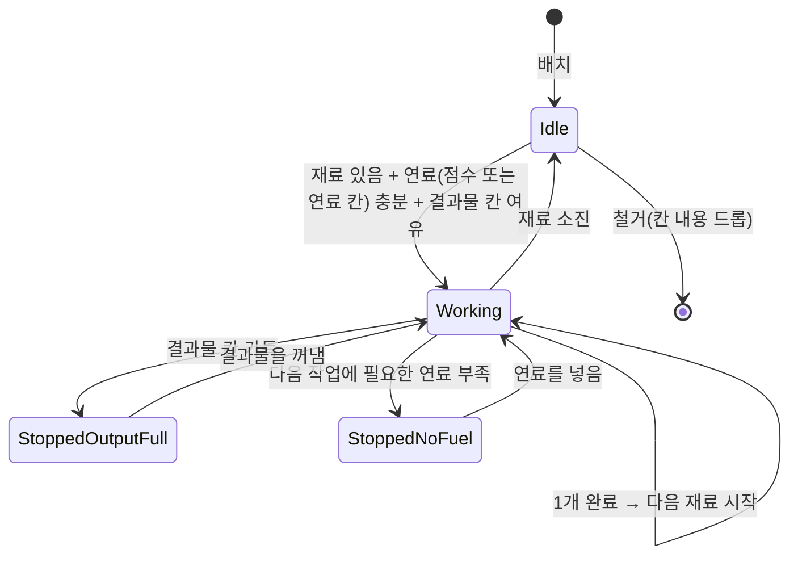
- 상태 전이는 호스트 서버 틱에서만 일어납니다. 플레이어가 떠나도(관심 범위 300 m 밖, 접속 종료 포함) 연료가 있는 동안 계속합니다. 월드가 닫혀 있으면 서버 플레이 시간이 흐르지 않아 진행하지 않고, 밤 건너뛰기로도 앞당겨지지 않습니다(`IFurnaceTimeRule`, C-65 잠정).
