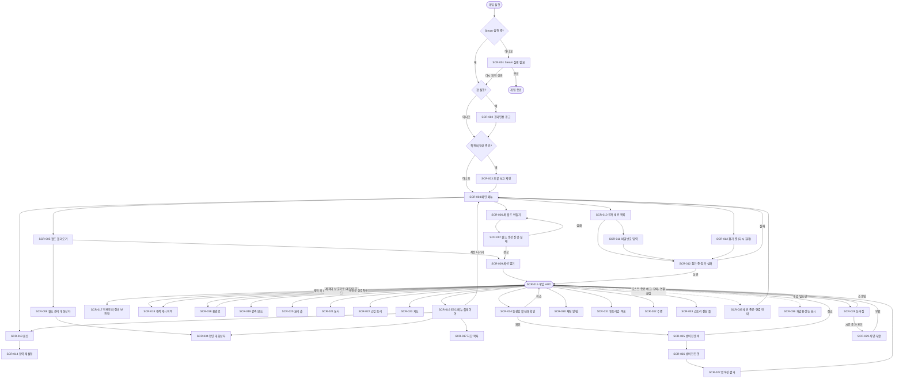

# 스토리보드 — 「꺼진 하늘」(임시 명칭)

---

## 1. 문서 정보

| 항목 | 내용 |
|---|---|
| 문서 버전 | 1.4 (확정 모드. 「결정 대기」 항목 포함. v1.1: 와이어프레임 확인 후 D-02·D-09 변경, v1.2: 손목 계기 세부 확정, v1.3: 제작대·용광로 추가, v1.4: 기본 키 할당표·Steam 필수 등 M1 착수 전 결정) |
| 작성일 | 2026-11-02 |
| 작성 | ui-ux-designer (확정 모드) |
| 참조 문서 | `docs/SRS.md` v0.4 기준 (FR-145 예약 자리 표시 I-03, **FR-171·FR-172 신설**은 requirements-analyst가 SRS v0.6에 반영 중), `docs/SDD.md` v0.2 기준 (v0.4 반영 중), `docs/DESIGN_PROPOSAL.md` v0.1, `docs/PROJECT_STATUS.md` |
| 사용자 결정일 | 2026-11-02 (기능별 시안 15개 + 디자인 관련 확인 결정 I-01, I-03, I-04, I-07, I-12) + 같은 날 와이어프레임 확인 후 변경 2건(D-02 → 장치형 기본 + 일반 HUD 옵션, D-09 → 솥 도식) |
| 시안 기록 | `docs/wireframes/hud-ABC.html`, `defense-ABC.html`, `cooking-ABC.html`은 선택하지 않은 시안을 포함한 **시안 기록**으로 그대로 둔다. 구현 기준은 이 문서다 |
| 표기 | 「결정 대기」 = 사용자·분석가 결정이 아직 없어 값을 채우지 않은 것. 「잠정」 = 화면 구조를 정하려고 둔 최소 가정(7.3에 목록). 「예시」 = 와이어프레임을 그리려고 쓴 샘플 값(설정값·콘텐츠 데이터가 정함) |
| 화면 ID | `SCR-001`~`SCR-038` (38개). 한 번 붙인 ID는 바꾸지 않는다 (SCR-038은 v1.3에서 추가) |

---

## 2. 디자인 시스템

사용자 결정: **D-01 시안 A 「불씨」**, **다크 단일 테마(I-12)**, **접근성 기반을 M1 UI부터 적용(I-04)**.
UI는 UI Toolkit(UXML/USS)로 만들고(SDD D-16), 아래 색·크기·모양 값은 모두 **USS 변수(토큰)** 로 둔다. 화면 파일에 색 코드나 픽셀 값을 직접 쓰지 않는다.

### 2.1 색상 (다크 단일 테마)

라이트 테마는 만들지 않는다. 밝은 정화 낮 화면에서도 반투명 어두운 패널로 가독성을 확보한다.

| 토큰 | 용도 | 다크 | 라이트 | 패널(#14151A) 대비 |
|---|---|---|---|---|
| `--panel` | 패널 배경 (불투명도 0.78 이상, 글자가 올라가는 패널은 **0.72 이상**) | #14151A | 해당 없음 (다크 단일 테마, 사용자 결정 I-12) | - |
| `--text` | 본문 글자 | #E8E4DC | 해당 없음 | 14.4 : 1 |
| `--text2` | 보조 글자 | #A9A59C | 해당 없음 | 7.4 : 1 |
| `--light` | 빛: 선택·포커스·활성·주 버튼·등광탑·정화 진행 | #F2A53A | 해당 없음 | 8.9 : 1 |
| `--danger` | 위험: 체력, 피해, 거부·오류, 낮은 수치, 방어전 실패 | #E5594F | 해당 없음 | 5.1 : 1 |
| `--pure` | 정화·성공·충족·연결됨 | #6FD1B0 | 해당 없음 | 9.9 : 1 |
| `--toxic` | 환경 위협 독기 | #C77DDB | 해당 없음 | 6.4 : 1 |
| `--cold` | 환경 위협 혹한 | #6DB8F0 | 해당 없음 | 8.5 : 1 |
| `--dark` | 환경 위협 완전한 어둠 | #8F9BFF | 해당 없음 | 7.2 : 1 |
| `--sp` | 스태미나 | #A8D45A | 해당 없음 | 10.6 : 1 |
| `--sand` | 허기·갈증·피로도 | #D8CBB0 | 해당 없음 | 11.4 : 1 |
| `--track` | 게이지 빈 부분 | #2C2E36 | 해당 없음 | (비텍스트) |
| `--disabled` | 비활성 글자 | #6B6A66 | 해당 없음 | 3.4 : 1 (비활성은 AA 예외, 3:1 이상 유지) |

- 대비는 sRGB 상대 휘도 공식으로 계산한 근사값이다. 구현 단계에서 도구로 다시 검증한다. 일반 글자 4.5:1 이상, 큰 글자·아이콘·게이지 3:1 이상.
- 패널 위 글자의 최악 조건 계산: 흰 배경 위 불투명도 0.72 패널에서 본문 글자 5.8 : 1.
- 색각 보정(FR-130)은 후처리로 적용한다. 보정 모드와 관계없이 아래 2.7의 모양·아이콘 규칙이 항상 유지된다.

### 2.2 글꼴과 글자 크기

| 항목 | 규칙 |
|---|---|
| 글꼴 | **Pretendard** (한글·영문 한 벌). 라이선스 SIL OFL 1.1: 상업 사용 가능, 글꼴 파일 단독 판매 금지, 라이선스 원문을 빌드에 동봉(출시 전 배포처에서 최종 확인). 한글 전체 글자가 많으므로 UI Toolkit 동적 글꼴 에셋 또는 서브셋을 쓴다(구현 결정) |
| 굵기 | Regular 400(본문), SemiBold 600(이름·라벨), Bold 700(제목·HUD 숫자) |
| 글자 크기 (보통, 1080p 기준) | 보조 20 / 본문 24 / 제목 30 / 큰 제목 40 / HUD 숫자 22(굵게, 숫자 폭 고정) |
| 글자 크기 옵션 | 작게 ×0.9 / **보통 ×1.0** / 크게 ×1.25 (FR-129 최소 3단계). 가장 작은 글자가 「작게」에서도 18px 이상. 모든 크기는 토큰×배율로 계산하고 화면 파일에 px를 직접 쓰지 않는다. 글자가 커져도 잘리지 않도록 컨테이너는 내용에 맞춰 늘어나거나 스크롤한다 |
| 영어 대응 | 버튼·탭은 **내용에 맞춰 늘어나는 너비**(최소 너비만 지정). 한국어보다 길어지는 영어 문장은 줄바꿈 허용. 이름류만 말줄임(…)하고 전체 이름은 도움말 줄·상세에 표시. 점검: 「글자 길이 +40% 가짜 번역」으로 모든 화면을 본다 |
| 사용자 입력 글자 | 채팅·월드 이름·Steam 이름은 리치 텍스트 해석 끔(NFR-050), 긴 이름 말줄임 |

### 2.3 간격·해상도·화면비 (반응형)

| 항목 | 규칙 |
|---|---|
| 간격 단위 | 4px 기준: 4 / 8 / 12 / 16 / 24 / 32 / 48 |
| 최소 높이 | 목록 행·버튼 56px (게임패드 포커스 표시가 보일 크기) |
| 화면 가장자리 여백 | HUD·창은 가장자리에서 40px 안쪽 (1080p 기준) |
| 기준 해상도 | 1920×1080 좌표로 설계. 패널 설정 「화면 크기에 맞춰 배율」, 기준 1920×1080, **높이 기준** |
| 1440p / 4K | 배율 ×1.333 / ×2.0 (벡터·SDF 글꼴로 선명하게) |
| 21:9 울트라와이드 | 배경·연출은 전체 폭을 채우고, **HUD와 모든 창은 가운데 16:9 영역(1920×1080)에 배치**. 가장자리 맞춤 옵션은 SRS에 없어 제안 상태(시안서 5장 P-03) |
| 16:10 등 좁은 화면 | 높이 기준 배율이라 좌우가 줄어든다. 좌우 여백 40px를 지키고 부족하면 채팅 폭을 먼저 줄인다 |
| 입력 장치 전환 | 2.4 참고 |

각 화면의 「반응형」 항목은 이 표를 따르고, 화면에 특별한 규칙이 있을 때만 덧붙인다.

### 2.4 입력 장치와 안내 표시 (FR-117, FR-166, NFR-002, NFR-004)

- 모든 화면은 키보드·마우스만, 또는 게임패드만으로 사용할 수 있다.
- 화면에 키 이름을 글자로 박지 않고 **키캡 컴포넌트**를 쓴다. 키캡은 마지막으로 입력한 장치의 현재 할당을 보여 주며, 장치가 바뀌면 1초 안에 교체된다. 스토리보드의 와이어프레임에서는 `[E 상호작용]`, `[인벤토리 키]`처럼 **행동 이름**을 쓴다.
- **기본 키·버튼 할당표 (v1.4 확정, 사용자 결정 2026-11-03)**: 이 표가 SCR-014 입력 재설정의 **기본값**이고 「기본값 복원」이 돌아가는 값이다. 각 장치의 할당은 따로 저장된다(FR-117).

| 행동 | 키보드·마우스 | Xbox 패드 | 비고 |
|---|---|---|---|
| 이동 / 달리기 | WASD / Shift | 왼쪽 스틱 / 왼쪽 스틱 누름 | - |
| 시점 | 마우스 | 오른쪽 스틱 | - |
| 상호작용 (길게: 소생·철거) | E | A | 길게 누르는 시간은 **결정 대기(I-08)** |
| 공격·도구 사용 | 마우스 왼쪽 | RT | - |
| 퀵슬롯 | 1~8, 휠 | LB / RB | 패드는 이전 / 다음 칸 |
| 인벤토리 / 레시피북 | Tab / C | 보기 버튼 / Y | - |
| 건축 / 지도 / 스킬 | B / M / K | 십자키 ← / ↓ / → | - |
| 손목 계기 (FR-172) | Q | 십자키 ↑ | - |
| 핑 / 채팅 / 메뉴 | 마우스 가운데 / Enter / Esc | LT+RB / **미지정(충돌, 확인 필요)** / 메뉴 버튼 | 패드 채팅은 사용자 표에 「보기 버튼과 겹치면 보정 제안」으로 되어 있어 보기 버튼(인벤토리)과 겹침. **임의로 정하지 않고 비워 둠** |

  - **패드 할당 겹침 (확인 필요, 임의로 바꾸지 않음)**: ① 채팅이 보기 버튼과 겹침 → 패드 채팅 입력 방법 미정. ② 핑 `LT+RB`와 퀵슬롯 `RB`: LT를 누른 채 RB를 누를 때 퀵슬롯이 함께 바뀌지 않도록 조합 입력 처리 필요. ③ LB/RB가 게임 중에는 퀵슬롯, 창 안에서는 탭 이동, 건축 모드(SCR-019)에서는 모드 전환에 쓰여 문맥에 따라 달라짐(문맥별이라 충돌은 아님, 확인 요청).
  - **표에 없는 행동의 할당은 결정 대기**: 준비 완료(FR-155), 방어전 취소 / 쓰러짐 포기 / 스토리 건너뛰기 (길게 누르기), 건축 회전·배치 확정, 사망 후 부활, 수면 중 일어나기, 사망 위치 지우기 등. 이 문서에서는 **행동 이름**으로 표기한다.
  - **키캡 표기 통일**: 화면의 키캡은 위 표의 현재 할당을 따른다. 이 문서의 `[E 상호작용]`, `[인벤토리 키]`, `[제작 키]`(= 레시피북), `[건축 키]`, `[지도 키]`, `[스킬 키]`, `[손목 계기]`, `[채팅 키]`는 모두 이 표의 행동이며 실제 화면에서는 현재 장치의 키캡(예: Tab / 보기 버튼)으로 표시된다.
- **메뉴 공통 입력**: 방향키·D-pad·왼쪽 스틱=포커스 이동, 확인=Enter·Ⓐ, 뒤로/닫기=Esc·Ⓑ(창 안에서는 인벤토리 키·지도 키 같은 여는 키로도 닫힘), **탭 이동=LB/RB, 키보드는 Q / E**(창이 열려 있는 동안 게임 행동 입력은 비활성이므로 Tab이 인벤토리 닫기와 겹치지 않도록 v1.4에서 Tab 대신 Q/E로 정함). 마우스는 호버·클릭.
- **게임패드 아이콘 (C-28, v1.4 확정)**: **Xbox 계열 아이콘 세트를 먼저** 만들고(M1), **PlayStation 아이콘은 M2**에 추가한다. 아이콘 세트는 교체 가능한 구조로 만든다. Steam 컨트롤러 등 그 밖의 종류는 **결정 대기**(7.4).
- 게임패드에서 글자 입력(채팅·월드 이름·비밀번호·시드)은 입력칸 선택 → **Steam 화면 키보드**(NFR-004).
- 게임패드는 호버가 없으므로 **툴팁에 의존하지 않는다.** 선택한 항목의 설명과 비활성 사유는 화면 아래 **도움말 줄**에 항상 표시한다.

### 2.5 공통 컴포넌트와 상태

| 컴포넌트 | 기본 | 호버(마우스) | 포커스(게임패드·키보드) | 눌림 | 비활성 | 오류 |
|---|---|---|---|---|---|---|
| 버튼 (주 / 보조 / 위험) | 주: `--light` 채움 + 어두운 글자(`--panel`). 보조: 선만. 위험: `--danger` 선+글자 | 배경 +8% 밝게, 커서 | **3px `--light` 외곽선 + 왼쪽 ▶ 표시** (색에만 의존하지 않음) | 배경 −8%, 1px 아래로 | 점선 테두리 + 🔒 + `--disabled` 글자. **포커스는 받음**(사유를 읽기 위해) | 위험 버튼은 `--danger` 선+글자 |
| 토글·체크 | ☐/☑ + 글자 「켬/끔」 | 배경 밝게 | 외곽선+▶ | - | `--disabled` + 사유 | - |
| 슬라이더 | 막대 + **값 숫자 병기** (예: 70%) | 손잡이 강조 | 외곽선, ◀▶로 5% 단위 | - | `--disabled` | - |
| 세그먼트·드롭다운 | 현재 값 표시 | 밝게 | 외곽선, ◀▶로 값 이동 | - | `--disabled` | - |
| 텍스트 입력 | 선 테두리 | 테두리 밝게 | 외곽선. 게임패드 Ⓐ → Steam 화면 키보드 | - | `--disabled` | **`--danger` 2px 테두리 + ⚠ + 아래 한 줄 메시지(무엇이 + 어떻게)** |
| 목록 행 | 아이콘 + 이름 + 상태 글자 | 배경 +8% | 외곽선 + ▶ | - | `--disabled` + 상태 글자 | `--danger` 왼쪽 막대 + ⚠ |
| 탭 | 글자 + 아래 선 | 밝게 | 외곽선. LB/RB로 이동 | - | 🔒 + 필요 조건 글자 | - |
| 아이템 칸 | 아이콘 + 수량(우하단) | 툴팁 0.5초 뒤 | 외곽선 + **도움말 줄에 이름·설명** | - | 어둡게(해당 없음) | 망가짐: 사선 줄무늬 + 「망가짐」 글자 |
| 게이지(막대) | 채움 + 숫자 | - | - | - | - | 25% 이하: 사선 줄무늬 + ⚠ + 숫자 |
| 위협 칩 | 모양(육각/마름모/원) + 아이콘 + 이름 + 상태 글자 | - | - | - | - | 노출 중: `--danger` 2px 테두리 + ⚠ |
| 길게 누르기 버튼 | 키캡 + 동사 | - | 누르는 동안 고리가 차오름 (시간 n초, **결정 대기 I-08**) | 고리 진행 | `--disabled` | 중간에 놓으면 고리가 줄어들며 취소 |
| 확인 대화상자 | 제목 + 설명 + 버튼 2개 | - | 위험한 동작은 **기본 포커스가 「취소」** | - | - | - |
| 토스트 | 아이콘 + 한두 줄, 3~5초 | - | - | - | - | 거부 사유는 `--danger` 선 + ⚠ |
| 도움말 줄 | 화면 아래 한 줄. 선택 항목 설명 | - | 포커스 이동 때마다 갱신 | - | - | 비활성·거부 사유는 `--danger` 글자 + ⚠ |

### 2.6 모든 화면에 공통인 전제

1. **게임은 멈추지 않는다 (사용자 결정 I-07).** 메뉴·인벤토리·제작·지도·요리·스킬 트리·ESC 메뉴를 열어도 월드와 시간, 적, 방어전은 계속 흐른다. 따라서 게임 안에서 열리는 화면(SCR-015~SCR-033 중 창 형태인 것)은 다음을 지킨다.
   - 창의 오른쪽 위에 **「● 게임 진행 중」 배지**를 표시한다.
   - 창 밖 화면 가장자리의 **피격 방향 호**(SCR-015 ⑭)와 **쓰러짐 전환**은 항상 창 위에 표시된다.
   - 닫기는 모든 창에서 같은 방법: Esc / Ⓑ / 창 오른쪽 위 [닫기]. 닫기까지 한 번의 입력.
   - 창이 열려 있는 동안 캐릭터 조작 입력은 창이 가져가고 캐릭터는 제자리에 서 있는다. 창을 연 채 걸을 수 있는지는 **결정 대기**(잠정: 불가).
   - 메인 메뉴 계열(SCR-001~SCR-014)은 게임 밖 화면이라 배지가 없다.
   - **손목 계기 올림(SCR-015 ⑳)은 창이 아니라 HUD 상태**이므로 배지를 달지 않고 캐릭터 조작 입력도 가로채지 않는다.
2. **한국어·영어**: 모든 글자는 텍스트 키로 두고(NFR-034, NFR-044) 두 언어를 함께 만든다.
3. **거부·오류**: 한 문장 「무엇이 + 어떻게」 + ⚠ 아이콘 (NFR-003). 위치는 행동 근처 토스트 또는 입력칸 아래. 3~5초(오류 모달은 확인할 때까지).
4. **요청 중 표시**: 호스트 검증이 필요한 행동(제작·이동·요리·획득 등)은 결과가 올 때까지 해당 칸/버튼에 작은 로딩 점을 보이고, 거부되면 원래 상태로 돌아가며 사유를 토스트로 알린다.
5. **값의 출처**: 수량·시간·글자 수 제한 같은 수치는 설정값이며 와이어프레임의 숫자는 예시다.

### 2.7 접근성 기반 (사용자 결정 I-04: M1 UI부터 적용)

| 항목 | 규칙 | 근거 |
|---|---|---|
| 글자 배율 | 2.2의 토큰×배율. 옵션 UI는 M6에 들어오더라도 M1 화면부터 배율 토큰을 쓴다 | FR-129 |
| 색 토큰 | 색은 2.1의 토큰만 쓴다. 색각 보정·고대비 같은 후속 기능이 토큰 교체/후처리로 가능하게 한다 | FR-130 |
| 색만으로 구분 금지 | 모든 상태는 **색 + (모양 또는 아이콘) + 글자** 중 둘 이상. 낮은 수치는 사선 줄무늬, 위협은 모양 칩(독기=육각형 ☣, 혹한=마름모 ❄, 어둠=원 ◐), 동료·핑은 기호(◆ 동료, ▼ 핑, ✚ 쓰러짐, ✕ 사망 위치, ⌂ 부활 지점)와 이름. **플레이어별 색은 쓰지 않는다** | FR-130 |
| 깜빡임·번쩍임 금지 | 1초에 3회를 넘는 밝기 변화 금지. 카운트다운은 숫자만 바뀌고 화면은 깜빡이지 않는다. 밝아지는 연출은 2초 이상에 걸쳐 서서히. 「섬광 줄이기」가 켜지면 더 완화 | FR-131 |
| 카메라 흔들림 | 피격·보스 연출의 흔들림은 옵션 값(0~100%)을 곱한다 | FR-131 |
| 포커스 순서 | 모든 화면은 왼쪽→오른쪽, 위→아래 순서를 기본으로 하고, 각 화면의 「접근성」 항목에 예외를 적는다. 포커스는 항상 화면에 보이며 창 밖으로 나가지 않는다 | NFR-004 |
| 스크린리더 라벨 | 모든 요소는 이름을 텍스트 키로 가진다(`요소 이름`). UI Toolkit의 스크린리더 직접 지원은 SRS 요구가 없어 이 문서의 「스크린리더 라벨」은 텍스트 키 이름 규칙을 뜻한다 | NFR-034 |
| 길게 누르기 | 위험·실수하기 쉬운 동작(철거, 쓰러짐 포기, 소생, 방어전 취소)에만 쓴다. 대체 방식(토글·연타)은 SRS에 없어 제안 상태(P-08) | - |
| 명암 대비 | 일반 글자 4.5:1 이상. 반투명 패널 위 글자는 패널 불투명도 0.72 이상 | WCAG AA |

### 2.8 아이콘·표시 규칙

- 아이콘은 단색(글자색과 같은 토큰) 한 세트를 쓰고, 아이콘 단독 표시는 금지(항상 글자나 숫자 병기). 와이어프레임의 이모지/기호는 임시 표시이며 아이콘 세트는 구현 단계에서 제작한다. **게임패드 버튼 아이콘은 Xbox 계열 세트를 먼저(M1), PlayStation 세트는 M2**에 추가한다(C-28 확정, 2.4). 키보드 키캡 아이콘도 같은 단색 규칙을 따른다.
- 따뜻한 색(`--light`)은 「빛과 관련된 의미」에만 쓴다(선택, 활성, 등광탑, 정화 진행).

---

## 3. 화면 흐름도



게임 안 화면(SCR-017~SCR-023, SCR-030~SCR-033)에서 Esc/Ⓑ를 누르면 모두 SCR-015로 돌아간다. 이 화면들이 열려 있는 동안에도 게임은 흐른다(2.6).

---

## 4. 화면 목록

| 화면 ID | 화면명 | 관련 FR | 관련 DES | 진입 경로 |
|---|---|---|---|---|
| SCR-001 | Steam 실행 필요 안내 | NFR-006 | DES-102, DES-091 | 게임 시작 시 Steam 미실행 (메인 메뉴로 못 들어가고 이 화면에서 멈춤) |
| SCR-002 | 광과민성 경고 | FR-132 | DES-095 | 첫 실행 / 옵션 > 접근성 |
| SCR-003 | 오류 보고 제안 | FR-158 | DES-107 | 비정상 종료 뒤 첫 실행 |
| SCR-004 | 메인 메뉴 | FR-115, NFR-006 | DES-091, DES-100 | 시작 / 세션 종료 후 |
| SCR-005 | 월드 불러오기 | FR-013, FR-021, FR-022, FR-144, FR-167 | DES-055, DES-099, DES-030 | SCR-004 |
| SCR-006 | 새 월드 만들기 | FR-012, FR-144, FR-156, FR-167 | DES-055, DES-029, DES-030, DES-041 | SCR-004, SCR-005 |
| SCR-007 | 월드 생성 진행·실패 | FR-012, FR-168~FR-170 | DES-043, DES-045, DES-111 | SCR-006 [만들기] |
| SCR-008 | 월드 관리 대화상자 | FR-020, FR-022, FR-149~152 | DES-099, DES-055 | SCR-005 |
| SCR-009 | 세션 열기 | FR-001, FR-144, FR-146 | DES-054, DES-031 | SCR-005, SCR-007 |
| SCR-010 | 공개 세션 목록 | FR-003, FR-145, FR-165 | DES-102, DES-054 | SCR-004 |
| SCR-011 | 비밀번호 입력 | FR-146 | DES-085 | SCR-010 |
| SCR-012 | 참가 중·참가 실패 | FR-003, FR-004, FR-009, FR-115, FR-146, FR-148, FR-169 | DES-072, DES-085 | SCR-004, SCR-010, SCR-011 |
| SCR-013 | 옵션 | FR-117~121, FR-122, FR-123, FR-129~132, FR-157, FR-159, FR-166, FR-171 | DES-073, DES-092, DES-093, DES-095, DES-109 | SCR-004, SCR-016 |
| SCR-014 | 입력 재설정 | FR-117, FR-118, FR-166, FR-172 | DES-092 | SCR-013 조작 탭 |
| SCR-015 | 게임 HUD (장치형 기본 / 일반 HUD 옵션) | NFR-001~003, FR-018, FR-024~029, FR-039, FR-041~046, FR-096, FR-097, FR-104~108, FR-122, FR-125, FR-126, FR-131, FR-135, FR-136, FR-159, FR-160, FR-171, FR-172 | DES-091, DES-096, DES-097 | 게임 진입 |
| SCR-016 | ESC 메뉴·플레이어 | FR-002, FR-011, FR-116, FR-144, FR-147, FR-148, FR-160 | DES-054, DES-031 | SCR-015 Esc |
| SCR-017 | 인벤토리·장비·보관함 | FR-032, FR-038~043, FR-107, FR-133~137 | DES-005, DES-006, DES-011 | SCR-015, 보관함 상호작용 |
| SCR-018 | 제작 레시피북 (손 / 제작대 모드) | FR-052~054, FR-173, FR-174 | DES-010, DES-058 | SCR-015 제작 키 = 손 모드 / 제작대 상호작용 = 제작대 모드 |
| SCR-019 | 건축 모드 | FR-056~059, FR-089, FR-090, FR-138, FR-139, FR-161 | DES-012, DES-059, DES-096 | SCR-015 건축 키 |
| SCR-020 | 요리 솥 | FR-089~097, FR-108 | DES-023, DES-065, DES-024 | 요리 솥 상호작용 |
| SCR-021 | 농사 | FR-083~088 | DES-022, DES-065, DES-097 | SCR-015 (씨앗 든 채 땅 조준, 작물 조준) |
| SCR-022 | 스킬 트리 | FR-098~101 | DES-026, DES-067 | SCR-015 스킬 키 |
| SCR-023 | 지도 | FR-071, FR-075, FR-102, FR-124, FR-126, FR-140, FR-141 | DES-097, DES-032 | SCR-015 지도 키 |
| SCR-024 | 등광탑 활성화 확인 | FR-060, FR-064, FR-069, FR-153 | DES-017, DES-061 | 비활성 등광탑 상호작용 |
| SCR-025 | 방어전 준비 | FR-154, FR-155 | DES-017, DES-061 | SCR-024 [활성화] |
| SCR-026 | 방어전 진행 | FR-061~064, FR-072, FR-073, FR-112 | DES-017, DES-018, DES-061 | SCR-025 종료 |
| SCR-027 | 방어전 결과 | FR-065, FR-069, FR-070, FR-074, FR-075, FR-131 | DES-017, DES-061 | SCR-026 종료 |
| SCR-028 | 쓰러짐 | FR-142, FR-143 | DES-004, DES-060 | 체력 0 |
| SCR-029 | 사망·부활 | FR-030, FR-031, FR-140, FR-141 | DES-004, DES-013, DES-060 | SCR-028 시간 초과·포기 |
| SCR-030 | 채팅·알림 | FR-099, FR-127, FR-128 | DES-069, DES-034 | SCR-015 (항상), 채팅 키 |
| SCR-031 | 튜토리얼 카드·목표 한 줄 | FR-122, FR-123 | DES-035, DES-071 | 새 플레이어 진행 생성 시 |
| SCR-032 | 수면 오버레이 | FR-161, FR-162 | DES-013 | 침대 상호작용 |
| SCR-033 | 스토리 전달 틀 | FR-110, FR-111, FR-113 | DES-028, DES-071 | 새 월드 첫 진입, 핵심 등광탑 정화, 결말 |
| SCR-034 | 확인 대화상자 | FR-011, FR-020, FR-116, FR-151 | DES-091 | 여러 화면 |
| SCR-035 | 세션 종료·연결 안내 | FR-004, FR-115, FR-116, FR-147 | DES-054, DES-085 | 게임 중 이벤트 |
| SCR-036 | 개발용 성능 표시 | FR-163 | DES-108 | 개발 빌드 전용 |
| SCR-037 | 차단 목록 | FR-148 | DES-031, DES-054 | SCR-016 |
| SCR-038 | 용광로 | FR-175~FR-178 | (SDD v0.6에서 배정) | 용광로 상호작용 (SCR-015 ②) |

---

## 5. 화면별 스토리보드

> 공통 사항(포커스 표시, 반응형, 접근성 기본 규칙, 게임 진행 중 배지)은 2장을 따르며 각 화면에는 **그 화면만의 내용**을 적는다. 와이어프레임은 1920×1080 기준이고 오른쪽 테두리는 생략했다. 「잠정」·「결정 대기」·「예시」 표기는 1장을 따른다.

---

### SCR-001 Steam 실행 필요 안내
- 경로: 게임 시작 직후 (Steam 클라이언트 미실행·미로그인 감지). **Steam 실행 필수(v1.4 확정, 사용자 결정 2026-11-03)**: Steam이 없으면 메인 메뉴로 들어가지 않고 이 화면에서 멈춘다 (이전 잠정 「메인 메뉴 진입 허용」을 폐기)
- 관련 요구사항: NFR-006
- 관련 설계: DES-102, DES-091
- 마일스톤: M1

```
┌─ 전체 화면 어두운 배경 + 모달 (중앙, 폭 640) ─────────
│ ① ⚠ Steam이 실행 중이 아닙니다
│ ② Steam을 실행하고 로그인한 뒤 [다시 확인]을 누르세요.
│    이 게임은 Steam이 실행 중이어야 시작할 수 있습니다.
│ ③ [다시 확인]   ⑤ [종료]
└──────────────────────────────────────────
```

| 번호 | 요소 | 설명 | 동작/이벤트 | 입력 규칙·검증 |
|---|---|---|---|---|
| ① | 제목 | ⚠ + 「Steam이 실행 중이 아닙니다」 | - | - |
| ② | 설명 | 무엇이 + 어떻게 | - | - |
| ③ | [다시 확인] (주 버튼) | Steam 상태를 다시 조회 | 성공 시 모달 닫고 다음 단계(SCR-002 첫 실행 / SCR-003 / SCR-004). 실패 시 ② 아래에 「아직 Steam에 연결되지 않았습니다」 | - |
| ④ | (없음) | v1.3까지 있던 [메인 메뉴로 계속]을 삭제. 요소 번호 ④는 비워 둠(번호 재사용 안 함) | - | Steam 실행 필수 |
| ⑤ | [종료] | 게임 종료 | 즉시 종료 | - |

- 상태별 표시: 기본 / 재확인 중(③ 로딩 점) / 오류(재확인 실패 문구). 이 화면 뒤의 메인 메뉴·옵션은 열 수 없다.
- 반응형: 2.3. 모달은 가운데 고정.
- 접근성: 포커스 순서 ③→⑤, 기본 포커스 ③. 스크린리더 라벨: `steam.required.title/desc/retry/quit`.
- 메인 메뉴를 쓰는 중 Steam이 종료되는 경우의 처리(이 화면으로 되돌릴지)는 **결정 대기**(M1, 7.4).

---

### SCR-002 광과민성 경고
- 경로: 첫 실행 때 메인 메뉴 전 / 옵션 > 접근성 [광과민성 경고 다시 보기]
- 관련 요구사항: FR-132
- 관련 설계: DES-095
- 마일스톤: M2

```
┌─ 전체 화면 (어두운 배경) ───────────────
│ ① ⚠ 광과민성 발작 경고
│ ② 일부 장면에 밝은 빛 변화와 깜빡임이 있을 수 있습니다…(예시 문구)
│ ③ [확인했습니다]
└──────────────────────────────────────────
```

| 번호 | 요소 | 설명 | 동작/이벤트 | 입력 규칙·검증 |
|---|---|---|---|---|
| ① | 제목 | ⚠ + 경고 제목 | - | - |
| ② | 경고 문구 | 본문 글자 크기, 전체 문구는 콘텐츠 | - | 법무·번역 확인 필요 |
| ③ | [확인했습니다] (주 버튼) | 확인 기록(로컬 설정, NFR-047) | 첫 실행: SCR-003 또는 SCR-004. 옵션에서 연 경우: 옵션으로 | 확인해야 넘어감. 닫기 입력(Esc/Ⓑ)은 첫 실행에서는 무시 |

- 상태별 표시: 기본 / (두 번째 실행부터 표시 안 함)
- 반응형: 2.3. 문구는 가운데 폭 960px, 글자 배율에 따라 줄바꿈.
- 접근성: 단일 포커스 ③. 배경 점멸 없음.

---

### SCR-003 오류 보고 제안
- 경로: 비정상 종료 뒤 첫 실행 (SCR-004 직전)
- 관련 요구사항: FR-158
- 관련 설계: DES-107
- 마일스톤: M2

```
┌─ 모달 (폭 720) ─────────────────────────
│ ① 지난번 게임이 비정상 종료되었습니다
│ ② 오류 보고 파일을 만들까요? 포함 내용: 최근 로그, 시스템 정보, 게임 버전
│    파일은 이 PC에만 만들어지며 어디로도 전송되지 않습니다.
│ ③ ⚠ 이 파일에는 Steam ID가 들어 있습니다.
│ ④ ☐ 월드 파일도 포함 (월드 선택 ▾)
│ ⑤ [파일 만들기 + 폴더 열기]   ⑥ [나중에]
└──────────────────────────────────────────
```

| 번호 | 요소 | 설명 | 동작/이벤트 | 입력 규칙·검증 |
|---|---|---|---|---|
| ① | 제목 | - | - | - |
| ② | 포함 내용·전송 설명 | 로그·시스템 정보(OS, CPU, GPU, 드라이버, RAM)·게임 버전. **로컬 파일만 만들며 자동 전송은 없음**(C-43 확정, 사용자 결정 2026-11-03). 파일을 개발자에게 보내는 일은 사용자가 직접 한다 | - | FR-158 |
| ③ | Steam ID 표시 | 항상 표시 | - | 삭제 불가 |
| ④ | 월드 파일 포함 체크박스 + 월드 선택 | 기본 꺼짐. 켜면 월드 선택 드롭다운 활성 | 체크 시 ④의 드롭다운 활성 | 월드가 없으면 비활성 + 사유 |
| ⑤ | [파일 만들기 + 폴더 열기] (주) | 압축 파일 1개를 이 PC에 만들고 그 폴더를 Windows 탐색기로 연다 (두 동작을 한 버튼으로) | 성공: 「보고 파일을 만들었습니다. 폴더에서 파일을 확인하세요」 토스트 후 SCR-004. 실패: ⚠ 「파일을 만들지 못했습니다. 저장 공간을 확인하세요」 | - |
| ⑥ | [나중에] | 건너뜀 | SCR-004 | - |

- 상태별 표시: 기본 / 생성 중(⑤ 로딩 점) / 성공 / 오류
- 반응형·접근성: 포커스 순서 ④→⑤→⑥, 기본 포커스 ⑤.

---

### SCR-004 메인 메뉴
- 경로: 시작 / 세션 종료 후
- 관련 요구사항: FR-115, NFR-006
- 관련 설계: DES-091, DES-100
- 마일스톤: M1(최소) ~ M3(월드 항목)

```
┌─ 메인 메뉴 (사용자 결정 D-03 A 계층형) ──────────────────────
│ (배경: 꺼져 가는 마지막 등불 3D 장면, 메뉴는 왼쪽)
│ ① 「꺼진 하늘」(임시 로고)
│ ② ▶ 월드 불러오기
│ ③    새 월드 만들기
│ ④    참가하기
│ ⑤    다시 참가
│ ⑥    옵션
│ ⑦    종료
│ ⑧ 게임 버전 · Steam 이름                         ⑨ 도움말 줄
└──────────────────────────────────────────────────────────
```

| 번호 | 요소 | 설명 | 동작/이벤트 | 입력 규칙·검증 |
|---|---|---|---|---|
| ① | 로고 | 임시 명칭 텍스트 키(NFR-034) | - | - |
| ② | 월드 불러오기 | 메뉴 항목 | SCR-005 | - |
| ③ | 새 월드 만들기 | 메뉴 항목 | SCR-006 | - |
| ④ | 참가하기 | 메뉴 항목 | SCR-010 | Steam이 실행 중이어야 이 화면에 도달하므로 Steam 때문에 비활성이 되는 경우는 없음(SCR-001) |
| ⑤ | 다시 참가 | 마지막 세션이 있을 때만 활성 | SCR-012 (비밀번호·참가 조건 확인 생략, FR-115) | 없으면 비활성 + 도움말 줄 「다시 참가할 수 있는 세션이 없습니다」 |
| ⑥ | 옵션 | 메뉴 항목 | SCR-013 | - |
| ⑦ | 종료 | 게임 종료 | 즉시 종료 (**잠정**: 확인창 없음) | - |
| ⑧ | 버전·사용자 이름 | 게임 버전, Steam 표시 이름 | - | 이름 말줄임 |
| ⑨ | 도움말 줄 | 포커스 항목 설명 / 비활성 사유 | - | - |

- 상태별 표시: 기본 / 세션 종료·강퇴 직후(상단에 SCR-035 안내 한 줄 토스트)
- 반응형: 메뉴는 왼쪽 가장자리 + 40px 여백, 배경 3D 장면은 전체 폭. 21:9에서도 메뉴는 가운데 16:9 영역의 왼쪽.
- 접근성: 위→아래 순서 ②→⑦, 기본 포커스 ②. 스크린리더 라벨 `menu.main.*`.

---

### SCR-005 월드 불러오기
- 경로: SCR-004 > 월드 불러오기
- 관련 요구사항: FR-013, FR-021, FR-022, FR-144, FR-167
- 관련 설계: DES-055, DES-099, DES-030
- 마일스톤: M3

```
┌─ 월드 불러오기 ──────────────────────────────────────────────
│ ① [◀ 뒤로]                                         [⑩ 새 월드 만들기]
│ ┌ ② 월드 목록 ───────────────┐ ┌ ④ 선택한 월드 상세 ──────────────────┐
│ │ ▶ ③ 재의 숲                  │ │ 이름: 재의 숲                          │
│ │   보통 · 친구 전용 · Cloud   │ │ 시드: ASH-01 [복사⑤]                    │
│ │   어제 21:40 저장            │ │ 난이도: 보통   참가 조건: 친구 전용     │
│ │   늪 건너기 · 어려움 …       │ │ 마지막 저장: 어제 21:40                 │
│ │                              │ │ ⑥ Steam Cloud 동기화 [켬 ☑]             │
│ └──────────────────────────┘ │ ⑦ [세션 열기]                           │
│                                │ ⑧ [이름 변경] [복제] [삭제] [백업 복원] [폴더 열기] │
│                                └─────────────────────────────────┘
│ ⑨ 도움말 줄
└──────────────────────────────────────────────────────────
```

| 번호 | 요소 | 설명 | 동작/이벤트 | 입력 규칙·검증 |
|---|---|---|---|---|
| ① | [뒤로] | SCR-004로 | Esc/Ⓑ | - |
| ② | 월드 목록 | 세로 목록(세로 스크롤). 마지막 플레이한 월드가 맨 위 | 포커스 이동 시 ④ 갱신 | - |
| ③ | 월드 카드 | 이름 / 난이도 글자 / 참가 조건 아이콘+글자 / Cloud 표시 / 마지막 저장 시각 | 선택 | 손상: 「손상됨」 배지 |
| ④ | 선택 월드 상세 | 이름, 시드, 난이도, 참가 조건(**읽기 전용**, 변경은 SCR-009), 마지막 저장 | - | - |
| ⑤ | 시드 [복사] | 시드를 클립보드에 복사 | 토스트 「시드를 복사했습니다」 | FR-167 |
| ⑥ | Steam Cloud 토글 | 월드별 켬/끔 | 켬: 동기화 시작 표시 | App ID 480 한계 시 안내는 개발 빌드만 |
| ⑦ | [세션 열기] (주) | 선택 월드로 세션 열기 | SCR-009 | 손상·미지원 버전이면 비활성 + 사유 |
| ⑧ | 월드 관리 버튼 5개 | 이름 변경 / 복제 / 삭제 / 백업 복원 / 폴더 열기 | 각각 SCR-008 대화상자 (폴더 열기는 즉시 탐색기 실행) | - |
| ⑨ | 도움말 줄 | 비활성 사유 등 | - | - |
| ⑩ | [새 월드 만들기] | 바로가기 | SCR-006 | - |

- 상태별 표시
  - 기본: 첫 카드 선택.
  - 로딩: 목록 읽는 중 스켈레톤 줄 3개.
  - 빈 데이터: 「저장된 월드가 없습니다. [새 월드 만들기]를 눌러 시작하세요」.
  - 오류: 카드가 손상되면 「손상됨 · 백업에서 복원할 수 있습니다」(NFR-037) + ⑦ 비활성. 생성기/저장 형식 버전이 이 게임보다 새로우면 「이 월드는 더 새로운 게임 버전에서 만들어졌습니다. 게임을 업데이트하세요」 + ⑦ 비활성(NFR-054).
  - 성공: 시드 복사 토스트.
- 반응형: 2.3. 좁은 폭에서는 상세 패널이 목록 아래로 내려가지 않고 폭만 줄인다.
- 접근성: 포커스 순서 ①→②→⑥→⑦→⑧→⑩, 기본 포커스 ②의 첫 카드. 목록 이동은 ↑↓, 상세로 이동은 →.

---

### SCR-006 새 월드 만들기
- 경로: SCR-004 > 새 월드 만들기 / SCR-005 [새 월드 만들기]
- 관련 요구사항: FR-012, FR-144, FR-156, FR-167
- 관련 설계: DES-055, DES-029, DES-030, DES-041
- 마일스톤: M3

```
┌─ 새 월드 만들기 (한 화면 폼) ──────────────────────────────
│ ① 월드 이름   [ 재의 숲                       ]  n/최대(결정 대기)
│ ② 시드        [ ASH-01                    ] ③[🎲 무작위] ④[복사]
│              ※ 같은 시드는 같은 지형을 만듭니다
│ ⑤ 난이도      [쉬움] [●보통] [어려움] [사용자 지정 ▸]
│   ⑥ (사용자 지정) 상태 감소 속도 [──●──] 1.0   적 체력 [──●──] 1.0
│                   적 피해 [──●──] 1.0   실패 시 재료 손실 비율 [──●──] 30% (상한 100%)
│ ⑦ 참가 조건   [공개] [●친구 전용] [초대 전용]
│    「Steam 친구만 참가할 수 있습니다」
│ ⑧ ⚠ (공개일 때) 참가자는 보관함과 건축물을 자유롭게 쓸 수 있습니다
│                                         ⑨ [만들기]  ⑩ [취소]
│ ⑪ 도움말 줄 (비활성 사유·오류)
└──────────────────────────────────────────────────────────
```

| 번호 | 요소 | 설명 | 동작/이벤트 | 입력 규칙·검증 |
|---|---|---|---|---|
| ① | 월드 이름 입력 | 텍스트 입력(게임패드: 화면 키보드) | 입력 중 글자 수 표시 | 1자 이상, 제어 문자 제거(NFR-050). **최대 글자 수·이름 중복 허용 여부는 결정 대기(I-11, M3)**. 비어 있으면 ⑨ 비활성. 오류 문구: 「월드 이름을 입력하세요」 |
| ② | 시드 입력 | 문자열 시드. 기본은 「무작위」 상태이며 정해진 시드 값이 미리 보임 | 직접 입력하면 「무작위」 해제 | **최대 길이 결정 대기(I-11)**. 규칙: 같은 문자열 = 같은 월드(FR-167) |
| ③ | [🎲 무작위] | 새 무작위 시드를 ②에 채움 | ② 값 갱신 | - |
| ④ | [복사] | ② 값을 복사 | 토스트 | - |
| ⑤ | 난이도 세그먼트 | 쉬움 / **보통(기본, 모든 배율 1.0)** / 어려움 / 사용자 지정 | 사용자 지정 선택 시 ⑥ 펼침 | - |
| ⑥ | 사용자 지정 슬라이더 4개 | 상태 감소 속도, 적 체력, 적 피해, 실패 시 재료 손실 비율 | 값 숫자 병기 | 배율 범위는 설정값(**결정 대기**), 손실 비율 100% 상한(DES-029). 인원 배율은 적 수·보스 체력에만 적용되므로 여기에 없음. 만든 뒤 난이도를 바꿀 수 있는지 안내 문구 자리 = **결정 대기(C-47, M3)** |
| ⑦ | 참가 조건 세그먼트 | 공개 / **친구 전용(기본)** / 초대 전용 + 선택 항목의 한 줄 설명 | 선택에 따라 설명·⑧ 갱신 | 설명: 공개 「공개 목록에 나타나며 누구나 참가할 수 있습니다」, 친구 전용 「Steam 친구만 참가할 수 있습니다」, 초대 전용 「초대를 받은 사람만 참가할 수 있습니다」 |
| ⑧ | 공개 경고 | ⑦이 공개일 때만 표시 | - | FR-133(보관함 공용), SUG-018 보류 |
| ⑨ | [만들기] (주) | 월드 생성 시작 | SCR-007 | 이름이 비면 비활성 + ⑪에 사유 |
| ⑩ | [취소] | 변경 내용이 있으면 SCR-034(「입력한 내용을 버릴까요?」) | 이전 화면 | - |
| ⑪ | 도움말 줄 | 포커스 항목 설명, 오류 | - | - |

- 상태별 표시: 기본(보통·친구 전용·무작위 시드) / 입력 오류(해당 입력칸 `--danger` 테두리 + 아래 문구) / 사용자 지정 펼침 / 비활성 [만들기]
- 반응형: 폼은 가운데 폭 960px. 글자 크기 「크게」에서 슬라이더 줄이 두 줄로 줄바꿈.
- 접근성: 위→아래 ①→②→③→④→⑤→⑥→⑦→⑨→⑩. 입력칸은 Ⓐ로 화면 키보드. 스크린리더 라벨 `world.new.*`.

---

### SCR-007 월드 생성 진행·실패
- 경로: SCR-006 [만들기]
- 관련 요구사항: FR-012, FR-168, FR-169, FR-170
- 관련 설계: DES-043, DES-045, DES-111
- 마일스톤: M3

```
┌─ 월드 생성 중 ───────────────────────────
│ ① 월드를 만드는 중…
│ ② [▓▓▓▓▓░░░░░] 단계 문구
│ (취소 없음)
└────────────────────────────────────────
┌─ 월드 생성 실패 ─────────────────────────
│ ③ ⚠ 이 시드로는 플레이할 수 있는 월드를 만들지 못했습니다
│ ④ 다른 시드를 입력하거나 [무작위]를 눌러 다시 시도하세요.
│ ⑤ [다른 시드로 돌아가기]   ⑥ [취소]
└────────────────────────────────────────
```

| 번호 | 요소 | 설명 | 동작/이벤트 | 입력 규칙·검증 |
|---|---|---|---|---|
| ① | 진행 문구 | 「월드를 만드는 중…」 | - | - |
| ② | 진행 막대 + 단계 문구 | 지형 → 자원 → 검증 단계 | 완료 시 SCR-009 | 생성 시간 목표는 NFR-052(설정값) |
| ③ | 실패 제목 | 검증 실패(FR-170) 또는 생성 오류 | - | - |
| ④ | 해결 안내 | 무엇을 하면 되는지 | - | - |
| ⑤ | [다른 시드로 돌아가기] (주) | SCR-006으로, 입력값 유지 | SCR-006 | - |
| ⑥ | [취소] | SCR-004 | - | 월드 파일이 만들어지지 않았음을 확인 |

- 상태별 표시: 진행 / 실패 / 성공(SCR-009로 자동 이동)
- 반응형·접근성: 진행 중 포커스 대상 없음(입력 무시). 실패 시 기본 포커스 ⑤. 진행 막대는 깜빡이지 않고 천천히 채워짐.

---

### SCR-008 월드 관리 대화상자
- 경로: SCR-005 ⑧ 버튼
- 관련 요구사항: FR-020, FR-022, FR-149, FR-150, FR-151, FR-152
- 관련 설계: DES-099, DES-055
- 마일스톤: M3

```
┌─ A 이름 변경 ──────────────────────────
│ ① 새 이름 [              ]   ② [저장] [취소]
├─ B 복제 ───────────────────────────────
│ ③ 새 월드 이름 [재의 숲 (복사본)]  ④ ※ 백업은 복사되지 않습니다   ⑤ [복제] [취소]
├─ C 삭제 (SCR-034 형식) ─────────────────
│ ⑥ 「재의 숲」을 삭제할까요?  ⑦ 월드 파일과 백업이 모두 삭제됩니다. ⑧ ⚠ Cloud 켜진 월드: 다른 PC에서도 사라집니다
│ ⑨ [삭제] (위험)  ⑩ [취소] (기본 포커스)
├─ D 백업에서 복원 ──────────────────────
│ ⑪ 백업 목록 (시각 · 크기)   ⑫ [복원] [취소]  → 복원 전 SCR-034 확인
└────────────────────────────────────────
```

| 번호 | 요소 | 설명 | 동작/이벤트 | 입력 규칙·검증 |
|---|---|---|---|---|
| ① | 새 이름 입력 | 기존 이름이 채워져 있음 | - | SCR-006 ①과 같은 규칙. 최대 글자 수·중복 = **결정 대기(I-11)** |
| ② | [저장] / [취소] | 이름 저장 | 목록 갱신, 토스트 | 빈 값이면 [저장] 비활성 |
| ③ | 복제 이름 입력 | 기본값 「<원래 이름> (복사본)」 | - | 위와 같음 |
| ④ | 복제 안내 | 백업은 복사하지 않음 | - | FR-150 |
| ⑤ | [복제] / [취소] | 현재 월드 파일만 복사 | 성공: 목록에 새 카드 | 디스크 부족 시 오류 문구 |
| ⑥ | 삭제 제목 | 월드 이름 포함 | - | - |
| ⑦ | 삭제 설명 | 결과를 구체적으로 | - | - |
| ⑧ | Cloud 경고 | Cloud 동기화가 켜진 월드만 | - | FR-151 |
| ⑨ | [삭제] (위험) | 삭제 실행 | 목록에서 제거 | - |
| ⑩ | [취소] (**기본 포커스**) | 닫기 | - | - |
| ⑪ | 백업 목록 | 시각·크기, 최신순 | 선택 | 백업이 없으면 「사용할 수 있는 백업이 없습니다」 |
| ⑫ | [복원] / [취소] | 선택 백업으로 월드 복원 | SCR-034 확인 후 실행 | FR-020 |

- 폴더 열기(FR-152, FR-022)는 대화상자 없이 즉시 탐색기를 연다. 실패 시 토스트 「폴더를 열지 못했습니다」.
- 상태별 표시: 기본 / 처리 중(버튼 로딩 점) / 오류(입력칸 아래 ⚠ 문구)
- 반응형·접근성: 중앙 모달 폭 640. 기본 포커스는 입력칸(A, B)과 [취소](C). 스크린리더 라벨 `world.manage.*`.

---

### SCR-009 세션 열기
- 경로: SCR-005 [세션 열기] / SCR-007 성공
- 관련 요구사항: FR-001, FR-144, FR-146
- 관련 설계: DES-054, DES-031
- 마일스톤: M2(참가 조건 선택), M3(월드별 저장)

```
┌─ 세션 열기 (모달, 폭 720) ─────────────────────────────
│ ① 재의 숲 · 보통
│ ② 참가 조건  [공개] [●친구 전용] [초대 전용]
│ ③ 「Steam 친구만 참가할 수 있습니다」
│ ④ 비밀번호(선택) [••••••] ⑤[보기]
│ ⑥ ※ 비밀번호는 저장되지 않으며 세션을 열 때마다 입력합니다.
│    초대로 들어오는 사람에게는 묻지 않습니다.
│                                  ⑦ [세션 열기]  ⑧ [취소]
└──────────────────────────────────────────────────────
```

| 번호 | 요소 | 설명 | 동작/이벤트 | 입력 규칙·검증 |
|---|---|---|---|---|
| ① | 월드 요약 | 이름, 난이도 | - | - |
| ② | 참가 조건 세그먼트 | **월드에 저장된 값이 미리 선택**(새 월드는 친구 전용) | 값을 바꾸고 세션을 열면 그 월드 설정으로 저장 | FR-001, FR-144 |
| ③ | 설명 | 선택 항목 한 줄 설명(SCR-006 ⑦과 같음) | - | - |
| ④ | 비밀번호 입력 | 선택 입력. 가려서 표시 | 게임패드: 화면 키보드 | 최대 글자 수는 설정값 `비밀번호 최대 길이`. 월드 설정·월드 파일에 저장하지 않음(FR-146) |
| ⑤ | [보기] 토글 | 입력 내용 표시/가림 | - | **잠정**: 화면 키보드 입력 확인용 |
| ⑥ | 안내 | 저장 안 됨, 초대는 비밀번호 면제 | - | - |
| ⑦ | [세션 열기] (주) | 월드를 불러오고 로비 생성 | 성공: SCR-015로 입장. 실패: 오류 모달 「세션을 열지 못했습니다. Steam 연결을 확인하세요」 | - |
| ⑧ | [취소] | 이전 화면 | - | - |

- 상태별 표시: 기본 / 여는 중(⑦ 로딩 점, 입력 잠금) / 오류
- 반응형·접근성: 포커스 순서 ②→④→⑤→⑦→⑧, 기본 포커스 ⑦.

---

### SCR-010 공개 세션 목록
- 경로: SCR-004 > 참가하기
- 관련 요구사항: FR-003, FR-145, FR-165
- 관련 설계: DES-102, DES-054
- 마일스톤: M2
- 사용자 결정: 표준안 + 인원 표시에 예약 자리 포함(I-03)

```
┌─ 참가하기 ─────────────────────────────────────────────────
│ ① [◀ 뒤로]                                       ② [새로 고침]
│ ③ 월드 이름        호스트     인원        🔒    게임 버전
│ ④ 재의 숲          하루       3/8                일치        ⑤[참가]
│   늪 건너기        서림       7/8 · 예약 1  🔒    일치        [참가]
│   (다른 버전)      이안       2/8                불일치 ✕    [참가] (비활성)
│ ⑥ 친구가 연 방에는 Steam 친구 목록에서 「게임 참가」로 들어갈 수 있습니다.
│ ⑦ 도움말 줄
└──────────────────────────────────────────────────────────
```

| 번호 | 요소 | 설명 | 동작/이벤트 | 입력 규칙·검증 |
|---|---|---|---|---|
| ① | [뒤로] | SCR-004 | - | - |
| ② | [새로 고침] | 목록 다시 조회 | 로딩 점 | 연타 방지(1초) |
| ③ | 목록 헤더 | 월드 이름 / 호스트 / 인원 / 비밀번호 / 게임 버전 | - | - |
| ④ | 세션 행 | 5가지 정보. **인원은 「접속/8」, 예약 자리가 있으면 「 · 예약 n」을 덧붙임**(I-03). 🔒 = 비밀번호 | 선택 | 이 게임의 세션만 표시(NFR-009) |
| ⑤ | [참가] | 선택 세션에 참가 | 비밀번호 있음: SCR-011. 없음: SCR-012 | 버전 불일치는 비활성 + 도움말 줄 「게임을 업데이트해야 참가할 수 있습니다」 |
| ⑥ | 친구 참가 안내 | Steam 친구 목록의 「게임 참가」 안내 | - | 참가 조건이 초대 전용이면 친구 목록 참가 불가(FR-165) |
| ⑦ | 도움말 줄 | - | - | - |

- 상태별 표시: 로딩(스켈레톤) / 빈 데이터 「지금 열려 있는 공개 세션이 없습니다. [새로 고침]을 눌러 다시 확인하세요」 / 오류 「목록을 불러오지 못했습니다. Steam 연결을 확인하세요」 / 성공
- 반응형: 열 폭은 내용에 맞춰 늘어나고, 월드 이름·호스트는 말줄임.
- 접근성: 포커스 순서 ②→목록(↑↓)→⑤. 비활성 행도 포커스를 받는다. 인원 「7/8 · 예약 1」은 글자로만 의미가 전달됨(색 없음).

---

### SCR-011 비밀번호 입력
- 경로: SCR-010 [참가] (비밀번호 세션)
- 관련 요구사항: FR-146
- 관련 설계: DES-085
- 마일스톤: M2

```
┌─ 비밀번호 입력 (모달) ───────────────────
│ ① 「늪 건너기」는 비밀번호가 필요합니다
│ ② [••••••] ③[보기]
│ ④ ⚠ 비밀번호가 맞지 않습니다 (남은 시도 n회)
│ ⑤ [참가]  ⑥ [취소]
└────────────────────────────────────────
```

| 번호 | 요소 | 설명 | 동작/이벤트 | 입력 규칙·검증 |
|---|---|---|---|---|
| ① | 제목 | 세션 이름 포함 | - | - |
| ② | 비밀번호 입력 | 가려서 표시 | 게임패드: 화면 키보드 | 최대 글자 수는 설정값 |
| ③ | [보기] 토글 | - | - | - |
| ④ | 오류 줄 | 틀렸을 때만 표시, 남은 시도 횟수 | 시도 상한 초과: 「1분 뒤에 다시 입력하세요」 + ⑤ 비활성 | `비밀번호 시도 상한`(설정값) |
| ⑤ | [참가] (주) | 호스트에 확인 요청 | 성공: SCR-012 | 빈 값이면 비활성 |
| ⑥ | [취소] | SCR-010 | - | - |

- 상태별 표시: 기본 / 확인 중(⑤ 로딩 점) / 오류 / 잠금(1분)
- 반응형·접근성: 기본 포커스 ②. 오류 시 포커스는 ②로 돌아가고 ④가 읽힌다.

---

### SCR-012 참가 중·참가 실패
- 경로: SCR-004 [다시 참가] / SCR-010 / SCR-011
- 관련 요구사항: FR-003, FR-004, FR-009, FR-115, FR-146, FR-148, FR-169
- 관련 설계: DES-072, DES-085
- 마일스톤: M1(최소), M2(전체 사유)

```
┌─ 참가 중 ───────────────────────────────
│ ① ✔ 호스트에 연결   ▶ 월드 정보 받기   ○ 월드 만들기   ○ 변경 사항 적용
│ ② [▓▓▓▓░░░░░░] 
│ ③ [취소]
└────────────────────────────────────────
┌─ 참가 실패 ─────────────────────────────
│ ④ ⚠ 제목  ⑤ 무엇이 잘못됐나  ⑥ 어떻게 고치나
│ ⑦ [확인]   (해당 시 ⑧ [오류 보고 파일 만들기])
└────────────────────────────────────────
```

| 번호 | 요소 | 설명 | 동작/이벤트 | 입력 규칙·검증 |
|---|---|---|---|---|
| ① | 단계 목록 | 완료 ✔ / 진행 ▶ / 대기 ○ + 글자 | - | - |
| ② | 진행 막대 | 중도 참가 목표 60초(NFR-018) | 완료: SCR-015 | - |
| ③ | [취소] | 참가 중단 | SCR-004 | - |
| ④ | 실패 제목 | 아래 사유 표의 제목 | - | - |
| ⑤ | 원인 문장 | - | - | - |
| ⑥ | 해결 문장 | - | - | - |
| ⑦ | [확인] (주) | SCR-004로 돌아감 | SCR-004 | - |
| ⑧ | [오류 보고 파일 만들기] | 월드 생성 불일치일 때만 표시 | SCR-003과 같은 흐름 | FR-169 |

**참가 실패 사유 문구** (표준안, NFR-003)

| 사유 | 제목 | 무엇이 잘못됐나 | 어떻게 고치나 |
|---|---|---|---|
| 호스트 응답 없음 | 호스트에 연결하지 못했습니다 | 호스트가 응답하지 않습니다 | 호스트가 게임 중인지, 인터넷 연결이 정상인지 확인하고 다시 시도하세요 |
| 인원 초과 | 인원 초과 | 세션이 가득 찼거나 자리 예약 중입니다 | 잠시 후 다시 시도하거나 호스트에게 문의하세요 |
| 버전 불일치 | 게임 버전 불일치 | 호스트와 게임 버전이 다릅니다 | Steam에서 게임을 업데이트한 뒤 다시 시도하세요 |
| 비밀번호 불일치 | 비밀번호 불일치 | 입력한 비밀번호가 맞지 않습니다 | 호스트에게 비밀번호를 확인하세요 (남은 시도 n회) — SCR-011에서 처리 |
| 시도 횟수 초과 | 잠시 후 다시 시도하세요 | 1분 안에 너무 많이 틀렸습니다 | 1분 뒤에 다시 입력하세요 |
| 차단됨 | 참가할 수 없습니다 | 호스트가 이 계정의 참가를 막았습니다 | 호스트에게 직접 문의하세요 |
| 참가 조건 불충족 | 참가 조건이 맞지 않습니다 | 이 방은 (친구만 / 초대받은 사람만) 참가할 수 있습니다 | 호스트에게 초대를 요청하세요 |
| 월드 생성 불일치 | 월드 생성 오류 | 이 PC에서 만든 월드가 호스트와 다릅니다 | 게임을 다시 시작해 참가하세요. 계속되면 「오류 보고 파일 만들기」를 사용하세요 |
| 다시 참가 실패(예약 만료) | 자리 예약이 끝났습니다 | 다시 참가할 수 있는 시간이 지났습니다 | 일반 참가 방법(초대·친구 목록·공개 목록)으로 들어가세요 |

- 상태별 표시: 진행 / 실패 / 성공(SCR-015) / 취소
- 반응형·접근성: 진행 중 기본 포커스 ③, 실패 시 ⑦. 단계 목록은 ✔▶○ 기호와 글자를 함께 표시.

---

### SCR-013 옵션
- 경로: SCR-004 > 옵션 / SCR-016 > 옵션 (게임 안에서도 같은 화면, 게임은 계속 흐름)
- 관련 요구사항: FR-117~121, FR-122, FR-123, FR-129~132, FR-157, FR-159, FR-166
- 관련 설계: DES-073, DES-092, DES-093, DES-095, DES-109
- 마일스톤: M1(그래픽 최소) ~ M6
- 사용자 결정: 표준안

```
┌─ 옵션 ──────────────────────────────────────────────────
│ ① 탭 [조작] [화면] [오디오] [언어] [접근성] [게임]   (LB/RB)   ⑨[닫기]
│ ┌ ② 조작 ─────────────────────────────────────────────┐
│ │ 장치 [키보드·마우스 | 게임패드]   → 행동 목록은 SCR-014    │
│ │ 마우스 감도 [──●──] 50   상하 반전 [끔]   시야각 [──●──] 90 │
│ └──────────────────────────────────────────────┘
│ ⑧ [이 탭 기본값 복원]                        ⑩ 도움말 줄
└──────────────────────────────────────────────────────
```

| 번호 | 요소 | 설명 | 동작/이벤트 | 입력 규칙·검증 |
|---|---|---|---|---|
| ① | 탭 줄 | 조작 / 화면 / 오디오 / 언어 / 접근성 / 게임 | LB/RB, 클릭 | - |
| ②~⑦ | 탭 내용 | 아래 표 | 변경 즉시 적용 | 재시작 필요 항목은 항목 옆에 「재시작 필요」 |
| ⑧ | [이 탭 기본값 복원] | 현재 탭만 | SCR-034 확인 | - |
| ⑨ | [닫기] | 이전 화면 | Esc/Ⓑ | - |
| ⑩ | 도움말 줄 | 항목 설명 | - | - |

**탭별 항목** (모든 항목은 게임패드 ◀▶로 변경 가능)

| 탭(번호) | 항목 | 컨트롤 | 값/규칙 | 근거 |
|---|---|---|---|---|
| ② 조작 | 장치 전환 | 세그먼트 | 키보드·마우스 / 게임패드 (할당은 장치별로 따로 저장) | FR-117 |
| ② 조작 | 입력 할당 | 목록 → SCR-014 | 행동 이름 / 현재 키캡 / [변경] | FR-117 |
| ② 조작 | 마우스 감도, 게임패드 시점 감도 | 슬라이더(값 병기) | 범위는 설정값 | FR-118 |
| ② 조작 | 상하 반전 | 토글 | 즉시 적용 | FR-118 |
| ② 조작 | 시야각 | 슬라이더 | `시야각 범위` 안 | FR-118 |
| ② 조작 | **손목 계기** | 세그먼트 **눌러서 전환(기본) / 누르는 동안** + 한 줄 설명 (눌러서 전환 「한 번 누르면 올라가고 다시 누르면 내려갑니다」 / 누르는 동안 「누르고 있는 동안만 올라갑니다」) | 즉시 적용. 장치형 HUD를 쓸 때 의미가 있고, 일반 HUD일 때는 비활성 + 「일반 HUD에서는 사용하지 않습니다」 | FR-172. 키·버튼 할당은 SCR-014 |
| ③ 화면 | 그래픽 프리셋 | 세그먼트 | 낮음 / 보통 / **높음(기준 프리셋)** / 최고. 세부를 바꾸면 「사용자 지정」 표시 | FR-120 |
| ③ 화면 | 해상도 | 드롭다운 | 지원 해상도 | FR-121 |
| ③ 화면 | 화면 모드 | 세그먼트 | 전체 화면 / 창 / 테두리 없는 창 | FR-121 |
| ③ 화면 | 수직 동기화, 프레임 제한 | 토글 / 드롭다운 | - | FR-121 |
| ③ 화면 | 업스케일링 | 토글 + 방식(DLSS / FSR) + 품질 단계 | 지원하지 않는 방식은 비활성 + 사유(「이 GPU는 DLSS를 지원하지 않습니다」) | FR-121 |
| ④ 오디오 | 전체 / 효과음 / 음악 / 환경음 / UI 소리 | 슬라이더 5개 (0~100%, 숫자 병기) | - | FR-119 |
| ⑤ 언어 | 언어 | 드롭다운 한국어 / English | 선택 즉시 적용(재시작 없음). **첫 실행 기본 언어 확정(C-48, v1.4)**: Steam 언어 설정이 한국어면 한국어, 그 밖은 영어. **첫 실행 언어 선택 화면은 없음**(처음부터 해당 언어로 표시되고, 바꾸려면 이 항목 사용) | FR-157 |
| ⑥ 접근성 | **HUD 방식** | 세그먼트 **장치형(기본) / 일반 HUD** + 한 줄 설명 (장치형 「상태를 손목 계기로 확인합니다」 / 일반 HUD 「상태를 화면 아래에 항상 표시합니다」) | 즉시 적용(재시작 없음), 게임 중에도 변경 가능. SCR-015 참고 | FR-171. 이 항목은 접근성 탭의 맨 위 |
| ⑥ 접근성 | 자막 | 토글 | - | FR-129 |
| ⑥ 접근성 | 글자 크기 | 세그먼트 작게 / 보통 / 크게 + 미리보기 문장 | ×0.9 / ×1.0 / ×1.25 | FR-129 |
| ⑥ 접근성 | 색각 보정 | 드롭다운 없음 / 적색약 / 녹색약 / 청색약 | - | FR-130 |
| ⑥ 접근성 | 카메라 흔들림 | 슬라이더 0~100% | - | FR-131 |
| ⑥ 접근성 | 섬광 줄이기 | 토글 | - | FR-131 |
| ⑥ 접근성 | 광과민성 경고 다시 보기 | 버튼 | SCR-002 | FR-132 |
| ⑦ 게임 | 목표 안내 | 토글 | 끄면 SCR-015 ⑤ 숨김 | FR-122 |
| ⑦ 게임 | 튜토리얼 안내 | 토글 + [다시 보기] | 끄면 SCR-031 카드 숨김 | FR-123 |
| ⑦ 게임 | 이름표 | 토글 | 끄면 SCR-015 ⑬ 이름표 숨김 | FR-159 |

- 상태별 표시: 기본 / 항목 비활성(사유 도움말 줄) / 재시작 필요 표시
- 반응형: 2.3. 왼쪽 세로 탭이 아니라 위쪽 가로 탭(LB/RB 이동에 맞춤). 항목은 세로 스크롤.
- 접근성: 포커스 순서 ①→현재 탭 항목 위→아래→⑧→⑨. 슬라이더는 값을 숫자로도 읽는다. 해상도·화면 모드 변경 뒤 되돌리기 확인은 SRS에 없음(제안 P-04).

---

### SCR-014 입력 재설정
- 경로: SCR-013 > 조작 탭 > 입력 할당
- 관련 요구사항: FR-117, FR-118, FR-166
- 관련 설계: DES-092
- 마일스톤: M2

```
┌─ 입력 할당 [키보드·마우스 | 게임패드] ───────────────────
│ ① 행동 목록: 이동 앞 / 뒤 / 좌 / 우 · 달리기 · 상호작용 · 인벤토리 · …
│ ② 행동 이름              ③ 현재 키캡        ④[변경]
│    상호작용               [E]               [변경]
│ ⑤ [기본값 복원]
└───────────────────────────────────────────────────
┌─ 새 입력 대기 (모달) ────────  ┌─ 겹침 경고 (모달) ──────────────────
│ ⑥ 「새 입력을 누르세요」 [취소] │ ⑦ 이 입력은 [점프]에 이미 쓰고 있습니다.
└────────────────────────────  │ ⑧ [기존 할당 비우기] ⑨ [취소]
```

| 번호 | 요소 | 설명 | 동작/이벤트 | 입력 규칙·검증 |
|---|---|---|---|---|
| ① | 행동 목록 | 행동은 데이터로 받음. 행동 이름에 **「손목 계기」(올림/내림, FR-172)** 포함. **기본 할당은 2.4의 확정 표(v1.4)**, 표에 없는 행동의 기본 할당은 **결정 대기(7.4)**. [기본값 복원]이 이 표의 값으로 돌아감 | ↑↓ 스크롤 | - |
| ② | 행동 이름 | 텍스트 키 | - | - |
| ③ | 현재 키캡 | 현재 장치의 할당 | - | 비어 있으면 「미지정」 |
| ④ | [변경] | 새 입력 대기 | ⑥ 모달 | - |
| ⑤ | [기본값 복원] | 현재 장치 탭만 복원 | SCR-034 확인 | 상호작용 키가 E로 돌아감 |
| ⑥ | 입력 대기 모달 | 다음 입력을 받음 | 입력 → 저장, Esc/Ⓑ → 취소 | 다른 장치의 입력은 무시 |
| ⑦ | 겹침 경고 | **같은 장치 안**에서 겹칠 때 | - | FR-117 |
| ⑧ | [기존 할당 비우기] | 겹친 행동의 할당을 비우고 새 입력 적용 | 저장 | - |
| ⑨ | [취소] (기본 포커스) | 변경 취소 | - | - |

- 상태별 표시: 기본 / 입력 대기 / 겹침 경고 / 저장됨(토스트 없이 즉시 반영)
- 반응형·접근성: 장치 탭 두 개는 각자 저장되고 서로 영향을 주지 않는다. 필수 행동(이동·메뉴)을 비웠을 때 경고 규칙은 **결정 대기**. 게임패드로 재설정 중 메뉴 이동 입력과 새 입력이 충돌하지 않도록 ⑥ 모달이 메뉴 이동을 막는다.

---

### SCR-015 게임 HUD
- 경로: 게임 입장 후 항상 표시. **HUD 방식 두 가지**: **장치형(기본, 시안 C)** / **일반 HUD(옵션, 시안 A 상시 표시형)**. 옵션 > 접근성 > 「HUD 방식」(SCR-013, FR-171)으로 바꾸며 게임 중에도 즉시 적용된다 (사용자 결정 D-02 변경: 와이어프레임 확인 후 「C 기본 + A를 옵션으로」)
- 관련 요구사항: NFR-001, NFR-002, NFR-003, FR-018, FR-024~029, FR-039, FR-041~046, FR-096, FR-097, FR-104~108, FR-122, FR-125, FR-126, FR-131, FR-135, FR-136, FR-159, FR-160, **FR-171(HUD 표시 방식 옵션), FR-172(손목 계기 올림/내림)** — FR-171·172는 requirements-analyst가 SRS v0.6에 추가 중
- 관련 설계: DES-091, DES-096, DES-097
- 마일스톤: M1(스태미나) → M2(생존 수치·동료·HUD 방식 옵션·손목 계기) → M3(나침반·저장) → M5(핑) → M6(목표) → M7·M9(버프·위협)
- 시안 기록: `docs/wireframes/hud-ABC.html`의 시안 C(기본)와 시안 A(옵션)
- 공통 사실: **두 방식 모두 HUD 정보 전부를 가진다.** 장치형에서 숫자·목록이 필요한 정보는 손목 계기 「내림」 줄(항상 보이는 숫자)과 「올림」 상태에서 읽는다.

#### SCR-015-C 장치형 HUD (기본)

```
┌─ 장치형 HUD · 손목 계기 내림 (1920×1080, 가운데 16:9 영역) ───────────────────
│          ④ 나침반 (얇은 띠)  ◆하루  ▼서림  ✚도윤  ✕사망  ⌂부활
│
│                                  ⑱ ◯ 스태미나 호 (소모·회복 중에만)
│                                  ① ＋
│                                  ② [E 상호작용] 열매 채집          ㉒ 🏮 하루 ◕  (머리 위 등불 이름표)
│                                  ③ 거부 사유 한 줄
│ ⑯ 채팅(SCR-030)                   ⑨ 🪓 돌도끼 82/100
│   (좌측 중단)
│ ⑲ 손목 계기(내림): ♥72 🍖38 💧55 🌙64 │ ⬢☣ 막는 중 │ 🍲 2:31        ⑧ 슬림 퀵슬롯 [1]…[8]
│ ㉑ 시야 가장자리 위협 테두리: 화면 둘레에 가는 띠 (위협 지역일 때)         ⑮ 💾 저장 중
└──────────────────────────────────────────────────────────────────────────
┌─ 장치형 HUD · 손목 계기 올림 (키: 「손목 계기」 행동, 할당은 결정 대기) ──────────
│          ④ 나침반
│          ⑤ ◎ 목표: 첫 등광탑 재료 모으기          ← 올림 상태에서만 보임
│
│ ㉓ 동료 줄:  하루 ◕ 90%   서림 ◑ 55%   도윤 ✚ 쓰러짐 0:24   이안 ● 100%
│ ⑳ 손목 계기(올림):  [♥ 72]  [🍖 38]  [💧 55]  [🌙 64]   ⚡ 스태미나 62
│     ⬢ ☣ 독기 · 막는 중 (해독 절임으로) / 노출 중이면 「⚠ 체력 -2/초」
│     버프: 🍲 해독 절임 2:31 ▓▓▓░  (+n)
└──────────────────────────────────────────────────────────────────────────
  ⑭ 피격 방향 호: 공격이 온 쪽 화면 가장자리에 짧게 표시
```

#### SCR-015-A 일반 HUD (옵션, 상시 표시형)

```
┌─ HUD (1920×1080, 가운데 16:9 영역) ──────────────────────────────────────
│          ④ 나침반 [NW …… N …… NE]  ◆하루  ▼서림  ✚도윤  ✕사망  ⌂부활             ⑩ 동료 4
│          ⑤ ◎ 목표: 첫 등광탑 재료 모으기                                         하루 ▓▓▓▓░ 90%
│                                                                                    도윤 ✚ 쓰러짐 0:24
│                                                                                    ⑰ (중요 알림 토스트 영역)
│                                  ① ＋
│                                  ② [E 상호작용] 열매 채집      (⑬ 월드 마커: ▼ 서림 · 광석 · 42 m, 하루)
│                                  ③ 거부 사유 한 줄
│                                  ⑰ (튜토리얼 카드 / 방어전 바는 상단)
│ ⑯ 채팅(SCR-030)               ⑨ 🪓 돌도끼 82/100
│ 좌하단                ⑥ ♥ ▓▓▓▓░ 72   ⑧ [1][2][3]…[8]   ⑦ 🍖▓░ 38              ⑪ ☣ 독기 [막는 중]
│                         ⚡ ▓▓▓░ 62       (퀵슬롯 선택 칸)     💧▓▓ 55              ⑫ 🍲 해독 절임 02:31
│                                                               🌙▓▓ 64                  ⑮ 💾 저장 중
└──────────────────────────────────────────────────────────────────────────
  ⑭ 피격 방향 호: 공격이 온 쪽 화면 가장자리에 짧게 표시
```

요소 표의 **적용** 표기: 「공통」 = 두 방식 모두, 「일반」 = 일반 HUD(SCR-015-A)만, 「장치형」 = 장치형(SCR-015-C)만. 번호는 두 방식에서 같은 의미를 유지한다(예: ⑤ 목표 한 줄, ⑩ 동료 표시).

| 번호 | 요소 | 설명 | 동작/이벤트 | 입력 규칙·검증 |
|---|---|---|---|---|
| ① | [공통] 십자선 | 정중앙 흰 원 + 어두운 외곽선(밝은 낮에도 보임) | - | - |
| ② | [공통] 상호작용 안내 | 십자선 아래. 키캡(현재 장치·현재 할당) + 동사 + 대상 이름. 상호작용 거리 밖이면 표시 안 함. 종류: 채집, 줍기, 보관함 열기, 솥 열기, **제작대 사용**(제작 UI 팝업, SCR-018 제작대 모드), **용광로 열기**(SCR-038), 침대(자기 / 부활 지점 지정), 등광탑 활성화, 쓰러진 동료 소생(길게), 철거(길게) | 안내 키 입력 시 해당 행동 | NFR-002. 못 하는 이유가 있으면 회색 + 사유 한 줄(도구 등급 부족 등, FR-046). 줍기 방식(자동/키)은 **결정 대기(C-10, M3)** |
| ③ | [공통] 거부 사유 토스트 | ② 아래 한 줄, 3초 | - | 「무엇이 + 어떻게」. 예: 「인벤토리 가득 참 · 버리거나 보관함에 넣으세요」(FR-039), 「도구 등급 부족 · 더 높은 등급의 곡괭이가 필요합니다」(FR-046) |
| ④ | [공통] 나침반 | 상단 중앙 폭 700(장치형은 얇은 띠). 방위 ±90°. 동료 ◆(이름), 핑 ▼, 쓰러진 동료 ✚, 사망 위치 ✕, 부활 지점 ⌂, 방어전 중 등광탑 | - | FR-125, FR-141, FR-140, FR-154 |
| ⑤ | [공통] 목표 한 줄 | 나침반 아래 `◎ 목표: …`. **일반: 항상 표시. 장치형: 손목 계기를 올렸을 때만 표시, 내리면 숨김.** 방어전(SCR-025·026) 동안은 두 방식 모두 숨김 | 목표가 바뀌면 SCR-031 ⑦ 토스트(손목 상태와 무관하게 표시) | 옵션에서 끔(FR-122) |
| ⑥ | [일반] 체력·스태미나 | 퀵슬롯 왼쪽. 체력(굵게, 막대+숫자), 스태미나(얇은 막대+숫자) | 값 변화 0.5초 안에 갱신(NFR-001) | 25% 이하: 사선 줄무늬 + ⚠ + 숫자. 스태미나 0일 때 불이익 표시는 **결정 대기(C-04)** |
| ⑦ | [일반] 허기·갈증·피로도 | 퀵슬롯 오른쪽. 아이콘 + 막대 + 숫자 3줄 | 위와 같음 | 0일 때 불이익 문구는 **결정 대기(C-04, M2 착수 전)** |
| ⑧ | [공통] 퀵슬롯 | 하단 중앙, 8칸 (**잠정**: 가방 첫 줄 8칸이 퀵슬롯, SCR-017 ⑭). 선택 칸은 `--light` 외곽선. 장치형은 **슬림형**(칸 54px, 선택 칸 외 55% 불투명도) | 칸 선택 = 손에 들기(FR-042) | 퀵슬롯 칸 수·선택 입력은 **결정 대기(키 할당표)** |
| ⑨ | [공통] 현재 도구 이름·내구도 | 퀵슬롯 위(두 방식 모두 항상 표시, 「망가짐」을 놓치지 않도록). 이름 + 내구도 n/최대 + 얇은 막대. 내구도 0은 사선 줄무늬 + 「망가짐」. 대응 장비·광원 등 내구도 없는 것은 막대 없음 | - | FR-135, FR-136 |
| ⑩ | [일반] 동료 목록 | 우상단, 최대 7명. 이름 / 체력 막대+% / 쓰러짐 `✚ 쓰러짐 m:ss` / 사망 `✕`. (장치형의 같은 정보는 ㉒ ㉓ + SCR-016) | 쓰러짐 1초 안에 반영 | FR-160. 이름 말줄임 |
| ⑪ | [일반] 환경 위협 칩 | 우하단. 모양(독기 육각 ☣ / 혹한 마름모 ❄ / 어둠 원 ◐) + 이름 + 상태 글자 **「막는 중」 / 「노출 중」** + 막는 수단. 해당 지역이 아니면 숨김. 노출 중이면 `--danger` 테두리 + ⚠ + 효과 요약(예: 「체력 -2/초 · 방독 마스크 또는 해독 요리 필요」) | - | 사용자 결정 I-01: **누적 게이지 없음** |
| ⑫ | [일반] 버프 칩 | ⑪ 아래. 아이콘 + 이름 + 남은 시간(분:초, 초 단위 갱신) + 얇은 진행 막대 | 만료 시 사라짐 | NFR-001, FR-096, FR-097. 중첩 표시 규칙은 **결정 대기(C-23, M7)** |
| ⑬ | [공통] 월드 마커 | 핑 ▼(이름 · 종류 · 거리, `핑 유지 시간` 뒤 사라짐). **일반**: 동료 이름표(이름만, `이름표 표시 거리` 안)도 여기. **장치형**: 동료 표시는 ㉒. **플레이어별 색 없음** | - | FR-126, FR-159. 화면 좌표 투영, 개수 제한: 이름표 ≤7, 핑 ≤ `핑 최대 개수`×플레이어 |
| ⑭ | [공통] 피격 방향 호 | 공격 방향 쪽 가장자리에 짧게. 붉은 호 + 모양 | - | 강도는 흔들림·섬광 옵션을 따름(FR-131). 메뉴 창이 열려 있어도 창 위에 표시 |
| ⑮ | [공통] 저장 중 표시 | 우상단 아래 작은 💾 + 「저장 중」(자동 저장 때만 2~3초) | - | FR-018. 호스트에게만 표시 여부는 **결정 대기(M3)** |
| ⑯ | [공통] 채팅 자리 | 일반: 좌하단. **장치형: 좌측 중단**(좌하단은 손목 계기 자리). 내용은 SCR-030 | - | - |
| ⑰ | [공통] 상단·우측 영역 | 방어전 바(SCR-025·026), 튜토리얼 카드(SCR-031), 중요 알림 토스트(SCR-030 ⑧)가 들어오는 자리 | - | 방어전 중 목표 한 줄 숨김 |
| ⑱ | [장치형] 스태미나 호 | 십자선 둘레의 얇은 호(지름 약 80px). 달리기·공격으로 줄어드는 중, 회복 중에 표시되고 가득 차면 1초에 걸쳐 사라짐. 현재 비율만큼 호가 채워짐 | 값 변화 0.5초 안에 갱신 | 25% 이하: 호가 **점선 패턴 + ⚠** (색에만 의존하지 않음). 숫자는 호출 없이는 보이지 않으므로 정확한 값은 ⑳. 스태미나 0 불이익 표시는 **결정 대기(C-04)** |
| ⑲ | [장치형] 손목 계기 — 내림 | 화면 왼쪽 아래의 **한 줄 요약**(기울인 화면 UI). 항상 보임: ♥ 체력 / 🍖 허기 / 💧 갈증 / 🌙 피로도 **숫자**, 환경 위협 모양 칩(독기 육각 ⬢ · 혹한 마름모 · 어둠 원 + 「막는 중 ✔」 또는 「노출 중 ⚠」), 활성 버프 아이콘 + 남은 시간(m:ss, 2개 이상이면 `+n`) | **손목 올림 입력**(행동 이름 「손목 계기」, 할당 **결정 대기**)으로 ⑳ | NFR-001: 숫자가 바뀌면 0.5초 안에 갱신. 25% 이하 수치는 숫자 옆 ⚠ + 줄무늬. **올림 방식 확정**: 기본 「눌러서 전환」(한 번 누르면 올림, 다시 누르면 내림), 옵션 > 조작 > 「손목 계기」에서 「누르는 동안」으로 바꿀 수 있음(SCR-013). 자동 내림 시간은 **결정 대기**(FR-172) |
| ⑳ | [장치형] 손목 계기 — 올림 | ⑲가 위로 올라와 커진 상태. 4개 링(체력·허기·갈증·피로, 링 + 숫자 + 아이콘, 25% 이하는 링에 사선 줄무늬 + ⚠) / ⚡ 스태미나 숫자와 막대 / 환경 위협 상세(모양 칩 + 「막는 중 · 해독 절임으로」 또는 「노출 중 · 체력 -2/초 · 방독 마스크 또는 해독 요리 필요」) / 버프 목록(아이콘 + 이름 + 남은 시간 + 얇은 진행 막대, 최대 4개 + `+n`). **올림 동안 ⑤ 목표 한 줄과 ㉓ 동료 줄도 함께 표시** | 눌러서 전환: 다시 입력하면 내림 / 누르는 동안(옵션): 놓으면 내림. 슬라이드 0.25초(깜빡임 없음) | 사용자 결정 I-01: 누적 게이지 없음. **올린 동안에도 모든 행동 가능**(이동·시점·공격·채집·도구 사용, 사용자 결정): 올림은 창이 아니므로 입력을 가로채지 않음. 창(인벤토리 등)을 열면 자동으로 내림(확정). 전투 중 가림 방지 배치 규칙은 아래 「장치형 배치 규칙」 |
| ㉑ | [장치형] 시야 가장자리 위협 테두리 | 화면 둘레에 위협 색의 부드러운 테두리. 위협 지역에서 **막는 중: 얇고 옅게 / 노출 중: 두껍고 진하게**. 위협 종류는 ⑲⑳의 모양 칩이 알려 주고 테두리는 보조 | 상태가 바뀔 때 1초 이상에 걸쳐 서서히 변함 | FR-131: **깜빡임·맥동 없음**(정적), 「섬광 줄이기」를 켜면 노출 중 진하기 상한을 낮춤. 색만으로 전달하지 않음(테두리는 보조, 모양 칩·글자가 주). 어둠 지역에서는 테두리를 밝은 청보라로 |
| ㉒ | [장치형] 동료 등불 이름표 | 동료 머리 위의 **작은 등불 + 이름**(`이름표 표시 거리` 안). 체력 단계를 **살아 있는 4단계 + 꺼짐**으로 표시(사용자 결정): ● 76% 이상 / ◕ 51~75% / ◑ 26~50% / ◔ 25% 이하 / **꺼짐(쓰러짐)** = 등불 꺼진 윤곽 + ✚ + `m:ss` / ✕ 사망. 모양에 더해 등불 밝기도 4단계로 어두워지고 꺼짐은 윤곽만 남음 | 쓰러짐은 1초 안에 반영 | FR-159, FR-160. 이름만 필수, 단계는 모양+밝기. 정확한 % 숫자는 ㉓과 SCR-016 플레이어 탭. **플레이어별 색 없음** |
| ㉓ | [장치형] 올림 상태의 동료 줄 | ⑳ 위쪽에 동료 최대 7명을 한 줄씩: 이름 / 단계 모양 / **체력 %** / 쓰러짐 `✚ 쓰러짐 m:ss` / 사망 `✕` | 올림 상태에서만 표시 | 장치형의 약점(동료 체력 숫자를 못 읽음) 보완. 항상 숫자가 필요하면 SCR-016 플레이어 탭 또는 일반 HUD |

- 상태별 표시
  - 기본: 장치형은 ⑲ 내림 + ⑧ 슬림 퀵슬롯 + ⑨ + 필요할 때 ⑱㉑㉒. 일반은 ⑥⑦⑧⑨⑩⑪⑫.
  - 손목 올림(장치형): ⑳㉓⑤ 표시. 내림: ⑤㉓ 숨김(목표 갱신 토스트 SCR-031 ⑦은 그대로).
  - 낮은 수치(25% 이하): 일반은 게이지 사선 줄무늬 + ⚠, 장치형은 ⑲ 숫자 옆 ⚠, ⑳ 링에 사선 줄무늬, ⑱ 점선 호.
  - 위협 지역: 일반은 ⑪ 칩이 나타남(막는 중 / 노출 중). 장치형은 ⑲ 위협 칩 + ㉑ 테두리.
  - 쓰러짐·사망: SCR-028·029가 HUD 위에 표시됨(수치 요소 숨김).
  - 메뉴 창 열림: ⑭ 피격 호는 유지. 일반은 ⑩ 동료 목록 유지, 장치형은 손목 계기 내림.
  - 빈 데이터: 동료 없음(1인) → ⑩·㉒·㉓ 숨김. 퀵슬롯 빈 칸은 번호만.
  - 오류: 값이 오지 않으면 마지막 값을 유지(별도 표시 없음).
  - 첫 진입(장치형): **잠정** — 게임에 처음 들어올 때 한 번 토스트 「손목 계기를 올려 상태와 목표를 확인하세요 [손목 계기 키]」(일반 HUD를 쓰는 플레이어에게는 표시 안 함). FR-123 튜토리얼 6단계에는 포함하지 않음.
  - HUD 방식 전환: 옵션에서 바꾸면 즉시 반영, 화면은 1초에 걸쳐 교체(깜빡임 없음).
- 반응형: HUD는 **가운데 16:9 영역**에 배치(2.3). 요소 배치는 화면 가장자리 40px 안쪽. 일반의 하단 군집(⑥⑧⑦)은 항상 가운데 정렬. 장치형의 손목 계기는 가운데 영역의 왼쪽 아래 끝에 붙인다(올림 시 높이 약 210px + 동료 줄 최대 약 240px). 글자 「크게」에서는 일반의 ⑩ 동료 목록 폭이 늘어나고, 장치형의 ⑲ 요약 줄이 두 줄로 줄바꿈되며 ⑯ 채팅이 위로 밀린다. 손목 계기는 3D 소품이 아니라 **화면 좌표 UI에 원근 기울임을 준 평면**으로 확정(M6까지, 사용자 결정. M6 수직 슬라이스에서 3D 소품 전환 여부 재결정, 7.1).
- **장치형 배치 규칙** (올린 채 전투하는 경우를 위한 확인 결과, 가림 방지):
  1. 손목 계기(올림)는 **폭 430px(글자 「크게」에서 최대 540px) × 높이 약 210px**, 위치는 가운데 16:9 영역의 **왼쪽 아래 끝**(x 40~470, y 830~1040). 동료 줄(㉓)은 그 바로 위(최대 7줄, y 590~830)로 **같은 폭 안**에 둔다.
  2. 화면 중앙의 **전투 시야 영역**(가운데 폭 약 600px × 높이 약 440px: 십자선 ①, 상호작용 안내 ②, 거부 사유 ③, 스태미나 호 ⑱)은 비워 둔다. 계기·동료 줄은 이 영역과 겹치지 않는다(계기 오른쪽 끝 x 470 이하, 안내 왼쪽 끝 x 770 이상).
  3. **피격 방향 호(⑭)와 위협 테두리(㉑)는 화면 가장자리 0~40px 띠에 그려 계기보다 위(최상위)에 표시**한다. 계기가 왼쪽 가장자리에서 40px 떨어져 있으므로 계기가 호를 가리지 않는다.
  4. 올림 상태 패널은 불투명도 0.88(글자 대비 확보)이며, 뒤의 월드가 비치는 부분은 계기 바깥 여백뿐이다.
  5. 좌측 중단의 채팅(⑯)은 y 330~560으로 동료 줄(y 590~)과 겹치지 않는다. 글자 「크게」에서 겹칠 만큼 길어지면 채팅이 위로 밀린다.
- 접근성: HUD는 포커스 대상이 아님(조작 불가). 모든 수치는 아이콘 + 숫자, 위협은 모양+글자. 상태 변화 알림은 깜빡임 없이 줄무늬/굵은 테두리로만 강조. 장치형은 시각적 몰입을 위한 방식이므로 **일반 HUD로 언제든 전환**할 수 있게 한다(FR-171). 스크린리더 라벨 `hud.*`, `hud.wrist.*`.

---

### SCR-016 ESC 메뉴·플레이어
- 경로: SCR-015 > Esc/메뉴 버튼. **게임은 멈추지 않음(I-07)**
- 관련 요구사항: FR-002, FR-011, FR-116, FR-144, FR-147, FR-148, FR-160
- 관련 설계: DES-054, DES-031
- 마일스톤: M2
- 사용자 결정: D-04 A 최소형 (초대는 Steam 오버레이)

```
┌─ ESC 메뉴 (중앙 창)                            ⑫ ● 게임 진행 중   [닫기]
│ ① 탭 [메뉴] [플레이어 4/8]
│ ── 메뉴 탭 ──
│ ② ▶ 계속하기   ③ 옵션   ④ 세션 나가기 (호스트: 세션 종료…)
│ ── 플레이어 탭 ──
│ ⑤ ★ 나(호스트)  접속   ▓▓▓▓░ 72%
│    하루          접속            ⑥[강퇴] ⑦[차단]   (호스트만)
│    도윤          ✚ 쓰러짐 0:24   [강퇴] [차단]
│ ⑧ [친구 초대 (Steam)]   ⑨ 참가 조건 [공개|●친구 전용|초대 전용] (호스트만)   ⑩ [차단 목록]
│ ⑪ 도움말 줄
└──────────────────────────────────────────────────
```

| 번호 | 요소 | 설명 | 동작/이벤트 | 입력 규칙·검증 |
|---|---|---|---|---|
| ① | 탭 | 메뉴 / 플레이어 n/8 | LB/RB | - |
| ② | [계속하기] | 창 닫기 | SCR-015 | Esc/Ⓑ도 같음 |
| ③ | [옵션] | SCR-013 | - | - |
| ④ | [세션 나가기] | 참가자: SCR-034 확인 후 나가기(진행 보존, FR-011) → SCR-004. 호스트: [세션 종료…] → SCR-034 확인 → 모든 플레이어에 **종료 예고 카운트다운(SCR-035)** | - | FR-011, FR-116 |
| ⑤ | 플레이어 행 | 이름(말줄임) / ★호스트 / 상태 글자(접속, ✚ 쓰러짐, ✕ 사망) / **체력 막대 + %** (HUD 방식과 관계없이 항상 표시. 장치형에서 동료 체력 숫자를 읽을 수 없는 약점을 보완) | - | 최대 8행. FR-160 |
| ⑥ | [강퇴] | **호스트에게만 보임.** SCR-034 확인 후 연결 종료(진행 보존), 대상은 SCR-035 강퇴 안내 | 알림 「○○이 내보내졌습니다」 | 자기 자신 행에는 없음 |
| ⑦ | [차단] | **호스트에게만 보임.** SCR-034 확인 후 차단 목록에 추가 + 접속 중이면 강퇴 | - | FR-148. **차단은 호스트의 모든 월드에 적용**(C-46 확정, v1.4). SCR-034 확인 문구에 「이 PC에서 연 모든 월드에서 차단됩니다」를 포함 |
| ⑧ | [친구 초대 (Steam)] | Steam 오버레이의 친구 초대 창을 연다 | 오버레이 열림 | Steam 오버레이가 꺼져 있으면 비활성 + 「Steam 오버레이를 켜야 초대할 수 있습니다」. 참가 조건이 초대 전용이어도 초대는 가능 |
| ⑨ | 참가 조건 세그먼트 | **호스트만 변경 가능**(참가자는 읽기 전용). 세션 중 변경 → 월드 설정에 저장 | 변경 즉시 로비 갱신 | FR-144 |
| ⑩ | [차단 목록] | 호스트만 | SCR-037 | - |
| ⑪ | 도움말 줄 | - | - | - |
| ⑫ | 게임 진행 중 배지 | 2.6 | - | - |

- 상태별 표시: 기본 / 플레이어 1명(혼자): ⑥⑦ 없음 / 오류: 초대 실패 토스트
- 반응형: 2.3. 창 폭 720.
- 접근성: 포커스 순서 ①→②→③→④ / ⑤(행)→⑥→⑦→⑧→⑨→⑩. 기본 포커스 ②. [강퇴]·[차단]은 위험 버튼.

---

### SCR-017 인벤토리·장비·보관함
- 경로: SCR-015 > 인벤토리 키 / 보관함 상호작용(보관함이 함께 열림). **게임은 멈추지 않음**
- 관련 요구사항: FR-032, FR-038~043, FR-107, FR-133~137
- 관련 설계: DES-005, DES-006, DES-011, DES-057, DES-059
- 마일스톤: M3(가방), M4(보관함·내구도), M9a(착용 장비)
- 사용자 결정: D-05 A 격자 한 화면

```
┌─ 인벤토리                                                      ⑬ ● 게임 진행 중  [⑫ 닫기]
│ ┌ ① 가방 (8×N 격자) ──────────┐ ┌ 장비 ──────────────┐ ┌ ⑦ 보관함 (열렸을 때만) ┐
│ │ ⑭ [🔦1][🪓2][⛏3][🍎x4]…     │ │ ③ 손: [🪓 돌도끼]   │ │ [돌 x20][나무 x50]…     │
│ │ [🪵x23][🧱x8][  ][  ]…       │ │ ④ 착용 칸 (칸 구성   │ │ 다른 사람이 쓰는 중이면  │
│ │                              │ │    결정 대기 I-05)   │ │ 칸에 ● 표시             │
│ │ ② 사용 7/32 칸               │ └──────────────┘ │ ⑧ 이동 수량 [전부|절반|n]│
│ └────────────────────────┘                    └─────────────────┘
│ ⑤ 선택한 아이템: 돌도끼 · 1등급 도끼   ⑨ 내구도 ▓▓▓░ 82/100 (망가지면 사선 + 「망가짐」)
│ ⑥ [손에 들기] [먹기] [착용] [나누기] [버리기]   ⑩ [수리] 재료: 나무 2 · 돌 1 (보유 ✔)
│ ⑪ 도움말 줄
└──────────────────────────────────────────────────────────────
```

| 번호 | 요소 | 설명 | 동작/이벤트 | 입력 규칙·검증 |
|---|---|---|---|---|
| ① | 가방 격자 | 칸 수는 설정값 `인벤토리 칸 수`. 아이콘 + 수량(우하단). 같은 아이템은 `최대 묶음 수`까지 한 칸에 쌓임 | 마우스: 끌어다 놓기. 게임패드: Ⓐ로 「집기」→ 이동 → Ⓐ로 「놓기」, Ⓑ로 집기 취소 | 이동은 호스트 검증(FR-007). 거부 시 칸이 원래대로 돌아가고 사유 토스트 |
| ② | 용량 표시 | 「사용 n/N 칸」. 가득 차면 `--danger` + ⚠ + 「인벤토리 가득 참」 | - | FR-038, FR-039 |
| ③ | 손에 든 것 슬롯 | 도구·무기·광원 1개 | 가방에서 놓으면 손에 듦 | FR-042 |
| ④ | 착용 칸 영역 | 착용 장비(방독 마스크, 방한복, 등광 랜턴 등)를 놓는 칸들. **칸 수·이름·위치는 결정 대기(I-05, 인벤토리 M3 이전·착용 구현 M9a)**. **잠정**: 칸 목록은 데이터로 받아 세로로 나열하고, 빈 착용 칸이 없으면 영역을 숨김 | 장비를 놓으면 착용, 다시 가방으로 옮기면 해제 | FR-043. 대응 장비에는 내구도 막대를 그리지 않음(FR-107, FR-135) |
| ⑤ | 선택 아이템 설명 | 이름, 설명, 도구 등급 | 포커스 이동 시 갱신 | - |
| ⑥ | 동작 버튼 줄 | 선택한 아이템에 가능한 동작만 활성: 손에 들기, 먹기(음식), 착용(장비), 나누기, 버리기 | 먹기: 수치 회복 + 1개 소모(FR-032). 버리기: 수량 선택 후 바닥에 드롭(FR-040) | 불가능한 동작은 비활성 + 도움말 줄 사유 |
| ⑦ | 보관함 격자 | 보관함을 열었을 때만 가방 오른쪽에 표시. 칸 수는 `보관함 칸 수` | 가방↔보관함 이동 | 다른 사람이 같은 칸을 가져가면 즉시 갱신(FR-134). 거부(이미 비어 있음) 시 토스트 「다른 플레이어가 먼저 가져갔습니다」 |
| ⑧ | 이동 수량 선택 | 가방↔보관함, 나누기, 버리기 때 수량 선택: 전부 / 절반 / 직접(슬라이더+숫자) | 확정 | 수량은 보유량 이하 |
| ⑨ | 내구도 | 막대 + n/최대. 0이면 사선 줄무늬 + 「망가짐」, 아이템은 사라지지 않음 | - | FR-135, FR-136 |
| ⑩ | [수리] | 망가졌거나 닳은 도구·무기에 표시. 수리 재료 「보유/필요」 | 수리: 내구도 최대 | 재료 부족 시 비활성 + 「나무 1 부족」(FR-137). **수리를 제작대에서만 할 수 있는지는 결정 대기(C-11 남은 부분, M4)**, 잠정: 어디서나 가능 |
| ⑪ | 도움말 줄 | 이름·설명·비활성 사유 | - | - |
| ⑫ | [닫기] | SCR-015 | Esc/Ⓑ | - |
| ⑬ | 게임 진행 중 배지 | 2.6 | - | - |
| ⑭ | 퀵슬롯 구분 | **잠정**: 가방 첫 줄 8칸에 번호 1~8 표시, 선택 칸 강조 | - | 별도 퀵슬롯 편성은 결정 대기 |

- 상태별 표시
  - 기본: 가방만 표시(보관함 없음).
  - 보관함 열림: 오른쪽에 ⑦. 닫을 때 보관함 정보 닫힘.
  - 로딩: 이동 요청 중 해당 칸에 로딩 점.
  - 빈 데이터: 빈 칸은 어두운 테두리만. 가방이 완전히 비어도 별도 문구 없음.
  - 오류: 이동 거부 사유 토스트.
  - 성공: 즉시 반영(토스트 없음).
- 반응형: 2.3. 글자 「크게」에서 격자 칸 크기는 유지하고 설명·버튼 줄이 늘어나 스크롤. 칸 수가 많으면 가방 격자만 세로 스크롤.
- 접근성: 포커스 순서 ①(좌→우, 위→아래)→③→④→⑦→⑥→⑩→⑫. 기본 포커스 ①의 선택된 칸. 칸의 이름·수량은 도움말 줄에도 표시. 망가짐은 색이 아닌 사선+글자. 목록 보기 전환은 SRS에 없어 제안 P-05.

---

### SCR-018 제작 레시피북
- 경로: **진입 두 가지(v1.3 확정)**: ① SCR-015 > 제작 키 = **「손」 모드**(열람 + 손 제작만), ② 제작대 상호작용(SCR-015 ② 「제작대 사용」) = **「제작대」 모드**(제작대 제작법까지 제작 가능, 제작대 제작 UI 팝업). 게임은 멈추지 않음
- 관련 요구사항: FR-052, FR-053, FR-054, **FR-173(제작대), FR-174(제작대 제작 UI)** — FR-173·174는 SRS v0.8에서 추가 중
- 관련 설계: DES-010, DES-058
- 마일스톤: M4
- 사용자 결정: D-06 B 독립 레시피북. 규칙(2026-11-03): **도구·무기·대응 장비는 제작대에서만, 제작대·횃불 같은 기본품은 손 제작**

```
┌─ 제작  ⑫ [열린 곳: 🖐 손 / 🔨 제작대]                              ⑪ ● 게임 진행 중  [⑨ 닫기]
│ ① 카테고리 │ ② 제작법 카드 격자                         │ ④ 상세
│  [도구]    │ ┌③─────┐ ┌──────┐ ┌──────┐          │ 돌도끼 (1등급)
│  [무기]    │ │🪓      │ │⛏      │ │🔦      │          │ ⑧ 제작 장소: 🔨 제작대 필요 (또는 🖐 손으로 제작)
│  [광원]    │ │돌도끼  │ │돌곡괭이│ │횃불    │          │ ⑤ 필요 재료
│  [장비]    │ │🔒제작대│ │🔒제작대│ │✔ 가능  │          │   나무 5/3 ✔   돌 1/2 ✕(1 부족)
│  [건축물…] │ └─────┘ └──────┘ └──────┘          │ ⑥ [제작]   ⑦ ⚠ 사유 (손 모드: 「제작대에서 만들 수 있습니다」)
│ ⑩ 도움말 줄
└──────────────────────────────────────────────────────────────
```

| 번호 | 요소 | 설명 | 동작/이벤트 | 입력 규칙·검증 |
|---|---|---|---|---|
| ① | 카테고리 탭 | 세로 탭(도구·무기·광원·장비 등). 카테고리 구성은 데이터 | LB/RB 또는 ↑↓ | 건축물 설계도는 건축 모드(SCR-019)에서 다룸 |
| ② | 제작법 카드 격자 | 선택한 카테고리의 제작법 | 카드 선택 → ④ 갱신 | - |
| ③ | 제작법 카드 | 결과물 아이콘 + 이름 + 상태 **✔ 가능 / ▲ 재료 부족 / 🔒 제작대 필요** (색 + 기호 + 글자). **손 모드에서 제작대 제작법은 흐리게 + 「🔒 제작대 필요」**, 제작대 모드에서는 모든 제작법이 ✔/▲ 중 하나. 장소 조건이 재료 부족보다 우선해 표시되고 재료는 ⑤에서 확인 | - | FR-173 |
| ④ | 상세 | 결과물 이름·설명·**도구 등급(숫자 + 글자)** | - | FR-054 |
| ⑤ | 필요 재료 | 재료별 「보유/필요」, 충족 ✔ / 부족 ✕ + 부족 수량(`--danger` + 글자) | - | FR-053 |
| ⑥ | [제작] (주) | 제작 요청. **손 모드에서 제작대 제작법을 선택하면 [제작] 대신 안내 버튼 모양의 「🔒 제작대 필요」**(포커스는 받고 눌러도 동작 없음) | 성공: 결과물이 가방에 들어옴 + 토스트. 가방이 가득 차면 「인벤토리 가득 참 · 바닥에 떨어집니다」 | 재료 부족이면 비활성(포커스는 받음) + ⑦ |
| ⑦ | 부족·불가 사유 | 「무엇이 + 어떻게」: 「돌 1 부족」(재료) / 「제작대가 필요합니다. 제작대를 만들어 상호작용하세요」(손 모드에서 제작대 제작법, 제작대를 만들기 전이면 제작대 제작법 안내 포함) | - | NFR-003, FR-174 |
| ⑧ | 제작 장소 | 선택한 제작법의 제작 장소를 항상 표시: 「🖐 손으로 제작」 / 「🔨 제작대에서 제작」 (아이콘 + 글자). **확정(v1.3)**: 도구·무기·대응 장비 = 제작대, 제작대·횃불 같은 기본품 = 손. 제작법별 장소 구분은 데이터 | - | FR-173. 어떤 제작법이 손/제작대인지 목록과 해금 방식은 **결정 대기(C-11 남은 부분, M4 착수 전)** |
| ⑨ | [닫기] | SCR-015 | Esc/Ⓑ | - |
| ⑩ | 도움말 줄 | 비활성 사유 | - | - |
| ⑪ | 게임 진행 중 배지 | 2.6 | - | - |
| ⑫ | 열린 곳 표시 | 창 제목 옆 배지 **「🖐 손」(키로 열었을 때) / 「🔨 제작대」(제작대에서 열었을 때)** + 한 줄 설명(손: 「제작대 제작법은 제작대에서 만들 수 있습니다」 / 제작대: 「제작대 제작법까지 만들 수 있습니다」). 색 외에 아이콘+글자 | - | FR-174. 제작대 모드에서 제작대에서 멀어지면(거리 규칙은 SRS) 「제작대에서 멀어져 손 모드로 바뀌었습니다」 토스트 후 손 모드로 전환(**잠정**) |

- **진입 구분 요약**: 키로 열면 열람 + 손 제작만 / 제작대에 상호작용하면 같은 화면이 제작대 모드로 팝업. 화면 구성·요소는 같고 ⑫·③·⑥·⑦만 달라진다.
- 상태별 표시: 기본(손) / 기본(제작대) / 요청 중(⑥ 로딩 점) / 오류(재료 부족 ⑦, 제작대 필요 ⑦, 호스트 거부 토스트) / 성공(토스트 「돌도끼를 만들었습니다」) / 빈 데이터(해금된 제작법 없음: 「만들 수 있는 것이 없습니다」)
- 제작대를 여러 플레이어가 동시에 쓰는 경우의 표시는 **결정 대기**(제작은 각자 인벤토리 재료로 하므로 충돌이 없을 수 있음. 7.4).
- 반응형: 2.3. 카드 격자는 폭에 맞춰 열 수가 줄고 세로 스크롤.
- 접근성: 포커스 순서 ①→②(좌→우)→⑥→⑨. 기본 포커스 ②의 첫 카드. 열린 곳(⑫)과 장소(⑧)는 글자로 읽을 수 있음. 정렬·「만들 수 있는 것만」 필터는 SRS에 없어 제외(제안 P-05).

---

### SCR-019 건축 모드
- 경로: SCR-015 > 건축 키 (건축 도구를 손에 듦). **게임은 멈추지 않음**
- 관련 요구사항: FR-056, FR-057, FR-058, FR-059, FR-089, FR-090, FR-133, FR-138, FR-139, FR-161
- 관련 설계: DES-012, DES-059, DES-096
- 마일스톤: M4(기본 건축·철거·수리), M6(등광탑), M7(솥·기구)
- 사용자 결정: D-07 A 건축 도구 모드형

```
┌─ 건축 모드 (월드가 대부분 보임, HUD 유지) ────────────────────────────
│        (월드: 반투명 윤곽이 십자선 위치를 따라감)  ② ✔ 배치 가능   /  ✕ 겹침 · 지형 · 거리 · 정화 구역
│                                     ⑦ [회전]  [배치 확정]
│ (⑧ 철거 대상 조준: 나무 벽 → 회수 나무 2 · [철거 길게] 고리)
│ (⑨ 수리 대상 조준: 체력 ▓▓░ 50% · 수리 재료 나무 2 ✔ · [수리])
│ ③ 모드 [●배치] [철거] [수리]   (LB/RB)               ⑩ [건축 끝내기]
│ ④ 카테고리 [벽][바닥][침대][보관함][요리][등광탑]…
│ ⑤ 목록: [나무 벽 4] [나무 바닥] [침대] …      ⑥ 재료: 나무 4/4 ✔
│ ⑪ 도움말 줄
└──────────────────────────────────────────────────────
```

| 번호 | 요소 | 설명 | 동작/이벤트 | 입력 규칙·검증 |
|---|---|---|---|---|
| ① | 배치 미리보기 | 선택 건축물의 반투명 윤곽이 십자선 위치를 따라감 | 회전 입력으로 방향 변경 | - |
| ② | 배치 가능 표시 | 가능: `--light` 윤곽 + ✔. 불가: `--danger` 윤곽 + ✕ + **사유 글자**(「다른 건축물과 겹칩니다」 「설치할 수 없는 지형입니다」 「너무 멉니다」 「정화 구역 안에는 등광탑을 지을 수 없습니다」) | - | FR-058, FR-059. 재료는 배치 확정 전에는 줄지 않음 |
| ③ | 모드 탭 | 배치 / 철거 / 수리 | LB/RB, 클릭 | - |
| ④ | 카테고리 줄 | 건축물 종류 묶음. **건축물 종류 목록은 결정 대기(C-12, M4 착수 전)** | - | 솥·보조 기구(M7), 침대·보관함·**제작대·용광로**(M4 전후, SRS 마일스톤 배분을 따름), 등광탑(M6)도 같은 목록. 제작대·용광로·횃불 같은 기본품 제작은 SCR-018 손 모드 |
| ⑤ | 건축물 목록 | 하단 가로 목록. 이름 + 필요 재료 수. 첫 등광탑은 처음부터 선택 가능(FR-056) | 선택 → ① 갱신 | 재료가 부족해도 선택은 가능, 확정만 막힘 |
| ⑥ | 재료 칩 | 선택 건축물의 필요 재료 「보유/필요」, 부족이면 ✕ + 부족 수량 | - | - |
| ⑦ | 조작 안내 | 회전·확정 키캡 | 확정: 호스트 검증 후 건축물 생성, 재료 차감 | 거부 시 사유 토스트 |
| ⑧ | 철거 정보 | 철거 모드에서 조준한 건축물: 이름 + **회수 재료 미리보기**(소수점 버림, 예: 「나무 2 회수」) + 길게 누르기 고리. 보관함: 「내용물도 모두 떨어집니다」 경고. 방어전 준비·진행 중 등광탑: 비활성 + 「방어전 중에는 철거할 수 없습니다」 | 길게 누르기 완료 시 철거 | **길게 누르기 시간 n초는 결정 대기(I-08, M4)**. FR-138 |
| ⑨ | 수리 정보 | 수리 모드에서 조준한 건축물: 체력 막대 + 필요 재료. 피해 없음: 「수리할 필요가 없습니다」 | [수리] | FR-139. 방어전 중 등광탑 수리 허용은 **결정 대기(C-54, M6)** |
| ⑩ | [건축 끝내기] | 건축 모드 종료 | SCR-015 | Esc/Ⓑ |
| ⑪ | 도움말 줄 | 선택 건축물 설명, 비활성 사유 | - | - |

- 등광탑 설치 위치 제한(생성된 후보 자리에만 짓기 등)은 **결정 대기(C-13, M6)**. 잠정: 후보 자리 표시 없이 ②의 사유 문구로만 안내.
- 상태별 표시: 기본 / 배치 가능 / 배치 불가(사유) / 요청 중(① 윤곽이 잠시 고정, 로딩 점) / 오류(거부 사유 토스트) / 철거 진행(고리)
- 반응형: 하단 목록은 가운데 16:9 영역 폭. 항목이 넘치면 가로 스크롤. HUD는 하단 퀵슬롯 대신 ③~⑤ 줄이 대신 보이도록 퀵슬롯을 잠시 숨긴다.
- 접근성: 포커스 순서 ③→④→⑤→⑩. 월드 조준은 일반 시점 조작. 배치 가능/불가는 색 + ✔/✕ + 글자.

---

### SCR-020 요리 솥
- 경로: 요리 솥 상호작용(SCR-015 ②). **게임은 멈추지 않음**
- 관련 요구사항: FR-089~097, FR-108
- 관련 설계: DES-023, DES-065, DES-024
- 마일스톤: M7(솥·기구·요리), M9a~c(대응 요리)
- 사용자 결정: D-09 **B 솥 도식 + 목록** (와이어프레임 확인 후 A 방식 탭에서 변경). 핵심: 솥 주변 **기구 배치도로 「왜 못 만드는지」를 보여 준다.** A에서 넣었던 요리법 행의 기구 상태, 이유 문장은 유지
- 시안 기록: `docs/wireframes/cooking-ABC.html`의 시안 B

```
┌─ 요리 솥 ──────────────────────────────────  ⑯ ● 게임 진행 중   [⑮ 닫기]
│ ① 🍲 요리 솥  (솥에는 단계나 레벨이 없습니다. 주변 보조 기구가 조리 방식을 엽니다)
│ ┌ ② 솥 주변 기구 (읽기 전용 도식) ┐ ┌ ⑥ 요리법 목록 (상태별 묶음) ────────────────┐
│ │      ④ [🔪도마·손질 ✔연결됨]     │ │ ▎지금 만들 수 있음 (2)                         │
│ │  ③ 점선 원 = 솥 인식 범위         │ │ ▎재료 부족 (1)                                  │
│ │ [⚗절구·가루 ⚠범위 밖]┄ (🍲솥) ━ [🏺항아리·발효 ✔연결됨]│ │ ⑦ ▶ 해독 절임 스튜 ▲ 재료 부족                  │
│ │      [♨훈연대·훈제 ✕미설치]       │ │      🏺항아리 + 🔪도마                            │
│ │ ⑤ 선택한 요리법이 요구하는 기구는   │ │ ▎기구 부족 (2)   야광 버섯 요리 ✕ 절구 필요      │
│ │    굵은 윤곽으로 강조              │ ├ 상세 ──────────────────────────────────┤
│ └────────────────────────┘ │ ⑧ 해독 절임 스튜     ▲ 재료 부족                 │
│                                 │ ⑨ ☣ 독기 저항 10:00 (예시)                      │
│                                 │ ⑩ 늪 이끼 1/3 ✕  소금 2/2 ✔  물 1/1 ✔           │
│                                 │ ⑪ 필요 기구: 🏺항아리 ✔  🔪도마 ✔                │
│                                 │ ⑫ [🔒 요리하기]   ⑬ ⚠ 늪 이끼 2 부족             │
│ ⑭ 도움말 줄: 「해독 절임 스튜 — 늪 이끼 2 부족」
└──────────────────────────────────────────────────────────────
```

| 번호 | 요소 | 설명 | 동작/이벤트 | 입력 규칙·검증 |
|---|---|---|---|---|
| ① | 제목·설명 | 솥에 레벨·업그레이드 표시가 **없음**을 한 줄로 안내 | - | FR-089, FR-092 |
| ② | 솥 주변 기구 도식 | 창 왼쪽(폭 520). **읽기 전용 배치도**: 가운데 솥 노드, 그 둘레에 기구 노드 4개(🔪 도마·손질 / 🏺 항아리·발효·절임 / ♨ 훈연대·훈제 / ⚗ 절구·가루·약재). 노드마다 **기구 이름 + 해금하는 조리 방식 + 상태 글자**. 위쪽에 안내 「점선 안 = 솥 인식 범위」 | 솥 주변 기구를 옮기거나 설치하면 즉시 갱신 | FR-092(기구 = 조리 방식 하나 해금), 솥에 레벨·단계 표시 없음. 도식은 포커스 대상이 아니므로 같은 정보를 ⑪ ⑬ ⑭에도 글자로 제공 |
| ③ | 솥 노드·인식 범위 | 가운데 솥(🍲) + 점선 원(`기구 인식 거리`) | - | FR-091. 거리 수치는 **결정 대기(C-07, M7)**, 화면에는 원 모양과 글자로만 표현 |
| ④ | 기구 노드 4개 | 상태 3종을 **선 모양 + 기호 + 글자**로 구분: **연결됨 ✔** = 솥과 실선으로 연결 + 밝은 윤곽 / **미설치 ✕** = 점선 윤곽만(설치 위치 예시) + 「미설치」 / **범위 밖 ⚠** = 원 밖에 실선 윤곽 + 솥을 향한 점선 화살표 + 「범위 밖」 | - | FR-091, FR-093 |
| ⑤ | 필요 기구 강조 | 목록에서 선택한 요리법이 요구하는 기구 노드에 **굵은 외곽선**(나머지는 흐리게). 요구하는 기구가 없으면(솥만) 솥 노드만 강조 | 요리법 선택 변경 시 갱신(깜빡임 없음) | FR-093 「기구 부족」을 공간으로 설명 |
| ⑥ | 요리법 목록(묶음) | 오른쪽 위. 상태별 묶음 제목 + 개수: **지금 만들 수 있음 (n) / 재료 부족 (n) / 기구 부족 (n)**. 묶음 안에서는 이름순 | ↑↓ 이동, 선택 → ⑤⑧ 갱신 | FR-094 |
| ⑦ | 요리법 행 | 이름 / 필요 기구(없으면 「솥만」) 아이콘+이름 / 상태 **✔ 만들 수 있음 · ▲ 재료 부족 · ✕ 기구 부족**(색 + 기호 + 글자). 기구 부족 행은 어떤 기구가 부족한지 표시(예: `✕ 절구 필요`). 기구와 재료가 모두 부족하면 기구 부족이 우선해 표시되고 재료는 ⑩에서 확인 | 선택 | FR-094, FR-093 |
| ⑧ | 상세 헤더 | 요리법 이름 + 상태 칩 | - | - |
| ⑨ | 버프 | 위협 종류 모양 칩 + 이름 + 지속 시간. 버프 없는 요리는 「버프 없음 (수치 회복)」 | - | FR-096, FR-108. 지속 시간·중첩은 **결정 대기(C-23, M7)** |
| ⑩ | 필요 재료 | 「보유/필요」 + ✔/✕ | - | - |
| ⑪ | 필요 기구 칩 | 필요한 기구마다 `✔ 연결됨 / ✕ 미설치 / ⚠ 범위 밖` | - | FR-093 |
| ⑫ | [요리하기] (주) | 재료 소모 후 요리 아이템 생성. 못 만들면 🔒 점선 + 포커스는 받음 | 성공: 토스트 「해독 절임 스튜를 만들었습니다」. 가방이 가득 차면 「인벤토리 가득 참 · 바닥에 떨어집니다」 | 정해진 요리법만 가능. 재료를 임의로 섞는 입력은 없음(FR-095). 요리 시간·진행 표시는 **결정 대기(C-23)**, 잠정: 즉시(SDD 잠정 규칙) |
| ⑬ | 이유 문장 | 「무엇이 + 어떻게」: 「절구 필요: 솥 인식 범위 밖입니다. 솥 가까이로 옮기세요」 / 「훈연대 필요: 설치되지 않았습니다. 건축 모드에서 만들어 솥 근처에 놓으세요」 / 「늪 이끼 2 부족」 | - | NFR-003, FR-093 |
| ⑭ | 도움말 줄 | ⑬과 같은 문장을 항상 표시(게임패드는 호버가 없으므로) | - | - |
| ⑮ | [닫기] | SCR-015 | Esc/Ⓑ | - |
| ⑯ | 게임 진행 중 배지 | 2.6 | - | - |

- 보조 기구는 솥·기구 모두 건축물이므로 설치는 건축 모드(SCR-019 ⑤)에서 한다.
- 상태별 표시: 기본 / 요청 중(⑫ 로딩 점) / 빈 데이터(해당 묶음에 요리법 없음: 묶음 제목을 숨김, 전체가 비면 「요리법이 없습니다」) / 오류(호스트 거부 토스트) / 성공
- 반응형: 2.3. 창 폭 1320, 도식 폭 520. 글자 「크게」에서 상세 폭이 줄어들면 ⑩⑪이 세로로 쌓이고, 도식은 크기를 유지한 채 노드 글자만 커진다.
- 접근성: 포커스 순서 ⑥→⑫→⑮ (도식 ②는 포커스 대상 아님). 기본 포커스 ⑥의 첫 요리법. 기구 상태는 색이 아닌 실선/점선 + ✔/✕/⚠ + 글자.

---

### SCR-021 농사
- 경로: SCR-015 (씨앗을 손에 든 채 땅 조준 / 작물 조준 / 근처 이동). 별도 창 없음, HUD 위 표시. **게임은 멈추지 않음**
- 관련 요구사항: FR-083~088
- 관련 설계: DES-022, DES-065, DES-097
- 마일스톤: M7
- 사용자 결정: D-10 B 조준 패널 + 근처 상태 아이콘

```
         ① [E 상호작용] 심기 / ⚠ 사유
              ＋
        ② ┌ 감자 ─────────────────┐
          │ 생장 ●●●○ (3/4)         │
          │ ◉ 물 있음 (남은 2:10)    │
          │ ☀ 정화 구역에서 자라는 중│
          └───────────────────┘
        ③ [E 상호작용] 물 주기 / 수확
   (월드) ④ ◌ 물 없음   ✔ 수확 가능   ☀✕ 햇빛 부족  — 근처 작물 위 아이콘
```

| 번호 | 요소 | 설명 | 동작/이벤트 | 입력 규칙·검증 |
|---|---|---|---|---|
| ① | 심기 안내 | 씨앗을 든 채 심을 수 있는 땅을 조준했을 때 상호작용 안내 「심기」. 심을 수 없는 땅은 사유 | 심기: 씨앗 1개 소모, 1단계 작물 생성 | FR-083. 경작지 필요·잠식 지역 심기 허용은 **결정 대기(C-22, M7 전)**. 잠정: 경작지 불필요, 잠식 지역 심기 허용(생장 안 함) |
| ② | 작물 조준 패널 | 십자선 옆. 작물 이름 / 생장 단계 점(●●○○) + n/N / 물 상태 `◉ 물 있음(남은 시간)` 또는 `◌ 물 없음` / 햇빛 상태 | 조준을 벗어나면 사라짐 | FR-084, FR-085 |
| ③ | 상호작용 안내 | 물 줄 수 있으면 「물 주기」, 수확 가능이면 「수확」. 불가는 「아직 자라는 중입니다」 | 물 주기: 「물 있음」+시간. 수확: 드롭 | FR-084, FR-088. 물 주는 수단·물 획득 방법은 **결정 대기(C-22)** |
| ④ | 근처 상태 아이콘 | 플레이어 반경 약 8 m 안의 작물 위에 **아이콘 하나**: 물 없음 ◌ / 수확 가능 ✔ / 햇빛 부족 ☀✕. 정상 생장 중이면 표시 없음 | - | 최대 약 20개(가까운 순), **반짝임 없음**(FR-131). 월드 마커 투영 방식(DES-097). 아이콘마다 모양이 달라 색 의존 없음 |
| ⑤ | 햇빛·그늘 문구 | 일반 작물이 잠식 지역에 있을 때 「햇빛이 닿는 정화 구역에서만 자랍니다」. 그늘 작물은 「그늘 작물 · 잠식 지역에서도 자랍니다」 | - | FR-086, FR-087 |

- 상태별 표시: 기본 / 물 없음 / 수확 가능 / 햇빛 부족 / 시듦은 **결정 대기(C-22)**
- 반응형: 2.3. 패널은 십자선 오른쪽, 화면 오른쪽 가장자리에 걸리면 왼쪽으로 뒤집힘.
- 접근성: 포커스 대상 아님. 상태는 아이콘 모양 + 글자(패널). 근처 아이콘의 의미는 조준 패널에서 글자로 확인 가능.

---

### SCR-022 스킬 트리
- 경로: SCR-015 > 스킬 키. **게임은 멈추지 않음**
- 관련 요구사항: FR-098, FR-099, FR-100, FR-101
- 관련 설계: DES-026, DES-067
- 마일스톤: M8
- 사용자 결정: D-11 B 열형 트리. **노드 목록·레벨 구조(단일/행동별)·스탯 종류는 결정 대기(C-06, M8 착수 전)** — 구조만

```
┌─ 숙련도                                                     ⑪ ● 게임 진행 중  [⑨ 닫기]
│ ① 레벨 7   ② ▓▓▓▓▓░░ 경험치 340/500          ③ 스탯 포인트 2
│ ④ [분야 1]       [분야 2]        [분야 3]  …   (열 구성 = 결정 대기 C-06)
│  ⑤ ● 노드 A       ◎ 노드 D        🔒 노드 G
│     ↓              ↓
│  ⑤ ◎ 노드 B       🔒 노드 E
│ ⑦ 선택한 노드: 이름 · 효과 · 비용 n · 선행: 노드 A ✔      ⑧ [획득]
│ ⑥ 범례: ● 획득함  ◎ 획득 가능  🔒 선행 필요  ○ 포인트 부족    ⑩ 도움말 줄
└──────────────────────────────────────────────────────────
```

| 번호 | 요소 | 설명 | 동작/이벤트 | 입력 규칙·검증 |
|---|---|---|---|---|
| ① | 레벨 | 현재 레벨 | - | - |
| ② | 경험치 막대 | 현재/다음 레벨 경험치 + 숫자 | - | FR-098, FR-099 |
| ③ | 스탯 포인트 | 보유 포인트 | 획득 시 차감 | FR-100 |
| ④ | 분야 열 머리 | 열 이름. 단일 트리면 열 1개 | ←→ 열 이동 | **열 구성은 결정 대기(C-06)** |
| ⑤ | 노드 | 4상태: 획득함 ● / 획득 가능 ◎(굵은 외곽선) / 선행 노드 필요 🔒 / 포인트 부족 ○(회색 + 「포인트 n 필요」) | ↑↓ 노드 이동 | 상태는 모양 + 글자 |
| ⑥ | 범례 | 4상태 설명 | - | - |
| ⑦ | 노드 상세 | 이름, 효과, 비용, 선행 노드(획득 여부 ✔/✕) | 포커스 이동 시 갱신 | 노드 내용은 콘텐츠(미정) |
| ⑧ | [획득] (주) | 확인 한 번으로 획득 | 성공: 노드 ●, 포인트 차감, 효과 즉시 적용. 거부: 토스트 | 선행 노드 없으면 비활성 + 「선행 노드 필요: 노드 A」, 포인트 부족이면 「포인트 n 필요」. 스킬 초기화는 없음(SUG-024 보류) |
| ⑨ | [닫기] | SCR-015 | Esc/Ⓑ | - |
| ⑩ | 도움말 줄 | 비활성 사유 | - | - |
| ⑪ | 게임 진행 중 배지 | 2.6 | - | - |

- 상태별 표시: 기본 / 빈 데이터(노드 없음, 구현 전) / 레벨업 직후 ③ 숫자 강조(굵은 테두리, 깜빡임 없음) / 오류(획득 거부 토스트)
- 반응형: 열이 많으면 가로 스크롤. 노드 라벨이 길면 말줄임 + ⑦에 전체 이름.
- 접근성: 포커스 순서 ④(←→)→⑤(↑↓)→⑧→⑨. 이동 규칙이 항상 같음(열 간 ←→, 열 안 ↑↓). 레벨업 알림은 SCR-030 토스트.

---

### SCR-023 지도
- 경로: SCR-015 > 지도 키. **게임은 멈추지 않음**
- 관련 요구사항: FR-071, FR-075, FR-102, FR-124, FR-126, FR-140, FR-141
- 관련 설계: DES-097, DES-032
- 마일스톤: M6 (사망 위치 표시는 M3 나침반과 함께)
- 사용자 결정: D-12 B 반투명 창 지도. 고려사항: 창 크기·투명도, 게임패드 조작, 지도 중 게임이 흐름(I-07)

```
 (게임 화면이 창 주위로 그대로 보임 — 어둡게 덮지 않음)
        ┌─ ① 지도 ─────────── ⑯ ♥ 72 ──── ● 게임 진행 중 ──── [닫기] ┐   창 1152×648 (화면의 60%)
        │ ② 지도 영역 (어두운 판, 불투명도 0.85)                       │
        │    ⑪ 잿빛 숲   ⑪ 잿물 늪 …                                    │
        │    ⑥ ░░░ 정화 구역(해칭 + 굵은 외곽선)    ⑤ ★ 등광탑(정화)       │
        │    ③ ▲ 나   ④ ◆ 하루   ⑧ ▼ 서림의 핑   ⑨ ✕ 사망   ⑩ ⌂ 부활     │
        │    ⑦ 가 보지 않은 곳은 어두운 안개                              │
        │ ⑫ 범례(토글): ◆동료 ▼핑 ★등광탑 ░정화 ✕사망 ⌂부활  ⑬[−][+][내 위치로] ⑭[사망 위치 지우기] │
        └──────────────────────────────────────────────────────┘
        ⑮ 도움말 줄 (창 아래)
```

| 번호 | 요소 | 설명 | 동작/이벤트 | 입력 규칙·검증 |
|---|---|---|---|---|
| ① | 창 프레임 | 화면 가운데 **1152×648(1080p 기준 60%)** 반투명 창. 제목 「지도」, 오른쪽 위 「● 게임 진행 중」 배지와 [닫기] | Esc/Ⓑ/[닫기] | 창 밖은 어둡게 덮지 않고 게임이 그대로 보임 |
| ② | 지도 영역 | **창 안쪽은 불투명도 0.85 이상의 어두운 판** 위에 지도를 그려 대비(4.5:1)를 지킨다. 창 가장자리 40px 테두리만 더 투명(게임이 비쳐 보임) | 마우스 드래그 / 왼쪽 스틱으로 이동, 휠 / 트리거로 확대·축소 | 3km×3km 월드. 확대 단계는 구현 |
| ③ | 내 위치 | ▲ 화살표(방향 표시) | - | 항상 표시 |
| ④ | 동료 | ◆ + 이름 | - | 이름 겹침은 가까운 것만 표시 |
| ⑤ | 등광탑 | 모양으로 상태 구분: 비활성 △ / 방어전 중 ▲ + 불꽃 / 정화 완료 ★ | - | FR-124 |
| ⑥ | 정화 구역 | **연한 해칭 채움 + 굵은 외곽선**(색에만 의존하지 않음). 시작 정화 구역 포함 | 정화 성공 시 새 구역이 추가됨 | FR-071, FR-075 |
| ⑦ | 탐험한 곳 / 안개 | 탐험한 곳은 밝게, 가 보지 않은 곳은 어두운 안개 | - | 탐험 기록 공유 여부는 **결정 대기(C-53, M6 착수 전)**, 잠정: 공유(SDD 잠정) |
| ⑧ | 핑 | ▼ + 이름 + 종류 | 유지 시간 뒤 사라짐 | FR-126. 지도에서 핑 찍기는 SRS에 없음(제안 P-09) |
| ⑨ | 내 사망 위치 | ✕ | - | FR-141 |
| ⑩ | 내 부활 지점 | ⌂ | - | FR-140 |
| ⑪ | 지역 이름 라벨 | 5개 지역 이름. 가 보지 않은 지역은 「???」 대신 안개 위에 이름 없이 윤곽만 (**잠정**) | - | FR-102 |
| ⑫ | 범례·표시 토글 띠 | 창 아래 한 줄. 항목별 켜고 끄기(동료, 핑, 등광탑, 정화 구역, 사망 위치, 부활 지점) | 포커스 이동 후 Ⓐ로 토글 | 기본은 모두 켬 |
| ⑬ | 확대·축소·내 위치로 | 버튼 3개 + 휠/트리거 | 내 위치로: 지도 중심을 ③으로 | - |
| ⑭ | [사망 위치 지우기] | 사망 위치가 있을 때만 | SCR-034 없이 즉시 지움(토스트 「사망 위치를 지웠습니다」) | FR-141 |
| ⑮ | 도움말 줄 | 조작 안내(현재 장치 키캡) | - | - |
| ⑯ | 체력 미니 표시 | 창 제목줄 오른쪽에 `♥ 72` (체력 25% 이하면 사선 + ⚠) | - | 지도를 보는 동안 위험을 알아채도록 HUD 정보 반복(새 기능 아님) |

- 지도를 열면 캐릭터 이동 입력은 지도 조작이 가져가고 캐릭터는 제자리(**잠정**, 2.6). 피격 방향 호(SCR-015 ⑭)와 쓰러짐 전환(SCR-028)은 창 위에 표시됨.
- 상태별 표시: 기본 / 로딩(탐험 데이터 읽는 중, 지도 판만 표시) / 빈 데이터(핑·사망 위치 없음: 해당 아이콘 없음) / 오류 없음 / 성공(정화 성공 직후 새 구역 추가 표시)
- 반응형: 창은 가운데 16:9 영역의 60%. 1440p·4K는 같은 비율로 배율. 21:9에서도 창 크기 유지. 글자 「크게」에서는 범례 띠 글자가 커져 두 줄로 줄바꿈.
- 접근성: 포커스 순서 ②(스틱/드래그)→⑫(항목 이동)→⑬→⑭→[닫기]. 지도 이동은 스틱, 확대·축소는 트리거(키 할당 결정 대기). 정화 구역·등광탑·핑은 모양/해칭 + 글자(범례)로 구분.

---

### SCR-024 등광탑 활성화 확인
- 경로: 비활성 등광탑 상호작용 (SCR-015 ②)
- 관련 요구사항: FR-060, FR-064, FR-069, FR-153
- 관련 설계: DES-017, DES-061
- 마일스톤: M6

```
┌─ 확인 모달 (중앙, 폭 800) ───────────────────────
│ ① 🗼 등광탑을 활성화할까요?
│ ② 방어전이 시작됩니다. 웨이브 5개
│ ③ 마지막 웨이브에 보스가 나타납니다
│ ④ 실패하면 등광탑이 파괴되고 건설 재료의 30%가 사라집니다. 나머지 70%는 자리에 남습니다.
│ ⑤ 현재 접속 인원 5명 기준으로 적 수와 보스 체력이 정해집니다
│ ⑥ 확인하면 준비 시간이 시작됩니다. 준비 중에는 취소할 수 있습니다.
│ ⑦ [활성화]   ⑧ [취소] (기본 포커스)
└────────────────────────────────────────────
```

| 번호 | 요소 | 설명 | 동작/이벤트 | 입력 규칙·검증 |
|---|---|---|---|---|
| ① | 제목 | - | - | - |
| ② | 웨이브 수 | 설정값 `웨이브 수` (튜토리얼 방어전은 튜토리얼 구성) | - | FR-153 |
| ③ | 보스 안내 | 마지막 웨이브에 보스 | - | FR-063 |
| ④ | 실패 시 손실 | `실패 시 재료 손실 비율`과 남는 비율(자리에 드롭) 숫자로 | - | FR-069. 숫자는 난이도 배율 반영 |
| ⑤ | 인원 기준 안내 | 접속 인원 n명 기준 조정 | - | FR-064 |
| ⑥ | 진행 안내 | 준비 단계 설명 | - | - |
| ⑦ | [활성화] (주) | 호스트가 준비 단계 시작 | SCR-025. 모든 플레이어에게 알림 | 확인 없이 상호작용만으로는 시작 안 됨 |
| ⑧ | [취소] (**기본 포커스**) | 비활성 그대로 | SCR-015 | Esc/Ⓑ |

- 상태별 표시: 기본 / 요청 중(⑦ 로딩 점) / 오류(이미 다른 플레이어가 활성화: 「이미 방어전이 시작되었습니다」)
- 반응형·접근성: 모달은 가운데 고정. 이 모달이 열린 동안에도 게임은 흐른다(2.6): 모달 우상단에 「● 게임 진행 중」 배지.

---

### SCR-025 방어전 준비
- 경로: SCR-024 [활성화]
- 관련 요구사항: FR-154, FR-155
- 관련 설계: DES-017, DES-061
- 마일스톤: M6
- 사용자 결정: D-08 A 상단 방어전 바
- **결정 대기(I-10)**: 준비 단계 중 다른 행동(인벤토리·건축 등)이 가능한지. 이 화면은 어느 쪽이어도 같은 모양이다.

```
┌─ 방어전 준비 (상단 카드, 폭 760, 나침반 아래) ───────────
│ ① 🗼 방어전 준비                               ② 0:42
│ ③ [▓▓▓▓▓▓▓░░░]
│ ④ ✔ 하루  ✔ 서림  ✔ 이안  ○ 도윤  ○ 나
│ ⑤ 준비 3/5 · 전원이 준비하면 바로 시작합니다
└──────────────────────────────────────────────
  하단 중앙: ⑥ [준비 완료]   ⑦ [방어전 취소 (길게)]  ← 활성화한 플레이어·호스트에게만 보임
  나침반: ⑧ 등광탑 방향 표시
```

| 번호 | 요소 | 설명 | 동작/이벤트 | 입력 규칙·검증 |
|---|---|---|---|---|
| ① | 제목 | - | - | - |
| ② | 남은 시간 | 큰 숫자 m:ss. 숫자만 바뀌고 깜빡이지 않음 | 0이 되면 SCR-026 | `방어전 준비 시간`(설정값) |
| ③ | 진행 막대 | 남은 시간 비율 | - | - |
| ④ | 준비 목록 | 접속 인원 전원: 이름 + ✔ 준비 / ○ 대기 | 실시간 갱신 | 색이 아닌 기호 + 글자 |
| ⑤ | 준비 n/N + 안내 | - | 전원 준비: 문구가 「전원 준비 완료 · 바로 시작합니다」로 바뀌고 즉시 SCR-026 | FR-155 |
| ⑥ | [준비 완료] (주) | 자신을 준비 완료로 표시. 이미 준비했으면 [준비 취소] | 토글 | 모든 플레이어 |
| ⑦ | [방어전 취소] (위험, 길게 누르기) | **활성화한 플레이어와 호스트에게만 보임**. 취소하면 등광탑은 비활성, 재료는 줄지 않음 | 완료 시 SCR-015 + 알림 「방어전이 취소되었습니다」 | 길게 누르기 시간은 **결정 대기(I-08, M6)**. 참가자에게는 버튼이 없음(FR-154) |
| ⑧ | 나침반 등광탑 방향 | SCR-015 ④에 등광탑 마커 추가 | - | - |

- 상태별 표시: 기본 / 내가 준비 완료 / 전원 준비 / 취소됨 / 인원 변경(방어전 중 인원 변경 처리는 **결정 대기 C-15, M6**)
- 반응형: 상단 카드는 가운데 정렬 폭 760. 글자 「크게」에서 ④ 줄바꿈.
- 접근성: 포커스 순서 ⑥→⑦. 기본 포커스 ⑥. 카운트다운 숫자와 막대 모두 표시. 목표 한 줄(SCR-015 ⑤)은 숨김.

---

### SCR-026 방어전 진행
- 경로: SCR-025 종료
- 관련 요구사항: FR-061, FR-062, FR-063, FR-064, FR-072, FR-073, FR-112
- 관련 설계: DES-017, DES-018, DES-061
- 마일스톤: M6(잿빛 숲), M9a~c(지역 보스), M10(최종 보스)
- 사용자 결정: D-08 A 상단 방어전 바
- 시안 기록: `docs/wireframes/defense-ABC.html`의 시안 A

```
┌─ 상단 방어전 바 (폭 760, 나침반 아래) ───────────────────
│ ① 웨이브 3 / 5                              ② ☠ 남은 적 14
│ 🗼 ③ [▓▓▓▓▓▓▓▓░░░░░] ④ 68%  (25/50/75% 눈금)
│ 등광탑 체력 6,800 / 10,000 (예시) — 0이 되면 실패
├─ (마지막 웨이브) ⑤ ☠ 재 군주 (예시 이름)  [▓▓▓▓▓▓▓▓▓▓▓▓] 100%
│ ⑥ 「보스 등장」 알림 (3초, 깜빡임 없음)
│ ⑦ 튜토리얼 방어전 안내 한 줄 (첫 방어전만)
└──────────────────────────────────────────────
  나침반: ⑧ 등광탑 방향 · 거리
```

| 번호 | 요소 | 설명 | 동작/이벤트 | 입력 규칙·검증 |
|---|---|---|---|---|
| ① | 웨이브 번호 | 「웨이브 n / N」. 마지막 웨이브는 「웨이브 N / N · 보스」 | 웨이브 시작 시 갱신 | FR-062 |
| ② | 남은 적 수 | - | 실시간 | - |
| ③ | 등광탑 체력 막대 | 25/50/75% 눈금. `--light` 채움. 25% 이하는 사선 줄무늬 + ⚠ | 모든 플레이어 같은 값(FR-061) | - |
| ④ | 체력 수치 | % + 현재/최대(예시) | - | - |
| ⑤ | 보스 체력 막대 | 마지막 웨이브에만. 보스 이름 + 막대 + % | 보스 처치 시 사라짐 | FR-063, FR-073, FR-112 |
| ⑥ | 보스 등장 알림 | 중앙 위쪽 3초, 정적 | - | 소리 자막(FR-129) 켜짐이면 자막도 표시 |
| ⑦ | 튜토리얼 방어전 안내 | 월드의 첫 등광탑 방어전에서만, 단계별 한 줄 | - | FR-072 |
| ⑧ | 등광탑 방향·거리 | 나침반에 마커 + 거리(m). 탑이 시야 밖이어도 방향 확인 | - | 시안 B의 가장자리 표시는 채택하지 않음 |

- 상태별 표시: 기본 / 보스 / 탑 체력 25% 이하(경고) / 오류 없음 / 성공·실패는 SCR-027
- 반응형: 2.3. 상단 중앙 카드. 21:9에서도 가운데.
- 접근성: 포커스 대상 아님. 목표 한 줄은 숨김. 모든 수치는 숫자로도 표시.
- 결정 대기: 다음 웨이브 시작 조건 표시(전멸/간격, C-14, M6), 인원 변경 시 표시(C-15, M6).

---

### SCR-027 방어전 결과
- 경로: SCR-026 종료 (성공 / 실패)
- 관련 요구사항: FR-065, FR-069, FR-070, FR-074, FR-075, FR-131
- 관련 설계: DES-017, DES-061
- 마일스톤: M6

```
┌─ 성공 (중앙 패널, 폭 820) ──────────────  ┌─ 실패 (중앙 패널, 폭 820) ──────────────
│ ① ☀ 정화 성공                              │ ① ✕ 등광탑 파괴
│ ② · 정화 구역이 넓어졌습니다 (반경 +… 예시)│ ② · 건설 재료의 30%가 사라졌습니다 (예시값)
│   · 새로 열린 제작법 3개 · 재료 2종 (예시) │   · 남은 70%는 등광탑 자리에 떨어져 있습니다
│   · 목표가 갱신되었습니다                  │   · 같은 자리나 다른 자리에 다시 지어 재도전할 수 있습니다
│ ③ [계속]                                   │ ③ [계속]
└────────────────────────────────────  └──────────────────────────────────
  ④ 연출 규칙: 성공 = 화면이 2초 이상에 걸쳐 서서히 밝아짐 / 실패 = 서서히 어두워짐 (깜빡임·번쩍임 없음)
```

| 번호 | 요소 | 설명 | 동작/이벤트 | 입력 규칙·검증 |
|---|---|---|---|---|
| ① | 결과 제목 | 성공: `--light` / `--pure` + ☀. 실패: `--danger` + ✕ | - | 색 + 기호 + 글자 |
| ② | 요약 목록 | 성공: 정화 구역 확대, 해금된 제작법·재료(정화 성공이 해금 조건, FR-074), 목표 갱신. 실패: 잃은 재료 비율, 자리에 남은 재료, 재도전 안내 | - | FR-065, FR-069, FR-070, FR-074, FR-075. 정화 성공 직후 지도에 새 구역 표시(SCR-023 ⑥) |
| ③ | [계속] (주) | 패널 닫기 | SCR-015 | 모든 플레이어에게 같은 패널. Esc/Ⓑ도 닫기 |
| ④ | 연출 규칙 | 밝기 변화는 2초 이상 서서히. 「섬광 줄이기」 켜짐이면 즉시 완화(변화 폭 축소) | - | FR-131 |

- 상태별 표시: 성공 / 실패. 남은 적 처리(실패 뒤)는 **결정 대기(C-14, M6)**.
- 반응형·접근성: 가운데 패널. 기본 포커스 ③. 이 패널이 열린 동안에도 게임은 흐르므로 우상단에 「● 게임 진행 중」 배지.

---

### SCR-028 쓰러짐
- 경로: 체력 0 (SCR-015 위에 표시)
- 관련 요구사항: FR-142, FR-143
- 관련 설계: DES-004, DES-060
- 마일스톤: M2
- 사용자 결정: D-13 A 중앙 패널형
- **결정 대기(C-45, M2 착수 전)**: 쓰러진 동안 적이 계속 공격하는지. 이 화면은 어느 쪽이든 같다.

```
┌─ 쓰러짐 (화면 흑백 70% + 어두운 비네트, 천천히 변화) ──────
│          ① ✚ 쓰러졌습니다
│             ② ◯ 0:24 (원형 고리 + 숫자)
│          ③ 동료가 가까이 와서 소생해 줄 수 있습니다
│          ④ (소생 중일 때) 도윤이 소생 중 … 62%
│          ⑤ [포기 (길게 누르기)]
│  나침반(상단): ⑥ ✚ 나 · ◆ 하루 접근 중
└─────────────────────────────────────────────
  동료 시점: ⑦ [E 길게] 소생 — 도윤 · 고리 진행
```

| 번호 | 요소 | 설명 | 동작/이벤트 | 입력 규칙·검증 |
|---|---|---|---|---|
| ① | 제목 | ✚ + 「쓰러졌습니다」 | - | - |
| ② | 카운트다운 | 원형 고리 + 숫자 m:ss (`쓰러짐 유지 시간`) | 0이 되면 SCR-029 | 숫자만 바뀜, 깜빡임 없음 |
| ③ | 안내 | 이동·공격·채집·제작을 할 수 없음, 동료의 소생을 기다림 | - | FR-142 |
| ④ | 소생 진행 | 동료가 소생 중일 때 이름 + 진행 % | 소생 완료: 체력 `소생 후 체력`으로 일어남 → SCR-015. 소생 중단: 0%로 돌아감 | FR-143 |
| ⑤ | [포기] (위험, 길게 누르기) | 즉시 사망 | 완료 시 SCR-029 | 길게 누르기 시간 **결정 대기(I-08, M2)**. 실수 방지 |
| ⑥ | 나침반 | 동료 접근 방향 강조(SCR-015 ④) | - | - |
| ⑦ | 동료 시점: 소생 안내 | 쓰러진 동료 옆에서 상호작용 안내 「[상호작용 길게] 소생」 + 진행 고리(`소생 시간`). 소생 중 피격·이동으로 중단되면 고리가 0으로 돌아가고 토스트 「소생이 중단되었습니다」 | 완료 시 상대가 일어남 | FR-143. 소생 키는 SCR-015 ② 상호작용 안내 컴포넌트 |

- 상태별 표시: 쓰러짐 / 소생 중 / 소생 중단 / 소생 성공(화면 색이 2초에 걸쳐 돌아옴)
- 반응형: 가운데 패널. 흑백·비네트 효과는 전체 폭.
- 접근성: 기본 포커스 ⑤(위험 버튼이므로 길게 누르기 필요). 카운트다운은 고리 + 숫자. 흔들림은 옵션을 따름. 다른 플레이어에게는 SCR-015의 ④ 나침반 ✚와, 일반 HUD는 ⑩ 동료 목록의 `✚ 쓰러짐 m:ss`, 장치형은 ㉒ 등불 이름표의 ✚ + 시간, 손목 올림 시 ㉓ 동료 줄, 그리고 SCR-030 ⑧ 중요 알림 토스트.

---

### SCR-029 사망·부활
- 경로: SCR-028 시간 초과 또는 포기
- 관련 요구사항: FR-030, FR-031, FR-140, FR-141
- 관련 설계: DES-004, DES-013, DES-060
- 마일스톤: M2
- 사용자 결정: D-13 A 중앙 패널형
- **결정 대기(C-05, M2 착수 전)**: 부활 대기 시간, 사망 시 소지품 처리, 부활 후 상태 값, 새 플레이어 시작 아이템

```
┌─ 사망 (중앙 패널, 폭 720) ─────────────────────────────
│ ① ✕ 사망했습니다
│ ② 사망 위치는 지도와 나침반에 ✕로 표시됩니다
│ ③ 부활 위치: 침대 (재의 숲 근처)    [또는: 마지막 등불 근처]
│ ④ 소지품: (결정 대기 C-05)    ⑤ 부활까지: (결정 대기 C-05)
│ ⑥ [부활]
└──────────────────────────────────────────────────
```

| 번호 | 요소 | 설명 | 동작/이벤트 | 입력 규칙·검증 |
|---|---|---|---|---|
| ① | 제목 | ✕ + 「사망했습니다」 | 다른 플레이어에게 「(이름) 사망」 알림 | FR-030 |
| ② | 사망 위치 안내 | - | 지도·나침반에 ✕ 표시(SCR-023 ⑨, SCR-015 ④) | FR-141 |
| ③ | 부활 위치 | 지정한 부활 지점(침대)이 있으면 그 위치 이름, 없으면 「마지막 등불 근처」 | - | FR-031, FR-140. 세션을 나가지 않고 이어 갈 수 있음 |
| ④ | 소지품 안내 자리 | 사망 시 소지품 처리 문구 | - | **결정 대기(C-05)**, 잠정 숨김 |
| ⑤ | 부활 대기 시간 자리 | 대기가 있으면 카운트다운 | - | **결정 대기(C-05)**, 잠정: 대기 없음(SDD 잠정 규칙) → 숨김 |
| ⑥ | [부활] (주) | 부활 요청 | 성공: 캐릭터 조작 가능 → SCR-015 | 대기 중이면 비활성 + 남은 시간 |

- 상태별 표시: 사망 / 부활 대기(대기 시간이 생기면) / 부활 중(로딩 점)
- 반응형·접근성: 기본 포커스 ⑥. 화면은 흑백.

---

### SCR-030 채팅·알림
- 경로: SCR-015 위에 항상 표시(채팅 창은 일반 HUD에서 좌하단, **장치형 HUD에서 좌측 중단**). 중요 알림은 우측 토스트. **게임은 멈추지 않음**
- 관련 요구사항: FR-099, FR-127, FR-128, NFR-050
- 관련 설계: DES-069, DES-034
- 마일스톤: M2
- 사용자 결정: D-14 B 분리형

```
┌─ 채팅 창 (좌하단, 폭 430) ──────────────────   ┌─ ⑧ 중요 알림 토스트 (우측, 동료 목록 아래) ─
│ ② 탭 [전체 | 채팅 | 알림]                       │ ✚ 도윤이 쓰러졌습니다   (4초)
│ ③ 서림: 늪 입구에 광석 있어요                    │ ☀ 정화 성공              (4초)
│ ④ ◆ 도윤이 쓰러졌습니다  (기울임, 보조색)        └────────────────────────────
│ ③ 하루: 가요!
│ ⑤ [채팅 키 ▸ 입력칸                ] ⑥ 12/200 ⑦[전송]
└─────────────────────────────────────────
```

| 번호 | 요소 | 설명 | 동작/이벤트 | 입력 규칙·검증 |
|---|---|---|---|---|
| ① | 채팅 창 | 좌하단, 최근 줄만. 일정 시간 입력이 없으면 40% 불투명도로 **천천히** 흐려짐, 새 메시지가 오면 다시 진해짐 | 채팅 키로 입력 모드 | 최근 `알림 기록 개수`만큼 유지(FR-128) |
| ② | 탭 | 전체 / 채팅 / 알림 | LB/RB 또는 클릭, 입력 모드에서만 포커스 가능 | 「알림」 탭 = 알림 기록 |
| ③ | 일반 메시지 행 | `이름: 내용`. 이름은 SemiBold, 말줄임. 긴 내용은 줄바꿈 | - | 리치 텍스트 해석 안 함(NFR-050) |
| ④ | 시스템 알림 행 | ◆ 아이콘 + 기울임 + 보조 글자색. 대상: 참가·퇴장, 쓰러짐·사망, 방어전 시작·성공·실패, 레벨업 | - | 플레이어 메시지와 구분(FR-128). 색 외 아이콘·기울임 |
| ⑤ | 입력칸 | 채팅 키(키보드 Enter) → 포커스. 게임패드: **채팅 버튼 미지정(보기 버튼과 충돌, 확인 필요, 2.4)** — 우선 [전송]·입력칸을 포커스로 선택해 Steam 화면 키보드를 연다 | Enter 전송, Esc/Ⓑ 취소 | 최대 `채팅 최대 글자 수`(넘는 글자는 입력 안 됨), 빈 메시지는 전송 안 됨 |
| ⑥ | 글자 수 카운터 | `n/최대`. 한도에 가까우면(**잠정** 90%) `--danger` + ⚠ | - | - |
| ⑦ | [전송] | 전송 버튼(마우스·게임패드용) | 호스트 검증 후 모두에게 전달 | 빈 값이면 비활성 |
| ⑧ | 중요 알림 토스트 | 우측(일반 HUD는 동료 목록 아래, 장치형은 우상단부터), 최대 3개 쌓임, 4초 | 대상: 쓰러짐·사망, 방어전 시작·성공·실패, 레벨업(FR-099). 참가·퇴장은 로그만 | 방어전 중에도 방어전 바와 겹치지 않는 위치 |

- 채팅은 월드 파일에 저장하지 않으며(NFR-042) 세션 동안만 유지된다.
- 상태별 표시: 평상시(흐림) / 새 메시지(진해짐) / 입력 모드 / 전송 중(⑦ 로딩 점) / 오류(검증 실패는 조용히 무시하고 입력칸 유지)
- 반응형: 좌하단 채팅은 퀵슬롯 왼쪽 군집과 겹치지 않게 폭 430 고정, 좁은 화면에서는 폭만 줄임.
- 접근성: 입력 모드 포커스 순서 ⑤→⑦→②. 중요 알림은 토스트 + 기록(「알림」 탭)에 남음. 자막과 별개.

---

### SCR-031 튜토리얼 카드·목표 한 줄
- 경로: 새 플레이어 진행 생성 시(튜토리얼 카드) / 월드 진행 중 항상(목표 한 줄)
- 관련 요구사항: FR-122, FR-123
- 관련 설계: DES-035, DES-071
- 마일스톤: M6(목표·안내 구조). 튜토리얼 6단계 중 일부 행동 기능은 M3~M4에 들어오지만 안내 UI는 M6
- 사용자 결정: D-15 B 한 단계 카드

```
┌─ 튜토리얼 카드 (화면 중앙 아래쪽, 폭 640) ─────────────
│ ① ▶ 2/6      ② 열매 채집하기
│ ③ 열매 덤불을 조준하고 [E 상호작용]을 누르세요
│ ④ [건너뛰기 ▸]
└────────────────────────────────────────────
  (완료 ⑤: ✔ 표시 1초 뒤 다음 단계 카드로 교체)
HUD ⑥ 목표 한 줄: ◎ 목표: 첫 등광탑 재료 모으기      ⑦ 목표 갱신 토스트
```

| 번호 | 요소 | 설명 | 동작/이벤트 | 입력 규칙·검증 |
|---|---|---|---|---|
| ① | 단계 번호 | 「n/6」 | - | 6단계: 이동 → E 키 채집 → 도구 제작 → 도구로 벌목·채광 → 건축 → 섭취 |
| ② | 단계 제목 | 한 번에 현재 단계만 | - | - |
| ③ | 설명 | **현재 장치의 키캡**으로 안내(「[E]」 또는 Ⓐ) | 장치 전환 시 1초 안에 교체 | FR-123, FR-166 |
| ④ | [건너뛰기] | 언제든 가능(길게 누르기 아님) | 튜토리얼 전체 건너뜀, 진행 저장 | 옵션에서 끄기·다시 보기(SCR-013 ⑦) |
| ⑤ | 완료 표시 | 해당 행동을 하면 ✔ + 1초 뒤 다음 단계 | - | 이미 끝낸 플레이어는 다시 안 나옴. 새 참가자는 각자 진행 |
| ⑥ | 목표 한 줄 | `◎ 목표: …`. SCR-015 ⑤와 같은 요소(월드 진행 기준, 모든 플레이어 같은 문구). 일반 HUD는 항상, **장치형은 손목 계기를 올렸을 때만** 보임 | 방어전 중 숨김 | FR-122 |
| ⑦ | 목표 갱신 토스트 | 목표가 바뀔 때 한 번 「목표가 갱신되었습니다」 (HUD 방식·손목 상태와 무관하게 표시) | - | - |

- 첫 방어전 안내(FR-072)는 SCR-026 ⑦. 시작 도입은 SCR-033.
- 놓친 설명을 다시 보려면 옵션 > 게임 > 튜토리얼 [다시 보기](SCR-013 ⑦).
- 상태별 표시: 기본 / 완료 / 건너뜀(카드 사라짐) / 옵션 꺼짐(카드·목표 숨김)
- 반응형: 카드는 화면 가운데 아래쪽(퀵슬롯 위, 상호작용 안내 아래). 글자 「크게」에서 카드 높이가 늘어남.
- 접근성: 카드는 포커스 대상이 아니며 [건너뛰기]는 지정 입력(키 할당 결정 대기)으로 선택. 화면 가림이 적도록 투명도 0.78.

---

### SCR-032 수면 오버레이
- 경로: 침대 상호작용 (SCR-015 ②) — 수면 시작. **게임은 흐른다(다른 플레이어·시간)**
- 관련 요구사항: FR-161, FR-162
- 관련 설계: DES-013
- 마일스톤: M4(수면), M5(밤 건너뛰기)

```
┌─ 수면 오버레이 (화면이 서서히 어두워짐) ──────────────
│ ① (어두운 오버레이)
│ ② 수면 중 · 피로도 회복 중
│ ③ 잠든 인원 5/8
│ ④ ⚠ (건너뛰지 못할 때) 정화 구역 밖에서 자는 사람이 있습니다
│ ⑤ [일어나기]
└──────────────────────────────────────────────
```

| 번호 | 요소 | 설명 | 동작/이벤트 | 입력 규칙·검증 |
|---|---|---|---|---|
| ① | 오버레이 | 서서히 어두워짐(1초 이상), 일어나면 서서히 밝아짐 | 피격 시 즉시 깨어남 | 깜빡임 없음 |
| ② | 수면 문구 | 피로도 회복 중 | 피로도 `수면 회복 속도`로 상승 | FR-161 |
| ③ | 잠든 인원 | 「n/접속 인원」 (밤 건너뛰기 조건 2) | - | FR-162 |
| ④ | 건너뛰기 불가 이유 | 조건이 맞지 않을 때만. 예: 「정화 구역 밖에서 자는 사람이 있습니다」 「방어전 중에는 밤을 건너뛸 수 없습니다」 「아직 밤이 아닙니다」 | - | FR-162 4개 조건 |
| ⑤ | [일어나기] | 항상 표시 | 수면 종료 | Esc/Ⓑ도 같음 |

- 모든 조건이 맞으면 모든 플레이어의 시각이 아침이 되고 오버레이가 서서히 밝아진다.
- 상태별 표시: 수면 중 / 건너뛰기 불가(④ 표시) / 아침(밝아짐) / 깨어남
- 반응형·접근성: 가운데 문구. 기본 포커스 ⑤. 이유는 글자로만 전달(색 없음).

---

### SCR-033 스토리 전달 틀
- 경로: 새 월드 첫 진입 / 핵심 등광탑 정화 성공 / 결말
- 관련 요구사항: FR-110, FR-111, FR-113
- 관련 설계: DES-028, DES-071
- 마일스톤: M6(도입), M9a~c(단서), M10(결말)
- **결정 대기(C-25, M6 착수 전)**: 스토리 전달 형식. 여기서는 **틀만** 정의한다.

```
┌─ 스토리 전달 틀 (전체 화면) ─────────────────
│ ① (어두운 배경 또는 정지 이미지)
│ ② 자막형 문장 (한 번에 1~2문장, 하단 중앙)
│ ③ [건너뛰기 (길게)]       ④ 진행 표시 n/N
└─────────────────────────────────────────
```

| 번호 | 요소 | 설명 | 동작/이벤트 | 입력 규칙·검증 |
|---|---|---|---|---|
| ① | 배경 | 형식(C-25)에 따라 결정 | - | 번쩍임 없음 |
| ② | 자막형 문장 | 본문 글자 크기, 글자 배율 적용, 패널 불투명도 0.72 이상 | 입력으로 다음 문장(자동 진행 여부는 결정 대기) | 한·영 |
| ③ | [건너뛰기] | 길게 누르기 | 완료 시 SCR-015 | 도입은 **플레이어당 1회**, 다음 진입에는 안 나옴(FR-110). 길게 누르기 시간 **결정 대기(I-08)** |
| ④ | 진행 표시 | 현재/전체 | - | - |

- 상태별 표시: 재생 / 건너뜀 / 완료. 결말(FR-113) 뒤에는 같은 월드에서 계속 플레이(FR-114): 틀이 닫히고 SCR-015로 복귀.
- 반응형·접근성: 가운데 16:9 영역. 자막은 항상 켜짐(대사 자막 옵션과 무관한 스토리 본문).
- 다른 플레이어는 이 틀이 열린 동안에도 게임이 흐른다(2.6). 단서(FR-111)는 모든 플레이어에게 전달된다.

---

### SCR-034 확인 대화상자 (공통)
- 경로: 여러 화면(SCR-005 월드 삭제·복원, SCR-006 취소, SCR-013 기본값 복원, SCR-014 기본값 복원, SCR-016 세션 나가기·종료·강퇴·차단)
- 관련 요구사항: FR-011, FR-020, FR-116, FR-151
- 관련 설계: DES-091
- 사용자 결정: 표준안

```
┌─ 확인 대화상자 (중앙, 폭 640) ────────
│ ① 제목
│ ② 설명 (결과를 구체적으로)
│ ③ [위험 동작]   ④ [취소] (기본 포커스)
└──────────────────────────────────
```

| 번호 | 요소 | 설명 | 동작/이벤트 | 입력 규칙·검증 |
|---|---|---|---|---|
| ① | 제목 | 동작 이름 | - | - |
| ② | 설명 | 결과를 구체적으로(「월드와 백업이 모두 삭제됩니다」) | - | - |
| ③ | 위험 동작 버튼 | 위험 동작은 `--danger` 선 + 글자. 위험하지 않은 확인은 주 버튼 | 실행 | - |
| ④ | [취소] | 기본 포커스(위험 동작일 때) | 닫기 | Esc/Ⓑ |

**사용되는 곳과 문구**: 월드 삭제(SCR-008) / 백업 복원 확인(SCR-008) / 입력 내용 버리기(SCR-006) / 이 탭 기본값 복원(SCR-013, SCR-014) / 세션 나가기 「세션에서 나갈까요? 진행은 저장됩니다」 / 세션 종료 「세션을 닫을까요? 모든 플레이어에게 종료 예고 카운트다운이 표시됩니다」(FR-116) / 강퇴 「○○을 내보낼까요? 다시 초대받으면 참가할 수 있습니다」 / 차단 「○○을 차단할까요? 차단된 계정은 이 PC에서 연 모든 월드에 어떤 방법으로도 참가할 수 없습니다」.
- 상태별 표시: 기본 / 처리 중(③ 로딩 점)
- 접근성: 포커스 ④→③. 모달이 열려 있는 동안 게임은 흐르며 게임 안에서는 배지 표시(2.6).

---

### SCR-035 세션 종료·연결 안내
- 경로: 게임 중 이벤트(호스트 종료 예고, 강퇴, 연결 끊김, 세션 종료)
- 관련 요구사항: FR-004, FR-115, FR-116, FR-147
- 관련 설계: DES-054, DES-085
- 마일스톤: M2(강퇴), M3(재접속·종료 예고)
- 사용자 결정: 표준안

```
┌─ A 호스트 종료 예고 배너 (모든 플레이어, 상단 중앙) ─────────
│ ① ⏳ 호스트가 세션을 닫습니다  0:30     ② [취소] (호스트만)
├─ B 연결 끊김 (모달) ───────────────────
│ ③ ⚠ 연결이 끊겼습니다   ④ [다시 참가]  ⑤ [메인 메뉴]
├─ C 강퇴·종료 안내 (SCR-004 위 토스트/모달) ─
│ ⑥ 호스트가 내보냈습니다. 다시 초대받으면 참가할 수 있습니다.
│ ⑦ 세션이 종료되었습니다.
└──────────────────────────────────────────
```

| 번호 | 요소 | 설명 | 동작/이벤트 | 입력 규칙·검증 |
|---|---|---|---|---|
| ① | 종료 예고 배너 | 상단 중앙(나침반 아래, 목표 한 줄 자리). 숫자만 갱신, 깜빡임 없음 | 0이 되면 저장 후 세션 종료 → SCR-004 + ⑦ | `호스트 종료 예고 시간`(설정값) |
| ② | [취소] | **호스트에게만 보임** | 세션 계속, 배너 사라짐 | FR-116 |
| ③ | 연결 끊김 제목 | 호스트 비정상 종료·네트워크 끊김 | - | - |
| ④ | [다시 참가] (주) | 자리 예약 시간 안에서 재접속 | SCR-012 | FR-115. 예약 만료: SCR-012 「자리 예약이 끝났습니다」 |
| ⑤ | [메인 메뉴] | SCR-004 | - | - |
| ⑥ | 강퇴 안내 | 강퇴당한 플레이어의 SCR-004 | 확인하면 닫힘 | FR-147. 진행은 보존됨 |
| ⑦ | 세션 종료 안내 | 호스트가 정상 종료한 뒤 참가자의 SCR-004 | - | - |

- 인원 초과(FR-004) 거부 문구는 SCR-012 사유 표에 있음.
- 상태별 표시: 예고 중 / 연결 끊김 / 안내 확인 후 메인 메뉴
- 접근성: 배너는 포커스 대상이 아니고, 호스트의 [취소]는 지정 입력으로 선택. 모달 기본 포커스 ④.

---

### SCR-036 개발용 성능 표시
- 경로: 개발 빌드 전용 (출시 빌드 메뉴에 없음)
- 관련 요구사항: FR-163
- 관련 설계: DES-108
- 마일스톤: M1
- 사용자 결정: 표준안

```
┌─ 좌상단 모서리 (고정폭 글꼴, 반투명) ─
│ ① FPS 평균 62 · 1% Low 51
│ ② 프레임 시간 16.1 ms
│ ③ 송신 1.9 Mbps · 수신 310 kbps
│ ④ RTT 34 ms
│ ⑤ 동시 활동 적 41
│ ⑥ 동기화 자원 오브젝트 5,000
│ ⑦ ● 측정 파일 기록 중
└──────────────────────────────
```

| 번호 | 요소 | 설명 | 동작/이벤트 | 입력 규칙·검증 |
|---|---|---|---|---|
| ①~⑥ | 지표 6가지 | FPS(평균·1% Low) / 프레임 시간 / 송수신 대역폭 / RTT / 동시 활동 적 수 / 동기화 자원 오브젝트 수 | 1초마다 갱신 | FR-163 |
| ⑦ | 측정 파일 기록 표시 | 기록 중일 때 | - | - |

- 켜고 끄기는 개발용 입력(일반 메뉴에 노출 안 함). 글자는 고정폭, 화면 가림이 적게 작게 표시. 개발자 전용이라 영어 약어로 표시한다(개발 빌드 전용 화면에 NFR-044를 적용할지는 **결정 대기**).

---

### SCR-037 차단 목록
- 경로: SCR-016 > 플레이어 탭 > [차단 목록] (호스트만)
- 관련 요구사항: FR-148
- 관련 설계: DES-031, DES-054
- 마일스톤: M2

```
┌─ 차단 목록 (모달, 폭 640) ──────── [닫기]
│ ① ℹ 차단은 이 호스트의 모든 월드에 적용됩니다
│ ② 표시 이름              ③ 차단한 날
│ ④ 이안                    11-02              ⑤[해제]
│ ⑥ (비어 있음: 「차단한 계정이 없습니다」)
└──────────────────────────────────────
```

| 번호 | 요소 | 설명 | 동작/이벤트 | 입력 규칙·검증 |
|---|---|---|---|---|
| ① | 범위 안내 | 고정 문구 「차단은 이 호스트의 모든 월드에 적용됩니다」 (C-46 확정, v1.4: 호스트의 모든 월드). 해제도 모든 월드에서 한 번에 풀림 | - | FR-148 |
| ② | 목록 헤더 | 표시 이름 / 차단한 날 | - | 이름 말줄임 |
| ③ | 차단한 날 | - | - | - |
| ④ | 차단 목록 행 | 차단된 계정 | 선택 | - |
| ⑤ | [해제] | SCR-034 없이 즉시 해제 (진행 데이터는 지워지지 않았음) | 토스트 「차단을 해제했습니다」 | FR-148 |
| ⑥ | 빈 목록 문구 | 차단한 계정이 없을 때 | - | - |

- 상태별 표시: 기본 / 빈 데이터 / 오류(해제 실패 토스트)
- 접근성: 포커스 ④→⑤→[닫기]. 이 창이 열린 동안 게임은 흐른다(배지 표시).

---

### SCR-038 용광로
- 경로: 용광로(건축물) 상호작용 (SCR-015 ② 「용광로 열기」). **게임은 멈추지 않음**
- 관련 요구사항: FR-175(용광로 설치와 투입, 공유), FR-176(연료 규칙), FR-177(가공 진행), FR-178(숯 만들기), FR-134(동시 조작 패턴 참고) — FR-175~178은 SRS v0.8에서 추가 중
- 관련 설계: SDD v0.6에서 배정
- 마일스톤: M4 (**SRS 마일스톤 배분을 따름**)
- 사용자 결정(2026-11-03): **표준안 하나** — 시안 비교 없이 확정 디자인 시스템(D-01 불씨), 보관함(SCR-017 ⑦ 칸·이동·동시 조작 표시), 요리 솥(SCR-020 상태 칩·이유 문장·도움말 줄) 패턴을 따른다

```
┌─ 용광로 ─────────────────────────────────────────────  ⑰ ● 게임 진행 중   [⑯ 닫기]
│ ① 🔥 용광로      ② 상태: ▶ 가공 중 (또는 ○ 대기 / ⚠ 멈춤)      ③ ● 하루도 이 용광로를 열었습니다
│ ┌ 용광로 칸 ───────────────────────────────┐ ┌ ⑫ 내 가방 (SCR-017 격자 방식) ┐
│ │ ④ 연료 칸      ⑤ 재료 칸            ⑥ 결과물 칸 │ │ [🪵x23][⛏][🪨x40]…            │
│ │ [🪵 x6]   →    [철광석 x10]    →    [철괴 x2]    │ │ ⑬ 이동 수량 [전부|절반|n]       │
│ │ ⑦ 연료 규칙: 나무 2개 = 광석 1개 · 석탄 1개 = 광석 4개 │ └────────────────────────┘
│ │ ⑧ 남은 연료: 광석 3.5개분  (재료 칸 광석 10개 중 3개까지 가공 가능)                       │
│ │ ⑨ 가공 진행 ▓▓▓░░ 현재 광석 남은 시간 0:24 · 대기 광석 9개                                 │
│ └──────────────────────────────────────┘
│ ⑩ ℹ 이 창을 닫거나 자리를 떠나도 가공은 계속됩니다. 결과물은 용광로에 쌓입니다.
│ ⑪ ⚠ (멈춤 사유 한 줄: 무엇이 + 어떻게)
│ ⑭ 숯 만들기 모드 표시 (재료 칸에 나무를 넣었을 때)           ⑮ 도움말 줄
└──────────────────────────────────────────────────────────────────
  (월드: 가공 중인 용광로는 불빛·연기로 표시 — 월드 연출이라 화면 요소 아님, 비고)
```

| 번호 | 요소 | 설명 | 동작/이벤트 | 입력 규칙·검증 |
|---|---|---|---|---|
| ① | 제목 | 🔥 용광로 | - | - |
| ② | 상태 칩 | **가공 중 ▶ / 대기 ○ / 멈춤 ⚠** (모양 + 글자, 색만 쓰지 않음). 멈춤이면 사유가 ⑪에 표시됨 | 상태 변화 1초 안에 갱신 | 가공 중이면 `--light`, 멈춤이면 `--danger` + ⚠ |
| ③ | 동시 사용 표시 | 같은 용광로를 연 다른 플레이어 이름(최대 3명 + `+n`) 「● 하루도 이 용광로를 열었습니다」 | 열고 닫을 때 갱신 | 보관함과 같은 규칙: 여러 명이 동시에 열 수 있음(FR-134 패턴) |
| ④ | 연료 칸 | 연료 아이템(나무 / 석탄)만 놓을 수 있음. 아이콘 + 수량. 칸당 `최대 묶음 수`까지 | 가방에서 이동(끌어다 놓기 / 게임패드 집기-놓기) | 연료가 아닌 아이템: 거부 토스트 「연료로 쓸 수 없는 아이템입니다. 나무나 석탄을 넣으세요」. 호스트 검증 |
| ⑤ | 재료 칸 | **광석(가공) 또는 나무(숯 만들기, FR-178)** 를 놓는 칸. 놓은 아이템에 따라 ⑭ 모드 표시와 칸 라벨(「광석 가공」 / 「숯 만들기」)이 바뀜. 가공할 수 없는 아이템: 거부 토스트 | 가방에서 이동 | 연료 칸의 나무와 재료 칸의 나무는 **칸 라벨(「연료」 / 「재료」)과 화살표 방향으로 구분**. 광석 종류·가공 가능 목록은 데이터 |
| ⑥ | 결과물 칸 | 가공 결과(광석 → 금속 등, 숯)가 쌓임. **꺼내기만 가능**(넣기 불가) | 가방으로 이동 | 다른 플레이어가 먼저 가져가면 토스트 「다른 플레이어가 먼저 가져갔습니다」(보관함과 같음). 가방이 가득 차면 「인벤토리 가득 참 · 먼저 가방을 비우세요」 |
| ⑦ | 연료 규칙 | **항상 표시되는 규칙 줄**: 「나무 2개 = 광석 1개 · 석탄 1개 = 광석 4개」(아이콘 + 글자) | - | FR-176. 숯의 연료 환산은 **결정 대기** |
| ⑧ | 남은 연료 | 연료 칸 + 진행 중 연료 잔량을 **광석 몇 개분인지 숫자로**: 「남은 연료: 광석 3.5개분」(0.5개분 단위, 소수 한 자리). 재료 칸의 광석 수와 비교해 「광석 10개 중 3개까지 가공할 수 있습니다. 연료를 더 넣으세요」(부족할 때만, ⚠) | 칸 변화·가공 진행에 따라 갱신 | FR-176. 연료 0이면 「남은 연료: 없음」 + ⑪ |
| ⑨ | 가공 진행 | 지금 가공 중인 광석 1개의 진행 막대 + 남은 시간(m:ss) + 대기 중인 광석 수. 가공 중이 아니면 「가공 대기 중」 | 가공이 끝나면 결과물 칸 증가 | 가공 시간은 **결정 대기(SRS 설정값)** |
| ⑩ | 계속 가공 안내 | 창 아래 고정 문구 「이 창을 닫거나 자리를 떠나도 가공은 계속됩니다. 결과물은 용광로에 쌓입니다」 | - | FR-177. 닫을 때 토스트 「용광로가 계속 가공합니다」(가공 중일 때만) |
| ⑪ | 멈춤 사유 | 가공이 멈췄을 때 「무엇이 + 어떻게」: **연료 소진** 「연료가 떨어졌습니다. 연료 칸에 나무나 석탄을 넣으세요」 / **결과물 칸 가득 참** 「결과물 칸이 가득 찼습니다. 결과물을 꺼내세요」 / 재료 없음 「가공할 광석이 없습니다. 재료 칸에 광석을 넣으세요」 | 원인이 해소되면 자동 재개, 문구가 사라지고 ② ▶ | NFR-003. 색 외에 ⚠ + 글자 |
| ⑫ | 내 가방 | SCR-017 ①과 같은 격자(칸 수·묶음 규칙 동일) | 이동 | FR-038 |
| ⑬ | 이동 수량 선택 | SCR-017 ⑧과 같은 방식: 전부 / 절반 / 직접 | 확정 | 수량은 보유량 이하, 칸 용량 이하 |
| ⑭ | 숯 만들기 표시 | 재료 칸에 나무가 있으면 「숯 만들기 · 나무 → 숯」 모드 표시와 비율 줄. **비율·숯의 가치는 결정 대기(SRS 부록 C)**, 비율 자리는 「n : n」 형식으로 비워 둠 | - | FR-178 |
| ⑮ | 도움말 줄 | 선택 칸의 아이템 설명 / 비활성·거부 사유 | - | - |
| ⑯ | [닫기] | SCR-015 | Esc/Ⓑ | - |
| ⑰ | 게임 진행 중 배지 | 2.6 | - | - |

- 상태별 표시
  - 기본(대기): ② 대기 ○, ⑨ 「가공 대기 중」.
  - 가공 중: ② ▶, ⑨ 진행 막대, ⑧ 숫자 갱신.
  - 멈춤: ② ⚠ + ⑪ 사유(연료 소진 / 결과물 칸 가득 참 / 재료 없음).
  - 로딩: 칸 이동 요청 중 해당 칸에 로딩 점(2.6).
  - 빈 데이터: 세 칸이 비어 있으면 칸 안에 「나무나 석탄을 연료 칸에, 광석을 재료 칸에 넣으세요」 안내.
  - 오류: 이동 거부(연료 아님 / 가공 불가 / 다른 플레이어가 먼저 가져감) 토스트.
  - 성공: 즉시 반영(토스트 없음). 결과물이 생길 때 ⑥ 칸 숫자가 올라감(깜빡임 없음).
- 반응형: 2.3. 창 폭 1100, 왼쪽 용광로 칸 / 오른쪽 가방. 글자 「크게」에서 ⑦⑧ 문장은 줄바꿈하고 가방 격자는 스크롤.
- 접근성: 포커스 순서 ④→⑤→⑥→⑫(가방 격자)→⑯. 기본 포커스 ④. 게임패드는 SCR-017과 같이 Ⓐ로 「집기→놓기」. 상태는 ▶/○/⚠ + 글자, 연료 부족은 ⚠ + 글자. 월드에서 가공 중 불빛 표시는 월드 연출(비고): 켜짐/꺼짐은 소리와 함께 나타나며 색에만 의존하지 않아야 함.

---

## 6. 요구사항-화면 추적표

### 6.1 화면에 연결된 FR / NFR

| FR | 화면 ID | 요소 번호 |
|---|---|---|
| NFR-001 | SCR-015 | 일반: ⑥ ⑦ ⑪ ⑫ / 장치형: ⑱ ⑲ ⑳ |
| NFR-002 | SCR-015 | ② |
| NFR-003 | SCR-015, SCR-017, SCR-018, SCR-012 | SCR-015 ③ / SCR-017 ⑥ ⑩ / SCR-018 ⑦ / SCR-012 ④ ⑤ ⑥ |
| NFR-004 | 2.4 (공통), SCR-005~SCR-006, SCR-009~SCR-011, SCR-030 | 화면 키보드: SCR-006 ① ②, SCR-009 ④, SCR-011 ②, SCR-030 ⑤ |
| NFR-006 | SCR-001, SCR-004 | SCR-001 ①~⑤ / SCR-004 ④ |
| NFR-037 | SCR-005 | 상태별 표시(오류) |
| NFR-044 | 2.2, 2.6 (공통) | 전 화면 |
| NFR-050 | SCR-006, SCR-030 | SCR-006 ① / SCR-030 ③ ⑤ |
| FR-001 | SCR-009 | ② ⑦ |
| FR-002 | SCR-016 | ⑧ |
| FR-003 | SCR-010, SCR-012 | SCR-010 ④ ⑤ / SCR-012 ① ② |
| FR-004 | SCR-012, SCR-035 | SCR-012 사유 표(인원 초과) |
| FR-009 | SCR-012 | ① ② |
| FR-011 | SCR-016, SCR-034 | SCR-016 ④ / SCR-034 사용처 |
| FR-012 | SCR-006, SCR-007 | SCR-006 ①~⑩ / SCR-007 ①② |
| FR-013 | SCR-005 | ②③④⑦ |
| FR-018 | SCR-015 | ⑮ |
| FR-020 | SCR-008 | ⑪ ⑫ |
| FR-021 | SCR-005 | ⑥ |
| FR-022 | SCR-005, SCR-008 | SCR-005 ⑧ / SCR-008 (폴더 열기) |
| FR-024 | SCR-015 | 일반: ⑥ / 장치형: ⑱ |
| FR-025 | SCR-015 | 일반: ⑥ / 장치형: ⑱ ⑳ |
| FR-026 | SCR-015 | 일반: ⑥ / 장치형: ⑲ ⑳ |
| FR-027, FR-028, FR-029 | SCR-015 | 일반: ⑦ / 장치형: ⑲ ⑳ |
| FR-030 | SCR-029, SCR-030 | SCR-029 ① ② / SCR-030 ④ |
| FR-031 | SCR-029 | ③ ⑥ |
| FR-032 | SCR-017 | ⑥ |
| FR-038 | SCR-017 | ① ② |
| FR-039 | SCR-015, SCR-017 | SCR-015 ③ / SCR-017 ② |
| FR-040 | SCR-017 | ⑥ ⑧ |
| FR-041 | SCR-015 | ② |
| FR-042 | SCR-015, SCR-017 | SCR-015 ⑧ ⑨ / SCR-017 ③ ⑭ |
| FR-043 | SCR-017 | ④ |
| FR-044, FR-045 | SCR-015 | ② |
| FR-046 | SCR-015 | ② ③ |
| FR-052 | SCR-018 | ②~⑥ |
| FR-053 | SCR-018 | ⑤ ⑦ |
| FR-054 | SCR-018 | ④ |
| FR-173 | SCR-018, SCR-015, SCR-019 | SCR-018 ③ ⑥ ⑦ ⑧ ⑫ / SCR-015 ② (제작대 사용) / SCR-019 ⑤ (제작대 설치) |
| FR-174 | SCR-018 | ⑫ ③ ⑥ ⑦ (제작대 모드 팝업, 손 모드와 구분) |
| FR-175 | SCR-038, SCR-015, SCR-019 | SCR-038 ③ ④ ⑤ ⑥ ⑫ ⑬ (칸 구성·이동·동시 사용 표시) / SCR-015 ② (용광로 열기) / SCR-019 ⑤ (용광로 설치) |
| FR-176 | SCR-038 | ⑦ ⑧ (연료 규칙, 「남은 연료: 광석 n개분」, 연료 부족 경고) ④ (연료 거부) |
| FR-177 | SCR-038 | ② ⑨ ⑩ ⑪ (진행·남은 시간, 「자리를 떠나도 계속」 안내, 멈춤 사유: 연료 소진·결과물 칸 가득 참) |
| FR-178 | SCR-038 | ⑤ ⑭ |
| FR-056 | SCR-019 | ⑤ |
| FR-057 | SCR-019 | ① ④ ⑤ ⑥ ⑦ |
| FR-058 | SCR-019 | ② |
| FR-059 | SCR-019 | ② ⑤ |
| FR-060 | SCR-024 | ⑦ |
| FR-061 | SCR-026 | ③ ④ |
| FR-062 | SCR-026 | ① ② |
| FR-063 | SCR-026 | ⑤ ⑥ |
| FR-064 | SCR-024 | ⑤ |
| FR-065 | SCR-027 | ① ② |
| FR-069 | SCR-024, SCR-027 | SCR-024 ④ / SCR-027 ② |
| FR-070 | SCR-027 | ② |
| FR-071 | SCR-023 | ⑥ |
| FR-072 | SCR-026, SCR-031 | SCR-026 ⑦ |
| FR-073 | SCR-026 | ⑤ |
| FR-074 | SCR-027 | ② |
| FR-075 | SCR-027, SCR-023 | SCR-027 ② / SCR-023 ⑥ |
| FR-083 | SCR-021 | ① |
| FR-084 | SCR-021 | ② ③ |
| FR-085 | SCR-021 | ② |
| FR-086, FR-087 | SCR-021 | ② ④ ⑤ |
| FR-088 | SCR-021 | ③ ④ |
| FR-089 | SCR-019, SCR-020 | SCR-019 ⑤ / SCR-020 ① |
| FR-090 | SCR-019 | ⑤ |
| FR-091 | SCR-020 | ② ③ ④ ⑪ ⑬ |
| FR-092 | SCR-020 | ① ② ④ |
| FR-093 | SCR-020 | ② ④ ⑤ ⑥ ⑦ ⑪ ⑬ ⑭ |
| FR-094 | SCR-020 | ⑥ ⑦ ⑧ ⑩ ⑪ |
| FR-095 | SCR-020 | ⑫ |
| FR-096 | SCR-015, SCR-020 | SCR-015 일반 ⑫ / 장치형 ⑲ ⑳ / SCR-020 ⑨ |
| FR-097 | SCR-015 | 일반 ⑫ / 장치형 ⑲ ⑳ |
| FR-098 | SCR-022 | ① ② |
| FR-099 | SCR-022, SCR-030 | SCR-022 ① ② / SCR-030 ⑧ |
| FR-100 | SCR-022 | ③ |
| FR-101 | SCR-022 | ⑤ ⑦ ⑧ |
| FR-102 | SCR-023 | ⑪ |
| FR-104, FR-105, FR-106 | SCR-015 | 일반: ⑪ / 장치형: ⑲ ⑳ ㉑ |
| FR-107 | SCR-015, SCR-017 | SCR-015 일반 ⑪ / 장치형 ⑲ ⑳ / SCR-017 ④ |
| FR-108 | SCR-015, SCR-020 | SCR-015 일반 ⑪ ⑫ / 장치형 ⑲ ⑳ / SCR-020 ⑨ |
| FR-110 | SCR-033 | ③ |
| FR-111 | SCR-033 | ①~④ |
| FR-112 | SCR-026 | ⑤ |
| FR-113 | SCR-033 | ①~④ |
| FR-115 | SCR-004, SCR-012, SCR-035 | SCR-004 ⑤ / SCR-012 ① ② / SCR-035 ④ |
| FR-116 | SCR-016, SCR-035, SCR-034 | SCR-016 ④ / SCR-035 ① ② |
| FR-117 | SCR-013, SCR-014 | SCR-013 ② / SCR-014 ①~⑨ |
| FR-118 | SCR-013 | ② 조작 탭 |
| FR-119 | SCR-013 | ④ |
| FR-120 | SCR-013 | ③ |
| FR-121 | SCR-013 | ③ |
| FR-122 | SCR-015, SCR-031, SCR-013 | SCR-015 ⑤ (장치형은 ⑳ 올림 시) / SCR-031 ⑥ ⑦ / SCR-013 ⑦ |
| FR-123 | SCR-031, SCR-013 | SCR-031 ①~⑤ / SCR-013 ⑦ |
| FR-124 | SCR-023 | ② ③ ④ ⑤ ⑥ ⑦ ⑧ ⑨ ⑩ ⑫ ⑬ |
| FR-125 | SCR-015 | ④ |
| FR-126 | SCR-015, SCR-023 | SCR-015 ⑬ / SCR-023 ⑧ |
| FR-127 | SCR-030 | ① ③ ⑤ ⑥ ⑦ |
| FR-128 | SCR-030 | ② ④ ⑧ |
| FR-129 | SCR-013 | ⑥ |
| FR-130 | SCR-013 | ⑥ (+ 2.7 공통) |
| FR-131 | SCR-013, SCR-015, SCR-027 | SCR-013 ⑥ / SCR-015 ⑭ ㉑ / SCR-027 ④ |
| FR-132 | SCR-002, SCR-013 | SCR-002 ①~③ / SCR-013 ⑥ |
| FR-133 | SCR-017, SCR-019 | SCR-017 ⑦ / SCR-019 ⑤ |
| FR-134 | SCR-017 | ⑦ |
| FR-135, FR-136 | SCR-015, SCR-017 | SCR-015 ⑨ / SCR-017 ⑨ |
| FR-137 | SCR-017 | ⑩ |
| FR-138 | SCR-019 | ③ ⑧ |
| FR-139 | SCR-019 | ③ ⑨ |
| FR-140 | SCR-015, SCR-023, SCR-029 | SCR-015 ② ④ / SCR-023 ⑩ / SCR-029 ③ |
| FR-141 | SCR-015, SCR-023, SCR-029 | SCR-015 ④ / SCR-023 ⑨ ⑭ / SCR-029 ② |
| FR-142 | SCR-028 | ①②③⑤ |
| FR-143 | SCR-028 | ④ ⑦ |
| FR-144 | SCR-005, SCR-006, SCR-009, SCR-016 | SCR-005 ④ / SCR-006 ⑦ ⑧ / SCR-009 ② ③ / SCR-016 ⑨ |
| FR-145 | SCR-010 | ③ ④ |
| FR-146 | SCR-009, SCR-011, SCR-012 | SCR-009 ④ ⑤ ⑥ / SCR-011 ①~⑥ / SCR-012 사유 표 |
| FR-147 | SCR-016, SCR-035 | SCR-016 ⑥ / SCR-035 ⑥ |
| FR-148 | SCR-016, SCR-037 | SCR-016 ⑦ ⑩ / SCR-037 ④ ⑤ |
| FR-149 | SCR-008 | ① ② |
| FR-150 | SCR-008 | ③ ④ ⑤ |
| FR-151 | SCR-008, SCR-034 | SCR-008 ⑥~⑩ |
| FR-152 | SCR-005, SCR-008 | SCR-005 ⑧ / SCR-008 (폴더 열기) |
| FR-153 | SCR-024 | ①~⑧ |
| FR-154 | SCR-025 | ② ③ ⑦ ⑧ |
| FR-155 | SCR-025 | ④ ⑤ ⑥ |
| FR-156 | SCR-006 | ⑤ ⑥ |
| FR-157 | SCR-013 | ⑤ |
| FR-158 | SCR-003 | ①~⑥ |
| FR-159 | SCR-015, SCR-013 | SCR-015 일반 ⑬ / 장치형 ㉒ / SCR-013 ⑦ |
| FR-160 | SCR-015, SCR-016 | SCR-015 일반 ⑩ / 장치형 ㉒ ㉓ / SCR-016 ⑤ |
| FR-161 | SCR-032, SCR-019 | SCR-032 ①②⑤ / SCR-019 ⑤ (침대 설치) |
| FR-162 | SCR-032 | ③ ④ |
| FR-163 | SCR-036 | ①~⑦ |
| FR-166 | 2.4 (공통), SCR-013, SCR-014, SCR-031 | SCR-013 ② / SCR-014 / SCR-031 ③ |
| FR-167 | SCR-006, SCR-005 | SCR-006 ② ③ ④ / SCR-005 ⑤ |
| FR-171 | SCR-013, SCR-015 | SCR-013 ⑥ (HUD 방식) / SCR-015 두 방식 전체 (SCR-015-C 장치형, SCR-015-A 일반) |
| FR-172 | SCR-015, SCR-014 | SCR-015 ⑲ ⑳ (올림/내림), ⑤ ㉓ (올림 시 표시) / SCR-014 ① (행동 「손목 계기」) |
| FR-168, FR-169, FR-170 | SCR-007, SCR-012 | SCR-007 ③④⑤ / SCR-012 사유 표(월드 생성 불일치) |

### 6.2 화면과 연결하지 않은 FR (화면 요소가 없는 이유)

| FR | 이유 |
|---|---|
| FR-005, FR-006, FR-007, FR-008, FR-010 | 네트워크·서버 규칙. 직접 전송 선택(FR-006)은 개발 빌드 실행 옵션이며 일반 화면 없음 |
| FR-014, FR-015, FR-016, FR-017, FR-019 | 저장·복원 규칙(자동 저장 표시는 FR-018로 SCR-015 ⑮). 백업 목록 표시는 FR-020으로 SCR-008 |
| FR-023 | 1인칭 이동 조작. 화면 요소 없음 |
| FR-033, FR-034, FR-035, FR-036, FR-037 | 시간·조명 연출 규칙(월드 렌더링). UI 없음 |
| FR-047, FR-048, FR-049, FR-050, FR-051 | 벌목·채광 애니메이션·드롭 규칙. 안내는 SCR-015 ② |
| FR-055 | 도구별 공격 모션·효과(월드 연출) |
| FR-066, FR-067, FR-068 | 정화 구역 규칙(월드). 결과는 SCR-023 ⑥ 지도에 표시 |
| FR-076, FR-077, FR-078, FR-079, FR-080, FR-081, FR-082 | 전투·동물·적·밤 습격 규칙(월드 연출). 화면 UI는 피격 호(SCR-015 ⑭)만 |
| FR-103, FR-109 | 지역 진행·위협 중첩 규칙(데이터). 표시는 FR-104~106으로 SCR-015 ⑪ |
| FR-114 | 결말 이후 일반 플레이 복귀. 화면 없음(SCR-033 닫힘 후 SCR-015) |
| FR-164 | Steam 업적: Steam 오버레이 기본 알림 사용, 별도 UI 없음 |
| FR-179 | 석탄 광맥: 월드 자원(채집 대상). 화면 요소 없음(채집 안내는 SCR-015 ②, 석탄은 SCR-038 연료 칸에서 사용) |
| FR-165 | Steam 리치 프레즌스: Steam 친구 목록 쪽 표시. 게임 화면 요소 없음(SCR-010 ⑥에 안내만) |

화면과 연결되지 않은 FR(규칙·서버·월드 연출 성격)은 위 표가 전부이며, **화면이 있어야 하는데 누락된 FR은 없음**.

---

## 7. 디자인 결정 기록

### 7.1 기능별 확정 시안

| ID | 기능 | 확정 시안 | 추천과 같은가 | 이유·메모 |
|---|---|---|---|---|
| D-01 | 공통 디자인 시스템 | **A 불씨** | 같음 | 세계관 규칙(잿빛 속 따뜻한 빛)이 가장 단순하게 표현되고, Pretendard 한 벌로 한·영이 해결되며 대비 검증이 쉬움 |
| D-02 | HUD | **C 장치형(기본) + A 상시 표시형(접근성 옵션)** — *와이어프레임 확인 후 변경* (v1.0은 A) | **다름** (추천 A) | 사용자가 `hud-ABC.html`을 직접 보고 몰입감과 세계관(옛 등광 기술 장치)이 가장 잘 드러나는 C를 기본으로 선택. C의 단점(가독성·접근성·정확한 숫자)은 **「HUD 방식」 옵션으로 A(일반 HUD)로 전환**(FR-171)하게 해 보완. 사용자 요청: 손목 올림 상태에서는 시안 A의 목표 한 줄도 함께 표시, 내리면 숨김(목표 갱신 토스트는 그대로). **C의 약점 「동료 체력을 숫자로 못 읽음」 보완**: ① 손목 올림 상태의 동료 줄 ㉓(이름·단계 모양·% 숫자), ② SCR-016 플레이어 탭에 체력 막대+% 상시 표시, ③ 등불 이름표는 살아 있는 4단계 + 꺼짐(쓰러짐)의 모양+밝기. 손목 올림/내림은 새 요구사항 FR-172, 옵션은 FR-171. **v1.2 확정**: ⓐ 손목 계기는 **화면 UI에 원근 기울임을 준 평면으로 확정(M6까지)**, **M6 수직 슬라이스에서 3D 손목 소품으로 올릴지 다시 결정**(SDD R-18 함께 재검토). ⓑ 올림 방식은 **눌러서 전환(기본) + 누르는 동안(옵션, SCR-013 조작 탭)**. ⓒ 올린 동안 **모든 행동 가능**(이동·시점·공격·채집·도구 사용), 다른 창을 열면 자동으로 내림. 전투 중 가림 확인 결과: 계기는 왼쪽 아래 끝(x 40~470)이라 십자선·상호작용 안내(x 770 이상 중앙)와 겹치지 않아 위치는 유지하고, **보정으로 ① 중앙 전투 시야 영역(약 600×440px)을 비워 두는 규칙, ② 피격 방향 호·위협 테두리를 계기보다 위 레이어(화면 가장자리 0~40px 띠)에 그리는 규칙, ③ 계기·동료 줄 최대 폭 430px(「크게」 540px) 제한**을 SCR-015에 명시 |
| D-03 | 메인 메뉴·월드 관리·새 월드 | **A 계층형** | **다름** (추천 B) | 사용자가 고전적 구조를 선택. 월드 불러오기→세션 열기까지 동작 수(4동작)가 B보다 많은 점은 SCR-005에서 마지막 플레이 월드를 맨 위·선택 상태로 두어 줄임 |
| D-04 | 세션·로비 | **A 최소형** | 같음 | Steam 오버레이로 초대(FR-002 충족), 개발 비용이 낮음. 자체 친구 목록은 제안 P-10 |
| D-05 | 인벤토리·보관함·장비 | **A 격자 한 화면** | 같음 | 장르 관례, 가방+장비+보관함을 한 화면에서 처리. 퀵슬롯은 가방 첫 줄로 잠정 정의 |
| D-06 | 제작 | **B 독립 레시피북** | **다름** (추천 A) | 사용자 선택. v1.0: 레시피북은 키로 언제든 여는 별도 화면, 제작대 진입 경로는 예약. **v1.3 확정(2026-11-03, FR-173·174)**: 도구·무기·대응 장비는 제작대에서만, 제작대·횃불 같은 기본품은 손 제작. 제작대에 상호작용하면 제작 UI(같은 레시피북)가 팝업. **키로 열면 열람 + 손 제작만**(제작대 제작법은 「🔒 제작대 필요」 표시와 안내), **제작대에서 열면 제작대 제작법까지 제작 가능**. 지금 어디서 열었는지 창 상단 배지로 표시(SCR-018 ⑫). 같은 화면 하나로 두 모드를 처리해 화면 수를 늘리지 않음 |
| 용광로 (신규) | SCR-038 | **표준안 하나** (2026-11-03) | - | 시안 비교 없이 D-01 불씨, 보관함(SCR-017)·요리 솥(SCR-020) 패턴을 따름. 연료 규칙(나무 2개 = 광석 1개, 석탄 1개 = 광석 4개)과 「남은 연료: 광석 n개분」 숫자 표시, 자리를 떠나도 가공이 계속된다는 안내, 동시 사용 표시, 멈춤 사유(「무엇이 + 어떻게」) |
| D-07 | 건축 | **A 건축 도구 모드형** | 같음 | 월드가 보이는 하단 목록, 배치·철거·수리를 모드로 통합 |
| D-08 | 등광탑 방어전 | **A 상단 방어전 바** | 같음 | 웨이브·탑 체력을 같은 위치에서 읽을 수 있고 구현 위험이 낮음. 시안 B의 가장자리 표시는 채택하지 않음(나침반으로 방향·거리 표시). *와이어프레임 확인 후 재확정: 변경 없음 (A 유지)* |
| D-09 | 요리 솥·보조 기구 | **B 솥 도식 + 목록** — *와이어프레임 확인 후 변경* (v1.0은 A 방식 탭 + 목록) | 같음 (추천 B) | 사용자가 `cooking-ABC.html`을 보고, 솥 주변 기구 배치도가 「왜 못 만드는지」(미설치 / 범위 밖)를 가장 직관적으로 보여 준다고 판단. 솥 레벨업이 없고 기구가 조리 방식을 연다는 이 게임의 규칙도 도식으로 설명됨. A에서 넣었던 요리법 행의 기구 상태, 이유 문장, 도움말 줄은 유지. 방식 탭과 「탭마다 복합 요리법 중복 표시」 규칙은 삭제(SCR-020 ④ 노드로 대체) |
| D-10 | 농사 | **B 조준 패널 + 근처 상태 아이콘** | 같음 | 협동 농사에서 물 줄 곳·수확할 곳을 한눈에 확인. 월드 마커 시스템을 이름표·핑과 공유 |
| D-11 | 숙련도·스킬 트리 | **B 열형 트리** | 같음 | C-06 미정 상태에서 바뀌는 부분이 가장 적고 게임패드 이동이 명확. 노드 목록은 구조만 |
| D-12 | 지도 | **B 반투명 창 지도** | **다름** (추천 A) | 사용자 선택. 대비 문제를 피하려고 창 안쪽 지도 판은 불투명도 0.85 이상으로 하고 창 가장자리만 더 투명하게 함(SCR-023 ②). 창 크기 1152×648, 게임패드 스틱·트리거 조작, 지도 중에도 게임이 흐르므로 배지·피격 호·체력 미니 표시 추가 |
| D-13 | 쓰러짐·소생·사망·부활 | **A 중앙 패널형** | 같음 | 포기·부활 선택이 분명하고 실수가 적음. 동료 접근은 나침반으로 보완 |
| D-14 | 채팅·알림 기록 | **B 분리형** | 같음 | 동료 쓰러짐 등 중요 알림이 채팅에 묻히지 않음. 기록은 「알림」 탭 |
| D-15 | 튜토리얼·목표 안내 | **B 한 단계 카드** | 같음 | 자리를 적게 차지하고 HUD A와 겹치지 않음. 전체 과정은 옵션에서 다시 보기 |

### 7.2 디자인 관련 확인 결정

| ID | 결정 | 반영 위치 |
|---|---|---|
| I-01 | 환경 위협은 「막는 중 / 노출 중」 상태 칩 + 버프 남은 시간 막대. 누적 게이지 없음 | SCR-015 ⑪ ⑫ |
| I-03 | 공개 방 목록에 예약 자리도 표시(예: `7/8 · 예약 1`). requirements-analyst가 FR-145에 반영 중 | SCR-010 ④ |
| I-04 | 글자 배율, 색 토큰, 모양 구분 규칙 등 접근성 기반을 M1 UI부터 적용 | 2.1, 2.2, 2.7 |
| I-07 | 메뉴·지도·인벤토리 등을 열어도 게임은 멈추지 않음(항상 흐름). 모든 화면에 전제 명시 | 2.6, 각 화면 배지·진행 중 표기 |
| I-12 | 다크 단일 테마. 2.1 색상 표의 라이트 열은 「해당 없음(다크 단일 테마, 사용자 결정 I-12)」 | 2.1 |
| FR-171·FR-172 | 와이어프레임 확인 결정(D-02 변경)으로 새 요구사항 필요: **FR-171 HUD 표시 방식 옵션**(장치형 / 일반 HUD), **FR-172 손목 계기 올림/내림**. requirements-analyst가 SRS v0.6에 추가 중. 이 문서는 해당 ID로 연결(6.1) | SCR-013 ⑥, SCR-015 ⑲ ⑳, SCR-014 ① |
| M1 착수 전 확인 결정 (v1.4) | 2026-11-03 사용자 결정: ① **기본 키·버튼 할당표 확정**(2.4, SCR-014 기본값). 패드 채팅이 보기 버튼과 겹치는 곳은 임의로 바꾸지 않고 「미지정(확인 필요)」으로 보고. ② **C-28**: Xbox 계열 아이콘 먼저(M1), PlayStation은 M2. ③ **Steam 실행 필수**: SCR-001을 잠정에서 확정으로, Steam이 없으면 메인 메뉴로 들어가지 않고 이 화면에서 멈춤(이전 「메인 메뉴 진입 허용」 잠정 폐기). ④ **C-48**: 첫 실행 언어는 Steam 언어(한국어면 한국어, 그 밖은 영어), 첫 실행 언어 선택 화면 없음. ⑤ **C-46**: 차단은 호스트의 모든 월드에 적용. ⑥ **C-43**: 오류 보고는 로컬 파일만, 자동 전송 없음 → 「파일 만들기 + 폴더 열기」 흐름 | 2.4, SCR-001, SCR-003, SCR-013 ⑤, SCR-014, SCR-016 ⑦, SCR-037 ① |
| FR-173~FR-179 | 2026-11-03 사용자가 M4 제작 내용을 추가: 제작대(FR-173), 제작대 제작 UI(FR-174), 용광로 설치와 투입(FR-175), 연료 규칙(FR-176), 가공 진행(FR-177), 숯 만들기(FR-178), 석탄 광맥(FR-179). requirements-analyst가 SRS v0.8에 추가 중. 번호별 내용은 SRS와 공통으로 확정되어 6.1 추적표를 번호별로 연결함 | SCR-018, SCR-038, SCR-015 ②, SCR-019 ⑤ |
| 표준안 | 옵션, 공개 세션 목록, 참가 실패 문구, 비밀번호 입력, 확인 대화상자, 오류·거부 메시지 규칙, Steam 안내, 광과민성 경고, 오류 보고, 월드 생성 진행·실패, 월드 관리 세부, 호스트 종료 예고, 수면 오버레이, 스토리 전달 틀, 개발용 성능 표시는 시안서 4장 표준안 그대로 | SCR-001~003, 007, 008, 010~014, 032~036 |

### 7.3 「잠정」으로 둔 최소 가정

화면 구조를 그리려고 둔 가정이며, 결정되면 해당 화면을 고친다.

| 가정 | 화면 | 바뀌면 영향 |
|---|---|---|
| 퀵슬롯 = 가방 첫 줄 8칸 | SCR-015 ⑧, SCR-017 ⑭ | 별도 퀵슬롯 편성·칸 수 결정 시 |
| 착용 칸 목록은 데이터로 받아 세로 나열, 빈 칸이 없으면 영역 숨김 | SCR-017 ④ | I-05 결정 시 |
| 화면 창이 열려 있는 동안 캐릭터는 제자리(걷기 불가) | 2.6, SCR-023 | 이동 허용 여부 결정 시 |
| 수리는 어디서나 가능 | SCR-017 ⑩ | C-11 결정 시 |
| 모든 제작법 해금(해금 방식은 C-11 남은 부분) | SCR-018 | C-11 결정 시 |
| 제작대 모드에서 제작대에서 멀어지면 손 모드로 전환 | SCR-018 ⑫ | 거리 규칙은 SRS(FR-173/174) |
| 용광로 칸 구성: 연료 1칸 / 재료 1칸 / 결과물 1칸 (칸당 최대 묶음 수까지) | SCR-038 | 칸 수 변경 시 |
| 용광로 「남은 연료」는 0.5개분 단위로 표시 | SCR-038 ⑧ | 환산 규칙 변경 시 |
| 용광로 결과물 칸은 꺼내기만 가능(넣기 불가) | SCR-038 ⑥ | - |
| 경작지 불필요, 잠식 지역 심기 허용(생장 안 함) | SCR-021 | C-22 결정 시 |
| 요리 즉시(시간 없음) | SCR-020 ⑩ | C-23 결정 시 |
| 사망 대기 없음, 소지품·상태 문구 숨김 | SCR-029 | C-05 결정 시 |
| 탐험 기록 공유 | SCR-023 ⑦ | C-53 결정 시 |
| 가려진 지역 라벨은 이름 없이 윤곽만 | SCR-023 ⑪ | 콘텐츠 결정 시 |
| 채팅 글자 수 카운터 경고 임계값 90% | SCR-030 ⑥ | 필요 시 설정값 |
| 낮은 수치 경고 임계값 25% | SCR-015 ⑥ ⑦, 2.5 | 설정값으로 조정 |
| 비밀번호 [보기] 토글 | SCR-009 ⑤, SCR-011 ③ | 필요 시 삭제 |
| 개발용 성능 표시는 영어 약어 | SCR-036 | NFR-044 예외 확인 시 |
| 종료 버튼은 확인창 없음 | SCR-004 ⑦ | - |
| 장치형 첫 진입 때 손목 계기 안내 토스트 1회 (FR-123 6단계에는 넣지 않음) | SCR-015 상태별 표시 | 튜토리얼에 포함하기로 하면 SCR-031 |
| 장치형 채팅은 좌측 중단에 배치(좌하단은 손목 계기) | SCR-015 ⑯, SCR-030 | - |

### 7.4 결정 대기 항목 (마일스톤 기준)

| 항목 | 내용 | 영향 화면 | 결정이 필요한 시점 |
|---|---|---|---|
| 표에 없는 행동의 기본 키·버튼 | 기본 할당표(2.4, v1.4 확정)에 없는 행동: 준비 완료, 방어전 취소·쓰러짐 포기·스토리 건너뛰기(길게 누르기), 건축 회전·배치 확정, 부활, 일어나기, 사망 위치 지우기 등 | SCR-014, SCR-019 ⑦, SCR-025, SCR-028, SCR-029, SCR-032, SCR-033 | M2(포기·부활), M4(건축), M6(준비·방어전 취소·건너뛰기) |
| **패드 채팅 버튼 (키 할당 충돌, 확인 필요)** | 사용자 표의 패드 채팅이 보기 버튼(인벤토리)과 겹침. 임의로 정하지 않고 비워 둠 | 2.4, SCR-030 ⑤ | M2 (채팅 구현 전) |
| **핑 LT+RB와 퀵슬롯 RB (키 할당 확인 필요)** | LT를 누른 채 RB를 눌러도 퀵슬롯이 바뀌지 않게 할지 | 2.4, SCR-015 | M5 (핑) |
| **LB/RB 문맥별 사용 확인** | 게임 중 퀵슬롯, 창 안 탭 이동, 건축 모드 모드 전환에 같은 버튼 사용 | 2.4, SCR-019 ③ | M4 (건축 모드) |
| Steam 종료 감지 | 메인 메뉴·게임 중 Steam이 종료되면 SCR-001로 되돌릴지, 안내 후 메인 메뉴로 나갈지 | SCR-001 | M1 |
| 손목 계기 자동 내림 시간 | 올려 둔 계기를 몇 초 뒤 자동으로 내릴지(없음 포함). 올림 방식·올린 동안 행동은 v1.2에서 확정 | SCR-015 ⑳ | M2 착수 전 (FR-172) |
| 손목 계기 3D 소품 전환 | 평면 UI 유지 / 3D 손목 소품으로 올릴지 | SCR-015 ⑲ ⑳ | M6 수직 슬라이스 |
| C-28 남은 부분: Steam 컨트롤러 등 그 밖의 컨트롤러 | Xbox 계열(M1)·PlayStation(M2)은 확정. 그 밖의 종류 아이콘 추가 여부 | 2.4 | M2 이후 |
| C-04 수치 0일 때 불이익 | 허기·갈증·피로·스태미나 0 문구·표시 | SCR-015 ⑥ ⑦ | M2 착수 전 |
| C-05 사망·부활 규칙 | 부활 대기, 소지품 처리, 부활 후 상태, 시작 아이템 | SCR-029 ④ ⑤ | M2 착수 전 |
| C-45 쓰러진 동안 적 공격 | 적이 계속 공격하는지 | SCR-028 (표시 변화 없음) | M2 착수 전 |
| I-08 길게 누르기 확인 시간 | 소생·포기(M2), 철거(M4), 방어전 취소·스토리 건너뛰기(M6) | SCR-019 ⑧, SCR-025 ⑦, SCR-028 ⑤⑦, SCR-033 ③ | M2(소생·포기), M4(철거), M6 |
| I-11 월드 이름·시드 최대 길이, 이름 중복 | 입력 검증·오류 문구 | SCR-006 ① ②, SCR-008 ① ③ | M3 착수 전 |
| C-47 난이도 사후 변경 | 안내 문구 | SCR-006 ⑥ | M3 착수 전 |
| C-10 줍기 방식 | 자동 / 키, 소멸 시간 | SCR-015 ② | M3 착수 전 |
| 저장 중 표시 대상 | 호스트에게만 표시할지 | SCR-015 ⑮ | M3 |
| I-05 착용 칸 구성 | 칸 수·이름·종류 | SCR-017 ④ | M3(인벤토리 UI 전)~M9a |
| C-11 남은 부분: 제작법 해금 방식, 수리 장소 | 제작법 해금 표시(SCR-018), 수리를 제작대에서만 할 수 있는지(SCR-017 ⑩). 제작대 필요 여부는 v1.3에서 확정 | SCR-017, SCR-018 | M4 착수 전 |
| 제작대 동시 사용 | 여러 플레이어가 같은 제작대를 동시에 열 때의 표시(보관함식 「● n명 사용 중」이 필요한지) | SCR-018 | M4 착수 전 |
| 용광로 가공 시간 | 광석 1개당 가공 시간, 숯 1개당 시간 (SCR-038 ⑨ 표시값) | SCR-038 ⑨ | M4 (SRS 설정값) |
| 숯 비율·가치 | 나무 → 숯 비율, 숯의 연료 환산(연료로 쓸 수 있는지) | SCR-038 ⑦ ⑭ | M4 (SRS 부록 C) |
| 용광로 칸 용량·허용 아이템 | 칸당 최대 묶음 수, 연료·가공 가능 아이템 목록 | SCR-038 ④ ⑤ | M4 |
| 제작대·용광로 마일스톤 | 건축 목록과 화면 구현 시점 | SCR-019 ⑤, SCR-038 | SRS 마일스톤 배분 확인 |
| C-12 건축물 종류 목록 | 카테고리·목록 | SCR-019 ④ ⑤ | M4 착수 전 |
| C-13 등광탑 설치 위치 제한 | 후보 자리 표시 여부 | SCR-019 | M6 |
| C-14 방어전 실패·다음 웨이브 규칙 | 남은 적 처리, 다음 웨이브 시작 조건 표시 | SCR-026, SCR-027 | M6 |
| C-15 방어전 중 인원 변경 | 표시·배율 갱신 | SCR-025, SCR-026 | M6 |
| I-10 준비 단계 중 다른 행동 | 인벤토리·건축 등 가능 여부 | SCR-025 | M6 |
| C-54 방어전 중 등광탑 수리 | 허용 여부 | SCR-019 ⑨ | M6 |
| C-25 스토리 전달 형식 | 도입·단서·결말 연출 | SCR-033 | M6 착수 전 |
| C-53 탐험 기록 공유 | 공유 여부 | SCR-023 ⑦ | M6 착수 전 |
| C-22 농사 규칙 | 경작지, 심기 허용, 시듦, 물 획득·주는 수단 | SCR-021 | M3(물 획득), M7 착수 전 |
| C-07 기구 인식 거리 수치 | 거리 표현 | SCR-020 ③ | M7 |
| C-23 요리 규칙 | 요리 시간, 버프 중첩, 요리법 해금 | SCR-015 ⑫(일반)·⑲ ⑳(장치형), SCR-020 ⑨ ⑫ | M7 착수 전 |
| C-06 숙련도 구조 | 단일/행동별 레벨, 스탯 종류, 노드 목록, 열 구성 | SCR-022 | M8 착수 전 |

### 7.5 변경 이력

| 버전 | 날짜 | 작성 | 내용 |
|---|---|---|---|
| 1.0 | 2026-11-02 | ui-ux-designer | 확정 모드 최초 작성. 사용자 결정 15개 시안 + 확인 결정 5건 반영. 화면 37개(SCR-001~SCR-037) |
| 1.1 | 2026-11-02 | ui-ux-designer | 사용자가 와이어프레임을 보고 결정 변경: **D-09 → 시안 B 솥 도식 + 목록**(SCR-020 재작성), **D-02 → 시안 C 장치형 기본 + 일반 HUD 옵션**(SCR-015를 장치형 C / 일반 A 두 방식으로 재작성, 요소 ⑱~㉓ 추가, 손목 올림 시 목표 한 줄 표시), D-08 A 유지 확인. SCR-013에 「HUD 방식」 항목(FR-171), SCR-014에 행동 「손목 계기」(FR-172), SCR-016 플레이어 탭에 체력 %, SCR-030·031 위치·표시 규칙 보정, 6장 추적표에 FR-171·FR-172 추가. 화면 수 37개 그대로 |
| 1.2 | 2026-11-02 | ui-ux-designer | 사용자 결정 반영: 손목 계기는 화면 UI 평면으로 확정(M6 재결정), 올림 방식 눌러서 전환(기본)+누르는 동안(옵션, SCR-013 조작 탭), 올린 동안 모든 행동 가능, 장치형 가림 방지 배치 규칙 추가(SCR-015), 등불 이름표 체력 4단계+꺼짐(SCR-015 ㉒). 7.3 잠정 4건 정리, 7.4 손목 계기 항목 정리 |
| 1.3 | 2026-11-03 | ui-ux-designer | M4 제작 추가 반영: **SCR-018**에 손 모드 / 제작대 모드 구분(진입 경로 확정, 열린 곳 배지 ⑫, 「🔒 제작대 필요」 상태, 제작 장소 ⑧ 확정), **SCR-038 용광로 신설**(표준안), SCR-015 ②에 「제작대 사용」·「용광로 열기」, SCR-019 건축 목록에 제작대·용광로, 3장 흐름도·4장 화면 목록·6.1 추적표(FR-173~178)·6.2(FR-179)·7.1·7.2·7.3·7.4 갱신. 화면 수 38개(SCR-001~SCR-038) |
| 1.4 | 2026-11-03 | ui-ux-designer | M1 착수 전 사용자 결정 반영: 기본 키·버튼 할당표 확정(2.4 표, SCR-014 기본값, 키캡 표기 통일, 메뉴 탭 이동 키를 Tab에서 Q/E로 조정), C-28 Xbox 먼저·PlayStation M2(2.4·2.8), **SCR-001 Steam 필수 확정**([메인 메뉴로 계속] 삭제, 흐름도 갱신, SCR-004·009·010의 Steam 미실행 분기 삭제), C-48 첫 실행 언어(SCR-013 ⑤), C-46 차단 모든 월드(SCR-016 ⑦, SCR-037 ①, SCR-034 문구), C-43 오류 보고 로컬 파일만(SCR-003 문구·⑤). 7.3 잠정 3건 정리, 7.4 결정 대기 5건 해소(C-28은 일부)·5건 신설. 패드 키 할당 충돌 보고 |
